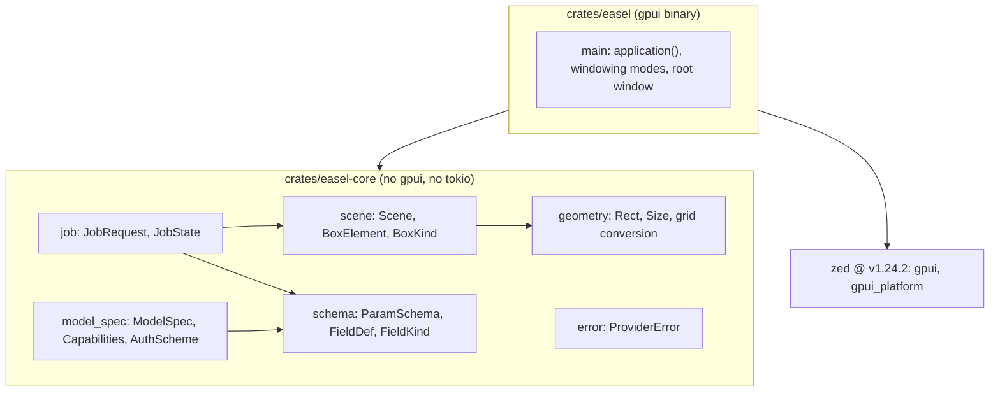
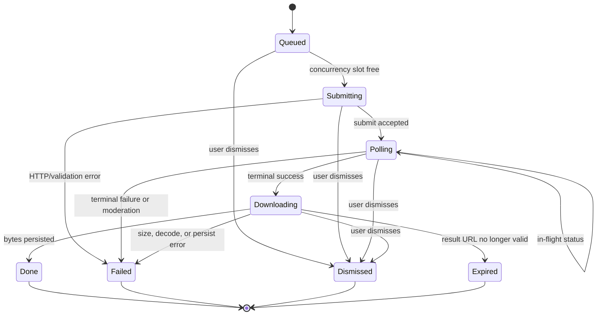

# Repo and Application Skeleton - Plan

This is step 1 of the four-plan `easel` series. Later plans build on the decisions here:

- Step 2: `docs/plans/2026-10-15-1724-feat-gpui-app-frame-plan.md`
- Step 3: `docs/plans/2026-10-15-1725-feat-flux3-mvp-editor-plan.md`
- Step 4: `docs/plans/2026-10-15-1726-feat-multi-model-providers-plan.md`

---

## Goal Capsule

- **Objective:** A contributor can clone the repo, run one build command, and see an `easel` window open on Linux, with the crate layout and domain types in place so steps 2–4 add features without restructuring.
- **Means:** Cargo workspace split into a pure `easel-core` library and a gpui `easel` binary, with gpui consumed from the Zed repo at tag `v1.24.2` (KTD1, KTD2).
- **Authority hierarchy:** Requirements (R-IDs) govern what; Key Technical Decisions (KTDs) govern how; a unit's Approach never overrides either.
- **Stop conditions:** Stop and report if the git dependency on gpui at `v1.24.2` fails to build after applying the `[patch.crates-io]` entries in KTD1, or if the Rust 1.98.1 toolchain cannot be installed.
- **Execution profile:** Scaffolding plus foundational types. Verification is build/run/test-green, not feature behavior.
- **Finishes and ships:** The implementer lands this as the repo's first commits on `main`.

---

## Product Contract

### Summary

Initialize the `easel` repository as a Rust workspace: a `easel-core` crate holding provider-agnostic domain types (scene, boxes, parameter schema, model spec, job lifecycle, geometry) with unit tests, and a `easel` binary that opens a gpui window from the Zed `v1.24.2` tag. Add toolchain pins, lint config, CI, and the provider protocol notes the API excerpts in `docs/api/` are missing.

### Problem Frame

`easel` is a desktop tool for marking up an image with labeled boxes and sending the result to hosted image models, FLUX 3 first. The repo is empty apart from four API excerpts. gpui's crates.io release is a year old and no longer matches how Zed starts an application, so the first job is proving the git dependency builds and runs on this machine before any UI work. The series also needs its load-bearing data shapes (what a box is, what a model's parameters are, what a job is) fixed early, because steps 3 and 4 each hang features off them and the spec-flow analysis found that retrofitting a per-model capability layer after the FLUX 3 UI exists would be expensive.

### Requirements

**Repository**

- R1. The repo is a Cargo workspace with `crates/easel-core` (library, no gpui or tokio dependency) and `crates/easel` (binary).
- R2. The Rust toolchain is pinned to 1.98.1 via `rust-toolchain.toml`, edition 2024, matching Zed at `v1.24.2`.
- R3. `cargo fmt --check`, `cargo clippy --workspace --all-targets -- -D warnings`, and the workspace tests pass on a clean checkout.
- R4. A GitHub Actions workflow runs R3's checks on push and pull request on Ubuntu with the Linux build prerequisites installed.
- R5. `Cargo.lock` is committed; `target/` is ignored.

**Application skeleton**

- R6. `cargo run -p easel` opens a titled window on Wayland and on X11 (`WAYLAND_DISPLAY='' cargo run -p easel` forces X11).
- R7. With no `WAYLAND_DISPLAY` and no `DISPLAY`, the binary exits with an error rather than running headless silently.
- R8. `easel-core` defines, with serde round-trips and unit tests: image-space rectangles and the 0–1000 normalized grid conversion; the scene (source image, reference images, boxes, prompt prose); parameter schema types; `ModelSpec` with capabilities; immutable `JobRequest` and the `JobState` machine; `ProviderError`.

**Documentation**

- R9. `docs/api/` gains protocol notes not present in the four excerpts: BFL `get_result` (status enum, result shape, URL lifetime), Krea `GET /jobs/{id}` and `POST /assets`, each citing the official doc URL.
- R10. `docs/dev-setup.md` lists Linux build and runtime prerequisites and the Wayland/X11 switch.
- R11. `README.md` states what easel is, the pinned Zed tag, and how to build and run.

### Key Decisions

- **gpui is consumed from the Zed repository at a release tag, not from crates.io.** (session-settled: user-directed — chosen over the crates.io `gpui 0.2.2` release: that release is from 2025-10 and predates the `gpui_platform` split, so apps built on it cannot start the way Zed now starts them.) Governs R2, R6.
- **Four sequenced plans, each independently shippable.** Chosen over one large phased plan so each step can be reviewed and landed on its own. Governs the series split above.
- **Boxes compile to FLUX 3's JSON box syntax; no brushes or masks.** FLUX 3 has no mask parameter. Governs R8 (box model shape).
- **Parameter forms are schema-driven per model from the start.** Governs R8 (`ParamSchema`, `ModelSpec`).

### Success Criteria

- A fresh clone on an Arch-family machine with the prerequisites from `docs/dev-setup.md` reaches a visible window in one `cargo run -p easel` after the initial fetch.
- `cargo nextest run -p easel-core` completes in seconds without building gpui.

### Scope Boundaries

- No UI beyond an empty titled window. Layout, image loading, pan/zoom, widgets are step 2.
- No FLUX 3 prompt compiler, request builder, or HTTP calls. Types only; behavior is step 3.
- No Krea or FLUX.2 types beyond what `ModelSpec` needs to be provider-agnostic.
- No packaging (AppImage, Flatpak, PKGBUILD) and no macOS/Windows builds.

#### Deferred to Follow-Up Work

- Choice of open-source license (user decision; add `LICENSE` when chosen).
- `sccache` or a CI build cache for the Zed git dependency if CI build time becomes a problem.

---

## Planning Contract

### Key Technical Decisions

- KTD1. **Depend on `gpui` and `gpui_platform` by git tag `v1.24.2`, with `gpui_platform` features `["wayland", "x11"]`.** (session-settled: user-directed — chosen over crates.io `gpui 0.2.2`: the published crate is stale and `gpui_platform`, now required to start an app, is unpublished.) Every Zed crate the workspace uses (`gpui`, `gpui_platform`, `gpui_tokio`) is pinned with `rev = "<commit sha>"` and the tag in a comment on the same line, all three identical; git tags are mutable and `Cargo.lock` only protects until the next `cargo update`, while a `rev` cannot drift. Mixing revisions produces duplicate `gpui` types. If the build fails on `calloop` or `async-task` mismatches, add Zed's `[patch.crates-io]` entries for those two crates (see Sources). Validated: a probe crate with this shape built and ran on this machine in 27 s wall after fetch.
- KTD2. **Two-crate workspace: `easel-core` (pure logic) and `easel` (gpui).** `easel-core` has no gpui, tokio, or reqwest dependency so its tests run in seconds; it owns domain types, provider request/response logic (step 3+), image preparation, and persistence formats. `easel` owns rendering, async orchestration, platform services. Chosen over a single crate because gpui's dependency graph (~440 crates) makes every test run pay the UI build cost.
- KTD3. **Toolchain 1.98.1, edition 2024, Zed's dev profile.** Copy Zed's `[profile.dev]` (`split-debuginfo = "unpacked"`, `debug = "limited"`, `codegen-units = 16`, `build-override` same) and `[profile.dev.package]` opt-level 3 for `gpui_macros`, `taffy`, `resvg`, `serde_json`, `syn`, `quote`, `proc-macro2`, plus `image`; `[profile.release]` thin LTO, `codegen-units = 1`. Rationale: gpui is built and tested only on that toolchain; the profile keeps debug `target/` and rebuilds manageable.
- KTD4. **Startup restricts windowing modes to Wayland | X11.** `gpui_platform::application()` defaults to `WindowingModes::all()`, which includes headless and silently runs with no window when no display is present. Use the Linux-specific entry that takes explicit modes so a missing display is a visible error (R7).
- KTD5. **Boxes are stored in image pixel space with named axes; the 0–1000 grid is a provider-boundary conversion.** FLUX 3's grid order is `[top, left, bottom, right]` (y before x), the opposite of the `[x1, y1, x2, y2]` most code assumes. A named `Rect { x, y, w, h }` in pixels plus a `to_grid(frame: Size) -> [u16; 4]` conversion keeps the UI and project files free of that convention and makes the conversion unit-testable against the official helper's example (`to_bbox(384, 108, 1536, 972, 1920, 1080) == [100, 200, 900, 800]`).
- KTD6. **`ModelSpec` carries capabilities, not just a field schema.** `ModelSpec { id, display_name, provider: ProviderId, auth: AuthScheme, endpoint, beta: bool, capabilities: { supports_boxes, image_slots: ImageSlots, size_control: AspectRatioAndResolution | WidthHeight }, schema: ParamSchema }`. `ProviderId::{Bfl, Krea}` is a closed enum with `base_url()`, `env_var()` (`BFL_API_KEY`, `KREA_API_KEY`), and `allowed_hosts() -> &[HostRule]` (exact or suffix match; `api.bfl.ai` + `.bfl.ai`, `api.krea.ai` + `.krea.ai`), the set of hosts the app may send requests to or download from for that provider; it is the single key for credentials, provider lookup, URL checks, and history badges in later steps. `ImageSlots` (`List { max }`, `Numbered { max }`, `Single`; step 4 adds `SingleWithStyleRefs { max_style_refs }` whose `max()` is `1 + max_style_refs`) is the only representation of how many images a model takes and where they go; the schema has no image field kind. The spec-flow analysis showed field rendering alone is insufficient: only FLUX 3 understands boxes, Krea uses bearer auth, FLUX.2 [pro] uses width/height. Defining this in step 1 lets step 3 build the FLUX 3 UI against the general shape and step 4 add models as data.
- KTD7. **`ParamSchema` is runtime data, values are `BTreeMap<String, serde_json::Value>`, and dependent rules are data too.** `FieldDef { key, label, help, kind: FieldKind, required, default, locked_when: Option<LockRule> }` with `FieldKind::{Text{multiline}, Select{options}, Int{min,max,step}, Float{min,max,step}, Bool, ReadOnly}`; `ParamSchema { fields, cross_rules: Vec<CrossRule> }`. `LockRule` and `CrossRule` are serializable enums whose variants later steps add (step 3: `LockRule::WhenSourceImageAndBoxes { value }`; step 4: `CrossRule::{MultipleOf { keys, n, exempt_zero }, MaxArea { w, h, max }, ZeroOrAtLeast { keys, min }, RequiresImagesWhen { key, min }}`), so `ModelSpec` stays plain data with no function pointers and its serde round-trip stays an equality test. A `BTreeMap` serializes directly into a provider request body in stable key order. Chosen over derive-macro reflection UIs, which bind to compile-time struct types and are egui-specific, and over closure hooks on the spec, which cannot be serialized or compared.
- KTD8. **Submission freezes an immutable `JobRequest`; `JobState` is an explicit enum.** `JobRequest { model_id, compiled_prompt, params, images: Vec<EncodedImage>, box_snapshot, created_at }`. `JobState::{Queued, Submitting, Polling{attempt, progress}, Downloading, Done{result_path, cost}, Failed{error}, Dismissed, Expired}`. `Queued` is a job waiting for a local concurrency slot (step 3 R11). `Downloading` carries no URL: the delivery URL lives only in the runner task's local variables, so serializing any `JobState` can never leak it. Dismiss is reachable from every in-flight state (`Queued`, `Submitting`, `Polling`, `Downloading`). Freezing the request makes editing boxes or promoting results while a job is in flight safe by construction (spec-flow gap C5).
- KTD9. **`ProviderError` is a `thiserror` enum in `easel-core`; the binary uses `anyhow`.** Variants: `Auth`, `OutOfCredits`, `RateLimited { retry_after: Option<Duration> }`, `Validation { field_errors: Vec<FieldError> }`, `Moderated { reasons }`, `Gone { replacement: Option<String>, sunset: Option<String> }`, `Http { status, body }`, `Protocol(String)`, `Network(String)`. `FieldError { key, message, approved_max: Option<i64> }` is shared by schema validation and provider 422 parsing (`approved_max` carries a server-stated cap such as the FLUX `safety_tolerance` maximum). The UI maps variants to user-facing copy; gpui itself returns `anyhow::Result`, so the binary stays on anyhow.
- KTD10. **Lints and hygiene follow Zed.** `[workspace.lints.clippy]`: `dbg_macro = "deny"`, `todo = "deny"`, `redundant_clone = "deny"`, `too_many_arguments = "allow"`, `type_complexity = "allow"`. `clippy.toml` disallows `serde_json::from_reader` (use `from_slice`) and `smol::Timer::after` (use `BackgroundExecutor::timer`). `rustfmt.toml` with `style_edition = "2024"`. Tests run with `cargo-nextest`.

### High-Level Technical Design

Workspace dependency direction and where each concern lives:



`JobState` lifecycle (behavior arrives in step 3; the enum is fixed here so step 2's layout and step 3's history strip share it):



### Output Structure

```text
easel/
  Cargo.toml                 workspace, profiles, lints, [workspace.dependencies]
  Cargo.lock
  rust-toolchain.toml        1.98.1
  rustfmt.toml
  clippy.toml
  .gitignore
  README.md
  deny.toml                  cargo-deny: advisories, GPL/AGPL deny-list, git sources
  .github/workflows/ci.yml
  docs/
    api/                     existing excerpts + bfl.get-result.md, krea.jobs.md, krea.assets.md
    dev-setup.md
    plans/
  crates/
    easel-core/
      Cargo.toml
      src/lib.rs
      src/geometry.rs
      src/scene.rs
      src/schema.rs
      src/model_spec.rs
      src/job.rs
      src/error.rs
    easel/
      Cargo.toml
      src/main.rs
```

### Assumptions

- The machine's existing `~/.cargo/git/db` clone of Zed is reused; a cold CI runner spends a few minutes on the initial fetch.
- The implementer has `rustup`; `rust-toolchain.toml` triggers the 1.98.1 install.

---

## Implementation Units

### U1. Workspace, toolchain, and hygiene files

- **Goal:** A buildable empty workspace with pinned toolchain, Zed-matched profiles, lints, and ignore rules.
- **Requirements:** R1, R2, R3, R5
- **Dependencies:** none
- **Files:** `Cargo.toml`, `rust-toolchain.toml`, `rustfmt.toml`, `clippy.toml`, `.gitignore`, `crates/easel-core/Cargo.toml`, `crates/easel-core/src/lib.rs`, `crates/easel/Cargo.toml`, `crates/easel/src/main.rs`
- **Approach:**
  1. `git init` on `main`; workspace `Cargo.toml` with `resolver = "3"`, `[workspace.package]` (edition, version, license placeholder), `[workspace.dependencies]` for shared crates (`serde`, `serde_json`, `thiserror`, `anyhow`, `image = "0.25"`, `base64`).
  2. Profiles and lints per KTD3 and KTD10.
  3. Both crates compile with placeholder contents (core: empty lib with `#![deny(unsafe_code)]`; binary: prints nothing, exits 0) so U2 and U3 can proceed in parallel.
- **Execution note:** Pure scaffolding; verify by a clean `cargo build --workspace`.
- **Test scenarios:** Test expectation: none -- scaffolding with no behavior.
- **Verification:** `cargo build --workspace`, `cargo fmt --check`, and `cargo clippy --workspace --all-targets -- -D warnings` succeed on 1.98.1.

### U2. gpui window spike in `easel`

- **Goal:** `cargo run -p easel` opens an "easel" window; absence of a display is an error.
- **Requirements:** R6, R7
- **Dependencies:** U1
- **Files:** `crates/easel/Cargo.toml`, `crates/easel/src/main.rs`
- **Approach:**
  1. Add `gpui` and `gpui_platform` (features `wayland`, `x11`) pinned by `rev = "<commit sha>"` with `# v1.24.2` on the same line, per KTD1.
  2. Start via the Linux entry with explicit `WindowingModes::WAYLAND | WindowingModes::X11` (KTD4); open one window with a title and a centered 1200×800 bounds; render a single `div` with the app name.
  3. If the build fails on `calloop`/`async-task`, add the two `[patch.crates-io]` entries from Sources and retry once.
- **Patterns to follow:** `crates/gpui/examples/hello_world.rs` and `crates/gpui/README.md` at `v1.24.2` in the Zed repo.
- **Execution note:** This is a runtime smoke check, not unit coverage. Run under Wayland, then with `WAYLAND_DISPLAY=''` for X11, then with both display variables unset.
- **Test scenarios:**
  - Launch under Wayland: a titled window appears within a few seconds.
  - Launch with `WAYLAND_DISPLAY=''` and `DISPLAY` set: window appears via X11/XWayland.
  - Launch with `WAYLAND_DISPLAY` and `DISPLAY` both unset: process exits non-zero with an error naming the missing display.
- **Verification:** All three launch scenarios behave as listed; record the resolved tag and commit SHA from `Cargo.lock` in `README.md`.

### U3. `easel-core` foundational types

- **Goal:** Domain types that steps 2–4 build on, each with serde round-trips and unit tests.
- **Requirements:** R8
- **Dependencies:** U1
- **Files:** `crates/easel-core/src/lib.rs`, `crates/easel-core/src/geometry.rs`, `crates/easel-core/src/scene.rs`, `crates/easel-core/src/schema.rs`, `crates/easel-core/src/model_spec.rs`, `crates/easel-core/src/job.rs`, `crates/easel-core/src/error.rs`, tests inline in each module
- **Approach:**
  1. `geometry`: `Size { w, h }` in pixels, `Rect { x, y, w, h }` with `normalize()` (positive w/h), `clamp_to(Size)`, `to_grid(frame: Size) -> GridBox` where `GridBox([u16; 4])` is explicitly documented as `[top, left, bottom, right]` on 0–1000 (KTD5), and `from_grid`.
  2. `scene`: `BoxElement { id: BoxId, kind: BoxKind, desc: String, src: Option<Rect>, tgt: Option<Rect>, from_image: Option<usize> }`; `BoxKind::{Layout, New, Keep, Move, Remove}`; `Scene { source_image: Option<ImageRef>, references: Vec<ImageRef>, boxes: Vec<BoxElement>, prose: String, aspect_ratio: Option<String> }`; `BoxId` validates `^[a-z][a-z0-9]*_[0-9]+$` and `Scene::next_id(prefix)` allocates the next unused suffix.
  3. `schema` per KTD7, with `ParamSchema::defaults() -> BTreeMap`, `validate(&values, &RuleContext) -> Vec<FieldError>` covering required, enum membership, numeric range, and `cross_rules`, and `locked_value(field, &RuleContext) -> Option<Value>` evaluating `locked_when`. `RuleContext { has_source_image, image_count, box_count }` is the only scene knowledge the schema layer has. The `LockRule` and `CrossRule` enums exist here with no variants yet beyond what tests need (a `CrossRule::Never` placeholder is acceptable); later steps add variants.
  4. `model_spec` per KTD6; `ProviderId::{Bfl, Krea}` with `base_url()` and `env_var()`; `AuthScheme::{HeaderKey { header }, Bearer}`; `ImageSlots::{List { max }, Numbered { max }, Single}` with `ImageSlots::max()`; `Capabilities::validate_image_count(n) -> Option<FieldError>`.
  5. `job` per KTD8; `JobState::is_terminal()`, `is_in_flight()`.
  6. `error` per KTD9, including `FieldError`.
- **Patterns to follow:** `#[serde(default)]` on optional fields; a `version: u32` field on `Scene` for forward compatibility.
- **Test scenarios:**
  - `Rect::to_grid` reproduces the official example: pixel box left 384, top 108, right 1536, bottom 972 in a 1920×1080 frame yields `[100, 200, 900, 800]`.
  - `to_grid` then `from_grid` round-trips within one pixel for a 1000×1000 frame and for a 3:2 frame.
  - A `Rect` with negative width normalizes to the equivalent positive rect.
  - `BoxId::parse("animal_1")` succeeds; `"Animal_1"`, `"animal"`, `"1_animal"` fail.
  - `Scene::next_id("animal")` on a scene containing `animal_1` and `animal_3` returns `animal_4`.
  - `ParamSchema::validate` reports a missing required field, an out-of-range `Int`, and a `Select` value not in its options, each as a distinct `FieldError` naming the key.
  - `Capabilities::validate_image_count(11)` for `List { max: 10 }` returns a `FieldError`; `10` returns `None`.
  - `validate` on `defaults()` returns no errors for a schema whose required fields all have defaults.
  - Serde round-trip of `Scene`, `ModelSpec` (including a `locked_when` and a `cross_rules` entry), `JobRequest`, and every `JobState` variant preserves equality; the serialized `JobState::Downloading` contains no URL.
  - `JobState::is_terminal()` is true for `Done`, `Failed`, `Dismissed`, `Expired` and false for the others; `is_in_flight()` is true for `Queued`, `Submitting`, `Polling`, `Downloading`.
  - `ProviderId::Krea.env_var() == "KREA_API_KEY"`; `ProviderId` serializes as `"bfl"` / `"krea"`.
  - `ProviderId::Bfl.allows_url("https://delivery-eu.bfl.ai/x")` is true; `"https://bfl.ai.evil.example/x"`, `"http://api.bfl.ai/x"`, and `"https://api.krea.ai/x"` are false.
- **Verification:** `cargo nextest run -p easel-core` passes in seconds and does not compile gpui.

### U4. CI workflow

- **Goal:** Every push and PR runs fmt, clippy, cargo-deny, the fixture secret grep, and tests on Ubuntu.
- **Requirements:** R3, R4
- **Dependencies:** U1, U2, U3
- **Files:** `.github/workflows/ci.yml`, `deny.toml`
- **Approach:** One job on `ubuntu-latest`: install the apt equivalents of the Linux prerequisites in `docs/dev-setup.md` (clang, cmake, pkg-config, libxkbcommon, wayland, xcb, fontconfig, vulkan loader headers, openssl), install the toolchain from `rust-toolchain.toml`, cache `~/.cargo` and `target/` (keyed on `Cargo.lock`), then run fmt check, clippy with `-D warnings`, `cargo deny check` (`deny.toml`: advisories; licenses deny-list `GPL-*`/`AGPL-*`, which enforces the step-2 decision not to pull Zed's GPL crates; git sources allowed only from `github.com/zed-industries`), and `cargo nextest run --workspace` (install nextest via its prebuilt binary). Build the `easel` binary too so the gpui dependency is exercised in CI. Pin every `uses:` action to a commit SHA. Add a step that fails if `**/tests/fixtures/` or `**/snapshots/` contain `x-key`, `Bearer `, or a `krea.ai/` URL with a query string (guards against live-captured credentials or signed URLs being committed in later steps).
- **Execution note:** Packaging/config; verify by a green run on the first push.
- **Test scenarios:** Test expectation: none -- CI configuration; the proof is a passing workflow run.
- **Verification:** The workflow passes on `main`; a deliberate `cargo fmt` violation on a branch fails it; a fixture containing `x-key: abc` on a branch fails it.

### U5. Provider protocol notes and developer docs

- **Goal:** The repo documents what the API excerpts omit and how to set up a Linux dev machine.
- **Requirements:** R9, R10, R11
- **Dependencies:** U2 (for the tag and SHA in the README)
- **Files:** `docs/api/bfl.get-result.md`, `docs/api/krea.jobs.md`, `docs/api/krea.assets.md`, `docs/dev-setup.md`, `README.md`
- **Approach:**
  1. `bfl.get-result.md`: `GET <polling_url>` with `x-key`; status enum (`Task not found`, `Pending`, `Reasoning`, `Generating`, `Request Moderated`, `Content Moderated`, `Ready`, `Error`); `result.sample`, `result.prompt`, `result.duration`, `details["Moderation Reasons"]`, settled `cost`; result URL lifetime documented as 10 minutes (the FLUX 3 pages say 1 hour; design for 10); polling must use `polling_url` verbatim; concurrency 24; raw base64 (no data-URI prefix) for `images`; 16 MP max and 256×256 min per reference.
  2. `krea.jobs.md`: `GET /jobs/{id}` schema and status enum, `result.urls[0]`, `error` object, `DELETE /jobs/{id}`, 2–5 s polling, `backlogged` behavior, 410 `Gone` envelope and `Deprecation`/`Sunset` headers; note that job ids are UUIDs and that `GET /jobs/<random uuid>` with a valid key returns a non-401 response (step 4 uses this as the cheapest key test, mirroring BFL's `Task not found`).
  3. `krea.assets.md`: `POST /assets` multipart `file` (75 MB max), response fields, that `image_urls` entries accept external URL, `data:` URI, or asset URL.
  4. `dev-setup.md`: pacman package list trimmed to what gpui needs (clang, cmake, pkgconf, openssl, fontconfig, libxkbcommon(-x11), wayland, libxcb, vulkan-icd-loader plus a driver ICD, xdg-desktop-portal with a backend), `rustup`, the `WAYLAND_DISPLAY=''` switch, `ZED_DEVICE_ID` for GPU selection, and the first-fetch size (~400 MB).
  5. `README.md`: one paragraph on easel, the Zed tag and SHA, build/run/test commands.
- **Test scenarios:** Test expectation: none -- documentation.
- **Verification:** Each API note cites its official source URL from Sources; a reader can follow `dev-setup.md` on a fresh Arch install to a window.

---

## Verification Contract

| Check | Command | Applies to | Pass signal |
|---|---|---|---|
| Format | `cargo fmt --check` | all units | no diff |
| Lint | `cargo clippy --workspace --all-targets -- -D warnings` | all units | zero warnings |
| Core tests | `cargo nextest run -p easel-core` | U3 | all pass; gpui not compiled |
| Workspace build | `cargo build --workspace` | U1, U2 | success on 1.98.1 |
| Window smoke | `cargo run -p easel`; `WAYLAND_DISPLAY='' cargo run -p easel`; both display vars unset | U2 | window on Wayland, window on X11, error exit with no display |
| CI | GitHub Actions run on `main` | U4 | green |

---

## Definition of Done

- All Verification Contract rows pass.
- `README.md` records the pinned Zed tag `v1.24.2` and the resolved commit SHA.
- `docs/api/` contains the three protocol notes with source URLs.
- No placeholder modules, `todo!()`, or dead probe code remain; the binary contains only the window spike.
- Per unit: U1 builds clean; U2 passes the three launch scenarios; U3 tests pass; U4 is green; U5 docs exist and cite sources.

---

## Risks & Dependencies

- **Zed git dependency churn.** Zed ships two to three builds a week and gpui's API moves with them. Mitigation: pin by `rev` (KTD1), bump deliberately, record tag and SHA in the README. gpui's crate version string (`0.2.2`) does not change between tags, so `Cargo.lock`'s source URL is the only indicator of which revision is in use.
- **TLS build footprint.** rustls defaults to `aws-lc-rs`, which adds a C/assembly build needing cmake and clang. Step 2 chooses the crypto provider explicitly when adding `reqwest` (`ring` is the lighter option); `dev-setup.md` lists whichever toolchain pieces the choice requires.
- **Supply-chain gate is minimal.** `cargo deny` covers advisories, licenses, and git sources; it does not vet the ~440 transitive crates gpui brings. Accepted for MVP.
- **Transitive patch requirements.** Consumers do not inherit Zed's `[patch.crates-io]`; the probe built without patches, but a future tag may need them (KTD1 names the two entries).
- **AMD/RADV rendering artifacts under Wayland** are an open Zed issue on this GPU class; `ZED_DEVICE_ID` and the GL fallback are documented in `dev-setup.md` as the escape hatch.

---

## Sources & Research

- Zed `v1.24.2` (2026-10-14): `crates/gpui/README.md`, `crates/gpui_platform/src/gpui_platform.rs`, `crates/gpui_linux/Cargo.toml`, `rust-toolchain.toml`, root `Cargo.toml` profiles and `[patch.crates-io]` (`async-task` rev `b4486cd71e4e94fbda54ce6302444de14f4d190e`, `calloop` rev `3759371fee14c40066d64777e2a36b6ffcc22590`), `clippy.toml`, `script/linux`, `docs/src/development/linux.md` — https://github.com/zed-industries/zed/tree/v1.24.2
- blade to wgpu renderer change: https://github.com/zed-industries/zed/pull/46758; `gpui_platform` extraction: https://github.com/zed-industries/zed/pull/49277
- crates.io `gpui` 0.2.2 (2025-10-22): https://crates.io/crates/gpui
- FLUX 3 box coordinate convention and helper: https://docs.bfl.ml/flux_3/flux3_image_layout, https://docs.bfl.ml/guides/prompting_layout
- BFL get_result, status enum, integration guide: https://docs.bfl.ml/api-reference/utility/get-result, https://docs.bfl.ml/api_integration/errors, https://docs.bfl.ml/api_integration/integration_guidelines
- Krea job lifecycle, assets, deprecations: https://www.krea.ai/docs/developers/job-lifecycle, https://www.krea.ai/docs/api-reference/assets/upload-an-asset, https://www.krea.ai/docs/developers/deprecations
- Local API excerpts: `docs/api/flux.3.md`, `docs/api/flux.2-pro.md`, `docs/api/krea.3.md`, `docs/api/krea.2.large.md`
