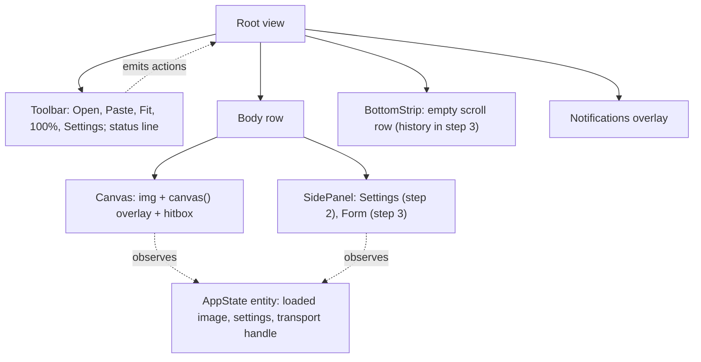
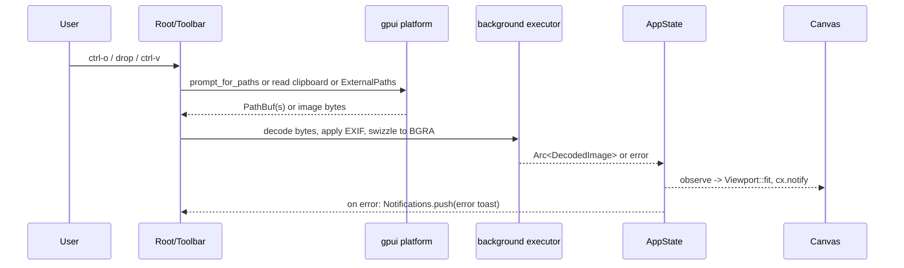
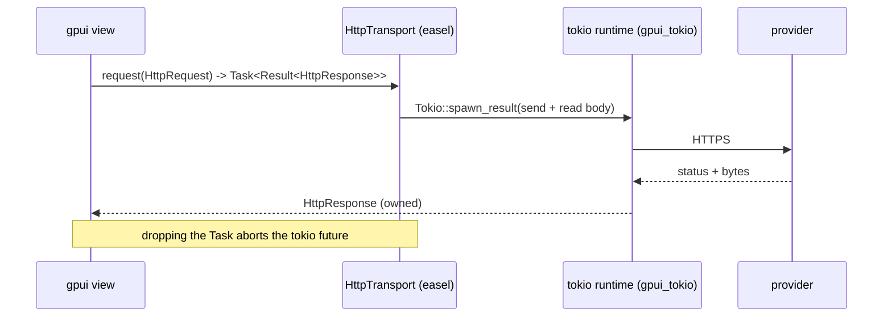

# gpui Application Frame - Plan

Step 2 of the `easel` series. Builds on `docs/plans/2026-10-15-1723-chore-repo-and-skeleton-plan.md` (step 1); its KTD1–KTD10 apply here and are cited as `S1-KTD<N>`.

---

## Goal Capsule

- **Objective:** A user can open easel, load an image from disk, drag-drop, or clipboard, see it on a zoomable and pannable canvas inside the final window layout, enter an API key that persists across launches, and the app can make an authenticated HTTP call and show the outcome — without any model-specific behavior yet.
- **Means:** gpui views for a four-region layout, gpui's built-in platform services for files, clipboard, drag-drop, and credentials, a `gpui_tokio` + `reqwest` transport, and a hand-rolled widget kit (KTD1–KTD8).
- **Authority hierarchy:** R-IDs govern behavior; KTDs govern mechanism; step 1 KTDs govern architecture.
- **Stop conditions:** Stop and report if gpui's `prompt_for_paths` cannot be made to work on this desktop (no portal) and drag-drop also fails, or if `gpui_tokio` at `v1.24.2` cannot be consumed from outside the Zed repo.
- **Execution profile:** UI frame plus platform plumbing. Verification mixes unit tests on `easel-core` geometry, `#[gpui::test]` on view state, and runtime smoke checks for platform services.
- **Finishes and ships:** Implementer lands on `main` after step 1.

---

## Product Contract

### Summary

Turn the step-1 window into the application frame: a toolbar, a central canvas, a right-hand side panel, and a bottom strip. Load images from a file dialog, drag-drop, or paste; show them on a canvas with fit/zoom/pan. Add the async HTTP bridge, credential storage with a settings panel, a toast/status surface, and the text, number, select, checkbox, and slider widgets step 3's form needs.

### Problem Frame

gpui ships no widget library we can use: the community `gpui-kit` is pinned to a diverged Zed snapshot whose types do not unify with ours, and Zed's own input and editor crates are GPL. gpui's executor is not tokio, so `reqwest` cannot be called directly. gpui does ship file dialogs (xdg portal), clipboard image reading, external drag-drop, and a Secret Service credentials API, so the frame can lean on those instead of adding `rfd`, `arboard`, or `keyring`. Step 3 needs all of this in place to build the box tool, the parameter form, and the job runner; doing it here keeps step 3 about FLUX 3 rather than plumbing.

### Requirements

**Window and layout**

- R1. The window has four regions: a top toolbar, a central canvas, a right side panel (minimum 320 px, resizable is not required), and a bottom strip (fixed height, horizontally scrollable).
- R2. Actions with key bindings exist for Open (`ctrl-o`), Paste (`ctrl-v`), Save As (`ctrl-shift-s`), Fit (`ctrl-0`), Actual Size (`ctrl-1`), Settings (`ctrl-,`), Quit (`ctrl-q`); bindings use `ctrl-`, not `cmd-`.
- R3. A non-blocking toast surface shows informational and error messages that dismiss after a timeout or on click; a one-line status bar at the bottom of the toolbar shows the current operation.

**Image loading**

- R4. The user can load a PNG, JPEG, or WebP image via the file dialog, by dropping a file onto the window, or by pasting an image or a file path from the clipboard.
- R5. Decoding runs off the UI thread; EXIF orientation is applied; the image's intrinsic pixel size is retained alongside the renderable texture.
- R6. An undecodable or unsupported file produces an error toast and leaves the current canvas unchanged.
- R7. Loading a new image when one is already present replaces it; a drop of multiple files loads the first and reports the rest were ignored (reference images arrive in step 3).

**Canvas viewport**

- R8. A newly loaded image is fitted to the canvas region, centered.
- R9. Scroll wheel zooms around the cursor between 5% and 3200%; `ctrl-0` fits; `ctrl-1` shows 100%.
- R10. Middle-drag, or space+left-drag, pans; panning is clamped so at least a margin of the image stays visible.
- R11. The canvas exposes the image-to-view transform so later overlays (boxes) can map image pixels to view pixels and back.

**Networking**

- R12. The app owns one HTTP transport that can perform GET, POST, and DELETE with headers and a JSON or bytes body on a background runtime and deliver the response (status, headers, bytes) to a gpui task; dropping the task cancels the request.
- R12a. Every request has a connect timeout (10 s) and a total timeout (60 s for JSON requests, 180 s for uploads and downloads), a caller-supplied `max_body_bytes` enforced from `Content-Length` and while streaming (`TransportError::TooLarge`), and rejects non-`https` URLs (`TransportError::InsecureUrl`; loopback `http` is allowed only under `cfg(test)` for mock servers). A request carrying a credential never follows redirects: a 3xx is returned as-is.
- R13. Request and response logging never includes credential header values or request bodies. `Debug` for `HttpRequest`, `HttpHeader`, and `TransportError` prints `<redacted>` for sensitive values and omits bodies; `TransportError` carries method, URL, and status only. Bodies appear only at `trace` level, truncated to 1 KB; the app logs to stderr and introduces no log file.

**Credentials and settings**

- R14. Each provider has one API key, resolved in order: environment variable (`BFL_API_KEY`, `KREA_API_KEY`), then the desktop credential store, then an in-memory value entered this session.
- R15. A settings panel lets the user enter, replace, or clear a provider key with masked input and a "test" action that performs an authenticated request and reports success or a classified failure.
- R16. If the credential store is unavailable, or reading it fails for any reason (locked keyring, D-Bus timeout), the key is kept in memory for the session and the settings panel says so; the key is never written to a config file or log.
- R16a. A key entered in settings is trimmed of surrounding whitespace before use; a key containing characters outside visible ASCII is rejected with a field message instead of reaching the header builder. The masked input never exposes its contents through `Debug`.

**Widget kit**

- R17. The app has reusable widgets with keyboard focus and consistent styling: single-line text input, multi-line text area, number input with min/max/step, select dropdown, checkbox, and slider.
- R18. Widgets report changes through callbacks and are usable from a schema-driven form (step 3) without knowing field semantics.

### Key Decisions

- **Linux is the only target; macOS and Windows are not built or tested.** Governs R2 (ctrl bindings), R4 (portal dialogs).
- **No third-party widget crate.** gpui-kit is on a diverged snapshot; Zed's `ui_input` and `editor` are GPL. Governs R17.
- **Credentials live in the desktop credential store, not a config file.** Governs R14, R16.

### Success Criteria

- From launch, loading a 20 MP JPEG via drag-drop reaches a fitted canvas without the UI freezing.
- Zoom in and out keeps the point under the cursor stationary.
- Key entered in settings is available after relaunch without re-entry.

### Scope Boundaries

- No boxes, no prompt editor, no parameter form content, no model requests. The side panel holds only settings and a placeholder for step 3's form.
- No reference-image strip; the bottom strip is an empty scrollable container with a label until step 3.
- No session autosave (step 3).
- No theming system; one dark palette as constants.

#### Deferred to Follow-Up Work

- Resizable panel splitter.
- Touchpad pinch-zoom gesture handling (gpui exposes `ScrollWheelEvent` with `touch_phase`; wire only wheel zoom now).
- Rich text editing features in the text area (undo stack, word-wrap tuning beyond basic wrapping, find).

---

## Planning Contract

### Key Technical Decisions

- KTD1. **Root layout is one `Root` view owning child entities per region: `Toolbar`, `Canvas`, `SidePanel`, `BottomStrip`, `Toasts`.** Each region is an `Entity<_>` created once; the root renders them with a flex column (toolbar, body row, strip) where the body row is flex-row (canvas `flex_1`, side panel fixed width). Child-to-root communication uses `EventEmitter` + `cx.subscribe`; shared app state (loaded image, settings) lives in `Entity<AppState>` observed by regions that need it. `SidePanel` has a `mode: Editor | Settings`; the Settings action (`ctrl-,`), the toolbar Settings button, and a Back button in Settings mode toggle it, so step 3's editor content and the settings panel share one region without a second window or dialog (step 2 renders a placeholder in Editor mode). Chosen over a single giant view so step 3 can replace region internals independently.
- KTD2. **Canvas renders the image with `img(Arc<RenderImage>)` positioned by the viewport transform, with a `canvas()` overlay element for custom painting and a hitbox for mouse events.** Decoded `image::DynamicImage` is swizzled RGBA→BGRA before `RenderImage::new` (gpui textures are BGRA). The parent `div().relative()` holds the `img` absolutely positioned at the transformed rect and a `canvas()` with `.absolute().inset_0()` that paints nothing yet but captures `bounds` in prepaint (step 3 draws boxes there). `window.drop_image` is called when an image is replaced.
- KTD3. **Viewport math lives in `easel-core::geometry::Viewport`.** `Viewport { image_size: Size, view_size: Size, scale: f32, offset: Point }` with `fit()`, `actual_size()`, `zoom_at(view_point, factor)`, `pan_by(delta)`, `clamp()`, `image_to_view(Point) -> Point`, `view_to_image(Point) -> Point`, `image_rect_in_view() -> Rect`. Pure and unit-tested; the gpui view only feeds it events and reads the transform (R11).
- KTD4. **HTTP transport: `gpui_tokio` (same git `rev` as gpui) plus crates.io `reqwest 0.13` with `rustls-no-provider`, `json`, `http2`, `charset` features and a direct `rustls = { version = "0.23", default-features = false, features = ["ring", "std", "tls12"] }` dependency (reqwest's plain `rustls` feature would also compile `aws-lc-rs`); request and response types live in `easel-core::http`, the executor lives in `easel::net`.** `gpui_tokio::init(cx)` at startup; each request is `Tokio::spawn_result(cx, async { send + read full body })` returning a gpui `Task`; the entire reqwest future, including body read, runs inside tokio (polling a reqwest body from gpui's executor panics on tokio timers). `easel-core::http` defines `HttpRequest { method, url, headers: Vec<HttpHeader { name, value, sensitive }>, auth: Option<ProviderId>, body: Body::{Empty, Json(Value), Bytes(Vec<u8>, content_type), Multipart { parts: Vec<Part { name, filename, content_type, bytes }> }}, max_body_bytes: u64 }` and `HttpResponse { status, headers, body: Bytes }` so that step 3's providers (pure, in core) can describe requests and parse responses without depending on the app crate; this step implements `Empty`, `Json`, and `Bytes` in the reqwest transport and defines `Multipart` so step 4 only adds its encoding and test. `auth` is a marker, never a key: the transport resolves the key for that `ProviderId` at execution time (KTD5) and inserts `x-key` or `Authorization: Bearer` marked `sensitive`, so no core type, snapshot, or persisted request ever contains a credential. `easel::net` holds only the `HttpTransport` trait (`request(&self, HttpRequest, cx) -> Task<Result<HttpResponse, TransportError>>`), the `KeyResolver` trait, the reqwest implementation, `FakeTransport`, and `TransportError`. The reqwest client is built with `redirect::Policy::none()` (R12a; reqwest strips only `Authorization`-class headers on cross-host redirects, not `x-key`), the R12a timeouts, and `rustls::crypto::ring::default_provider().install_default()` called before the client is built (the step-1 TLS risk); sensitive `HeaderValue`s call `set_sensitive(true)`. R12a's two total-timeout classes are selected per request from its size, not its `Body` variant: 180 s when the body is `Multipart`, when the encoded body exceeds 1 MB (multi-image base64 submits), or when `max_body_bytes` exceeds 1 MB (downloads); 60 s otherwise. Chosen over Zed's `reqwest_client` (pulls a forked reqwest 0.12 and a second TLS stack), `async-compat` (hidden single-thread runtime, no cancellation), and blocking `ureq` on the background pool (polling would occupy shared threads).
- KTD5. **Credentials via gpui's `write_credentials`/`read_credentials`/`delete_credentials` (oo7 Secret Service on Linux), keyed by `ProviderId::base_url()` (S1-KTD6), layered under environment variables.** In-memory keys are held in `zeroize::Zeroizing<String>`. The `keyring` crate is not added: v4 is a facade its maintainers steer apps away from, and gpui already links oo7. A 0600 config-file fallback is deferred until a user without a Secret Service reports the gap (R16 keeps the session usable meanwhile).
- KTD6. **Widget kit is copied and extended from `crates/gpui/examples/input.rs` (Apache-2.0) at `v1.24.2`, plus hand-rolled controls on `div()`.** Text input: the example as-is with `cmd-` bindings re-keyed to `ctrl-`. Text area: extend the same `EntityInputHandler` implementation to multi-line with soft wrapping, up/down navigation, and a vertical scroll handle; no undo stack. Number input: text input plus parse-and-clamp on blur/Enter, with step buttons. Select: `anchored()`/`deferred()` overlay list (as in the `popover.rs` example). Checkbox: `div().on_click`. Slider: track `div` with `on_mouse_down/move/up` drag math, shared with the canvas's drag handling style. Chosen over gpui-kit (incompatible types) and Zed's GPL crates.
- KTD7. **Toasts and status are one `Notifications` entity.** `push(Toast { level, text, ttl, action: Option<(label, Box<dyn Action>)> })`, so an error that "links to settings" renders an action button that dispatches the Settings action; toasts render in the top-right of the canvas region and auto-expire via `cx.background_executor().timer`. Errors from any region flow here through an event, so step 3's job runner needs no new surface.
- KTD8. **Image decode and resize run on `cx.background_executor().spawn`; the UI receives `Arc<DecodedImage { size, render: Arc<RenderImage>, rgba_for_export: Arc<DynamicImage> }>`.** Keeping the `DynamicImage` lets step 3 re-encode for upload without re-reading disk and keeps clipboard-pasted images (which have no path) exportable. Every decode, whatever the source (file, drop, clipboard, and in step 3 downloads and session-embedded images), goes through one `decode_image(bytes) -> Result<DecodedImage>` in `image_load.rs` that: identifies the format from magic bytes and decodes only PNG, JPEG, and WebP; reads dimensions with `ImageReader::into_dimensions` and rejects anything over 16384 px on a side or 64 MP before allocating; and decodes with `image::Limits { max_alloc: 1 GiB }`. A rejected image is an error toast, never a crash.

### High-Level Technical Design

Window regions and ownership:



Image load sequence (any of three entry points):



Request path through the transport (used by the settings "test" action now, by the job runner in step 3):



### Output Structure

```text
crates/easel/src/
  main.rs            application(), gpui_tokio::init, assets, key bindings, open Root
  app_state.rs       AppState entity: image, settings, transport
  actions.rs         actions! and bind_keys
  root.rs            Root view and region composition
  toolbar.rs
  canvas/mod.rs      Canvas view: img + overlay + mouse handling
  canvas/viewport.rs thin adapter around easel_core::geometry::Viewport
  side_panel/mod.rs  SidePanel: mode Editor | Settings; settings now, form host later (step 3 adds submodules)
  bottom_strip.rs
  notifications.rs   toasts + status
  settings/mod.rs    SettingsPanel view
  settings/credentials.rs  env -> credential store -> memory
  net/mod.rs         HttpTransport trait, KeyResolver trait, FakeTransport, TransportError
  net/reqwest_transport.rs  gpui_tokio + reqwest implementation, auth header insertion
  image_load.rs      decode on background executor, DecodedImage
  widgets/mod.rs
  widgets/text_input.rs   from gpui examples/input.rs
  widgets/text_area.rs
  widgets/number_input.rs
  widgets/select.rs
  widgets/checkbox.rs
  widgets/slider.rs
  theme.rs           color/spacing constants
crates/easel-core/src/geometry.rs   + Viewport
crates/easel-core/src/http.rs       HttpRequest (incl. max_body_bytes), HttpHeader, Body, HttpResponse (pure data)
```

### Assumptions

- An xdg-desktop-portal backend is running on the development desktop (CachyOS); the dialog error path is still handled per R6.
- `gpui_tokio` is consumable as a git dependency at `v1.24.2` (it is a leaf crate in the Zed workspace; the researcher confirmed it exists at that tag but did not build it standalone).

---

## Implementation Units

### U1. Root layout, actions, theme, notifications

- **Goal:** The four-region frame renders, key bindings dispatch actions, and toasts/status work.
- **Requirements:** R1, R2, R3
- **Dependencies:** step 1 complete
- **Files:** `crates/easel/src/main.rs`, `crates/easel/src/root.rs`, `crates/easel/src/toolbar.rs`, `crates/easel/src/side_panel/mod.rs`, `crates/easel/src/bottom_strip.rs`, `crates/easel/src/notifications.rs`, `crates/easel/src/actions.rs`, `crates/easel/src/theme.rs`, `crates/easel/src/app_state.rs`, tests in `crates/easel/src/notifications.rs`
- **Approach:**
  1. Define `AppState` and region entities per KTD1; root composes them.
  2. `actions!` for the R2 set; `cx.bind_keys` with `ctrl-` bindings; toolbar buttons dispatch the same actions.
  3. `Notifications` per KTD7 with TTL expiry on the background timer.
  4. Dark palette constants in `theme.rs`.
- **Patterns to follow:** Zed `crates/gpui/examples/hello_world.rs`, `window.rs`, and the `image/image.rs` example's `actions!` + `bind_keys` usage at `v1.24.2`.
- **Test scenarios:**
  - `#[gpui::test]`: pushing a toast with a 2 s TTL then advancing the test clock by 2 s removes it; advancing 1 s does not.
  - `#[gpui::test]`: dispatching the Quit action triggers the quit path (observable via a flag on `AppState` in tests).
  - Smoke: all four regions are visible at 1200×800 and the side panel keeps 320 px when the window narrows.
- **Verification:** Window shows the frame; each binding in R2 triggers its action (visible via status line text).

### U2. Viewport math in `easel-core`

- **Goal:** Pure, tested image-to-view transform with fit, zoom-at-point, pan, and clamping.
- **Requirements:** R8, R9, R10, R11
- **Dependencies:** none within this plan
- **Files:** `crates/easel-core/src/geometry.rs` (add `Viewport`, `Point`), tests inline
- **Approach:** Implement KTD3. Zoom clamps scale to [0.05, 32]. Clamp keeps at least `min(image_dim_in_view, 64 px)` of the image inside the view on each axis.
- **Test scenarios:**
  - `fit()` for a 4000×2000 image in a 1000×800 view yields scale 0.25 and a horizontally centered, vertically centered rect.
  - `fit()` for an image smaller than the view does not upscale beyond 1.0 (scale 1.0, centered).
  - `zoom_at(view_point, 2.0)` leaves `view_to_image(view_point)` unchanged before and after.
  - Zooming past the max scale clamps at 32; past the min clamps at 0.05.
  - `pan_by` that would move the image fully offscreen is clamped so 64 px remain visible.
  - `image_to_view` and `view_to_image` are inverses within floating tolerance for several points and scales.
  - `actual_size()` sets scale 1.0 and recenters.
- **Verification:** `cargo nextest run -p easel-core` passes.

### U3. Image loading via dialog, drag-drop, and clipboard

- **Goal:** Three entry points load PNG/JPEG/WebP into `AppState` off the UI thread with EXIF applied.
- **Requirements:** R4, R5, R6, R7
- **Dependencies:** U1
- **Files:** `crates/easel/src/image_load.rs`, `crates/easel/src/toolbar.rs`, `crates/easel/src/root.rs`, `crates/easel/src/app_state.rs`, `crates/easel/Cargo.toml` (`image = "0.25"` with `jpeg`, `png`, `webp`), tests in `crates/easel/src/image_load.rs`
- **Approach:**
  1. Open: `cx.prompt_for_paths` with files-only, single selection; await the oneshot in `cx.spawn`; a portal-missing error becomes a toast naming the missing portal.
  2. Drop: root `div().on_drop::<ExternalPaths>` and `.drag_over::<ExternalPaths>` for a highlight; first path loads, remaining count reported (R7).
  3. Paste: `cx.read_from_clipboard()`; iterate entries for `ClipboardEntry::Image` (bytes + format) or `ClipboardEntry::ExternalPaths`; no image content → informational toast.
  4. Decode per KTD8: guess format, read orientation, `apply_orientation`, convert to RGBA8, swizzle to BGRA for `RenderImage`, keep the `DynamicImage`.
  5. On success, `AppState.set_image(DecodedImage)`; previous `RenderImage` dropped via `window.drop_image` on next render.
- **Patterns to follow:** Zed `crates/gpui/examples/image/image.rs` (asset + path loading), `image_loading.rs` (loading/fallback states), `drag_drop.rs`; gpui's own `decode_static_image_from_decoder` in `crates/gpui/src/platform.rs` for the EXIF + swizzle sequence.
- **Test scenarios:**
  - Decoding a PNG, a JPEG, and a WebP fixture (small, checked into `crates/easel/tests/fixtures/`) yields the expected pixel dimensions.
  - A JPEG fixture with EXIF orientation 6 decodes to swapped width/height.
  - Decoding a text file returns an error whose message names the file.
  - A PNG fixture whose header claims 100000×100000 fails before any pixel allocation (assert the error variant is the dimension check, not an allocation error) and leaves the canvas unchanged.
  - A GIF or BMP fixture is rejected as an unsupported format even though the `image` crate could decode it.
  - Swizzle: an RGBA pixel `(1, 2, 3, 4)` becomes `(3, 2, 1, 4)` in the `RenderImage` frame.
  - `#[gpui::test]`: a failed load leaves `AppState.image` unchanged and pushes one error toast.
  - Smoke: drop two files → first loads, toast says one ignored; paste with text-only clipboard → informational toast.
- **Verification:** All three entry points load the same fixture to an identical `size`; a 20 MP JPEG loads without the window freezing (status line updates during decode).

### U4. Canvas view with zoom and pan

- **Goal:** The loaded image displays fitted, zooms around the cursor, pans, and exposes the transform.
- **Requirements:** R8, R9, R10, R11
- **Dependencies:** U1, U2, U3
- **Files:** `crates/easel/src/canvas/mod.rs`, `crates/easel/src/canvas/viewport.rs`, tests in `crates/easel/src/canvas/mod.rs`
- **Approach:**
  1. Render per KTD2: `img(Arc<RenderImage>)` absolutely positioned at `viewport.image_rect_in_view()`, `canvas()` overlay capturing `bounds` in prepaint and painting nothing yet, a hitbox with crosshair cursor over the image.
  2. `on_scroll_wheel`: convert `ScrollDelta` (pixels or lines) to a zoom factor; `viewport.zoom_at(local_point, factor)`; `cx.notify()`.
  3. Pan: middle button or space-held left button drag; `pressed_button` on `MouseMoveEvent` drives it; `viewport.pan_by`.
  4. On `AppState` image change: `viewport = Viewport::fit(image_size, view_size)`. On view resize (bounds change in prepaint): re-fit only if the user has not zoomed manually since load.
  5. Fit and Actual Size actions call the corresponding `Viewport` methods.
- **Patterns to follow:** Zed `crates/gpui/examples/painting.rs` for the `canvas()` + mouse drag pattern; `interactive.rs` for `MouseMoveEvent.pressed_button`.
- **Test scenarios:**
  - `#[gpui::test]`: after setting an image, the canvas's viewport scale equals `Viewport::fit` for the test window size.
  - `#[gpui::test]`: dispatching Actual Size sets scale 1.0; Fit restores the fit scale.
  - `#[gpui::test]`: a simulated wheel event at a view point leaves `view_to_image` of that point unchanged.
  - Smoke: wheel-zoom in to 800% then pan to each corner; the image never disappears fully (clamp).
- **Verification:** Visual check that the point under the cursor stays fixed during zoom; `ctrl-0`/`ctrl-1` behave as R9.

### U5. HTTP transport on `gpui_tokio` + `reqwest`

- **Goal:** One cancellable, header-redacting transport usable from any gpui view.
- **Requirements:** R12, R13
- **Dependencies:** U1
- **Files:** `crates/easel/Cargo.toml` (`gpui_tokio` at the same git `rev`, `reqwest` with `rustls-no-provider`, `rustls` with `ring`, `tokio` with `rt-multi-thread`, `bytes`; dev: `mockito`), `crates/easel-core/src/http.rs`, `crates/easel/src/net/mod.rs`, `crates/easel/src/net/reqwest_transport.rs`, `crates/easel/src/main.rs` (init), tests in `crates/easel-core/src/http.rs` and `crates/easel/src/net/reqwest_transport.rs`
- **Approach:** Implement KTD4. Core: `HttpRequest`, `HttpHeader`, `Body` (all four variants defined; `Multipart` has no executor yet), `HttpResponse`, with a manual `Debug` for `HttpHeader` that prints `<redacted>` when `sensitive`. App: `HttpTransport::request(&self, req, cx) -> Task<Result<HttpResponse, TransportError>>`; the reqwest implementation takes a `KeyResolver` trait object (`fn key_for(&self, ProviderId) -> Option<Zeroizing<String>>`, defined in `net/mod.rs` here, implemented by U7's credential resolution; tests use a static map) and, when `req.auth` is `Some(provider)`, inserts the provider's header (`x-key` for `HeaderKey`, `Authorization: Bearer` for `Bearer`) marked sensitive, or fails fast with `TransportError::NoCredential(provider)` so callers can route to settings. `Body::Multipart` returns `TransportError::Unsupported` until step 4. A `FakeTransport` behind `#[cfg(test)]` or a `test-support` feature records every request (with `auth` and headers) and returns scripted responses in order, for step 3's runner tests.
- **Execution note:** Start with a failing test against a `mockito` server for the request/response contract, then implement.
- **Test scenarios:**
  - GET to a `mockito` endpoint returning 200 with a JSON body yields status 200 and the exact bytes.
  - POST with `Body::Json` sends `Content-Type: application/json` and the serialized body (matcher asserts).
  - A request with `auth: Some(ProviderId::Bfl)` and a resolver holding key `k` reaches the server with `x-key: k`; the same request with no key available fails with `NoCredential` and makes no HTTP call.
  - A header marked sensitive is sent to the server but its `Debug` output and the log line show `<redacted>`; `format!("{:?}", request)` for an `HttpRequest` and for a `TransportError` produced from it never contains the key string or the body.
  - A 404 response is delivered as a normal `HttpResponse` (not an error); a connection refused is a `TransportError::Network`.
  - A `mockito` 302 to a second mock server on a credentialed request is returned as status 302; the second server receives zero hits.
  - A response whose body exceeds `max_body_bytes` (by `Content-Length`, and separately by a chunked body with no length) yields `TransportError::TooLarge`.
  - `http://api.bfl.ai/...` yields `TransportError::InsecureUrl` without a connection attempt; `http://127.0.0.1:<port>` works under `cfg(test)`.
  - A `mockito` response delayed past the total timeout yields `TransportError::Timeout`.
  - A 2 MB `Body::Json` request and a request with `max_body_bytes` 100 MB each select the 180 s budget; a 1 KB `Body::Json` GET selects 60 s (assert on the per-request timeout the transport computes).
  - `cargo tree -e features` shows no `aws-lc-rs` in the dependency graph.
  - A `debug`-level log capture for a POST with a 1 MB `Body::Bytes` contains no body bytes.
  - Dropping the returned `Task` before completion aborts the request (mockito expects zero or one hit when the server delays; assert the task's drop does not panic and no late update occurs).
  - `#[gpui::test]`: a view awaiting the transport updates its state when the response arrives (via `FakeTransport`).
- **Verification:** Tests pass; a manual GET to `https://api.bfl.ai/v1/get_result?id=x` with `auth: Some(Bfl)` and a dummy key in the resolver logs `x-key: <redacted>` and a 401/403 status without panicking; the same request with no key fails with `NoCredential` and opens no connection.

### U6. Widget kit

- **Goal:** Text input, text area, number input, select, checkbox, slider with focus, keyboard handling, and change callbacks.
- **Requirements:** R17, R18
- **Dependencies:** U1
- **Files:** `crates/easel/src/widgets/mod.rs`, `crates/easel/src/widgets/text_input.rs`, `crates/easel/src/widgets/text_area.rs`, `crates/easel/src/widgets/number_input.rs`, `crates/easel/src/widgets/select.rs`, `crates/easel/src/widgets/checkbox.rs`, `crates/easel/src/widgets/slider.rs`, tests inline per widget
- **Approach:** Implement KTD6. Each widget is an `Entity<_>` with `on_change(Box<dyn Fn(&Value, &mut Window, &mut App)>)`, a `set_value`, `set_enabled`, and an optional label/help rendered by a shared `field_row` helper. Text area reuses the input's `EntityInputHandler` with a `Vec<Line>` model and wraps using gpui's text layout. Select supports keyboard open (`enter`/`space`), arrow navigation, `escape` close, and click-outside close via `on_mouse_down_out`.
- **Patterns to follow:** Zed `crates/gpui/examples/input.rs` (copy; license header retained), `popover.rs`/`anchor.rs` for the select overlay, `tab_stop.rs` for focus order.
- **Test scenarios:**
  - `#[gpui::test]`: text input: typing "abc", pressing `left`, typing "x" yields "abxc"; `ctrl-a` then `backspace` clears.
  - `#[gpui::test]`: text input paste inserts clipboard text at the cursor.
  - `#[gpui::test]`: text area: `enter` inserts a newline; `up`/`down` move between lines preserving column where possible.
  - `#[gpui::test]`: number input with min 0, max 7, step 1: typing "9" then blur clamps to 7 and fires `on_change(7)`; typing "abc" reverts to the previous value and fires nothing; step-up from 7 stays 7.
  - `#[gpui::test]`: select opens on `enter`, `down` twice then `enter` selects the third option and fires `on_change`; `escape` closes without change.
  - `#[gpui::test]`: checkbox toggles on click and on `space`.
  - `#[gpui::test]`: slider with range 0–100 maps a mouse-down at 25% of the track width to value 25 and fires `on_change`; drag to the right edge yields 100.
  - Smoke: tab order traverses widgets in a demo settings panel; focus ring visible.
- **Verification:** All widget tests pass; a demo panel exercising every widget renders and responds to keyboard and mouse.

### U7. Credentials and settings panel

- **Goal:** Provider keys resolve env → credential store → memory; settings UI edits and tests a key.
- **Requirements:** R14, R15, R16, R16a
- **Dependencies:** U1, U5, U6
- **Files:** `crates/easel/src/settings/mod.rs`, `crates/easel/src/settings/credentials.rs`, `crates/easel/src/side_panel/mod.rs`, `crates/easel/src/app_state.rs`, `crates/easel/Cargo.toml` (`zeroize`), tests in `crates/easel/src/settings/credentials.rs`
- **Approach:**
  1. `CredentialStore` trait with `read(ProviderId)`, `write(ProviderId, key)`, `delete(ProviderId)`, implemented over gpui's credentials API keyed by `ProviderId::base_url()` (KTD5); a `MemoryStore` for tests and the unavailable fallback.
  2. `resolve_key(ProviderId, env, store, session)` returns `(key, Source::{Env, Store, Session})` for display; the same resolver is handed to the transport (U5) as its `KeyResolver`.
  3. Settings panel in the side panel: per-provider row with masked text input (reveal toggle), Save, Clear, Test; Test performs the provider's cheapest authenticated call (for BFL: `GET /v1/get_result?id=nonexistent` with the key; a 401/403 is "invalid key", any other response is "key accepted" since `Task not found` is a 200 with that status) and reports via toast.
  4. Only BFL is shown until step 4; the store is per-provider from the start.
- **Test scenarios:**
  - `resolve_key` returns the env value and `Source::Env` when `BFL_API_KEY` is set even if the store has a different key.
  - With no env, returns the store value; with neither, returns the session value; with none, returns `None`.
  - `MemoryStore` write then read round-trips; delete then read is `None`.
  - When the store's write fails, the key is retained in session memory and `Source::Session` is reported; when the store's read fails (simulated locked keyring), resolution falls through to the session value instead of surfacing an error.
  - Saving `" abc\n"` stores `abc`; saving a key containing `\u{0}` or a non-ASCII character is rejected with a field message and nothing is written.
  - `format!("{:?}")` of the masked input entity after typing a key contains no key characters.
  - `#[gpui::test]` with `FakeTransport`: Test action with a 401 response pushes an "invalid key" toast; with a 200 `Task not found` body pushes "key accepted".
  - Log output from a Test call contains no key material (assert on captured log lines).
- **Verification:** Enter a key, relaunch, settings shows source "credential store" and Test succeeds; unset the Secret Service (or run under a session without one) and the panel reports in-memory mode.

---

## Verification Contract

| Check | Command | Applies to | Pass signal |
|---|---|---|---|
| Format and lint | `cargo fmt --check`; `cargo clippy --workspace --all-targets -- -D warnings` | all | clean |
| Core tests | `cargo nextest run -p easel-core` | U2, U5 | pass |
| App tests | `cargo nextest run -p easel` (gpui `test-support` in dev-deps) | U1, U3–U7 | pass |
| Runtime smoke | `cargo run -p easel` | U1, U3, U4, U7 | frame visible; load via all three paths; zoom/pan; key persists across relaunch |
| Platform fallbacks | run with portal stopped; paste text-only clipboard | U3 | error/info toasts, no crash |

---

## Definition of Done

- All Verification Contract rows pass.
- No `rfd`, `arboard`, `keyring`, or gpui-kit dependencies were added.
- No `cmd-` key bindings remain.
- No key material appears in logs or any file under `$XDG_CONFIG_HOME`.
- Abandoned widget experiments and probe code are removed.
- Per unit: U1 frame + toasts; U2 viewport tests; U3 three load paths with fixtures; U4 zoom/pan behaviors; U5 transport tests incl. redaction and cancel; U6 all widget tests; U7 credential resolution and settings flow.

---

## Risks & Dependencies

- **Multi-line text area is the largest unknown in the widget kit.** The gpui example is single-line; wrapping and vertical navigation are new code. Mitigation: scope to basic editing (KTD6 excludes undo and find); if it slips, step 3 can ship the prompt editor on the single-line input with horizontal scroll as a stopgap.
- **Portal dependency for file dialogs.** No portal → dialog error. Drag-drop and paste remain as entry points, and the error toast names the fix.
- **Secret Service availability and scope.** Minimal window managers may lack one; R16's in-memory mode keeps the app usable. Where it exists, Secret Service items are readable by every application in the user's session; that is the platform's model and is accepted, and the settings panel's source label ("credential store") does not claim more isolation than that.
- **Key in process memory.** The key exists in RAM for the session, in `/proc/<pid>/environ` when it came from the environment, and would appear in a core dump (systemd-coredump is enabled by default on Arch-family systems). Accepted for the MVP: `Zeroizing` bounds the session copy and the header is built once per request from it; setting `PR_SET_DUMPABLE=0` in release builds is deferred.
- **`gpui_tokio` standalone consumption** is unverified by build (Assumptions). Fallback is to vendor its ~90 lines (Apache-2.0) into `net/`.
- **AMD/RADV artifact issue** (step 1 Risks) may surface once the canvas paints large textures; `ZED_DEVICE_ID`/GL fallback documented.

---

## Sources & Research

- Zed `v1.24.2`: `crates/gpui/src/{app.rs, window.rs, elements/img.rs, elements/canvas.rs, elements/div.rs, interactive.rs, assets.rs, platform.rs}`, `crates/gpui/examples/{hello_world.rs, image/image.rs, image_loading.rs, painting.rs, input.rs, popover.rs, tab_stop.rs, drag_drop.rs, testing.rs}`, `crates/gpui_tokio/src/gpui_tokio.rs`, `crates/gpui_linux/src/linux/platform.rs` (credentials via oo7, `prompt_for_paths` via ashpd) — https://github.com/zed-industries/zed/tree/v1.24.2
- gpui-kit incompatibility (depends on `gpui-pre =0.3.9`, a diverged snapshot): https://github.com/longbridge/gpui-component, https://crates.io/crates/gpui-pre
- reqwest 0.13 changes (rustls default, feature renames): https://github.com/seanmonstar/reqwest/blob/master/CHANGELOG.md
- `keyring` v4 guidance: https://github.com/open-source-cooperative/keyring-rs/blob/master/README.md
- `mockito` (sync, runtime-agnostic mock server): https://docs.rs/mockito/latest/mockito/
- `image` 0.25 (pin to match gpui's `image::Frame`): https://github.com/image-rs/image/blob/main/CHANGES.md
- Open Zed Linux renderer issues: https://github.com/zed-industries/zed/issues/63358, https://github.com/zed-industries/zed/issues/63565
