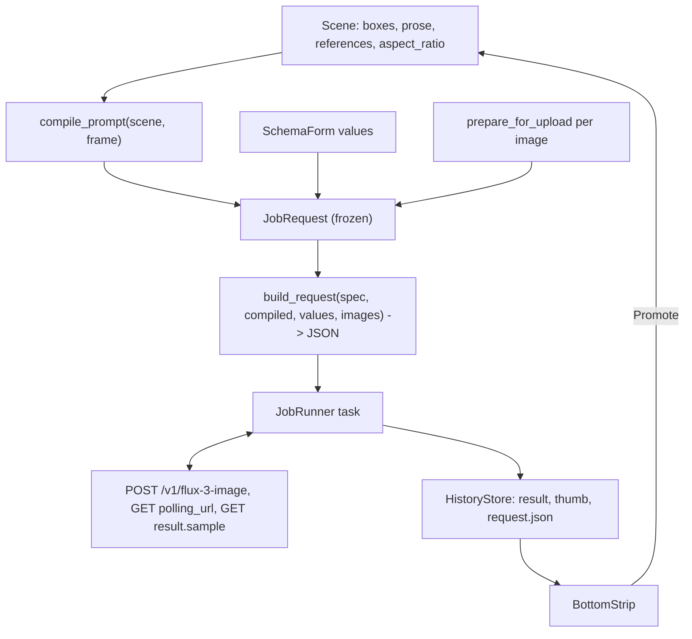
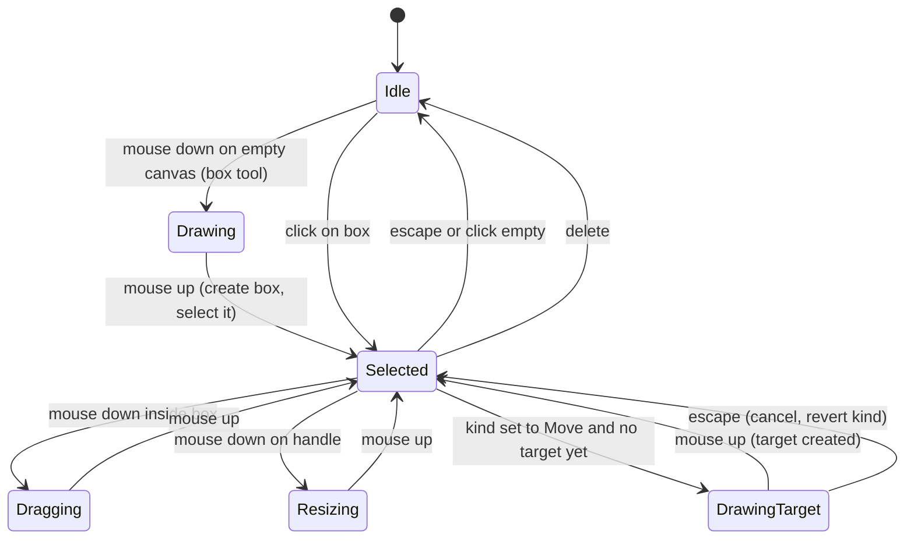

# FLUX 3 MVP Editor - Plan

Step 3 of the `easel` series. Builds on step 1 (`docs/plans/2026-10-15-1723-chore-repo-and-skeleton-plan.md`, cited `S1-KTD<N>`) and step 2 (`docs/plans/2026-10-15-1724-feat-gpui-app-frame-plan.md`, cited `S2-KTD<N>`).

---

## Goal Capsule

- **Objective:** A user can describe an image or an edit by drawing labeled boxes on the canvas and writing a prompt, set every FLUX 3 request parameter in the side panel, generate, watch progress, and get the result back into the app where it can be saved or used as the next edit's starting image.
- **Means:** A pure box-to-prompt compiler and request builder for the `flux-3-image` endpoint in `easel-core`, a schema-driven form over the FLUX 3 `ModelSpec`, and a job runner on the step-2 transport that polls, downloads immediately, and persists results to a local history (KTD1–KTD13).
- **Authority hierarchy:** R-IDs govern behavior; KTDs govern mechanism; S1/S2 KTDs govern architecture. The FLUX 3 docs in Sources are the authority on the wire format where this plan is silent.
- **Stop conditions:** Stop and report if a live request with one base64 reference image is rejected in a way that contradicts the documented format (raw base64, `[top, left, bottom, right]` grid), since the compiler and encoder are built on those two facts.
- **Execution profile:** Feature work. Core logic is test-first against golden examples from the official docs; UI is covered by `#[gpui::test]` state tests and smoke runs against the live API with a real key.
- **Finishes and ships:** Implementer lands on `main` after step 2.

---

## Product Contract

### Summary

Implement the FLUX 3 workflow end to end: box tool and inspector on the canvas, a prompt editor with tag insertion, a parameter form generated from the FLUX 3 schema, a reference-image strip, submission and polling against `POST /v1/flux-3-image`, immediate download of results into a persisted history, a history strip with promote/save/discard, and session autosave.

### Problem Frame

FLUX 3 is the only one of the four target models that takes spatial instructions, and it does so without a dedicated field: the prompt string carries prose with `<id>` tags followed by a JSON array of box rows on a 0–1000 grid ordered `[top, left, bottom, right]`. Users shouldn't hand-write that. The product's distinctive value is turning boxes drawn on a canvas into that syntax correctly, including the four row kinds (keep, move, new, remove) and the `<ref_image_N>` ordering that depends on the reference strip. Everything else (parameters, polling, moderation statuses, 10-minute result URLs, 422 clamping of `safety_tolerance`) is protocol work the step-1 notes already document.

### Requirements

**Boxes and scene**

- R1. The user can draw a box on the canvas by dragging, then select, move, resize via handles, and delete it; boxes are stored in source-image pixel space (S1-KTD5).
- R2. Each box has an id (auto-allocated as `<prefix>_<n>`, editable, validated), a kind (Layout, New, Keep, Move, Remove), a description, and for Move a second target rectangle drawn on the same canvas.
- R3. Renaming a box id rewrites every `<old_id>` tag in the prompt prose to `<new_id>`.
- R4. With a source image present and boxes drawn, `aspect_ratio` is locked to `auto` so the output keeps the source framing and all boxes share one frame; without a source image, boxes require a concrete `aspect_ratio` and the canvas shows a frame of that ratio to draw in.
- R5. Box kinds available depend on context: Layout only when there is no source image; New, Keep, Move, Remove only when there is one.

**Prompt and parameters**

- R6. The prompt editor is free prose with an Insert Tag action that inserts `<id>` for a chosen box at the cursor, and tags for `<ref_image_N>`; the compiled JSON suffix is shown read-only beneath it, never hand-edited.
- R7. The side panel renders every FLUX 3 request parameter from the schema: `prompt` (via the editor), `images` (via the reference strip), `aspect_ratio`, `resolution`, `safety_tolerance`, `grounding`, `version` (read-only `latest`).
- R8. Form validation blocks Generate with a per-field message for: empty prompt, more than 10 images, boxes without a concrete aspect ratio (R4), and a tag in the prose with no matching box.
- R9. The reference strip shows the source image as `ref_image_0` and up to nine extra images added by file, drop, or paste, reorderable, each labeled with its index; removing the source image shifts indices and the prose tags are updated.

**Generation**

- R10. Generate freezes an immutable `JobRequest` (S1-KTD8) and submits it; editing boxes, prompt, or images afterwards does not affect the in-flight job.
- R11. Up to four jobs may be in flight at once; a fifth Generate enters `JobState::Queued` (S1-KTD8), is shown in the strip as queued, and submits when a slot frees.
- R12. Polling uses the returned `polling_url` verbatim with the `x-key` header; `Pending`, `Reasoning`, `Generating` keep polling with progress shown; `Ready` triggers immediate download; `Error`, `Request Moderated`, `Content Moderated`, `Task not found` are terminal failures shown with the server's details, including moderation reasons.
- R12a. Server-supplied values are checked before use. `polling_url` and the result URL must be `https` with a host that is `api.bfl.ai` or ends in `.bfl.ai`; otherwise the job fails with a protocol error and no request is sent (this also applies to URLs read back from the history index on resume, R21). The job id must match `^[A-Za-z0-9_-]{1,64}$` before it names a directory, file, or URL segment. The result download carries no credential and is capped at 100 MB. Server-provided strings shown in the UI (status, moderation reasons, error messages, `result.prompt`) are truncated (2 KB in toasts and strip entries, 16 KB in details) and stripped of C0/C1 control characters other than newline and tab and of Unicode bidi controls (U+202A–202E, U+2066–2069).
- R13. A job with no terminal status after five minutes is marked failed with a timeout message; the user can Dismiss any in-flight job, which stops polling locally (there is no server-side cancel for BFL).
- R14. HTTP errors map to messages: 401/403 invalid key (links to settings), 402 out of credits, 422 field errors mapped to form fields (and `safety_tolerance` clamped to the approved maximum returned, remembered for the session; the returned maximum is itself clamped to the schema's 0–7 range, and a 422 naming a key not in the schema becomes a general error rather than a form change), 429 rate limited with retry after (clamped to 300 s), 400 reference too large, network failures as retryable. Error bodies retained in `ProviderError::Http` are truncated to 64 KB.
- R15. The submit response's `cost`, `input_mp`, `output_mp` are shown on the job entry; the final poll's settled `cost` replaces the quote when present.
- R16. Reference images are prepared before upload: EXIF applied, downscaled when above the pixel cap, encoded as JPEG (no alpha) or PNG (alpha), sent as raw base64; images below 256×256 are rejected with a message.

**History and results**

- R17. Results are downloaded on `Ready` and written to disk before display; the history entry stores the result bytes, the `JobRequest` with each reference image reduced to its content hash, dimensions, and MIME type (not the encoded bytes, which would multiply history size by the reference count), timings, and cost. The result URL is never persisted; nothing under the history directory contains a credential header value or a server-provided file name. If writing the result fails (disk full, read-only directory), the job is marked Failed with the I/O message and the downloaded bytes stay in memory so one Save As from that entry still works.
- R18. The bottom strip shows history entries newest-first: in-flight entries with a spinner and progress, completed entries as thumbnails, failed entries with the error.
- R19. A completed entry can be Promoted (becomes the canvas source image; boxes are kept and rescaled to the new frame; Move boxes collapse so target becomes the new source and target; the previous source is dropped), Saved As (file dialog, default name `easel-<job_id>.<ext>`, extension from the sniffed magic bytes out of the fixed set `png`, `jpg`, `webp`), Compared (the entry's request restored into the form read-only for inspection; reference images appear as their stored summaries, not pixels), or Discarded (removes the entry and its files).
- R20. History is capped at 200 entries and 2 GB on disk, oldest completed entries evicted first; in-flight entries are never evicted. The settings panel shows the history directory path so the user can inspect or clear it; a "Clear history" action is deferred.
- R21. In-flight jobs survive app close: on launch, each persisted in-flight job is polled once more; `Ready` downloads if the URL still works, otherwise the entry is marked Expired.

**Session**

- R22. Scene, prompt, form values, and reference list autosave to a session file on change and restore on launch; the source image is stored by path when it came from disk and embedded as PNG when it came from clipboard.

### Key Decisions

- **The user writes the prose; the app writes the JSON.** Chosen over app-generated sentences because the FLUX 3 guides emphasize that the instruction and the rows must agree and the prose is where edit intent lives; auto-generated prose would be generic. Governs R6, R8.
- **Boxes imply one frame: the source image's when editing, the chosen aspect ratio's when generating.** Chosen over allowing a different output ratio with boxes, which needs two overlapping frames in the UI. Governs R4, R5.
- **Results persist to disk before they appear.** BFL result URLs expire in about 10 minutes. Governs R17, R21.
- **Dismiss, not Cancel.** No BFL cancel endpoint exists; the label must not imply the server stopped. Governs R13.
- **Promote keeps boxes.** The iterative loop is the point of the history strip; losing boxes on promote would make it a restart. Governs R19.

### Success Criteria

- The three official FLUX 3 example prompts (layout, edit with keep rows, move) are reproduced byte-for-byte by the compiler from box data in golden tests; Remove rows are covered by a synthetic unit test since the docs show none.
- A text-to-image layout request and an edit request with one base64 reference each return `Ready` against the live API and land in history with the image visible, using only the UI.
- A 20 MP source image uploads as a downscaled JPEG under a few MB of base64 without the UI stalling.

### Scope Boundaries

- FLUX 3 only; the model selector is a single fixed entry. FLUX.2 [pro], Krea 3, Krea 2 Large are step 4.
- No brushes, masks, freehand annotation, or text layers on the canvas.
- Boxes on extra reference images (`from: "ref_image_1"`) are not drawable; the inspector allows setting `from` to another index for advanced users, but boxes are only drawn over `ref_image_0`.
- No pre-flight cost estimate; cost is shown after submission.
- No prompt history or templates.

#### Deferred to Follow-Up Work

- Different output aspect ratio with boxes (dual-frame UI).
- Using `result.prompt` (the model's expanded prompt with inferred boxes) to bootstrap a box set from a plain-text run.
- Undo/redo for box edits.
- Progressive `preview` images during polling.

---

## Planning Contract

### Key Technical Decisions

- KTD1. **Box compiler is a pure function `compile_prompt(scene, frame) -> CompiledPrompt { text, rows_json, warnings }` in `easel-core::providers::bfl::flux3`.** Output is `prose + " " + serde_json::to_string(rows)`. Layout rows: `{id, bbox, desc}`. Edit rows: `{id, from, src_bbox, tgt_bbox, desc}` with Keep (`from` set, `src == tgt`), Move (`from` set, both boxes), New (`from: null`, `src_bbox: null`, `tgt_bbox`), Remove (`from` set, `tgt_bbox: null`). Grid conversion via S1-KTD5's `Rect::to_grid(frame)`; the frame is the source image size when present, otherwise a virtual frame with the chosen aspect ratio (R4). Row order follows box order in the scene. Golden tests pin the three documented examples. `warnings` also carries a notice when `aspect_ratio` is `auto`, boxes exist, and the prose contains an `N:M` ratio token or the phrase "aspect ratio": under `auto` a ratio the prompt asks for wins over the source framing, which would shift every box.
- KTD2. **Prose tag handling is a small tokenizer, not regex-replace.** `tags(prose) -> Vec<Tag { name, span }>` recognizes `<[a-z][a-z0-9]*_[0-9]+>` and `<ref_image_[0-9]+>`; rename and index-shift operations rewrite spans. Validation (R8) reports tags with no box and boxes with no tag (the second as a warning: the docs say a missing tag misplaces the element).
- KTD3. **FLUX 3 `ModelSpec` is a `LazyLock` constant with the exact schema from `docs/api/flux.3.md`.** Fields: `aspect_ratio` Select (15 values + `auto`, default `auto`), `resolution` Select (`768sq`, `1k`, `1.5k`, `2k`, `4k`, default `1k`), `safety_tolerance` Int 0–7 default 2, `grounding` Bool default true, `version` ReadOnly `latest`; `prompt` and `images` are owned by the editor and strip, not the generic form. Capabilities: `supports_boxes: true`, `image_slots: List { max: 10 }`, `size_control: AspectRatioAndResolution`, auth `HeaderKey { header: "x-key" }`, endpoint `https://api.bfl.ai/v1/flux-3-image`. Unknown fields cause 422, so the request builder emits only schema keys plus `prompt` and `images`.
- KTD4. **BFL protocol parsing is pure and takes the whole `HttpResponse` (S2-KTD4): `parse_submit(&HttpResponse) -> Result<Submitted, ProviderError>` and `parse_poll(&HttpResponse) -> PollOutcome`.** Shared vocabulary in `providers::mod`, used unchanged by step 4: `Submitted { job_id, poll_url: Url, quote: Option<CostQuote { cost, input_mp, output_mp }> }` (BFL fills `poll_url` from `polling_url`; a provider with a fixed poll path builds the absolute URL itself) and `PollOutcome::{InFlight { status, progress }, Ready { url, settled_cost: Option<f64>, prompt: Option<String>, duration: Option<f64> }, Failed(ProviderError), Cancelled}` (`Cancelled` maps to `JobState::Dismissed`; BFL never emits it). Status strings per the step-1 note; unknown non-error status strings are treated as in-flight until the deadline. A `Failed(ProviderError::Network)` poll outcome (connection failure, timeout, or a non-JSON 5xx while polling) is not terminal: `advance(Polling, Poll(Failed(Network)))` stays `Polling` and the next `PollPolicy` delay applies until the deadline, so one transient error never discards a paid job. 422 bodies are parsed from `detail[].loc` to field keys; a `safety_tolerance` 422 fills `FieldError.approved_max` (S1-KTD9), clamped to the schema range. 503 with a JSON `status` body is treated as a poll response, not an outage. `parse_submit` produces `job_id: JobId`, a newtype in `providers::mod` that validates `^[A-Za-z0-9_-]{1,64}$` (R12a) and is the only type accepted by the history store, the URL builders, and Save As; `poll_url` is validated against the provider's host allowlist (`ProviderId::allowed_hosts()`) at parse time so the runner never holds an unchecked URL. `ProviderError::Http { body }` is truncated to 64 KB. Taking the full response (not `(status, body)`) is what lets the download step read `Content-Type` and step 4 read `Deprecation`/`Sunset` without changing the signature.
- KTD5. **Polling cadence is data in `easel-core::job`: `PollPolicy { initial: 1 s, factor: 1.5, cap: 5 s, deadline: 5 min }` with `next_delay(attempt) -> Duration` and `expired(elapsed) -> bool`; the runner sleeps via `cx.background_executor().timer` so tests advance a virtual clock.** Matches BFL's own client; FLUX 3 at 4k with grounding can run tens of seconds. The policy comes from `Provider::poll_policy()` (KTD13) so step 4 can give Krea a slower cadence without touching the runner.
- KTD6. **Job runner is an `Entity<JobRunner>` in `easel` that drives I/O; the state transitions are a pure function in core.** `easel-core::job::advance(state, event) -> JobState` takes `JobEvent::{SlotFreed, Submitted(Submitted), Poll(PollOutcome), Downloaded, DownloadExpired, DownloadFailed(ProviderError), Dismiss, Deadline}` and is unit-tested: `Downloading + DownloadExpired → Expired` (403/404/410 or a network failure fetching the result) and `Downloading + DownloadFailed(e) → Failed { error: e }` (body over the cap, decode-gate rejection, persist I/O error). A download-step `TransportError` is mapped to a `ProviderError` carrying only its kind, status, and host, never the result URL, so the persisted `Failed { error }` and its strip entry cannot leak the signed URL (R17); the runner holds `Vec<Job { id, request: Arc<JobRequest>, state: JobState, task: Option<Task<()>> }>`, owns timers, the transport, and the store, and applies `advance` after every event. Chosen over a full sans-I/O effect machine (where core would also emit "send this request" effects): the runner's I/O sequence is short and gpui's virtual clock already makes it testable; the pure `advance` is enough to keep the state rules out of UI code. Dropping `task` is Dismiss; a `Queued` job has no task yet. In-flight cap 4 (R11). Each job's task: resolve each `ReferenceStep` (KTD13; for BFL all are `Inline`) → submit via `HttpTransport` → poll loop → download → persist via `HistoryStore` → update state, emitting events the strip observes. All `HistoryStore` and session file calls run on `cx.background_executor()`, never on the UI thread; the runner is the single owner of the store, so the four concurrent job tasks never write `history.json` concurrently (writes are serialized through the runner entity). Resume-on-launch (R21) reconstructs tasks from persisted in-flight entries starting at the poll step.
- KTD7. **Image preparation in `easel-core::image_prep`: `prepare_for_upload(img, PrepOptions { max_pixels, prefer_jpeg }) -> EncodedImage { bytes, mime, width, height, content_hash }`.** `max_pixels` is 4 MP by default and 16 MP when `resolution` is `4k`; JPEG quality 92 when the image has no alpha, PNG otherwise; resize with `Triangle` filter. Below 256×256 is an error. `content_hash` is BLAKE3 (or SHA-256) of `bytes`, used by R17's reduced request snapshot and by step 4's upload cache. Base64 is `base64::engine::general_purpose::STANDARD` on the raw bytes, no `data:` prefix (BFL convention; Krea differs and is handled in step 4).
- KTD8. **History store in `easel-core::history` operates on an injected root directory; the app resolves `$XDG_DATA_HOME/easel/history` with the `directories` crate.** Layout `<root>/<job_id>/` with `result.<ext>`, `thumb.jpg`, `request.json`, `meta.json`; an index `history.json` written atomically (temp + rename). The store does `std::fs` I/O (acceptable in core: tests use temp dirs; no gpui, tokio, or environment discovery) and is called only from the runner on the background executor (KTD6). Thumbnails are 256 px long-edge JPEGs produced by the runner via `image_prep::thumbnail` at download time and passed to `complete`, so the strip never decodes full results and the store never decodes images. `request.json` is the `JobRequest` with `images` replaced by `ImageSummary { content_hash, width, height, mime }` (R17). Eviction per R20 counts entries and bytes. The store creates `easel/` and `history/` with mode 0700 and writes every file, including temp files before rename, with mode 0600 (`OpenOptions::mode`); `remove(JobId)` canonicalizes the entry directory and asserts its parent is the store root before `remove_dir_all`; index rows whose id fails `JobId` validation are skipped with a warning at load, never deleted. Result files are named `result.<ext>` with `ext` from the sniffed magic bytes (`png`, `jpg`, `webp`); any other container is stored as `result.bin`, never decoded, and the entry is marked Failed with "unsupported result format".
- KTD9. **Session file `$XDG_DATA_HOME/easel/session.json` with a `version` field; debounced autosave (500 ms) on scene, prompt, form, or reference change.** The format and read/write functions live in `easel-core::session` on an injected path; the app resolves the path. Writes are atomic (temp + rename, mode 0600) and the previous file is kept as `session.json.bak`. Source image by path plus a content hash to detect external changes. A source with no durable user path (clipboard-origin, or a promoted result whose history files Discard or eviction may delete) is written once, at full decoded resolution, to `$XDG_DATA_HOME/easel/session/<content_hash>.png` (atomic, mode 0600) and referenced as `SourceRef::Path`; `session.json` itself holds only scene, values, and references, so the 500 ms autosave never re-encodes pixels and boxes stored in source pixel space (S1-KTD5) restore against the same pixel dimensions. This is how R22's "embedded as PNG" copy is stored. Files under `session/` not referenced by the current session are removed on the next successful save. Restore is best-effort: a missing file leaves the scene empty silently (first launch is not an error); a file over 256 MB is refused; an unparseable file is renamed `session.corrupt-<timestamp>.json`, the `.bak` is tried, and the user is told.
- KTD10. **Form rendering is generic over `FieldKind` (S1-KTD7) using the step-2 widgets; `prompt` and `images` are special-cased by key.** `SchemaForm` entity maps each `FieldDef` to a widget row, holds `values: BTreeMap<String, Value>`, re-validates on change, and surfaces field errors inline. R4's aspect-ratio lock is `LockRule::WhenSourceImageAndBoxes { value: "auto" }` on the `aspect_ratio` field, a variant added to S1-KTD7's `LockRule` in `schema.rs`, evaluated as `has_source_image && box_count > 0` over S1-U3's `RuleContext`; with a source image and no boxes the select stays enabled (plain edits and style transfer may pick an output ratio). The form evaluates it through `ParamSchema::locked_value(field, &RuleContext)` from scene state, so the rule stays in data.
- KTD11. **Box tool interaction is a state machine in the Canvas: `Idle → Drawing{start} → Selected{id}`, `Idle → Selected{id} → Dragging{id, grab_offset} | Resizing{id, handle} → Selected`.** Hit-testing and handle geometry are pure functions in `easel-core::geometry` operating in view space via S2-KTD3's `Viewport`. Move kind enters a second `DrawingTarget{id}` state after the source box exists; `escape` in `DrawingTarget` cancels and reverts the box to its previous kind, and a Move box that still has no target is a `boxes` validation error (its row would have no `tgt_bbox`). The canvas has two tools, Select (default, `v`) and Box (`b`), both as toolbar buttons; the Box tool is disabled with a hint when `Scene::frame()` is `None` (no source image and no concrete aspect ratio), since there is no frame to draw in. Labels render as positioned `div`s above the `canvas()` overlay, which paints fills and outlines with `paint_quad`.
- KTD12. **Promote rescales boxes by grid round-trip.** Each box converts `to_grid(old_frame)` then `from_grid(new_frame)` so relative placement is preserved when the result's pixel dimensions differ from the source; Move boxes set `src = tgt` and keep `tgt`.
- KTD13. **The `Provider` trait in `easel-core::providers` is defined in its final shape here, gpui-free, so step 4 only adds implementations.** Methods: `spec() -> &ModelSpec`; `compile_prompt(&Scene, frame) -> CompiledPrompt` (default: prose only, no JSON suffix, with every `<id>` and `<ref_image_N>` tag removed and surrounding whitespace collapsed, each removed tag listed in `warnings`, since a provider without box support would otherwise receive literal angle-bracket tokens; FLUX 3 overrides with KTD1); `validate_for_submit(&Scene, &values, image_count) -> Vec<FieldError>`; `reference_steps(&[EncodedImage]) -> Vec<ReferenceStep>` where `ReferenceStep::{Inline(ImageInput), Upload { request: HttpRequest, content_hash }}` and `ImageInput::{RawBase64(String), Url(String)}` (BFL returns only `Inline(RawBase64)`; Krea in step 4 returns `Url` from uploads); `parse_upload(&HttpResponse) -> Result<ImageInput, ProviderError>` (default: `Protocol("provider does not upload")`); `build_submit(&JobRequest, &[ImageInput]) -> HttpRequest`; `poll_request(&Submitted) -> HttpRequest`; `parse_submit`; `parse_poll` (KTD4); `cancel_request(&Submitted, last: Option<&PollOutcome>) -> Option<HttpRequest>` (default `None`; a provider with server-side cancel decides from the last known status); `poll_policy() -> PollPolicy` (default KTD5's BFL values). The runner executes `Upload` steps through the transport, consulting a `content_hash -> ImageInput` cache held in `AppState` before each one, then calls `build_submit` with the resolved inputs. Chosen over a trait that returns a gpui `Task` (would put gpui in core, violating S1-R1/S1-KTD2) and over adding methods in step 4 (would edit every step-3 implementation and the runner).

### High-Level Technical Design

Data flow from canvas to request and back:



Job runner per-job sequence:

```mermaid
sequenceDiagram
  participant UI as Form/Canvas
  participant JR as JobRunner
  participant BG as background executor
  participant T as HttpTransport
  participant API as api.bfl.ai
  participant H as HistoryStore
  UI->>JR: Generate (snapshot JobRequest; Queued if 4 in flight)
  JR->>BG: prepare images (resize, encode, base64, hash)
  BG-->>JR: EncodedImage[]
  JR->>JR: provider.reference_steps -> all Inline for BFL
  JR->>T: POST flux-3-image (auth: Bfl)
  T->>API: submit with x-key inserted by transport
  API-->>JR: {id, polling_url, cost}
  JR->>BG: store.begin (persist in-flight entry)
  loop until terminal or poll_policy.deadline
    JR->>JR: timer (poll_policy.next_delay)
    JR->>T: GET poll_url (auth: Bfl)
    T->>API: poll
    API-->>JR: status, progress
  end
  alt Ready
    JR->>T: GET result url (auth: None)
    T-->>JR: bytes + content-type
    JR->>BG: thumbnail; store.complete(result, thumb, meta); index
    JR-->>UI: Done
  else Failed / Moderated / Timeout
    JR->>H: update entry with error
    JR-->>UI: Failed with details
  end
```

Box tool states (KTD11):



Side panel composition (prose description in place of a wireframe): in Editor mode (S2-KTD1) the panel is a vertically scrollable stack of the model header (fixed "FLUX 3"), the reference strip, the prompt editor with Insert Tag menu and the read-only compiled JSON preview, the box inspector for the selected box (id, kind, description, from-index), the generic schema form (aspect ratio, resolution, safety tolerance slider, grounding checkbox, version), and the validation summary; the Generate button with the local queue count is a pinned footer outside the scroll region so it is always reachable. Settings mode (S2-U7) replaces the stack; errors that "link to settings" carry the S2-KTD7 toast action that switches the panel to Settings mode.

### Key Flows

- F1. Edit an existing image with boxes
  - **Trigger:** Source image loaded (step 2), user selects the box tool.
  - **Steps:** Draw box over the tiger → inspector assigns `animal_1`, kind New (default when drawn over an image), description typed; draw a Keep box for the log; write prose "In <ref_image_0>, change <animal_1> to pink. Keep <log_1> unchanged."; `aspect_ratio` shows `auto` locked; Generate.
  - **Outcome:** JSON suffix carries two edit rows; job appears in strip; result lands; Promote makes it the new source with both boxes kept.
  - **Covered by:** R1, R2, R4, R5, R6, R10, R12, R17, R19

- F2. Text-to-image layout
  - **Trigger:** No source image; user picks `aspect_ratio` 1:1 and draws boxes.
  - **Steps:** Canvas shows a 1:1 frame; two Layout boxes drawn and described; prose written with both tags; Generate.
  - **Outcome:** Rows use `bbox` form; result appears; Save As writes the file.
  - **Covered by:** R4, R5, R7, R8, R19

- F3. Moderated or failed job
  - **Trigger:** Poll returns `Request Moderated` or `Content Moderated`.
  - **Steps:** Runner marks Failed with `details["Moderation Reasons"]`; strip entry shows the reasons; user edits and resubmits.
  - **Outcome:** No download attempted; entry retained in history as failed.
  - **Covered by:** R12, R18

- F4. Relaunch with a job in flight
  - **Trigger:** App closed while polling; relaunch.
  - **Steps:** Runner reads in-flight entries from the index, polls each once; `Ready` → download; download failure → Expired.
  - **Outcome:** Strip shows the recovered or expired entry.
  - **Covered by:** R21

### Acceptance Examples

- AE1. Covers R4. **Given** no source image and two boxes, **when** `aspect_ratio` is `auto`, **then** Generate is blocked with "Boxes need a fixed aspect ratio" on the aspect ratio field.
- AE2. Covers R4. **Given** a source image and one box, **when** the user opens the aspect ratio select, **then** it is disabled at `auto` with help text "keeps the source framing unless the prompt asks for a ratio"; with the same source image and no boxes, the select is enabled.
- AE3. Covers R3. **Given** prose "make <cat_1> orange" and box `cat_1`, **when** the id is renamed to `cat_2`, **then** the prose reads "make <cat_2> orange".
- AE4. Covers R9. **Given** references `ref_image_0` (source) and `ref_image_1`, and prose mentioning `<ref_image_1>`, **when** the source image is removed, **then** the former `ref_image_1` becomes `ref_image_0` and the prose tag is rewritten.
- AE5. Covers R14. **Given** `safety_tolerance` 6, **when** submit returns 422 naming approved levels up to 4, **then** the field shows the error, the slider max becomes 4 for the session, and the value is clamped to 4.
- AE6. Covers R12, R17. **Given** a poll returns `Ready`, **when** the download completes, **then** the history directory contains `result.<ext>` and `request.json` before the strip shows the thumbnail.
- AE7. Covers R13. **Given** a job polling for five minutes with only in-flight statuses, **when** the deadline passes, **then** the entry shows "Timed out waiting for result" and polling stops.
- AE8. Covers R19. **Given** a 1000×1000 source with a Move box src `[100,100,300,300]` tgt `[500,500,700,700]` (pixels) and a 2000×2000 result, **when** Promoted, **then** the box is Move with src and tgt both `[1000,1000,1400,1400]` in the new frame.

### Assumptions

- FLUX 3 accepts raw base64 in `images` (inferred from sibling BFL endpoints; the first live edit request validates this and is a stop condition if wrong).
- FLUX 3's effective `safety_tolerance` maximum is discovered from the 422 body rather than hardcoded.

---

## Implementation Units

### Unit Index

| U-ID | Title | Key files | Depends on |
|---|---|---|---|
| U1 | Scene operations and prose tags | `easel-core/src/scene.rs`, `easel-core/src/prose.rs` | — |
| U2 | FLUX 3 box compiler | `easel-core/src/providers/bfl/flux3.rs` | U1 |
| U3 | FLUX 3 ModelSpec, `Provider` trait, request builder | `easel-core/src/providers/bfl/flux3.rs`, `easel-core/src/providers/mod.rs`, `easel-core/src/schema.rs` | U2, U4 |
| U4 | BFL protocol parsing and job state machine | `easel-core/src/providers/bfl/protocol.rs`, `easel-core/src/job.rs` | — |
| U5 | Image preparation for upload | `easel-core/src/image_prep.rs` | — |
| U6 | History store | `easel-core/src/history.rs` | — |
| U7 | Box tool and inspector UI | `easel/src/canvas/boxes.rs`, `easel/src/side_panel/inspector.rs` | U1 |
| U8 | Prompt editor, schema form, reference strip | `easel/src/side_panel/{prompt_editor,schema_form,references}.rs` | U1, U3 |
| U9 | Job runner | `easel/src/jobs/runner.rs` | U3, U4, U5, U6 |
| U10 | History strip and result actions | `easel/src/bottom_strip.rs`, `easel/src/jobs/promote.rs` | U6, U7, U9 |
| U11 | Session autosave and restore | `easel-core/src/session.rs`, `easel/src/session.rs` | U1, U8 |

### U1. Scene operations and prose tags

- **Goal:** Box CRUD, id allocation and rename, kind rules, reference reordering, and tag rewriting as pure, tested operations.
- **Requirements:** R2, R3, R5, R9
- **Dependencies:** step 1 types
- **Files:** `crates/easel-core/src/scene.rs`, `crates/easel-core/src/prose.rs`, tests inline
- **Approach:**
  1. `Scene` methods: `add_box(rect, kind) -> BoxId` (default id prefix `box`, so new boxes are `box_1`, `box_2`, … until renamed), `update_box`, `remove_box`, `rename_box(old, new) -> Result`, `allowed_kinds() -> &[BoxKind]` (R5), `set_source(image)`, `clear_source()`, `add_reference`, `remove_reference(ix)`, `move_reference(from, to)`; reference changes call `prose::shift_ref_tags` and shift `BoxElement.from_image` the same way. Boxes outlive the frame they were drawn in: `set_source` and `clear_source` rescale every existing box into the new frame by KTD12's grid round-trip (from the previous `frame()` when it was `Some`), keep their kinds, and leave kind correction to the user; `validate_for_submit` (U3) reports any box whose kind is outside `allowed_kinds()` as a `boxes` field error so a `bbox` row and an edit row can never share one request.
  2. `prose` per KTD2: `tags`, `rename_tag`, `shift_ref_tags(removed_ix | moved)`, `unmatched(prose, scene) -> { tags_without_box, boxes_without_tag }`.
  3. `Scene::frame() -> Option<Size>`: source size, or a virtual frame derived from `aspect_ratio` (e.g. 1000 × 1000·h/w), or `None` when boxes exist without a ratio.
- **Test scenarios:**
  - `add_box` with prefix "animal" twice yields `animal_1`, `animal_2`; after removing `animal_1`, the next is `animal_3`.
  - `rename_box("cat_1", "cat_2")` rewrites `<cat_1>` in prose (AE3) and fails on an id already in use or invalid.
  - `allowed_kinds()` is `[Layout]` with no source and `[New, Keep, Move, Remove]` with one.
  - Removing `ref_image_0` shifts `<ref_image_1>` to `<ref_image_0>` (AE4); moving reference 2 to 0 rewrites all affected tags.
  - `unmatched` reports a tag with no box and a box with no tag separately.
  - `frame()` is `None` for boxes + `auto` + no source; `Some(1000×562)` for `16:9`; source size when present.
  - `set_source(4000×2250)` on a scene with a Layout box at `[100,100,300,300]` in a 1000×562 virtual frame yields the box at `[400,400,1200,1200]` with kind still Layout; `clear_source()` on a 2000×2000 source with `aspect_ratio` `1:1` maps boxes into the 1000×1000 virtual frame.
  - `remove_reference(0)` on a box with `from_image: Some(1)` leaves `from_image: Some(0)`.
- **Verification:** `cargo nextest run -p easel-core` passes.

### U2. FLUX 3 box compiler

- **Goal:** `compile_prompt` reproduces the official examples byte-for-byte.
- **Requirements:** R4, R6
- **Dependencies:** U1
- **Files:** `crates/easel-core/src/providers/mod.rs`, `crates/easel-core/src/providers/bfl/mod.rs`, `crates/easel-core/src/providers/bfl/flux3.rs`, golden fixtures in `crates/easel-core/tests/fixtures/flux3/*.json`
- **Approach:** Implement KTD1. Serialize rows with `serde_json` in field order `id, bbox, desc` (layout) and `id, from, src_bbox, tgt_bbox, desc` (edit), compact (no spaces), matching the docs' examples. Return `warnings` for boxes smaller than ~40×25 grid units (docs: too-small new elements often fail) and for unmatched tags.
- **Execution note:** Write the golden tests from the three `docs/api/flux.3.md` examples first; the box data for each is reverse-derived from the example JSON.
- **Test scenarios:**
  - Layout example (silhouette/background) compiles to the exact prompt string in `docs/api/flux.3.md`.
  - Edit-with-boxes example (tiger/butterfly/log/snow/trees) compiles exactly, including `from: null, src_bbox: null` rows and Keep rows.
  - Move example (knight/needle/dragon) compiles exactly.
  - A Remove box yields `tgt_bbox: null` with `from` and `src_bbox` set.
  - Grid order: a pixel box left 384, top 108, right 1536, bottom 972 on a 1920×1080 frame emits `[100, 200, 900, 800]`.
  - With no boxes, output equals the prose with no JSON suffix.
  - A 20×10 grid-unit New box produces a size warning.
  - Prose "make this a wide 16:9 shot" with one box and `aspect_ratio` `auto` produces the ratio-in-prompt warning; the same prose with no boxes does not.
- **Verification:** Golden tests pass; fixtures are the untouched doc examples.

### U3. FLUX 3 ModelSpec, `Provider` trait, and request builder

- **Goal:** The FLUX 3 spec as data, the final `Provider` trait, and a builder that emits exactly the accepted request body.
- **Requirements:** R7, R8, R16
- **Dependencies:** U2, U4 (for `Submitted`/`PollOutcome` and `PollPolicy`)
- **Files:** `crates/easel-core/src/providers/bfl/flux3.rs`, `crates/easel-core/src/providers/mod.rs` (`Provider` trait per KTD13, `ReferenceStep`, `ImageInput`, `Submitted`, `PollOutcome`, `CostQuote`), `crates/easel-core/src/schema.rs` (add `LockRule::WhenSourceImageAndBoxes`), tests inline
- **Approach:** KTD3, KTD10's lock rule, KTD13. Requests are `easel_core::http::HttpRequest` (S2-KTD4) with `auth: Some(ProviderId::Bfl)` and never a key. `validate_for_submit(scene, values, image_count) -> Vec<FieldError>` implements R8 beyond generic schema validation (image count via `Capabilities::validate_image_count`, S1-KTD6) plus the two box-shape checks that would otherwise produce a malformed request: a Move box with no target, and a box whose kind is outside `allowed_kinds()` for the current scene (U1), both reported on a `boxes` key. `reference_steps` returns `Inline(RawBase64)` for every image; `compile_prompt` delegates to U2.
- **Test scenarios:**
  - `build_submit` for a text-to-image request emits only `prompt`, `aspect_ratio`, `resolution`, `safety_tolerance`, `grounding`, `version`; no `images` key when there are none.
  - With two encoded images, `images` is an array of two raw base64 strings with no `data:` prefix, in reference order.
  - `aspect_ratio: auto` with a source image passes validation; `auto` with boxes and no source fails on `aspect_ratio` (AE1).
  - Eleven images fail validation on `images`; empty prompt fails on `prompt`; a `<dog_1>` tag with no box fails on `prompt`.
  - A Move box with `tgt: None` fails on `boxes`; a Layout box in a scene that has a source image fails on `boxes`.
  - A default-implementation provider's `compile_prompt` on "In <ref_image_0>, change <animal_1> to pink." returns text containing no `<` and no doubled spaces, and `warnings` lists `ref_image_0` and `animal_1` as removed tags.
  - Snapshot (`insta`) of the full JSON body for the F1 flow; the snapshot contains no header values.
  - `build_submit` sets `auth: Some(Bfl)` and `Content-Type: application/json`; `poll_request` sets `auth: Some(Bfl)` and the `Submitted.poll_url` verbatim; a download request built for a `Ready` URL has `auth: None`.
  - `reference_steps` for three images yields three `Inline(RawBase64)` steps and no `Upload`; `cancel_request` is `None`; `poll_policy()` equals KTD5's defaults.
  - A default-implementation provider (test double) returns tag-free prose unchanged from `compile_prompt` with empty `warnings`.
- **Verification:** Tests and snapshot pass; the emitted keys equal the schema's property set.

### U4. BFL protocol parsing and job state machine

- **Goal:** Pure classification of submit and poll responses into outcomes and `ProviderError`s, plus the pure job transition function and poll policy.
- **Requirements:** R12, R13, R14, R15
- **Dependencies:** none
- **Files:** `crates/easel-core/src/providers/bfl/protocol.rs`, `crates/easel-core/src/providers/mod.rs` (`Submitted`, `PollOutcome`, `CostQuote`), `crates/easel-core/src/job.rs` (`PollPolicy`, `JobEvent`, `advance`), fixtures in `crates/easel-core/tests/fixtures/bfl/*.json`, tests inline
- **Approach:** Implement KTD4, KTD5's `PollPolicy`, and KTD6's `advance`. Include `extract_result_mime(content_type, magic_bytes)` for the download step (FLUX 3 has no `output_format`; sniff).
- **Test scenarios:**
  - 200 submit body yields `Submitted { job_id, poll_url == polling_url, quote: Some(CostQuote { cost, input_mp, output_mp }) }`.
  - 401 and 403 → `ProviderError::Auth`; 402 → `OutOfCredits`; 429 with `retry_after` → `RateLimited { retry_after: Some(..) }`; 400 → `Validation` naming images.
  - 422 with `detail[].loc == ["body", "safety_tolerance"]` and a message listing approved levels → `Validation` with a `FieldError { key: "safety_tolerance", approved_max: Some(4), .. }` (AE5).
  - Poll `Pending`, `Reasoning`, `Generating` → `InFlight` with the status string and `progress`; `Ready` → `Ready { url, prompt, duration, settled_cost }`.
  - `Request Moderated` and `Content Moderated` with `details["Moderation Reasons"]` → `Failed(Moderated { reasons })`; `Error` → `Failed(Protocol)`; `Task not found` → `Failed(Protocol)` with a distinct message.
  - 503 with a JSON `status: "Pending"` body → `InFlight`; 503 with HTML → `Network` (retryable).
  - An unknown status string → `InFlight`.
  - `extract_result_mime` returns `image/png` for PNG magic bytes regardless of a `jpeg` content type; GIF magic bytes return `None` (unsupported).
  - A submit body with `id` `../x`, `a/b`, or a 65-character id → `Err(Protocol)`; `JobId::parse` accepts `abc-123_XYZ`.
  - A submit body whose `polling_url` is `https://evil.example/...` or `http://api.bfl.ai/...` → `Err(Protocol)`; `https://api.eu.bfl.ai/v1/get_result?id=..` is accepted.
  - A 5 MB HTML 503 body → `Network` error whose retained body is ≤ 64 KB.
  - 422 with `approved_max` 999 in the message → `approved_max: Some(7)`; 422 whose `loc` names `nonexistent` → `Validation` with an empty `field_errors` and a general message.
  - 429 with `retry_after: 999999` → `RateLimited { retry_after: Some(300 s) }`.
  - `PollPolicy::default_bfl().next_delay(n)` for n = 0, 1, 2, 10 is 1 s, 1.5 s, 2.25 s, 5 s; `expired(5 min + 1 s)` is true.
  - `advance`: `Queued + SlotFreed → Submitting`; `Polling + Poll(Ready) → Downloading`; `Polling + Poll(Cancelled) → Dismissed`; `Polling + Poll(Failed(Network)) → Polling` (attempt incremented); `Polling + Poll(Failed(Moderated))` → `Failed`; `Downloading + DownloadExpired → Expired`; `Downloading + DownloadFailed(e) → Failed { error: e }`; `Polling + Deadline → Failed { error: timeout }`; `Dismiss` from each in-flight state → `Dismissed`; `Dismiss` on a terminal state is a no-op.
- **Verification:** All fixtures parse as expected; `advance` tests cover every edge in the S1-KTD8 diagram.

### U5. Image preparation for upload

- **Goal:** Deterministic resize/encode/base64 with the documented limits.
- **Requirements:** R16
- **Dependencies:** none
- **Files:** `crates/easel-core/src/image_prep.rs`, `crates/easel-core/Cargo.toml` (`image` features, `base64`), tests inline with small generated images
- **Approach:** Implement KTD7. `PrepOptions::for_resolution(tier)` maps `4k` → 16 MP, others → 4 MP. Expose `encode_png(img)` for session embedding (KTD9), `thumbnail(bytes, 256) -> Vec<u8>` for the runner to call at download time (KTD8), and `EncodedImage::summary() -> ImageSummary` for R17's reduced snapshot.
- **Test scenarios:**
  - A 6000×4000 RGB image with the 4 MP cap resizes to ≤ 4 MP preserving aspect ratio and encodes as JPEG.
  - A 1000×1000 RGBA image with a transparent pixel encodes as PNG.
  - A 200×200 image returns an error naming the 256 minimum.
  - A 1920×1080 image under the cap is not resized (dimensions preserved).
  - The base64 output decodes back to the exact encoded bytes and contains no `data:` prefix.
  - `thumbnail` of a 4000×2000 image is 256×128.
  - Two preparations of the same pixels yield the same `content_hash`; a one-pixel change yields a different one.
- **Verification:** Tests pass; a 20 MP photo prepares in well under a second in release and a few seconds in debug.

### U6. History store

- **Goal:** Durable on-disk history with atomic index updates, thumbnails, eviction, and in-flight persistence.
- **Requirements:** R17, R20, R21
- **Dependencies:** none (takes already-encoded result and thumbnail bytes)
- **Files:** `crates/easel-core/src/history.rs`, tests inline using a temp dir
- **Approach:** Implement KTD8. `HistoryStore::open(root: PathBuf) -> Self`, `begin(job_id, request: &JobRequest, submitted: &Submitted) -> Entry` (in-flight; writes `request.json` with `ImageSummary` in place of image bytes, and `poll_url` in `meta.json` for resume), `complete(job_id, result_bytes, mime, thumb_bytes, meta)`, `fail(job_id, error)`, `set_state(job_id, state)`, `remove(job_id)`, `list() -> Vec<EntrySummary>` newest-first, `in_flight() -> Vec<Entry>`, `evict_to(cap)`. `meta.json` holds `JobState`, `model_id`, `provider`, timestamps, cost, prompt returned by the API, duration, `poll_url`. The store is synchronous `std::fs`; the caller (runner) is responsible for calling it off the UI thread.
- **Test scenarios:**
  - `begin` then `complete` writes `result.png`, `thumb.jpg`, `request.json`, `meta.json`, and the index lists the entry as Done.
  - `request.json` for a request with two images contains two `ImageSummary` objects and no base64 payload (assert file size under 64 KB).
  - `fail` records the error in `meta.json` and the index.
  - `remove` deletes the directory and index row.
  - Index write is atomic: a simulated failure between temp write and rename leaves the old index intact.
  - With cap 3 and four completed entries plus one in-flight, `evict_to(3)` removes the oldest completed and keeps the in-flight entry.
  - `in_flight()` after reopen returns entries whose state is in-flight with their `poll_url`.
  - Neither the index nor any `meta.json` contains a `delivery.` URL after `complete` (assert on serialized bytes of both).
  - After `open` on a fresh root, the root directory has mode 0700 and every written file (`result.*`, `thumb.jpg`, `request.json`, `meta.json`, `history.json`, and the temp file observed mid-write) has mode 0600.
  - A hand-written index row with id `..` or `x/y` is skipped at load with a warning; `evict_to(0)` afterwards removes nothing outside valid entry directories (assert a sibling directory under the root is intact).
  - With a 2 GB byte cap simulated as 1 MB and three 500 KB completed entries, `evict_to` removes the oldest until under the cap.
  - `complete` with bytes whose magic is not PNG/JPEG/WebP writes `result.bin` and records Failed "unsupported result format".
  - `complete` against a read-only root returns an I/O error and leaves the index unchanged.
- **Verification:** Tests pass in a temp directory; the app opens the store at `$XDG_DATA_HOME/easel/history` (resolved in `crates/easel/src/main.rs` with `directories`).

### U7. Box tool and inspector UI

- **Goal:** Draw, select, move, resize, delete boxes on the canvas; edit id/kind/description/from in the inspector; aspect frame for text-to-image.
- **Requirements:** R1, R2, R4, R5
- **Dependencies:** U1, step 2 canvas (S2-KTD2, S2-KTD3)
- **Files:** `crates/easel/src/canvas/boxes.rs`, `crates/easel/src/canvas/mod.rs`, `crates/easel/src/side_panel/inspector.rs`, `crates/easel/src/actions.rs` (Box Tool `b`, Select `v`, Delete `delete`), `crates/easel-core/src/geometry.rs` (hit-testing, handles), tests in `crates/easel-core/src/geometry.rs` and `#[gpui::test]` in `crates/easel/src/canvas/boxes.rs`
- **Approach:** Implement KTD11. Toolbar gains Select and Box tool buttons (Select is the default tool on launch). Paint: fill at 15% alpha and 2 px outline per kind color; selected box shows eight handles; Move boxes draw src dashed and tgt solid with an arrow (`PathBuilder`). Labels as positioned `div`s with the id. With no source image and a concrete ratio, paint the virtual frame (KTD1's frame) as the drawable area and clamp boxes to it; with no source image and no concrete ratio the canvas shows a centered hint ("Open, drop, or paste an image, or pick an aspect ratio to draw boxes") and the Box tool is disabled. After a box is created the inspector's id field receives focus with its text selected, so typing replaces the default `box_<n>` id. Inspector binds to the selected box via step-2 widgets; kind select lists every kind but marks those outside `allowed_kinds()` as unavailable; changing kind to Move prompts to draw the target (escape cancels and reverts, KTD11).
- **Patterns to follow:** Zed `crates/gpui/examples/painting.rs` for drag-draw; S2-KTD3 `Viewport` for coordinate mapping.
- **Test scenarios:**
  - Geometry: `hit_test(point, boxes)` returns the topmost box containing the point; `handle_at(point, rect)` returns the correct corner/edge handle within an 8 px tolerance and `None` elsewhere.
  - Geometry: resizing via the top-left handle past the bottom-right corner normalizes to a positive rect.
  - `#[gpui::test]`: mouse down at (100,100), move to (300,250), up creates one box whose image-space rect matches the viewport inverse transform.
  - `#[gpui::test]`: with a source image, a new box's kind defaults to New; with no source, to Layout.
  - `#[gpui::test]`: selecting a box and pressing `delete` removes it and clears the inspector.
  - `#[gpui::test]`: setting kind to Move then drawing creates the target; the compiled rows show both boxes.
  - `#[gpui::test]`: setting kind to Move then pressing `escape` before drawing reverts the kind and leaves no target.
  - `#[gpui::test]`: after creating a box, the inspector id field has focus and typing `cat` then `enter` renames `box_1` to `cat_1`.
  - `#[gpui::test]`: with no source and `aspect_ratio` `auto`, the Box tool button is disabled and the hint renders; choosing `1:1` enables it.
  - Smoke: boxes stay anchored to image content while zooming and panning.
- **Verification:** F1 and F2 can be drawn entirely with the mouse; compiled JSON preview updates live.

### U8. Prompt editor, schema form, and reference strip

- **Goal:** The side panel exposes every FLUX 3 parameter, the prompt with tag insertion, and the reference list with ordering.
- **Requirements:** R6, R7, R8, R9
- **Dependencies:** U1, U3, step-2 widgets (S2-KTD6)
- **Files:** `crates/easel/src/side_panel/mod.rs`, `crates/easel/src/side_panel/prompt_editor.rs`, `crates/easel/src/side_panel/schema_form.rs`, `crates/easel/src/side_panel/references.rs`, `crates/easel/src/side_panel/validation.rs`, tests `#[gpui::test]` per file
- **Approach:**
  1. `SchemaForm` per KTD10 driven by `ModelSpec.schema`; `locked_when` for the aspect ratio lock (AE2).
  2. Prompt editor: text area + Insert Tag select listing boxes and references; read-only compiled JSON preview and warnings obtained through `Provider::compile_prompt` (KTD13), never by calling the FLUX 3 compiler directly, so step 4's model switch changes the preview without touching this file's logic.
  3. Reference strip (inside the side panel, above the form): source thumbnail labeled `ref_image_0`, extra references added by file/drop/paste (reusing step-2 loaders), remove and reorder via left/right buttons; indices update prose via U1. Image-entry targets, now that there are two: a drop or `ctrl-v` over the canvas replaces the source (S2-R7); a drop on the strip, or the strip's own Add button, adds a reference; `ctrl-v` with no source image sets the source, otherwise it adds a reference.
  4. Validation summary aggregates schema errors and `validate_for_submit`; Generate is disabled while errors exist and shows the first error on hover. A missing provider key is a pre-flight validation entry ("No BFL API key — open Settings", with the settings action) rather than a submit failure, checked through the same `KeyResolver` the transport uses.
- **Test scenarios:**
  - `#[gpui::test]`: the form renders one widget per schema field with the schema default; `version` is read-only.
  - `#[gpui::test]`: with boxes and no source, choosing `auto` shows the AE1 error and disables Generate; choosing `1:1` clears it.
  - `#[gpui::test]`: with a source image and a box, the aspect ratio select is disabled at `auto`; with the source image and no boxes it is enabled (AE2).
  - `#[gpui::test]`: with no key resolvable, the validation summary shows the missing-key entry and Generate is disabled; adding a session key clears it.
  - `#[gpui::test]`: `ctrl-v` with an image on the clipboard and no source sets the source; a second `ctrl-v` adds `ref_image_1`.
  - `#[gpui::test]`: Insert Tag for `animal_1` inserts `<animal_1>` at the cursor.
  - `#[gpui::test]`: adding a tenth extra reference is refused with a message (source + 9 = 10).
  - `#[gpui::test]`: removing the source reference rewrites `<ref_image_1>` to `<ref_image_0>` in the editor (AE4).
  - `#[gpui::test]`: a 422 `Validation` on `safety_tolerance` with `approved_max 4` sets the slider max to 4 and clamps the value (AE5).
- **Verification:** All FLUX 3 schema fields are visible and editable; validation blocks and unblocks Generate as specified.

### U9. Job runner

- **Goal:** Submit, poll, download, persist, and report jobs with concurrency, dismissal, timeout, and resume.
- **Requirements:** R10, R11, R12, R13, R14, R15, R17, R21
- **Dependencies:** U3, U4, U5, U6, step-2 transport (S2-KTD4), credentials (S2-KTD5)
- **Files:** `crates/easel/src/jobs/mod.rs`, `crates/easel/src/jobs/runner.rs`, `crates/easel/src/app_state.rs` (reference input cache, store and session paths), `crates/easel/src/main.rs` (resolve `$XDG_DATA_HOME/easel` via `directories`), `crates/easel/Cargo.toml` (`directories`), tests `#[gpui::test]` in `crates/easel/src/jobs/runner.rs` using `FakeTransport` and the virtual clock
- **Approach:** Implement KTD6 over U4's `advance` and `PollPolicy` and U3's `Provider`. The transport resolves credentials from `auth: Some(provider)` (S2-KTD4); a `TransportError::NoCredential` becomes `Failed { error: Auth }` pointing at settings before any HTTP call. `reference_steps` are resolved in order: `Inline` passes through, `Upload` checks `AppState`'s hash cache, executes through the transport on a miss, and stores the parsed input (no-op for BFL, exercised by step 4). Download uses an `HttpRequest` with `auth: None` and `max_body_bytes` 100 MB, runs inside the job's deadline, and its bytes pass through S2-KTD8's `decode_image` gate (dimension and allocation limits) before the thumbnail is made. Resume validates each persisted `poll_url` against the allowlist again before polling. The runner calls `image_prep::thumbnail` and every `HistoryStore` method inside `cx.background_executor().spawn` and applies the resulting state on the foreground. Submit-phase errors become `JobState::Failed { error }`; during the poll phase a `TransportError::Network`/`Timeout` is fed to `advance` as `Poll(Failed(Network))` and polling continues on the next delay until the deadline (KTD4); during the download phase a 403/404/410 or network failure is `DownloadExpired` and a size, decode, or persist failure is `DownloadFailed(e)` with the URL stripped (KTD6). The strip maps variants to copy (R14). On launch, `resume(history.in_flight())`.
- **Execution note:** Drive the runner test-first with `FakeTransport` scripts (submit → N polls → ready → download) and `advance_clock`, before wiring the UI.
- **Test scenarios:**
  - Script: 200 submit, `Pending`, `Generating`, `Ready`, 200 bytes → state passes through Submitting, Polling, Downloading, Done; history has the entry; the poll interval sequence is 1 s, 1.5 s, 2.25 s.
  - Script: `Request Moderated` with reasons → `Failed { error: Moderated }` with reasons; no download request made.
  - Script: in-flight forever → after 5 virtual minutes, Failed with timeout; no further polls after the deadline.
  - Script: 200 submit, `Pending`, connection refused, `Generating`, `Ready`, 200 bytes → Done; the refused poll neither fails the job nor resets the backoff.
  - Dismiss during polling: no further requests are made and the entry is Dismissed in history; Dismiss while `Queued` removes it without any request.
  - Five Generates: four submit immediately, the fifth is `Queued` and submits when the first reaches a terminal state.
  - Submit 422 on `safety_tolerance` → `Failed { error: Validation }` carrying `approved_max`, surfaced to the form (AE5).
  - Download returns 403 → Expired state.
  - Resume: a persisted in-flight entry whose poll returns `Ready` downloads and completes; one whose download fails becomes Expired (F4).
  - `FakeTransport` records `auth: Some(Bfl)` on submit and poll requests and `auth: None` on the download request; no recorded request contains a key string.
  - A provider test double whose `reference_steps` returns one `Upload` step: the runner executes it once, caches the result by `content_hash`, and a second job with the same image performs no upload request.
  - Four jobs completing in the same virtual instant produce a consistent `history.json` with four entries (serialized writes).
  - A persisted in-flight entry whose `poll_url` host is off the allowlist (hand-edited index) is marked Failed on resume and no request is made.
  - A `Ready` whose download body exceeds 100 MB (`TransportError::TooLarge`) → Failed, not Expired, with no allocation of the body; the persisted `meta.json`, the index, and the strip's error text for this entry and for the 403-Expired entry contain no `delivery.` URL and no query string.
  - A `Ready` at 4:59 followed by a download that stalls → Failed with timeout at the 5-minute deadline.
  - Download succeeds but `HistoryStore::complete` fails (read-only root) → Failed with the I/O message; Save As from that entry writes the in-memory bytes.
  - A download whose bytes are a PNG claiming 100000×100000 → Failed "unsupported or oversized result", no OOM.
- **Verification:** Runner tests pass; a live text-to-image request with a real key completes end to end from the UI.

### U10. History strip and result actions

- **Goal:** Visible job list with progress, thumbnails, and Promote / Save As / Compare / Discard.
- **Requirements:** R15, R18, R19, R20
- **Dependencies:** U6, U9, U7
- **Files:** `crates/easel/src/bottom_strip.rs`, `crates/easel/src/jobs/promote.rs`, `crates/easel/src/settings/mod.rs` (data directory row), `crates/easel-core/src/scene.rs` (`rescale_boxes_to_frame`, `collapse_move_boxes`), `crates/easel-core/src/text.rs` (`sanitize_for_display(s, max_len)` per R12a), tests inline and `#[gpui::test]`
- **Approach:** Strip observes `JobRunner` (the store's single owner, KTD6) and reads `EntrySummary` snapshots it exposes; entries render newest-first in a horizontal scroll row: spinner + progress + status text for in-flight, thumbnail + cost for Done, error icon + short message for Failed/Expired with details on hover. Action invocation per R19: clicking an entry selects it and shows an action row beneath the strip (Promote, Save As, Compare, Discard; in-flight entries show Dismiss only); right-click opens the same set as a context menu; double-click on a Done entry is Promote; Discard asks for confirmation inline before removing files. Promote per KTD12 then loads the result bytes through the step-2 decode path and sets it as source. Compare restores `request.json` values into a read-only view of the form and the box overlay, with a Return button. The settings panel (S2-U7) gains a read-only "Data directory" row showing the resolved history path (R20).
- **Test scenarios:**
  - Core: `rescale_boxes_to_frame(1000×1000 → 2000×2000)` doubles pixel coordinates; `collapse_move_boxes` sets src = tgt for Move boxes (AE8).
  - `#[gpui::test]`: a Done entry's Promote sets `AppState.image` to the result and keeps the box count.
  - `#[gpui::test]`: Discard then confirm removes the entry from the strip and the store; Discard then cancel leaves both intact.
  - `#[gpui::test]`: clicking an entry shows the action row; double-click on a Done entry promotes it.
  - `#[gpui::test]`: in-flight entries render progress text updated on runner events.
  - `#[gpui::test]`: the strip shows the quoted cost after submit and the settled cost after completion.
  - `#[gpui::test]`: a Failed entry whose message is 10 KB containing U+202E and a C0 control renders ≤ 2 KB with both characters stripped (R12a); the details view shows ≤ 16 KB.
  - Smoke: Save As proposes `easel-<job_id>.png` for a PNG result and writes the file.
- **Verification:** The F1 loop (generate → promote → generate again) works from the UI with boxes preserved.

### U11. Session autosave and restore

- **Goal:** Scene, prompt, form values, and references persist across launches.
- **Requirements:** R22
- **Dependencies:** U1, U8, step-2 image loading
- **Files:** `crates/easel-core/src/session.rs`, `crates/easel/src/session.rs`, `crates/easel/src/main.rs`, tests inline
- **Approach:** Implement KTD9. `SessionFile { version, scene, values, source: Option<SourceRef::Path { path, hash, owned: bool }>, references: Vec<SourceRef> }` with `read(path)`/`write(path, &SessionFile)` in core (atomic temp + rename) and `session::own_image(dir, &DynamicImage) -> SourceRef` that writes the full-resolution PNG under `session/<content_hash>.png` once (`owned: true`) for clipboard-origin and promoted sources; the app resolves the paths and performs all I/O on the background executor. Save is debounced via a background timer; restore runs after the window opens and before the first render of the side panel content; owned files not referenced by the session being written are deleted after a successful write.
- **Test scenarios:**
  - Core: a `SessionFile` round-trips through JSON with equality; a file with an unknown newer `version` is rejected with a clear error.
  - Core: a `Path` source whose hash no longer matches the file yields a warning and still loads the path.
  - Core: a truncated `session.json` with a valid `session.json.bak` restores from the backup and renames the bad file to `session.corrupt-<ts>.json`; a file over 256 MB is refused before parsing; the written file and its temp file have mode 0600.
  - Core: `own_image` on the same pixels twice writes one file; writing a session that no longer references an owned file removes it; a missing `session.json` yields an empty session with no error.
  - App (`crates/easel/src/session.rs`, `#[gpui::test]`): an owned PNG whose header claims 100000×100000 is rejected on restore through the S2-KTD8 gate; the rest of the session loads with the source empty.
  - `#[gpui::test]`: three rapid scene changes within 500 ms produce one save (virtual clock), and the save rewrites no file under `session/`.
  - `#[gpui::test]`: a pasted 5000×4000 source with a box at `[4000,3000,4500,3500]` restores with the same pixel dimensions and the box at the same coordinates.
  - `#[gpui::test]`: a promoted result Discarded from history still restores as the session source on relaunch.
  - Smoke: draw boxes, type a prompt, quit, relaunch: everything is back.
- **Verification:** Relaunch restores the F1 setup exactly, including the compiled JSON preview.

---

## Verification Contract

| Check | Command | Applies to | Pass signal |
|---|---|---|---|
| Format and lint | `cargo fmt --check`; `cargo clippy --workspace --all-targets -- -D warnings` | all | clean |
| Core tests incl. goldens and snapshots | `cargo nextest run -p easel-core` | U1–U7, U10, U11 | pass; `insta` snapshots reviewed |
| App tests | `cargo nextest run -p easel` | U7–U11 | pass |
| Live smoke (requires `BFL_API_KEY`) | `cargo run -p easel`; perform F1 and F2 | U7–U10 | both jobs reach Done with images in history |
| Live edge | set `safety_tolerance` 7 and submit | U8, U9 | 422 handled per AE5 or accepted (then note the real cap in `docs/api/bfl.get-result.md`) |
| Persistence | quit mid-poll, relaunch | U9, U11 | entry recovered or Expired; scene restored |

---

## Definition of Done

- All Verification Contract rows pass; live smoke performed with a real key and the resulting cost noted in the PR.
- The three golden prompts are byte-identical to the doc examples.
- No result URL is persisted anywhere; no key material in logs or files.
- `docs/api/bfl.get-result.md` is updated with any live finding that contradicts it (base64 format, result container, safety cap).
- Abandoned experiments removed; no `todo!()`.
- Per unit: U1–U6 tests; U7 box interactions; U8 full parameter coverage and validation; U9 runner scripts; U10 promote/save/discard; U11 restore.

---

## System-Wide Impact

- **Data lifecycle:** this step introduces persistent user data (source and reference image summaries, results, thumbnails, prompts, form values, and under `session/` a full-resolution PNG copy of a clipboard-origin or promoted source) under `$XDG_DATA_HOME/easel`, created 0700 with 0600 files. Discard and eviction (200 entries, 2 GB) are the deletion paths for history; unreferenced session copies are removed on the next save; "Clear history" is deferred and the settings panel shows the directory path meanwhile. Nothing persisted contains result URLs, credential headers, or server-provided file names; the history directory contains no reference image bytes.
- **Trust boundary:** every URL taken from a server response (`polling_url`, `result.sample`) passes an `https` + host-allowlist check and every server id passes `JobId` validation before use; credentialed requests never follow redirects (S2-R12a); every downloaded or restored image goes through the decode gate (S2-KTD8). A failure at any of these is a Failed entry or a toast, never a crash and never a request to an unexpected host.
- **Network:** first outbound traffic to `api.bfl.ai` and `delivery.*.bfl.ai`; `grounding: true` (API default) lets the provider perform web/image search on the prompt. The form's help text says so.
- **Cost:** every Generate spends credits; the queue cap (R11) and the disabled-while-invalid Generate button are the only guards.

---

## Risks & Dependencies

- **Wire-format assumptions.** Raw base64 and `[top, left, bottom, right]` are documented but unverified against FLUX 3 by a live call in this repo. The stop condition covers it; the first live edit request is the check.
- **Result container unknown.** FLUX 3 has no `output_format`; U4 sniffs magic bytes so Save As uses the right extension.
- **Delivery host assumption.** The `.bfl.ai` suffix allowlist is inferred from the integration guide's `delivery-*.bfl.ai` examples. The first live call records the exact host in `docs/api/bfl.get-result.md`; an off-list host fails with a distinct "unexpected result host" message rather than silently fetching, so a CDN change is visible and fixable in one line.
- **Untrusted bytes.** Result downloads and user files are decoded only through S2-KTD8's gate with explicit dimension, allocation, and body-size limits; the `image` crate's own limits are not relied on.
- **Multi-line text area** (step-2 risk) is on the critical path for the prompt editor.
- **Rate limits.** 24 concurrent tasks per key is the documented ceiling for most BFL endpoints; the local cap of 4 keeps well under it.
- **FLUX 3 is two weeks old** (released 2026-10-01); statuses and limits may change. Pin nothing beyond `version: latest` (the only value).

---

## Sources & Research

- FLUX 3 request schema and examples: `docs/api/flux.3.md`
- FLUX 3 box format and coordinate helper: https://docs.bfl.ml/flux_3/flux3_image_layout, https://docs.bfl.ml/flux_3/flux3_image_bounding_boxes, https://docs.bfl.ml/guides/prompting_layout
- FLUX 3 generate page (status table, 16 MP / 256 px limits, submit errors): https://docs.bfl.ml/flux_3/flux3_image_generate
- Get result, status enum, moderation details, `safety_tolerance` 422: https://docs.bfl.ml/api-reference/utility/get-result, https://docs.bfl.ml/api_integration/errors
- Integration guide (polling_url verbatim, 10-minute delivery URLs, 24 concurrent): https://docs.bfl.ml/api_integration/integration_guidelines
- Pricing and release notes (FLUX 3 Image 2026-10-01): https://docs.bfl.ml/quick_start/pricing, https://docs.bfl.ml/release-notes
- Base64 convention inferred from sibling endpoints and BFL's skills repo: https://github.com/black-forest-labs/skills/tree/HEAD/skills/bfl-api
- Step-1 protocol note (to be written in step 1): `docs/api/bfl.get-result.md`
