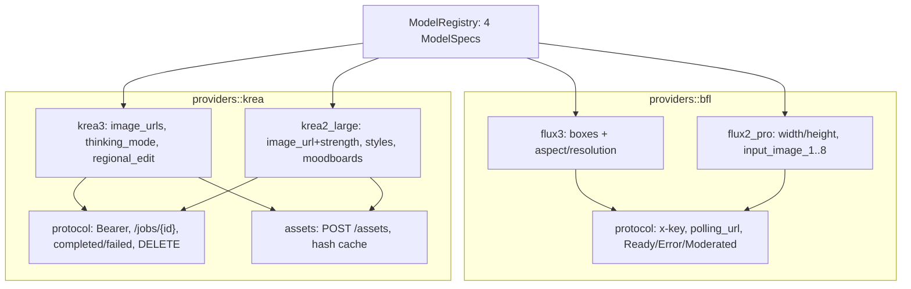
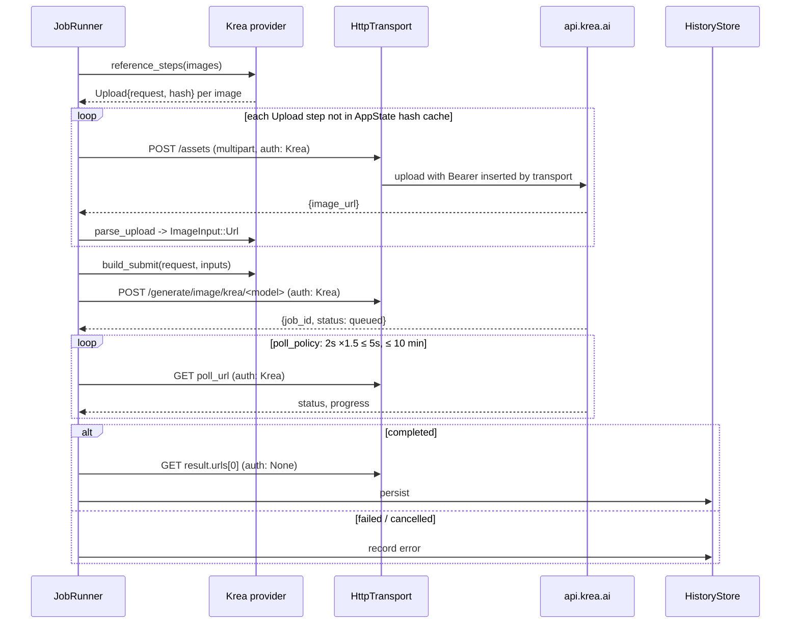
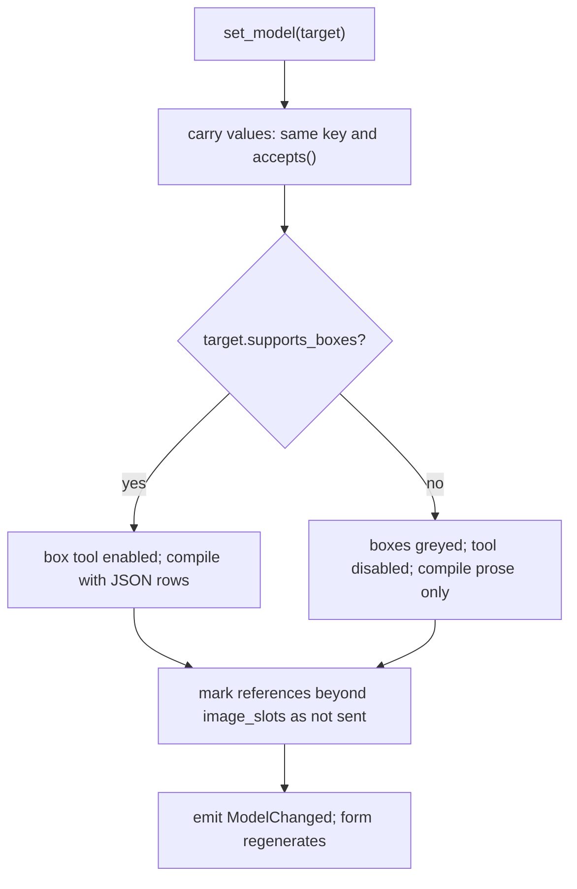

# Multi-Model Providers - Plan

Step 4 of the `easel` series. Builds on step 1 (`S1-KTD<N>`), step 2 (`S2-KTD<N>`), and step 3 (`docs/plans/2026-10-15-1725-feat-flux3-mvp-editor-plan.md`, cited `S3-KTD<N>`).

---

## Goal Capsule

- **Objective:** A user can pick any of the four documented models (FLUX 3, FLUX.2 [pro], Krea 3, Krea 2 Large), see and set every parameter that model accepts, send the current canvas and references to it, and get results into the same history, with the app being honest about what each model can and cannot do with boxes.
- **Means:** Three more `ModelSpec`s as data, a Krea provider implementing the step-3 `Provider` trait with its own protocol and asset upload, bearer auth and a second key, and a model switcher that regenerates the form and adjusts the canvas to the model's capabilities (KTD1–KTD10).
- **Authority hierarchy:** R-IDs govern behavior; KTDs govern mechanism; S1–S3 KTDs govern architecture and the FLUX 3 path, which this step must not regress.
- **Stop conditions:** Stop and report if the Krea 3 endpoint rejects the workspace as not in the beta (a 401/403 on every call); then ship FLUX.2 [pro] and Krea 2 Large and leave Krea 3 behind a visible "beta access required" state.
- **Execution profile:** Feature work. Core providers test-first against the live OpenAPI shapes; UI via `#[gpui::test]`; live smoke per model with real keys.
- **Finishes and ships:** Implementer lands on `main` after step 3.

---

## Product Contract

### Summary

Add FLUX.2 [pro] (BFL, width/height sizing, up to eight numbered reference images), Krea 3 (bearer auth, `GET /jobs/{id}` polling, `regional_edit`, no box input), and Krea 2 Large (img2img with strength, style references, LoRA styles, moodboards, creativity and slider parameters). Add a model switcher that carries compatible values across models, keeps boxes but makes them inert for models without box support, caps references per model, and routes Krea reference images through asset upload.

### Problem Frame

Step 3's abstractions (`ModelSpec` with capabilities, a `Provider` trait, a schema-driven form) exist so this step is mostly data plus one new protocol. The providers differ in ways that matter: BFL polls a returned URL with `x-key`; Krea polls a fixed `/jobs/{id}` with a bearer token, returns `result.urls[0]`, and documents `DELETE /jobs/{id}` for cancel. FLUX.2 [pro] sizes by `width`/`height` (multiples of 16, ≤ 4 MP) rather than aspect ratio and takes eight separate image fields. Krea wants `data:` URIs or uploaded asset URLs, not raw base64. Krea 3 is beta-gated and has no spatial input beyond a `regional_edit` flag; Krea 2 Large has no instruction editing at all, only img2img strength. The user asked for every parameter of each model to be settable, including LoRA style and moodboard ids that come from outside the API surface in this repo.

### Requirements

**Model selection**

- R1. A model select in the side panel header lists FLUX 3, FLUX.2 [pro], Krea 3, Krea 2 Large; switching regenerates the form from the new `ModelSpec`.
- R2. On switch, values carry over by key when the target schema has the same key and the value is valid there (`prompt`, `seed`, `safety_tolerance`, `aspect_ratio` when the value is in the new enum); everything else resets to the target's defaults.
- R3. For models without box support, existing boxes stay on the canvas greyed out, the box tool is disabled with a hint naming the model, and the compiled prompt is the prose only (no JSON suffix); switching back to FLUX 3 restores full behavior.
- R4. Reference images beyond the target model's capacity are kept in the strip but marked "not sent"; the validation summary says how many will be sent.
- R5. A job in flight when the model changes continues under its frozen request (S1-KTD8).

**Providers and auth**

- R6. Krea requests use `Authorization: Bearer <key>` resolved from `KREA_API_KEY`, the credential store, or session memory (S2-KTD5); the settings panel shows a Krea row with its own Test action.
- R7. Krea HTTP errors map to messages: 401 invalid key, 402 out of API balance (links to the Krea billing page), 429 concurrent job limit, 400 invalid body with the server message, 410 model sunset with the replacement named from the body.
- R8. Krea jobs poll `GET /jobs/{id}` every 2 s with backoff to 5 s; `backlogged`, `queued`, `scheduled`, `processing`, `sampling`, `intermediate-complete` are in flight with `progress`; `completed` downloads `result.urls[0]`; `failed` shows `error.code` and `error.message`; `cancelled` is terminal. The S3-R12a checks apply with Krea's allowlist (`ProviderId::Krea.allowed_hosts()`, extended from the first live observation and recorded in U7): `result.urls[0]` is fetched only if `https` on an allowed host, without the `Authorization` header, capped at 100 MB; server strings are sanitized and truncated before display.
- R9. Dismissing a Krea job also calls `DELETE /jobs/{id}` when the job is `queued` or `processing`; the local state is Dismissed regardless of the delete outcome. The id in the path is the validated `JobId` (S3-KTD4); no URL is ever built from a raw server string.
- R10. Krea reference images are uploaded via `POST /assets` (multipart) once per content hash per session and referenced by the returned URL. The multipart part uses a fixed filename `image.<ext>` derived from the sniffed MIME type, never the user's path. Inline `data:` URIs are not sent: the schema's `maxLength: 1024` on URL strings rules them out for any real image.
- R11. Deprecation headers (`Deprecation`, `Sunset`) on Krea responses produce a one-time informational toast per session naming the sunset date; `Sunset` is parsed as an HTTP-date and shown as "unknown date" if it does not parse. The raw header value is never displayed.

**FLUX.2 [pro]**

- R12. The form exposes `prompt`, `input_image` … `input_image_8` (filled from the reference strip in order), `seed`, `width`, `height`, `safety_tolerance`, `output_format`, `disable_pup`, `user`; `webhook_url` and `webhook_secret` are not exposed.
- R13. `width` and `height` validate as 0 (model decides) or integers ≥ 64 that are multiples of 16 with `width × height ≤ 4,000,000`; reference images are prepared under BFL rules (raw base64, S3-KTD7).
- R14. FLUX.2 [pro] uses the BFL protocol (S3-KTD4) unchanged; `safety_tolerance` above 5 is pre-clamped with a note, since the documented cap for FLUX.2 is 5.

**Krea 3**

- R15. The form exposes `prompt`, `thinking_mode` (`fast`, `high`), `image_urls` (from the strip, max 8), `resolution` (`1K`, `2K`), `aspect_ratio` (ten values, optional), `seed`, `regional_edit`.
- R16. `regional_edit: true` requires at least one reference image; validation says so.
- R17. A 401/403 from the Krea 3 endpoint with a valid key for other Krea endpoints is explained as "Krea 3 is in beta; your workspace needs access".

**Krea 2 Large**

- R18. The form exposes `prompt`, `aspect_ratio` (required, nine values), `resolution` (required, `1K` only), `seed`, `creativity` (`raw`, `low`, `medium`, `high`), `intensity`, `complexity`, `movement` (−100..100), `image_url` (from the strip's first image) with `strength` (0–1), `image_style_references` (up to 10 of url + strength from the strip's remaining images), `styles` (repeatable id + strength, −2..2), `moodboards` (one id + strength 0–1).
- R19. `styles` and `moodboards` ids are free-text entries with help text telling the user where ids come from (Krea web app / `GET /styles`); no browser is built.

**History**

- R20. History entries record the model id and provider; the strip shows a model badge; Compare restores the right model's form.
- R21. Krea results are downloaded on `completed` and persisted like BFL results; cost is shown as "not reported" for Krea.

### Key Decisions

- **Boxes are FLUX 3-only; other models get prose only.** Chosen over compiling boxes to spatial prose for Krea/FLUX.2, which would produce text the user did not write. Governs R3.
- **Krea references always go through asset upload.** The schema's `maxLength: 1024` on URL strings excludes inline data URIs for any image above a few hundred bytes; upload is the documented path and the only one implemented. Governs R10.
- **Every documented request parameter is exposed, except webhooks.** A desktop app polls; webhooks need a public endpoint. Governs R12, R15, R18.
- **Krea's `X-Api-Zero-Data-Retention` header is not sent in this step.** It is a header, not a request parameter, its billing and behavior implications are not documented in the excerpts, and a wrong default either leaks retention the user expected to avoid or silently changes cost. Deferred to follow-up as a per-provider setting; until then the Krea form help text says uploaded images may persist on Krea's side. Governs R10 and System-Wide Impact.
- **Style and moodboard ids are typed, not browsed.** The listing endpoints are outside the four documented models. Governs R19.

### Success Criteria

- Each of the four models completes one live text-to-image and, where supported, one image-input request from the UI, landing in history with the correct model badge.
- Switching FLUX 3 → Krea 3 → FLUX 3 leaves the box set and compiled JSON identical to before.

### Scope Boundaries

- No `flux-2-pro-preview` or other BFL endpoints beyond the two documented.
- No style training, moodboard creation, or `GET /styles` browser.
- No webhooks, zero-data-retention header (see Key Decisions), or Krea `user`-level features.
- No per-model cost estimation for Krea beyond the fixed price table in help text.

#### Deferred to Follow-Up Work

- Compile boxes to spatial prose for non-box models as an opt-in.
- Per-provider "zero data retention" setting that sends Krea's `X-Api-Zero-Data-Retention` header.
- A style/moodboard picker backed by `GET /styles`.
- Supporting `flux-2-pro-preview` as a variant of the FLUX.2 spec.
- Pre-flight cost estimates from the price tables.

---

## Planning Contract

### Key Technical Decisions

- KTD1. **No trait changes: the Krea provider implements S3-KTD13's `Provider` as defined, overriding `reference_steps`, `parse_upload`, `cancel_request`, and `poll_policy`, and inheriting the default prose-only `compile_prompt`.** `reference_steps` returns `Upload { request: POST /assets multipart, content_hash }` for every image (R10); the step-3 runner already executes `Upload` steps through the transport with the `AppState` hash cache, so the upload path needs no runner change beyond enabling `Body::Multipart` in the reqwest transport (KTD4). The provider never touches the transport or any gpui type (S1-R1).
- KTD2. **Keys are per `ProviderId` (S1-KTD6); the step-2 transport is the only place auth headers are built.** `HttpRequest.auth: Some(ProviderId::Krea)` makes the transport insert `Authorization: Bearer <key>` (S2-KTD4) using `AuthScheme::Bearer` from the provider's spec; the credential store entry is keyed by `ProviderId::Krea.base_url()` (S2-KTD5). The settings panel iterates `ProviderId` variants from a registry rather than hardcoding BFL.
- KTD3. **Krea protocol module `easel-core::providers::krea::protocol`: `parse_submit(&HttpResponse)` (200 job object with `job_id`, initial `status`) producing S3-KTD4's `Submitted { job_id, poll_url: <base_url>/jobs/<job_id>, quote: None }`, `parse_poll(&HttpResponse)` over the nine-status enum into the shared `PollOutcome` (`cancelled` → `Cancelled`), `parse_error` for `{error: string}` envelopes and the 410 `model_unavailable` body into `ProviderError::Gone { replacement, sunset }` (S1-KTD9), `deprecation_headers(&HttpResponse) -> Option<Sunset>`.** `result.urls` is a union in the live schema; parse the string-array form and treat other shapes as a protocol error.
- KTD4. **Krea asset upload: `POST /assets` multipart with `file`, described by the provider as an `Upload` step; the session cache `content_hash -> ImageInput` is the one S3-KTD13 placed in `AppState`.** This step implements the `Body::Multipart` variant that S2-KTD4 defined but left unexecuted (reqwest `multipart::Form`) and adds its mockito test. The part is named `file` with filename `image.<ext>` (R10). The upload request carries `auth: Some(Krea)` and is subject to the S2-R12a 180 s upload timeout. Reference images for Krea 3 are downscaled to ≤ 4 MP before upload (the service downscales anyway and charges more for 2K references).
- KTD5. **`FieldKind` gains `Repeated { item: Vec<FieldDef>, max }`; cross-field rules are `CrossRule` variants in `schema.rs` (S1-KTD7), not hooks.** `Repeated` renders as an add/remove list of sub-forms (for `styles`, `moodboards`, `image_style_references`). `size_control: WidthHeight` renders two number inputs; R13 is `CrossRule::MultipleOf { keys: [width, height], n: 16, exempt_zero: true }` plus `CrossRule::ZeroOrAtLeast { keys: [width, height], min: 64 }` (each dimension independently 0 or ≥ 64) plus `CrossRule::MaxArea { w: width, h: height, max: 4_000_000 }`; R16 is `CrossRule::RequiresImagesWhen { key: regional_edit, min: 1 }`. Constants that must be sent (`version`) use the existing `ReadOnly` kind; no `Hidden` kind is added.
- KTD6. **Model switch is `AppState::set_model(id)`: snapshot old values, build new defaults, carry over per R2 using `ParamSchema::accepts(key, value)`, then emit `ModelChanged`.** Canvas observes it to toggle box-tool enablement from `capabilities.supports_boxes`; prompt compilation always goes through the current provider's `compile_prompt` (S3-KTD13), which for every provider except FLUX 3 is the prose with `<id>` and `<ref_image_N>` tags removed and the removed tags listed as warnings in the preview and validation summary, so R3 holds without a flag and the stored prose is untouched. References strip observes `image_slots` to mark the "not sent" tail (R4) and labels each slot with the target model's field name from KTD7's mapping (`ref_image_N` for FLUX 3, `input_image`/`input_image_N` for FLUX.2 [pro], `image_urls[N]` for Krea 3, `image_url` then `style N` for Krea 2 Large). Image-count validation (S3-R8 via `validate_image_count`) counts only the images that will be sent, so an over-capacity strip marks a tail rather than blocking Generate.
- KTD7. **Image slot mapping is a pure function `map_images(slots, inputs) -> ImageFields`.** `List { max }` → one array key (`images` / `image_urls`); `Numbered { max }` → `input_image`, `input_image_2` … ; `Single` → `image_url`; `SingleWithStyleRefs { max_style_refs }` (the S1-KTD6 variant this step adds; Krea 2 Large uses `max_style_refs: 10`, `max()` = 11) → `image_url` from the first input and `image_style_references` from inputs 2..n with default strength 0.5, so `validate_image_count`, R4's not-sent marking, and `map_images` read one source of truth.
- KTD8. **Polling cadence per provider: BFL keeps S3-KTD5's defaults; Krea returns `PollPolicy { initial: 2 s, factor: 1.5, cap: 5 s, deadline: 10 min }` (Krea 2 Large is documented as slow).** Both are the S3-KTD5 type, returned from `Provider::poll_policy()`.
- KTD9. **FLUX.2 [pro] spec is a second `LazyLock` in `providers::bfl::flux2_pro` reusing the BFL protocol module.** `safety_tolerance` max is 5 in the schema (R14) even though the OpenAPI says 7. `output_format` default `jpeg`; download still sniffs magic bytes.
- KTD10. **Krea 3 is marked `beta: true` on its `ModelSpec`; the form header shows a beta badge and R17's message is produced only after the key is shown to work elsewhere.** On a 401/403 from a `beta: true` model the runner issues the settings Test probe (`GET /jobs/<random uuid>`, U1): if the probe also returns 401/403 the error is `Auth` (invalid key, links to settings); otherwise the beta message is shown. A plain 401 is never attributed to beta gating.

### High-Level Technical Design

Provider and model registry:

Krea job sequence with upload:

Model switch decision flow:

### Acceptance Examples

- AE1. Covers R2. **Given** FLUX 3 with `aspect_ratio` `21:9` and `safety_tolerance` 3, **when** switching to Krea 2 Large, **then** `aspect_ratio` resets to the default (21:9 is not in its enum) and `safety_tolerance` is absent (no such field); switching to Krea 3 keeps `21:9`.
- AE2. Covers R3. **Given** two boxes and prose with tags under FLUX 3, **when** switching to Krea 3, **then** the compiled prompt is the prose alone with no `<` tags, the preview warns which tags were removed, and the boxes render greyed; switching back restores the JSON suffix and the original prose unchanged.
- AE3. Covers R13. **Given** FLUX.2 [pro] with width 1000 and height 1000, **then** validation reports both as not multiples of 16; with 2048 × 2048 it reports the 4 MP limit; with 0 × 0 it passes.
- AE4. Covers R10. **Given** Krea 3 with a source image of any size, **when** generating, **then** one `POST /assets` with part filename `image.<ext>` precedes the generate call and `image_urls[0]` is the returned asset URL; a second generate with the same image performs no upload.
- AE5. Covers R16. **Given** Krea 3 with `regional_edit` true and no references, **then** Generate is blocked with "Regional edit needs a reference image".
- AE6. Covers R9. **Given** a Krea job in `processing`, **when** dismissed, **then** `DELETE /jobs/{id}` is sent once and the entry is Dismissed even if the delete returns 4xx.
- AE7. Covers R7. **Given** a Krea response 410 with `replacement` in the body, **then** the error message names the replacement model.
- AE8. Covers R18. **Given** Krea 2 Large with three references, **then** the request has `image_url` from the first and `image_style_references` with two entries at strength 0.5.

### Assumptions

- The Krea workspace used for development has API access and a prepaid balance; Krea 3 beta access may not be granted (stop condition covers it).
- Krea accepts `1K`/`2K` exactly as the OpenAPI spec casing (the overview page shows lowercase); the first live Krea 3 call verifies and the spec is corrected if needed.
- `width`/`height`/`negative_prompt` are not sent to Krea 3 because its spec has `additionalProperties: false`.

---

## Implementation Units

### U1. Provider registry, bearer auth, second key

- **Goal:** Providers and models are registered data; Krea auth and key management work end to end.
- **Requirements:** R6, R7
- **Dependencies:** step 3 complete
- **Files:** `crates/easel-core/src/providers/mod.rs` (`ModelRegistry` listing the four specs and their providers), `crates/easel/src/net/reqwest_transport.rs` (Bearer insertion for `AuthScheme::Bearer`; `Body::Multipart` encoding), `crates/easel/src/settings/mod.rs`, `crates/easel/src/settings/credentials.rs`, tests inline
- **Approach:** Implement KTD2 and KTD4's transport half; the `Provider` trait is unchanged (KTD1). Settings iterates the registry; Krea's Test action calls `GET /jobs/<fresh random UUID>` (documented in step 1's `krea.jobs.md`) and maps 401 to invalid key and any other status to "key accepted", mirroring the BFL test; the probe is exposed as a function the runner reuses for KTD10. Deprecation headers (R11) are U3's.
- **Test scenarios:**
  - The transport inserts `Authorization: Bearer <key>` marked sensitive for a request with `auth: Some(Krea)` and `x-key` for `auth: Some(Bfl)`, choosing by the provider's `AuthScheme`.
  - `resolve_key(ProviderId::Krea)` reads `KREA_API_KEY` first, then the store entry keyed by `ProviderId::Krea.base_url()`.
  - Multipart body with one file part serializes with a boundary and the `file` field name (mockito matcher on content type prefix and body containing the filename); the step-2 `Unsupported` error for `Multipart` no longer occurs.
  - `#[gpui::test]`: the settings panel renders one row per registered provider with independent Test results.
  - `format!("{:?}")` of a Bearer request after the transport has inserted the header contains `<redacted>` and no key.
- **Verification:** Both keys can be saved and tested from settings; logs contain neither.

### U2. FLUX.2 [pro] ModelSpec and request builder

- **Goal:** The FLUX.2 [pro] spec as data with width/height validation and numbered image slots.
- **Requirements:** R12, R13, R14
- **Dependencies:** U1
- **Files:** `crates/easel-core/src/providers/bfl/flux2_pro.rs`, `crates/easel-core/src/providers/bfl/mod.rs`, `crates/easel-core/src/schema.rs` (`CrossRule::MultipleOf`, `CrossRule::ZeroOrAtLeast`, `CrossRule::MaxArea` variants and their evaluation in `validate`), tests inline with an `insta` snapshot
- **Approach:** Implement KTD9 and KTD7's `Numbered` mapping. Fields per R12; `width`/`height` as `Int { min: 0, max: 4096, step: 16 }` plus the three `CrossRule`s from KTD5 in the spec's `cross_rules` (0 exempt). `user` as optional text. Reuse the BFL protocol module and `Provider` defaults without change; `ModelSpec` round-trips through serde with the rules present.
- **Test scenarios:**
  - Snapshot of a text-to-image body with seed 42, width 1024, height 768, `output_format: png`, `disable_pup: true`.
  - Three references map to `input_image`, `input_image_2`, `input_image_3` as raw base64; `validate_image_count(9)` for `Numbered { max: 8 }` returns a `FieldError`, and the strip marks the ninth as not sent (R4) rather than blocking Generate.
  - AE3 cases: 1000×1000 fails both fields; 2048×2048 fails the area rule; 0×0 passes; 1024×0 passes (each dimension independently 0 or ≥ 64); 48×1024 fails `width` on the ≥ 64 rule.
  - `safety_tolerance` 6 is clamped to 5 with a note before submit.
  - Poll outcome mapping reuses the BFL fixtures from step 3 (reference them, do not duplicate).
- **Verification:** Tests pass; a live FLUX.2 [pro] text-to-image and one edit with a reference complete from the UI.

### U3. Krea protocol and asset upload

- **Goal:** Pure Krea protocol parsing plus the upload step with hash caching.
- **Requirements:** R7, R8, R9, R10, R11
- **Dependencies:** U1
- **Files:** `crates/easel-core/src/providers/krea/mod.rs`, `crates/easel-core/src/providers/krea/protocol.rs`, `crates/easel-core/src/providers/krea/assets.rs`, fixtures in `crates/easel-core/tests/fixtures/krea/*.json`, `crates/easel/src/jobs/runner.rs` (call `cancel_request` on Dismiss when it returns `Some`; the upload path already exists from S3-U9), `crates/easel/src/app_state.rs` (R11 toast de-duplication per session), tests inline and `#[gpui::test]` with `FakeTransport`
- **Approach:** Implement KTD3, KTD4's provider half, KTD8's Krea policy. `reference_steps` yields one `Upload` step per image with the fixed part filename; `parse_upload` reads `image_url` from the asset response and validates it against Krea's allowlist; an upload failure fails the job with the Krea error mapping. `parse_submit` validates `job_id` as `JobId` and builds `poll_url` from `ProviderId::Krea.base_url()`, never from a server-supplied URL. `cancel_request` returns `DELETE <base_url>/jobs/<job_id>` only when the last known status was `queued` or `processing` (the provider receives the `Submitted` plus last `PollOutcome`), and the runner fires it without awaiting the outcome for the local state (R9).
- **Execution note:** Fixtures first: capture the live `GET /jobs/{id}` shapes (pending, completed, failed) and a `POST /assets` response during the first manual call and commit them. Scrub before committing: replace asset and result URLs (which may carry signed query strings) with `https://example.invalid/...`, and replace job, workspace, and user ids with fixed values; the step-1 CI grep (S1-U4) is the backstop.
- **Test scenarios:**
  - Submit 200 body yields `Submitted { job_id, poll_url: "https://api.krea.ai/jobs/<job_id>", quote: None }`.
  - Each of the six in-flight statuses → `InFlight` with `progress`; `completed` with `result.urls: ["https://..."]` → `Ready { url, settled_cost: None, .. }`; `failed` with `error.code/message` → `Failed(Protocol)` carrying both; `cancelled` → `PollOutcome::Cancelled`, which `advance` maps to `Dismissed`.
  - `result.urls` as an object map → `Failed(Protocol("unexpected result shape"))`.
  - 401 → Auth; 402 → OutOfCredits with the billing hint; 429 → `RateLimited { retry_after: None }`; 400 → Validation with the server's `error` text; 410 body → `Gone { replacement: Some(..), sunset: Some(..) }` (AE7).
  - `deprecation_headers` parses `Sunset` into a date; absent headers → `None`; a `Sunset` value that is not an HTTP-date → `Some(Sunset::Unknown)` and the toast says "unknown date".
  - `#[gpui::test]`: a response carrying `Deprecation: true` and `Sunset` produces one toast; a second such response in the same session produces none (R11).
  - `reference_steps`: a 5 MB JPEG and a 100 KB PNG each yield one `Upload` step whose request is `POST /assets` with `auth: Some(Krea)` and a multipart `file` part named `image.jpg` / `image.png` (never the source path); `parse_upload` of the asset fixture yields `ImageInput::Url`; an asset response whose URL is off the Krea allowlist → `Err(Protocol)`.
  - A submit body with `job_id` `../x` → `Err(Protocol)`; a `completed` poll whose `result.urls[0]` is `https://evil.example/r.png` → `Failed(Protocol)` with the "unexpected result host" message.
  - A 410 body whose `replacement` is 10 KB is retained ≤ 64 KB and rendered ≤ 2 KB in the strip (S3-R12a).
  - `#[gpui::test]` runner script: upload → submit → `queued` → `processing` → `completed` → download → Done, with intervals 2 s, 3 s, 4.5 s, 5 s; a second job with the same image performs no upload (AE4, via the S3-U9 cache); `FakeTransport` records `auth: None` on the download request.
  - `#[gpui::test]`: Dismiss during `processing` sends `DELETE /jobs/{id}` once; a 404 from delete still yields Dismissed (AE6); Dismiss after `completed` sends nothing.
  - `#[gpui::test]`: 10-minute deadline for Krea vs 5 for BFL (virtual clock).
- **Verification:** Tests pass; a live Krea 2 Large text-to-image completes from the UI.

### U4. Krea 3 ModelSpec

- **Goal:** Krea 3 as data with its validation rules and beta handling.
- **Requirements:** R15, R16, R17
- **Dependencies:** U3
- **Files:** `crates/easel-core/src/providers/krea/krea3.rs`, `crates/easel-core/src/schema.rs` (`CrossRule::RequiresImagesWhen`), tests inline with an `insta` snapshot
- **Approach:** Implement KTD10. `image_slots: List { max: 8 }` → `image_urls`; `aspect_ratio` optional with an "automatic" empty choice; `thinking_mode` default `fast`; `CrossRule::RequiresImagesWhen { key: regional_edit, min: 1 }` for R16 (variant added to `schema.rs`). Help text on `thinking_mode: high` notes the extra cost.
- **Test scenarios:**
  - Snapshot of a body with two `image_urls`, `thinking_mode: high`, `resolution: 2K`, `regional_edit: true`, `seed: 7`.
  - `regional_edit: true` with zero images fails validation on `regional_edit` (AE5); with one image passes.
  - Omitted `aspect_ratio` is not serialized.
  - `#[gpui::test]` with `FakeTransport`: a 401 on the Krea 3 submit followed by a 404 from the `GET /jobs/<uuid>` probe yields the beta message; a 401 followed by a 401 from the probe yields `Auth` with the settings link and no beta message (KTD10).
- **Verification:** Tests pass; if beta access exists, one live Krea 3 edit completes; otherwise the beta message is shown and noted in the PR.

### U5. Krea 2 Large ModelSpec

- **Goal:** Krea 2 Large as data including img2img, style references, LoRA styles, moodboards, and sliders.
- **Requirements:** R18, R19
- **Dependencies:** U3, KTD5's `Repeated`
- **Files:** `crates/easel-core/src/providers/krea/krea2_large.rs`, `crates/easel-core/src/schema.rs` (`Repeated`), `crates/easel-core/src/model_spec.rs` (`ImageSlots::SingleWithStyleRefs`), tests inline with an `insta` snapshot
- **Approach:** Implement KTD7's `SingleWithStyleRefs { max_style_refs: 10 }` routing and KTD5's `Repeated` for `styles` (id + strength −2..2), `moodboards` (max 1; id uuid-validated + strength 0–1 default 0.23), `image_style_references` (populated from references 2..n with editable strength 0–1 default 0.5). `strength` for `image_url` defaults 0.99 and is only serialized when `image_url` is present. `creativity` default `low` is always serialized (the overview and spec disagree on the default).
- **Test scenarios:**
  - Snapshot of a body with `aspect_ratio: 3:2`, `resolution: 1K`, `creativity: medium`, `intensity: 40`, two styles, one moodboard.
  - Missing `aspect_ratio` or `resolution` fails validation (required).
  - Three references → `image_url` + two `image_style_references` at 0.5 (AE8); zero references → neither key and no `strength`; `validate_image_count(11)` passes and `12` returns a `FieldError`.
  - A moodboard id that is not a UUID fails validation; a second moodboard entry is refused by `Repeated.max`.
  - Slider values outside −100..100 fail; `strength` 1.5 fails.
- **Verification:** Tests pass; live text-to-image and img2img (with strength 0.6) complete from the UI.

### U6. Model switcher UI and capability adaptation

- **Goal:** Switching models regenerates the form, carries values, adapts boxes and references, and badges history.
- **Requirements:** R1, R2, R3, R4, R5, R20
- **Dependencies:** U2, U4, U5, step-3 UI
- **Files:** `crates/easel/src/app_state.rs`, `crates/easel/src/side_panel/mod.rs`, `crates/easel/src/side_panel/schema_form.rs` (`Repeated`, `WidthHeight` rendering), `crates/easel/src/side_panel/prompt_editor.rs` (compile through the current provider), `crates/easel/src/side_panel/references.rs`, `crates/easel/src/canvas/boxes.rs`, `crates/easel/src/bottom_strip.rs`, `crates/easel-core/src/schema.rs` (`accepts`), tests `#[gpui::test]`
- **Approach:** Implement KTD6. The prompt editor and the submit path call `current_provider().compile_prompt(scene, frame)` instead of the FLUX 3 function directly, so the JSON suffix appears only for FLUX 3; greyed boxes use 40% opacity and no handles. Reference tail marking per R4. History entries already store `model_id` and `provider` in `meta.json` (S3-KTD8); the strip reads them for the badge, and Compare calls `set_model` before restoring values.
- **Test scenarios:**
  - `#[gpui::test]`: AE1 carry-over cases for FLUX 3 → Krea 2 Large and FLUX 3 → Krea 3.
  - `#[gpui::test]`: AE2 box behavior across FLUX 3 → Krea 3 → FLUX 3; compiled JSON identical before and after.
  - `#[gpui::test]`: with 9 references, switching to Krea 2 Large marks none as unsent (1 + 8 style refs ≤ 11) and labels them `image_url`, `style 1` … `style 8`; switching to FLUX.2 [pro] marks the ninth as unsent (max 8), labels the rest `input_image` … `input_image_8`, and Generate stays enabled.
  - `#[gpui::test]`: a job in flight when the model changes still completes under its original model id.
  - `#[gpui::test]`: `Repeated` field adds and removes entries and refuses beyond `max`; `WidthHeight` renders two number inputs and shows AE3 errors inline.
  - Smoke: the model badge on history entries matches the model used; Compare on a Krea entry switches the form to Krea.
- **Verification:** Success criterion "switch and back leaves boxes and JSON identical" holds in the UI.

### U7. Documentation and protocol notes update

- **Goal:** `docs/api/` reflects what live calls revealed; README lists the four models and their capabilities.
- **Requirements:** R19 (help text sources), plus Definition of Done
- **Dependencies:** U2–U6 live smoke
- **Files:** `docs/api/krea.jobs.md`, `docs/api/krea.assets.md`, `docs/api/bfl.get-result.md`, `README.md`, `crates/easel-core/src/model_spec.rs` (extend `ProviderId::Krea.allowed_hosts()` with the hosts observed live)
- **Approach:** Record observed `result.urls` shapes, resolution casing, any `additionalProperties` rejections, the FLUX.2 `safety_tolerance` cap, and the Krea 3 beta status at the time of landing. Add a capability table (boxes, image inputs, size control, auth) to the README. Add every result and asset host seen in the live smoke to `allowed_hosts()`.
- **Test scenarios:**
  - `ProviderId::Krea.allows_url(..)` is true for each recorded live result and asset host.
- **Verification:** Each live finding that changed a spec has a matching doc line.

---

## Verification Contract

| Check | Command | Applies to | Pass signal |
|---|---|---|---|
| Format and lint | `cargo fmt --check`; `cargo clippy --workspace --all-targets -- -D warnings` | all | clean |
| Core tests and snapshots | `cargo nextest run -p easel-core` | U1–U5 | pass; snapshots reviewed |
| App tests | `cargo nextest run -p easel` | U1, U3, U6 | pass |
| FLUX 3 regression | step-3 golden tests and live F1 | all | unchanged |
| Live smoke per model (keys required) | `cargo run -p easel` | U2, U4, U5, U6 | one text-to-image per model; one image-input request for FLUX.2 [pro], Krea 3 (if beta), Krea 2 Large |
| Cancel path | dismiss a Krea job mid-processing | U3 | `DELETE` observed in logs (redacted), entry Dismissed |

---

## Definition of Done

- All Verification Contract rows pass; live costs for each model noted in the PR.
- Every parameter in the four request schemas (except webhook fields) is reachable in the UI for its model.
- Step-3 FLUX 3 behavior is unchanged (goldens, live F1).
- `docs/api/` updated with live findings; README capability table present.
- Abandoned experiments removed; no `todo!()`.
- Per unit: U1 auth/registry; U2 FLUX.2 validation and slots; U3 Krea protocol and upload; U4/U5 specs and snapshots; U6 switcher behaviors; U7 docs.

---

## System-Wide Impact

- **Second credential and second billing relationship.** Krea's API balance is separate from its web app credits; the 402 message links to the billing page.
- **Uploads leave the machine before generation.** Krea asset upload sends reference images to Krea storage under a fixed filename; retention and whether the returned asset URL is fetchable without authentication are not documented, so the Krea form help text says images may persist on Krea's side. `X-Api-Zero-Data-Retention` is deliberately not sent (Key Decisions).
- **Data lifecycle:** asset URL cache is session-only and asset URLs are never persisted; nothing new persists beyond history entries with `model_id` and `provider`.
- **Trust boundary extends to a second host set.** Krea's allowlist (`api.krea.ai`, `.krea.ai`) gates uploads' returned URLs, result downloads, and nothing else; `poll_url` and the cancel URL are built locally from `base_url()` and the validated `JobId`.

---

## Risks & Dependencies

- **Krea 3 beta gating** may block live verification; the stop condition ships the other three.
- **Spec vs. docs disagreements on Krea** (resolution casing, `width`/`height`, `creativity` default). Built against the OpenAPI spec; the first live calls settle them and U7 records the outcome.
- **`result.urls` union type.** Only the string-array form is handled; others fail clearly.
- **Krea result and asset hosts unknown.** The allowlist starts at `api.krea.ai` plus the `.krea.ai` suffix; a CDN host elsewhere fails with the distinct "unexpected result host" message on the first live call and is added to `allowed_hosts()` and `docs/api/krea.jobs.md` in U7.
- **Krea rate limiting via `backlogged`** rather than 429 means a job can sit in flight for a long time; the 10-minute deadline bounds it.
- **FLUX.2 width/height constraints** (multiples of 16, 4 MP) come from BFL's client validator, not the OpenAPI; a 422 would still be handled by the step-3 mapping if the real rule differs.

---

## Sources & Research

- Local schemas: `docs/api/flux.2-pro.md`, `docs/api/krea.3.md`, `docs/api/krea.2.large.md`
- Step-1 protocol notes: `docs/api/krea.jobs.md`, `docs/api/krea.assets.md`, `docs/api/bfl.get-result.md`
- Krea job lifecycle, rate limits, deprecations, webhooks: https://www.krea.ai/docs/developers/job-lifecycle, https://www.krea.ai/docs/developers/rate-limits, https://www.krea.ai/docs/developers/deprecations
- Krea API keys and billing: https://www.krea.ai/docs/developers/api-keys-and-billing
- Krea 3 overview (beta, `regional_edit`, pricing, reference downscaling): https://www.krea.ai/docs/developers/krea-3/overview
- Krea 2 overview, style transfer, moodboards: https://www.krea.ai/docs/developers/krea-2/overview, https://www.krea.ai/docs/developers/krea-2/style-transfer, https://www.krea.ai/docs/developers/krea-2/moodboards
- Krea assets endpoint: https://www.krea.ai/docs/api-reference/assets/upload-an-asset; Krea OpenAPI: https://api.krea.ai/openapi.json
- FLUX.2 [pro] reference, multi-reference budget, editing: https://docs.bfl.ml/api-reference/models/generate-or-edit-an-image-with-flux2-[pro], https://docs.bfl.ml/guides/prompting_editing_multi_reference, https://docs.bfl.ml/flux_2/flux2_image_editing
- FLUX.2 width/height constraints and `safety_tolerance` cap: https://github.com/black-forest-labs/skills/tree/HEAD/skills/bfl-api, https://docs.bfl.ml/api_integration/errors
