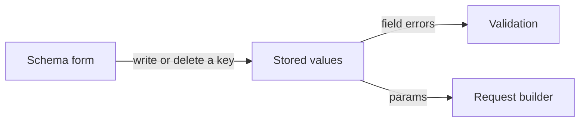

# Model Parameter Forms - Plan

## Goal Capsule

- **Objective:** For whichever model is selected, a person can change every parameter that model accepts, and generation sends those settings.
- **Means:** The side panel builds one control per field on that model's schema (KTD1, KTD2).
- **Authority hierarchy:** R-IDs govern behavior. KTDs govern mechanism. `docs/api/` is the checklist of parameters. Existing request builders stay the authority for what is sent.
- **Stop conditions:** Stop and report if a schema field uses a kind the widgets cannot show. Do not add a widget crate.
- **Execution profile:** Feature work. Prove it with widget tests against each model's schema, and keep the existing FLUX 3 form tests passing.
- **Finishes and ships:** The implementer lands the form on the current branch.

---

## Product Contract

### Summary

The editor will show an editable control for every parameter on the selected model: FLUX 3, FLUX.2 [pro], Krea 3, and Krea 2 Large. Switching models shows that model's parameters, and the values in those controls are what generation sends. The prompt editor, the compiled-prompt readout, and the reference strip stay as they are.

### Problem Frame

On Krea 3, thinking mode, seed, and regional edit are plain text. Resolution and aspect ratio are menus only because those names match the five FLUX 3 controls the form was built around. The other models have the same hole: their schemas already list the parameters, and the panel prints any unmatched field as text.

### Requirements

**Shared**

- R1. Every field on the active model's schema is a control. A read-only field is shown disabled. A new field cannot fall through to plain text.
- R2. Changing a control stores the value the request builder already reads, and a blank optional scalar removes its key while 0 and false stay stored.
- R3. Switching models rebuilds the controls from the new schema and shows the values the switch kept.
- R4. Each control shows the field's label and help.
- R5. Validation text and the Generate button keep using the existing field errors. A failing value leaves Generate disabled.

**Per model**

- R6. FLUX 3 still edits aspect ratio, resolution, safety tolerance, and grounding, and still shows version disabled. Choosing an aspect ratio still updates the canvas framing. An approved safety cap still shrinks the safety control.
- R7. FLUX.2 [pro] edits seed, width, height, safety tolerance, output format, disable prompt upsampling, and user. `docs/api/flux.2-pro.md` is the checklist. Reference images stay on the strip.
- R8. Krea 3 edits thinking mode, resolution, aspect ratio, seed, and regional edit. `docs/api/krea.3.md` is the checklist. Aspect ratio can be cleared. Regional edit can be turned on, and Generate stays disabled until a reference image is present.
- R9. Krea 2 Large edits aspect ratio, resolution, seed, creativity, intensity, complexity, movement, strength, styles, and moodboards. `docs/api/krea.2.large.md` is the checklist. Aspect ratio is required before Generate enables. Styles and moodboards are typed ids with a strength, added and removed as rows, up to the schema maximum.

### Key Decisions

- **Reference images stay on the reference strip.** They fill each model's image slots. (session-settled: user-approved — chosen over image fields in the form: confirmed in scope). Governs R7, R9.
- **Style and moodboard entries stay typed ids with a strength.** (session-settled: user-approved — chosen over a catalog browser: confirmed in scope). Governs R9.

### Scope Boundaries

The prompt editor, compiled prompt, reference strip, providers, auth, upload, and history compare stay as they are. Webhook fields stay off the form. No new models.

#### Deferred to Follow-Up Work

- Revisit FLUX.2 [pro] safety tolerance. The checked-in OpenAPI property allows 0 through 7, and the spec caps the field at 5.
- Revisit width and height against `docs/api/flux.2-pro.md`. The spec adds a multiple-of-16 rule and a 4 megapixel cap that the OpenAPI property bounds do not state.
- Revisit Krea 3 `thinking_mode` being required in the spec while the OpenAPI required list names only `prompt`. The deprecation table in `docs/api/krea.3.md` names that field as both the old and the new name, so this plan leaves the field in place.
- Revisit the styles list maximum. The spec caps it at 16. The OpenAPI schema does not.

### Acceptance Examples

- AE1. Covers R8. **Given** Krea 3, **when** thinking mode is set to high, seed to 7, and regional edit is turned on with no reference image, **then** those values are stored and Generate is disabled until a reference image exists.
- AE2. Covers R2, R8. **Given** Krea 3 with an aspect ratio chosen, **when** the blank aspect choice is picked, **then** the key is gone from the stored values.
- AE3. Covers R3, R7. **Given** Krea 3 with seed 7, **when** the model switches to FLUX.2 [pro], **then** seed is still 7, width shows its default, and thinking mode has no control.
- AE4. Covers R5, R9. **Given** Krea 2 Large, **when** a moodboard row has an id that is not a UUID, **then** validation names the UUID failure and Generate is disabled. A well-formed id and strength clear that error.
- AE5. Covers R6. **Given** FLUX 3, **when** aspect ratio changes, **then** the canvas framing changes and version stays disabled at latest.

---

## Planning Contract

### Key Technical Decisions

- KTD1. **One form walks the active schema and rebuilds its controls when the model id changes.** The current form constructs FLUX 3's aspect, resolution, safety, grounding, and version up front, then prints every other key as muted text. Reusing those five widgets by key also leaves the safety slider on a 0 to 7 range after a switch. Rebuild on model change, then push stored values into the live controls when the app state changes, including session load and an approved safety cap.
- KTD2. **Controls follow the table in High-Level Technical Design.** Every Int is stored as a JSON integer, whether the control is a slider, a number field, or text. A whole float passes the field range check and is skipped by the width and height cross rules, which read integers only. Floats stay floats. Sliders snap to the field step before that integer is stored. A blank optional control deletes the key. Select and integer validation both reject null, so a stored null would not survive a model switch.
- KTD3. **Label and help are drawn once, through `field_row`.** The control's own label and help stay empty, because those widgets already call `field_row` themselves.
- KTD4. **Two field keys keep a side effect.** FLUX 3 `aspect_ratio` writes the scene framing, including when the form rebuilds onto FLUX 3 from a carried value. Other models leave the scene ratio alone. The safety control still accepts the existing approved-max shrink. No other key gets a special case.
- KTD5. **Request builders and schema ranges stay put.** The form displays the spec. The doc deltas in Deferred to Follow-Up Work are recorded there so a later pass can retune them without this form work depending on that retune.
- KTD6. **Slider, checkbox, and number-step element ids include the entity id.** They are fixed strings today (`slider`, `checkbox`, `number-step-up`). Select already keys its id with the entity id. A second copy in one window collides, and Krea 2 Large needs three sliders.

A per-model form was the other concrete option. It would duplicate the four specs that already exist and would bring this same bug back the next time a field is added. That choice did not need a bake-off. Both shapes were already visible in the code, and reversing a schema-driven form later is cheap.

### High-Level Technical Design

Stored values flow from the form through the map generation already reads. Validation and the request builder do not grow a second copy of the parameters.

| Kind | Control | Blank |
| --- | --- | --- |
| Select, required | Menu of the schema options | Placeholder until a choice is stored |
| Select, optional | Menu plus a blank row that is not a schema option | Blank row deletes the key |
| Bool | Checkbox | false is stored |
| Int, required or defaulted, and `(max - min) / step` at most 200 | Slider, snapped to step, stored as an integer | Shows the default |
| Int whose every value is exact in a float, and every Float | Number field | An Int is stored as a JSON integer. A Float stays a float. Deletes the key only when the field is optional and has no default. 0 is stored |
| Int whose maximum is `i64::MAX`, such as seed | Single-line text, parsed as an integer | Empty text deletes the key. A float cannot round-trip that range |
| Text, Uuid | Single-line text | Deletes the key when the field is optional and the text is empty |
| ReadOnly | Disabled text of the locked value | The user cannot change it |
| Repeated | Add and remove rows, up to `max`, each row the item fields | An empty list is left empty. The Krea 2 builder already skips an empty array |

### Sequencing

U1 lands the scalar controls and the model switch. U2 adds repeated rows on that same form.

---

## Implementation Units

### U1. Scalar controls from the schema

- **Goal:** Each non-repeated field is a control, and switching models shows the new field's control with the carried value.
- **Requirements:** R2, R3, R4, R5, R6, R7, R8
- **Dependencies:** none
- **Files:** `crates/easel/src/side_panel/schema_form.rs`, `crates/easel/src/side_panel/form_tests.rs`, `crates/easel/src/widgets/number_input.rs`, `crates/easel/src/widgets/slider.rs`, `crates/easel/src/widgets/checkbox.rs`
- **Approach:**
  1. Replace the five fixed widgets with controls built from the active schema, per KTD1 and KTD2. Repeated fields stay for U2.
  2. Give the number field a blank state for an optional value with no default. Its current setter only applies a numeric value, and an empty commit does nothing.
  3. Parse seed as text per the control table. Do not store it through the number field.
  4. Give slider, checkbox, and number-step unique element ids per KTD6.
  5. Keep the FLUX 3 aspect and safety behavior in KTD4. Do not write `scene.aspect_ratio` for any other model. `2.35:1` is a Krea 2 Large option, and `Scene::frame` only parses integer sides, so that string clears the virtual frame. When the form rebuilds onto FLUX 3, copy the stored aspect onto the scene.
  6. Draw label and help with `field_row` per KTD3.
  7. Update the form tests that assume the FLUX 3 widget fields. `field_count` today reports the FLUX 3 schema length from inside the form.
- **Patterns to follow:** `crates/easel/src/widgets/` for Select, Slider, Checkbox, TextInput, and NumberInput. `AppState::set_model` for which values survive a switch. `widgets::field_row` for label and help.
- **Test scenarios:**
  - On Krea 3, set thinking mode to high, seed to 7, and regional edit to true. The stored values match. Clearing the seed text removes the key. The stored seed for `9007199254740993` is that integer, not a nearby float.
  - On Krea 3, choose an aspect ratio, then choose the blank row. The aspect key is absent. Resolution stays a menu whose options are 1K and 2K.
  - On FLUX.2 [pro], the safety slider's maximum is the schema maximum, width shows 0, and clearing seed removes the key while width 0 stays stored as an integer. Width 100 is stored as an integer, fails the multiple-of-16 check, and disables Generate.
  - On FLUX.2 [pro], an empty user field removes the key. A non-empty user string is stored.
  - Switching from Krea 3 with seed 7 to FLUX.2 [pro] keeps seed 7 and shows width at its default. Switching back to FLUX 3 restores a disabled version of latest and an enabled aspect menu.
  - On Krea 2 Large, choosing 4:3 leaves the scene ratio unchanged. Switching back to FLUX 3 copies 4:3 onto the scene.
  - On Krea 2 Large, choosing `2.35:1` stores that aspect and leaves `scene.aspect_ratio` unchanged. Two sliders in that form both move, which fails today because they share one element id.
  - On FLUX 3, choosing 16:9 writes the scene framing. Applying an approved safety maximum of 4 shrinks the slider and stores a value inside that range.
  - The existing case of boxes with aspect auto still disables Generate, and setting a fixed aspect enables it again.
  - A field help string is visible under its control, and the control is not labeled a second time.
- **Verification:** The Krea 3 fields from the screenshot are controls. FLUX 3's existing form tests still pass. No non-repeated schema field renders as muted text. Repeated fields are still U2.

### U2. Repeated style and moodboard rows

- **Goal:** Krea 2 Large styles and moodboards can be added, edited, and removed, and a bad row blocks Generate.
- **Requirements:** R1, R2, R5, R9
- **Dependencies:** U1
- **Files:** `crates/easel/src/side_panel/schema_form.rs`, `crates/easel/src/side_panel/form_tests.rs`
- **Approach:**
  1. Render `Repeated` as rows of the item fields, using the same control rules as U1.
  2. Add is available until the schema maximum. Remove deletes that row.
  3. Store a JSON array of objects under the field key. An empty list stays an empty array so the existing builder skips it.
  4. Add and remove use `Button::ghost`.
- **Patterns to follow:** The styles and moodboards shapes already built in `crates/easel-core/src/providers/krea/krea2_large.rs`, and the UUID check in schema validation.
- **Test scenarios:**
  - Add two style rows, set ids and strengths, and the stored array matches those objects in order. Remove the first row and the remaining row is the second style.
  - The add control stops at the schema maximum.
  - A moodboard id that is not a UUID surfaces the existing UUID validation message and Generate is disabled. Replacing it with `11111111-1111-4111-8111-111111111111` clears that message.
  - With no rows, the stored list is empty and does not by itself disable Generate. Aspect ratio still does, until one of the nine ratios is chosen.
  - Strength on the source image is a number field at its default. It stays visible with no source image.
- **Verification:** A Krea 2 Large form can express the styles and moodboard example the request builder tests already send, and invalid rows cannot generate.

---

## Verification Contract

Widget tests cover the scenarios in U1 and U2, including the existing FLUX 3 cases in `crates/easel/src/side_panel/form_tests.rs`.

The repo gate is `cargo fmt --check`, `cargo clippy --workspace --all-targets -- -D warnings`, and `cargo nextest run -p easel`.

A visual pass is the user driving the window. Pointer injection is unreliable on this desktop and is not part of the gate.

---

## Definition of Done

- R1 through R9 hold, and AE1 through AE5 pass in widget tests.
- U1 and U2 verification outcomes hold.
- The repo gate is clean.
- Abandoned experiments are not left in the diff.

---

## System-Wide Impact

- **Unchanged integration surfaces:** Session save, history compare, and the request builders all read the same value map. The form writes that map and does not add keys. Compare still replaces the editor body with its own readout. Returning from compare shows the live controls again.

---

## Risks & Dependencies

- **The slider is continuous, and the number field emits a float.** Snapping and integer storage in KTD2 keep width, height, and safety tolerance visible to the cross rules.
- **The number field cannot show blank today.** An optional number with no default needs that state, or an empty field is stored as the minimum. Seed is text, so this is not the seed path.
- **Rebuilding controls on every redraw would drop focus.** Rebuild only when the model id changes.

---

## Sources & Research

- Official parameter lists: `docs/api/flux.3.md`, `docs/api/flux.2-pro.md`, `docs/api/krea.3.md`, `docs/api/krea.2.large.md`.
- The muted-text fallback and the five fixed controls: `crates/easel/src/side_panel/schema_form.rs`.
- Value carry on switch: `AppState::set_model` in `crates/easel/src/app_state.rs`.
- Field kinds, including `Repeated`: `crates/easel-core/src/schema.rs`.
- Specs: `crates/easel-core/src/providers/bfl/flux3.rs`, `crates/easel-core/src/providers/bfl/flux2_pro.rs`, `crates/easel-core/src/providers/krea/krea3.rs`, `crates/easel-core/src/providers/krea/krea2_large.rs`.
- The earlier provider plan that introduced these specs: `docs/plans/2026-10-15-1726-feat-multi-model-providers-plan.md`.
- No `docs/solutions/` corpus exists for this repo. Nothing there constrained the form.
