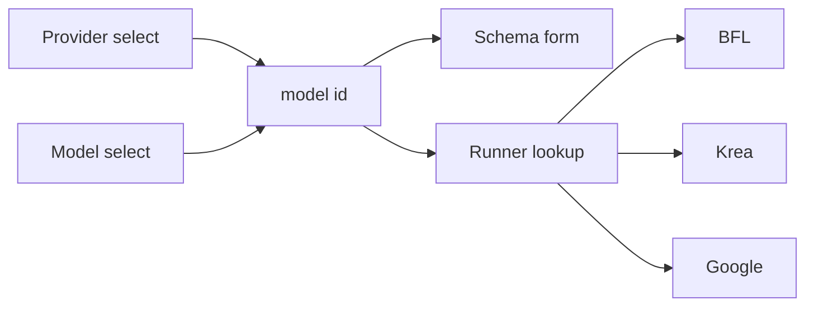
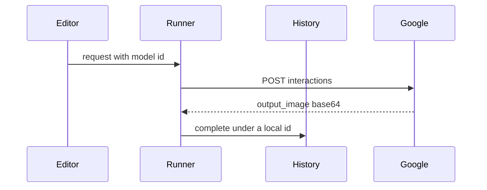
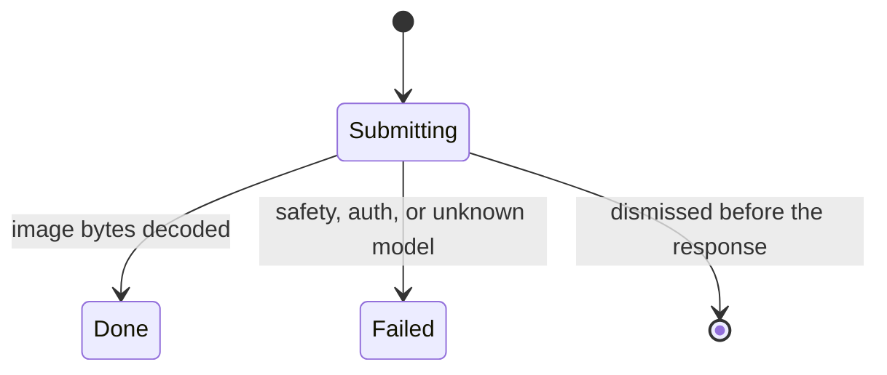

# Google Image Models - Plan

## Goal Capsule

- **Objective:** A person can pick Google, pick one of its three image models, and get a generated or edited picture into the same history as Black Forest Labs and Krea.
- **Means:** A Google provider on the Interactions API, with the header choosing the provider and the editor body choosing the model (KTD4).
- **Authority hierarchy:** R-IDs govern behavior. KTDs govern mechanism. `docs/api/` is the parameter checklist. Existing BFL and Krea request builders stay the authority for those providers.
- **Stop conditions:** Stop and report if a live call returns the picture only as a URI on a host other than `generativelanguage.googleapis.com`. Do not GET that host.
- **Execution profile:** Feature work. Prove the request and the history write with tests before wiring the selects.
- **Finishes and ships:** The implementer lands the work on the current branch.

---

## Product Contract

### Summary

Google joins Black Forest Labs and Krea. The Editor header lists providers. The first control in the scrolling editor body lists that provider's models, and the parameter form follows the selected model. Generate still sends one request and puts the picture in history. Google covers text-to-image and editing with the canvas and reference images, plus aspect ratio, image size, and web search grounding on the models that support it.

### Problem Frame

The header lists every model in one menu, and Generate always talks to FLUX 3. Krea is selectable and still does not run from that button. Google's image call returns the picture on the same response, and the history path only stores a picture after a later download. A person who picks Google today would still hit Black Forest Labs, and a finished Google image would have nowhere to land.

### Key Decisions

- **Three current Google models.** Nano Banana 2.1, Nano Banana 2 Lite, and Nano Banana Pro. (session-settled: user-directed — chosen over every model on the image guide, including previous-generation and legacy ids: those three are the current lineup.) Governs R1.
- **Web search grounding is in.** Multi-turn editing, video input, and image search stay out. (session-settled: user-directed — chosen over deferring grounding with the other extras: grounding is part of this pass.) Governs R5, R8, R12.
- **Model menu placement.** The model menu is the first control in the scrolling editor body. (session-settled: user-directed — chosen over placing it with the parameters: it sits under the provider header.) Governs R2.

### Requirements

**Choosing a model**

- R1. The person can generate and edit with Nano Banana 2.1 (`gemini-nano-banana-2.1`), Nano Banana 2 Lite (`gemini-3.1-flash-lite-image`), and Nano Banana Pro (`gemini-3-pro-image`).
- R2. The Editor header lists providers. The first control in the scrolling editor body lists only that provider's models.
- R3. Switching provider or model keeps the prompt, the canvas, the boxes, and the references, and the form shows only fields that model accepts.
- R4. Generate sends the model that was selected when the click happened. Black Forest Labs and Krea keep their current requests.

**Google request**

- R5. Search grounding can be turned on for Nano Banana 2.1 and Nano Banana Pro. Nano Banana 2 Lite has no grounding control.
- R12. The grounding control says Google keeps the prompt and the output for 30 days. Turning grounding off is how the person avoids that copy.
- R6. Aspect ratio and image size are limited to what that model documents. The four wide ratios exist only on Nano Banana 2.1. Lite offers 1K only.
- R7. References travel with the request, canvas first, up to 14. A body over 20 MB does not send.
- R8. Multi-turn editing, video input, and image search are not offered.

**Results**

- R9. A successful Google image appears in history and the strip the same way a finished Black Forest Labs image does.
- R10. A safety block, a rejected key, and an unknown model leave a failed history row and no image.
- R11. When grounding ran, Compare shows the suggestion text with the stored result. The app does not fetch citation URLs.

### Success Criteria

- Picking Google, picking Nano Banana 2.1, and generating puts a picture in the history strip.
- A FLUX 3 generate still posts to Black Forest Labs, and a Krea generate posts to Krea.
- Existing FLUX and Krea form and switch tests still pass.

### Scope Boundaries

- The three models, the provider and model menus, one-shot generate and edit, web search grounding, and a result that lands in the existing history.
- Reference images stay one flat list. The API's object, character, and style splits are not separate controls.
- Boxes stay on the canvas and stay inert for Google, the same way they stay inert for models that do not read boxes.
- The status bar keeps showing Black Forest Labs credits. Google has no balance line in this pass.

#### Deferred to Follow-Up Work

- Multi-turn editing through a previous interaction id.
- Video-to-image.
- Image search as a search type, and any gallery of source images.
- A thinking-level control and a gallery of thought images.
- A web view that draws the suggestion HTML with its own CSS.
- Background polling, if a live 4K call dies at the server's usual request deadline.
- Role labels on references, and saving extra references across restart.

### Acceptance Examples

- AE1. Switch from Nano Banana 2.1 to Lite.
  - **Covers:** R3, R5, R6
  - **Given:** 2.1 is selected, grounding is on, and the ratio is `1:8`.
  - **When:** the person picks Nano Banana 2 Lite.
  - **Then:** the form has no grounding control and no wide ratio, and the size is 1K.
- AE2. Safety block.
  - **Covers:** R10
  - **Given:** the Google key is present and the POST returns HTTP 400 with code `image_safety` and no image bytes.
  - **When:** Generate finishes.
  - **Then:** history has a failed row, the strip says the request was blocked by safety, and no result file is written.
- AE3. Grounded compare.
  - **Covers:** R11
  - **Given:** a finished 2.1 job stored a suggestion string and a citation URL was present on the response.
  - **When:** the person opens Compare for that job.
  - **Then:** the suggestion string is visible as text, and no request is made to the citation URL.

---

## Planning Contract

### Key Technical Decisions

- KTD1. **Interactions POST, current schema.** Google calls `POST https://generativelanguage.googleapis.com/v1beta/interactions` with `Content-Type: application/json` and reads base64 from `output_image.data`. The request omits `Api-Revision` and omits `delivery`. The image guide's May samples still send `Api-Revision: 2026-05-20`. After 8 June 2026 that header is ignored, and the live samples omit it. `delivery` is left unset because a community report says sending it is rejected, and the working samples do not set it.
- KTD2. **Local history id, no poll.** The history directory is a new id that already passes `JobId::parse`. The interaction id is stored on the job meta and is not the directory name. Published examples are 70 characters, and `JobId` stops at 64. `advance` today maps every submit to `Polling`, and the runner then schedules a poll. Google needs a new job event that `advance` maps from `Submitting` to `Done`. A provider method defaults to "no inline image". Google overrides it and returns the decoded bytes and the response mime. BFL and Krea still return a poll URL and enter `Polling`. The runner does not skip `advance` and mark `Done` on its own. A crash during the POST leaves no row. A dropped connection fails the live slot and does not retry.
- KTD3. **One runner, a provider on each slot.** `JobRunner` stops being generic. Root, the side panel, the strip, and the status bar share one entity, and the type parameter is part of that entity. Swapping it for another provider builds a different entity and drops in-flight jobs. Every slot today calls the runner's single provider, so one monomorphized runner cannot poll FLUX while it posts to Krea. Each slot holds the provider resolved from the snapshotted model id. The live resolver is a registry lookup in `easel-core`. Tests pass their own resolver, because the unregistered `Krea` test provider and `UploadFlux` are not in the registry. The slot's provider drives cancel, the key check, poll, download, sunset headers, and the upload cache. The cache key is the provider id plus the content hash. An unknown model id fails the slot and does not send HTTP. Resume of a BFL row resolves `flux-3-image` onto that slot. Resume of any other in-flight provider fails the row and does not resolve a provider. In-flight jobs are not retargeted when the editor model changes.
- KTD4. **Two selects, one model id.** The header options are `ProviderId::display_name` values from `ModelRegistry::providers`. Changing the header calls `set_model` with the last model id used for that provider in this process, or the first registered spec for that provider. Google's first spec is Nano Banana 2.1, then Lite, then Pro. The body select lists that provider's specs and calls `set_model` with the chosen id. The header observe writes the provider name. The body observe writes the model name. `Select::set_options` fills both lists when the registry or the provider changes.
- KTD5. **Grounding is a checkbox, and the suggestion string is stored verbatim.** 2.1 and Pro have a schema bool, default off. On sends `tools` with one `google_search` object and no `search_types`. Off omits `tools`. Lite has no field. Every one-shot Google body sends `store: false` and does not send `background`. The suggestion HTML is stored unmodified on the job meta. Compare shows that string as plain text under the prompt, cut only by the existing detail limit. The app does not parse the HTML, does not turn it into links, and does not GET `url_citation` URLs. Thought images are dropped. `output_image` is the file that is saved. A web view was the other way to satisfy the grounding terms. It did not qualify for a bake-off: both options are concrete, the app has no web view, and a widget crate is out of bounds. Storing the unmodified string leaves a later renderer possible. The terms want that HTML shown with its CSS beside the result. Plain text does not meet that. See Risks.
- KTD6. **Key and host.** `ProviderId::Google` uses env `GEMINI_API_KEY`, `AuthScheme::HeaderKey` with header `x-goog-api-key`, and allows only `generativelanguage.googleapis.com`. The key never goes in the query string. `apply_auth` marks the header sensitive. `credential_name` also matches `x-goog-api-key`, so a header that skips `apply_auth` is still redacted. Debug logs print the full URL. Settings probes with `GET https://generativelanguage.googleapis.com/v1beta/models`. HTTP 401 means the key is bad. Any other status means the key was accepted. The probe does not POST `/interactions`.
- KTD7. **Per-model schema.** 2.1 offers `1K`, `2K`, and `4K`, the standard ratios, and `1:4`, `4:1`, `1:8`, `8:1`. Pro offers `1K`, `2K`, and `4K` and the standard ratios, without those four wide ratios. Lite offers `1K` and the ten standard ratios, and has no grounding field. `512` is not offered. All three use `ImageSlots::List` with max 14 and `supports_boxes: false`. The prep key stays `resolution`. The value `4k` is the only one that raises input prep to 16 megapixels. `4K` on the Google size field maps to that prep value. Every other size stays on the 4 megapixel prep path. On the wire, aspect ratio and size are not flat keys. They go inside `response_format` with `type` `image`, `aspect_ratio`, and `image_size` using an uppercase K. The prompt is an `input` text block. Each reference is an `input` image block with `mime_type` and base64 `data`. The canvas image comes before the other references. Response `mime_type` is trusted. The bytes are written as returned, with no second encode.
- KTD8. **Failures and the 20 MB gate.** Before POST, a JSON body over 20 MB disables Generate with a message that names the 20 MB cap and tells the person to remove a reference. The response read cap stays 100 MB. The client timeout stays the existing long budget, and a timeout is not retried. HTTP 400 `safety`, `image_safety`, `image_prohibited_content`, `image_recitation`, or `image_other`, plus HTTP 401 and HTTP 404 `model_not_found`, write a `Failed` row under the local id, store no image, and do not retry. Those five HTTP 400 codes share the strip line "blocked by safety". That row exists only when `request.json`, `meta.json`, and a terminal index row are written together. `fail` and `complete` read an existing meta and cannot create this row. The strip lines are "blocked by safety", "authentication failed", and "model not found". Dismiss during the POST drops a late body and writes nothing. A missing key still disables Generate before HTTP, with the existing "No {name} API key — open Settings" line.
- KTD9. **Provider stamp, old rows unchanged.** `HistoryStore::begin` writes the spec's provider id for new jobs. Existing files keep the literal `bfl`, including Krea rows that were stamped that way. Resume does not treat `provider == "bfl"` as "poll with BFL". For a row whose stored provider is `bfl`, it keeps today's host allowlist. Any other in-flight provider is marked failed and does not send HTTP, per the resume rule in KTD3. A missing `provider` is not filled in as `bfl`. New meta fields, including the interaction id, use a serde default so old files still load, and later `fail`, `complete`, and `set_state` write those fields back. Startup does not gain a resume call.
- KTD10. **Compare reconciles values.** Compare still switches to the stored model and opens the inspection body. The values it writes back go through `reconcile_values`, so a 2.1-only ratio does not stick on Pro or Lite. The suggestion string is not a schema field.

### High-Level Technical Design

The header and the body select both write `AppState.model_id`. The form, validation, and prompt compile read that id through the registry. Generate snapshots the id onto the request. The runner looks the id up and keeps that provider on the slot.

Black Forest Labs and Krea still submit, poll, and download. Google submits once and completes from the response bytes.

A Google job does not enter `Polling`.

### System-Wide Impact

- **Runner entity.** Root builds one `JobRunner` and clones it into the side panel, the strip, and the status bar. Those four holders, plus `generate_tests.rs`, `bottom_strip_tests.rs`, `krea_tests.rs`, and the tests in `runner.rs`, name `JobRunner<Flux3>` today. KTD3 removes the type parameter. Credit fetches stay on `ProviderId::Bfl`.
- **Job state.** `advance` in `crates/easel-core/src/job.rs` is the only state change. The new inline-image event is applied there. The runner does not assign `Done` beside it.
- **History files.** New jobs record the real provider id. Old rows stay on disk as written. A Google failure is a terminal index row with `request.json` and `meta.json`, or it is not a row. An in-flight row with no `poll_url` is skipped by resume and kept by eviction.
- **Keys.** The Google key uses the same env, credential store, and session path as BFL and Krea. It is not written into `request.json` or the history index.
- **Krea sunset.** Sunset headers are read from the slot's provider. The existing watch on this entity starts seeing Krea responses once those jobs run on the live runner.

### Risks & Dependencies

- **Grounding terms.** The Additional Terms require the suggestion HTML to be shown unmodified, with its CSS, beside the grounded result. KTD5 stores that string and shows it as plain text. That is short of the terms. Do not fetch citation URLs, and do not rewrite the HTML to match the app theme.
- **Google keeps a copy.** Omitting `store` leaves the Interactions default, which keeps the prompt and the image on Google. KTD5 sends `store: false` on one-shot calls. Grounding has a separate 30-day copy of prompts and output, and `store: false` does not clear it. R12 is the control the person sees. Paid and free retention windows disagree across Google's own pages, so this plan does not name a number for the default `store` window.
- **Server deadline.** Ordinary HTTP calls are described as closing around 60 seconds. Image samples are still one synchronous POST. A 4K call may return `deadline_exceeded` before the client budget ends. Do not turn on `background` until a live call shows that failure. A timeout stays a failed slot and is not retried, per KTD2.
- **Aspect-ratio docs disagree.** The AI Studio render attributes the wide ratios to 2.1 and to the deprecated Flash Image model. The model card for 2.1 names those ratios. Lite's card names the ten standard ratios and also says "14 aspect ratios" without listing the wide ones. KTD7 follows the named lists. A live acceptance of a wide ratio on Lite or Pro is a schema change, not a silent send.
- **SynthID.** The watermark is in the pixels. A second encode can weaken it. KTD7 saves the returned bytes.

### Sources & Research

- Image guide: https://ai.google.dev/gemini-api/docs/image-generation (same guide as https://aistudio.google.com/docs/image-generation)
- Interactions overview and the June 2026 schema break: https://ai.google.dev/gemini-api/docs/interactions-overview and https://ai.google.dev/gemini-api/docs/interactions-breaking-changes-may-2026
- Deprecations: https://ai.google.dev/gemini-api/docs/deprecations
- Errors and safety: https://ai.google.dev/gemini-api/docs/api-errors and https://ai.google.dev/gemini-api/docs/safety-settings
- Grounding terms: https://ai.google.dev/gemini-api/terms and https://ai.google.dev/gemini-api/docs/grounding/search-suggestions
- API key header: https://ai.google.dev/gemini-api/docs/api-key
- Local constraints: `JobRunner` is generic over one provider and `Root` constructs `JobRunner<Flux3>`. `PollOutcome::Ready` is the only path into a download. `HistoryStore::begin` writes `provider: "bfl"`. `JobId::parse` allows 1 to 64 characters from letters, digits, `_`, and `-`. The header `Select` is filled once from model display names in `crates/easel/src/side_panel/mod.rs`.

---

## Implementation Units

### U1. Google identity and three model specs

- **Goal:** Google is a provider with a key row, a host allowlist, and three specs the registry lists.
- **Requirements:** R1, R5, R6
- **Dependencies:** none
- **Files:**
  - `crates/easel-core/src/model_spec.rs`
  - `crates/easel-core/src/providers/mod.rs`
  - `crates/easel-core/src/providers/google/mod.rs`
  - `crates/easel/src/settings/mod.rs`
  - `crates/easel/src/net/reqwest_transport.rs`
  - `docs/api/google.image.md`
- **Approach:** Add `ProviderId::Google` and the three unit structs beside the existing BFL and Krea specs. Register them from `ModelRegistry::specs` and `providers` in the order 2.1, Lite, Pro. Schemas follow KTD7. The checklist in `docs/api/google.image.md` lists the fields each spec sends. The settings row appears because `providers()` grew an entry. The probe follows KTD6.
- **Patterns to follow:** `crates/easel-core/src/providers/bfl/flux3.rs` for a `LazyLock` spec and a schema bool. `crates/easel/src/settings/mod.rs` `key_probe` for a GET that does not create a job.
- **Test scenarios:**
  - Registering the registry includes `gemini-nano-banana-2.1`, `gemini-3.1-flash-lite-image`, and `gemini-3-pro-image`, and `providers()` includes Google.
  - 2.1 schema accepts `1K`, `2K`, `4K`, ratio `1:8`, and grounding true. It rejects `512`.
  - Pro schema accepts `4K` and `16:9`. It rejects ratio `1:8` and rejects a grounding key only if that key is absent. Grounding true is accepted.
  - Lite schema accepts size `1K` and ratio `1:1`. It rejects `4K`, ratio `1:8`, and a grounding value.
  - `ProviderId::Google` allows `https://generativelanguage.googleapis.com/v1beta/interactions` and rejects `https://evil.example/x` and an `http` URL.
  - The settings probe is a GET to the models URL with header `x-goog-api-key`. The URL has no `key` query parameter.
  - A logged request redacts `x-goog-api-key` even when the header is not marked sensitive. The request URL has no key query parameter. `request.json` does not contain the key.
- **Verification:** The three ids resolve from the registry, Lite cannot accept grounding, and the settings row can be built for Google without a POST.

### U2. Send the selected model's request

- **Goal:** Generate posts to the provider that owns the snapshotted model id.
- **Requirements:** R4, R6, R7
- **Dependencies:** U1
- **Files:**
  - `crates/easel/src/jobs/runner.rs`
  - `crates/easel/src/jobs/submit.rs`
  - `crates/easel/src/root.rs`
  - `crates/easel/src/side_panel/mod.rs`
  - `crates/easel/src/bottom_strip.rs`
  - `crates/easel/src/status_bar.rs`
  - `crates/easel/src/app_state.rs`
  - `crates/easel/src/jobs/krea_tests.rs`
  - `crates/easel/src/bottom_strip_tests.rs`
  - `crates/easel/src/side_panel/generate_tests.rs`
- **Approach:** Follow KTD3. `field_errors` and `compiled` use the same registry lookup as the runner, and stop falling through to FLUX 3. Google compile uses the default tag strip and does not embed box rows. The credits request stays on `ProviderId::Bfl` and does not follow the selected model. Changing the editor model after `build_request` does not change the queued request. The Google body includes `store: false` per KTD5. Its JSON shape follows KTD7.
- **Execution note:** Start from a failing test that a Google model id posts to `generativelanguage.googleapis.com` and a FLUX id still posts to `api.bfl.ai`.
- **Patterns to follow:** `Flux3::build_submit` for copying schema values into JSON. The Krea runner tests for a provider that is not FLUX 3.
- **Test scenarios:**
  - A request whose model id is `gemini-nano-banana-2.1`, size `2K`, and ratio `16:9` is posted to `https://generativelanguage.googleapis.com/v1beta/interactions`. `response_format` carries `type` `image`, `aspect_ratio` `16:9`, and `image_size` `2K`. `input` starts with the prompt text block, then the canvas image block with `mime_type` and base64 `data`. The JSON has `store: false`, and has no `Api-Revision`, no `delivery`, no `background`, and no `image_search`. Aspect ratio and size are not top-level keys.
  - An unknown model id fails the slot and records no HTTP request.
  - The same click path with `flux-3-image` still posts to `api.bfl.ai`.
  - A request whose model id is `krea-3` posts to `api.krea.ai`.
  - Google compile of a prompt that contains a box tag does not include a box row. The tag is reported as removed.
  - `field_errors` for a Google id does not report a missing FLUX field.
  - Building a request, then switching the editor model, leaves the queued model id unchanged.
- **Verification:** One generate path reaches BFL, Krea, and Google. The status bar still requests BFL credits only.

### U3. Finish a Google job from the response bytes

- **Goal:** A Google response becomes a history image or a failed row, without a poll.
- **Requirements:** R9, R10
- **Dependencies:** U2
- **Files:**
  - `crates/easel/src/jobs/runner.rs`
  - `crates/easel-core/src/job.rs`
  - `crates/easel-core/src/history.rs`
  - `crates/easel-core/src/providers/google/mod.rs`
  - `crates/easel-core/src/providers/mod.rs`
- **Approach:** Follow KTD2, KTD8, and KTD9. The new event goes through `advance`. Decode `output_image.data` and pass the response mime into history. Store the interaction id on meta. `begin` records the real provider id for new jobs. A safety, 401, or 404 row is created as a terminal index entry with `request.json` and `meta.json`, not by calling `fail` on an id that was never begun.
- **Execution note:** Add the history test before changing `begin`, so a BFL row is shown to keep `provider: "bfl"` when the literal is removed.
- **Patterns to follow:** `HistoryStore::complete` for the result file and thumbnail. BFL `parse_submit` for rejecting a bad id, with the difference that Google mints the directory id locally.
- **Test scenarios:**
  - A response with `output_image.data` set to a tiny PNG base64 writes `result.png` under a local id. Meta has no `poll_url`. The interaction id on meta is the 70-character sample and is not the directory name.
  - JPEG `mime_type` writes `result.jpg`. The file bytes match the decoded payload.
  - HTTP 400 `image_safety` with no image writes `Failed`, the strip line is "blocked by safety", and no GET is issued.
  - HTTP 400 `image_prohibited_content` does the same.
  - HTTP 401 writes `Failed` with "authentication failed". HTTP 404 `model_not_found` writes `Failed` with "model not found".
  - Dismiss while the POST is in flight drops a late body and writes no row.
  - A BFL submit still writes `provider: "bfl"` and still polls.
  - Resume on an in-flight row with provider `google` marks it failed and sends no HTTP.
  - An old meta file with no interaction-id field still loads. The next `complete` writes the field back as empty rather than dropping the rest of the meta.
  - A stored provider `bfl` with a Krea poll URL is not polled as BFL. The host allowlist still rejects it.
- **Verification:** A fixture response lands a result file. A safety fixture lands a failed row. BFL polling tests still pass.

### U4. Provider header and model body

- **Goal:** The header lists providers and the body lists that provider's models.
- **Requirements:** R2, R3
- **Dependencies:** U1
- **Files:**
  - `crates/easel/src/side_panel/mod.rs`
  - `crates/easel/src/side_panel/switch_tests.rs`
  - `crates/easel/src/session.rs`
- **Approach:** Follow KTD4. The model select is the first child of the scrolling editor body, above the inspector. Switching provider does not cancel in-flight jobs. Session restore still assigns `model_id` when the id is registered. Both selects then show the provider and the model for that id.
- **Patterns to follow:** The existing header `Select` in `SidePanel::new`, plus `Select::set_options`. `AppState::set_model` for value carry.
- **Test scenarios:**
  - Opening the editor shows provider names in the header, including Google, Black Forest Labs, and Krea. The header does not list `FLUX 3`.
  - With Google selected, the body lists Nano Banana 2.1, Nano Banana 2 Lite, and Nano Banana Pro, and does not list FLUX 3.
  - Choosing Krea in the header lists Krea's models and selects the first Krea spec when that provider has not been used yet.
  - Choosing Google after using Pro earlier in the process selects Pro again.
  - Switching from 2.1 to Lite keeps the prompt text and drops grounding from the form, per AE1.
  - Restoring a session whose `model_id` is `gemini-3-pro-image` shows Google in the header and Nano Banana Pro in the body.
- **Verification:** Widget tests read the header options and the body options from the entities. FLUX and Krea switch tests still pass.

### U5. Grounding text, compare, and the 20 MB gate

- **Goal:** Grounding is optional, its suggestion text survives in Compare, and an oversized body never sends.
- **Requirements:** R5, R7, R8, R11, R12
- **Dependencies:** U1, U2, U3, U4
- **Files:**
  - `crates/easel-core/src/providers/google/mod.rs`
  - `crates/easel/src/jobs/submit.rs`
  - `crates/easel/src/jobs/promote.rs`
  - `crates/easel/src/bottom_strip.rs`
  - `crates/easel/src/side_panel/validation.rs`
  - `crates/easel-core/src/history.rs`
- **Approach:** The checkbox and the JSON follow KTD5 and KTD7. Compare follows KTD10. The 20 MB check follows KTD8 and counts the JSON that would be posted, including base64 images. Suggestion text is loaded with the history entry and rendered as text in the inspection body.
- **Patterns to follow:** FLUX 3's `grounding` bool for the checkbox. `inspection_from` for the compare rows.
- **Test scenarios:**
  - Grounding off on 2.1 omits `tools`. Grounding on sends one `google_search` tool and does not send `image_search`. The control's help text says Google keeps the prompt and the output for 30 days.
  - Lite build has no `tools` key and no grounding field in the form.
  - A response that includes a suggestion string and a `url_citation` stores the suggestion string. Compare shows that string as text immediately under the prompt and above the parameter rows. The test transport records no request to the citation host.
  - Compare of a 2.1 job with ratio `1:8`, opened so the editor had been on Pro, leaves the editor on 2.1 with `1:8` still accepted. Opening that job's params onto Pro through reconcile drops `1:8`.
  - A prepared body of 20 MB plus one byte disables Generate and does not POST. A body of exactly 20 MB stays enabled.
  - Fourteen references are accepted on each Google model. The fifteenth extra is kept in the strip and is not sent.
- **Verification:** AE3 is covered by the compare test. Generate stays disabled over 20 MB. Citation URLs are absent from the recorded requests.

---

## Verification Contract

| Check | Command | Applies to |
|---|---|---|
| Format | `cargo fmt --check` | All units |
| Lint | `cargo clippy --workspace --all-targets -- -D warnings` | All units |
| Core tests | `cargo nextest run -p easel-core` | U1, U3, U5 |
| App tests | `cargo nextest run -p easel` | U2, U3, U4, U5 |

Widget tests read bounds from the entity. Do not drive the window with injected clicks. A visual pass is the person running the app and confirming the header lists providers and the body lists models.

## Definition of Done

- U1 through U5 meet their verification lines, and the commands in the Verification Contract pass.
- AE1, AE2, and AE3 have a test each.
- Abandoned experiments are not left in the diff.
- `docs/api/google.image.md` matches the fields the three specs send.
