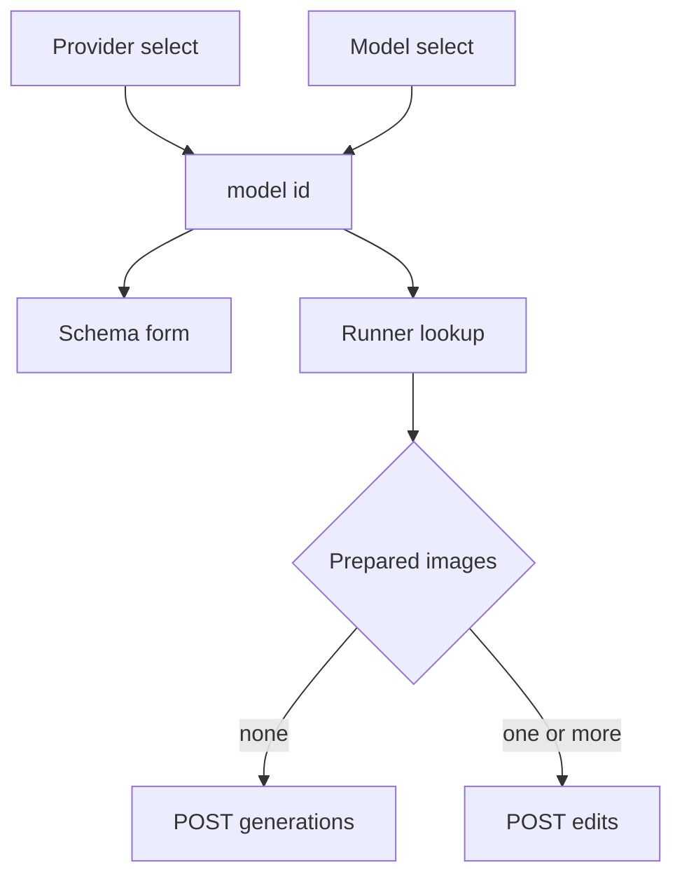
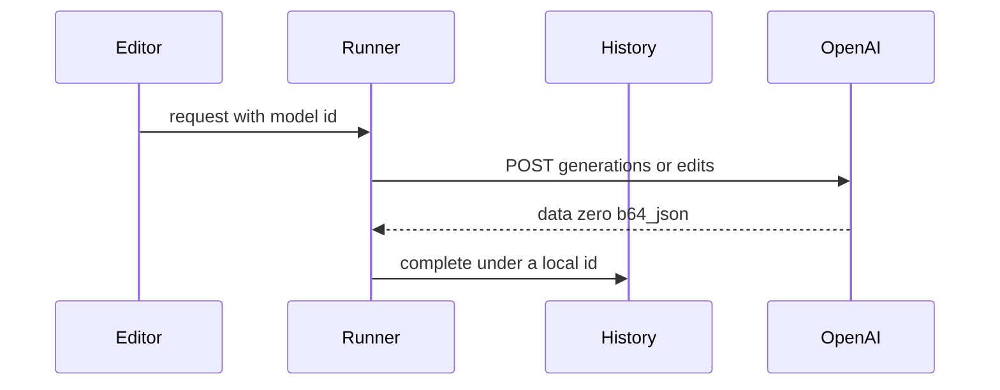
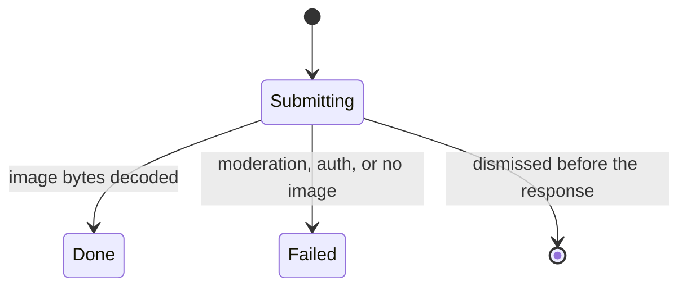

# OpenAI Image Models - Plan

## Goal Capsule

- **Objective:** A person can pick OpenAI, pick one of its six GPT Image models, and get a generated or edited picture into the same history as Black Forest Labs, Krea, and Google.
- **Means:** An OpenAI provider on the Images API, using the provider header and model body from the Google plan (KTD1).
- **Authority hierarchy:** R-IDs govern behavior. KTDs govern mechanism. `docs/api/openai.create.md` and `docs/api/openai.edit.md` are the parameter checklist. The Google plan stays the authority for the runner, the history stamp, and the two selects.
- **Stop conditions:** Stop if a successful response returns the picture only as a URL. Leave that URL unfetched.
- **Execution profile:** Feature work. Prove the request body and the failure mapping with tests before treating the selects as done.
- **Finishes and ships:** The implementer lands the work on the current branch.

---

## Product Contract

### Summary

OpenAI joins Black Forest Labs, Krea, and Google. A person picks OpenAI, picks one of the six current GPT Image models, and Generate puts one picture in the existing history. Create and edit both count. The form shows quality, size, and background, plus input fidelity on the gpt-image-1 family when the request is an edit.

### Problem Frame

The header lists providers, and the body lists the selected provider's models. A same-response picture can already land in history. OpenAI is not a provider, so a person cannot pick it, and a GPT Image response is not decoded.

### Key Decisions

- **Six current GPT Image models.** `gpt-image-1`, `gpt-image-1-mini`, `gpt-image-1.5`, `gpt-image-2`, `gpt-image-2.5-sunburst`, and `gpt-image-2.5-flare`. (session-settled: user-approved, chosen over only the two 2.5 models: the confirmed lineup is these six ids.) Conflict: `gpt-image-1` shuts down on 2026-10-23, and `gpt-image-1-mini` and `gpt-image-1.5` shut down on 2026-12-01. The lineup stays. The menu leads with a model that has no shutdown row. Governs R1, R2.
- **One finished picture.** Generate waits for the final image. (session-settled: user-approved, chosen over showing partial images: streaming stays out.) Governs R8, R9.
- **Boxes stay on the canvas.** They are not an edit mask. (session-settled: user-approved, chosen over wiring canvas boxes to the mask: boxes stay inert.) Governs R3, R8.
- **Three standard sizes.** `1024x1024`, `1536x1024`, and `1024x1536`. (session-settled: user-approved, chosen over free width and height and sizes above 2560 on the long edge: the form offers those three strings.) Governs R5, R8.

### Requirements

**Choosing a model**

- R1. The person can generate and edit with `gpt-image-1`, `gpt-image-1-mini`, `gpt-image-1.5`, `gpt-image-2`, `gpt-image-2.5-sunburst`, and `gpt-image-2.5-flare`.
- R2. With OpenAI selected, the model list is those six ids, in this order: Flare, Sunburst, GPT Image 2, GPT Image 1.5, GPT Image 1 mini, GPT Image 1. The three shutting-down display names include the date, `2026-12-01` for 1.5 and mini, and `2026-10-23` for GPT Image 1.
- R3. Switching provider or model keeps the prompt, the canvas, the boxes, and the references, and drops a quality or fidelity value the new model does not offer.
- R4. Generate sends the model that was selected when the click happened. Black Forest Labs, Krea, and Google keep their current requests.

**OpenAI request**

- R5. Every model offers quality, size, and background. Quality is `low`, `medium`, `high`, and `auto`, and the two 2.5 models also offer `xhigh` and `max`. Size is the three strings in the size decision. Background is `transparent`, `opaque`, and `auto`.
- R6. Input fidelity is `high` or `low` on `gpt-image-1` and `gpt-image-1.5`, and `low` only on `gpt-image-1-mini`. It is sent only on an edit. `gpt-image-2` and both 2.5 models have no fidelity control.
- R7. References travel with the request, canvas first when a canvas image exists. The edit array holds at most 16 prepared images, and the canvas counts toward that 16 when it is present. A prompt over 32000 characters does not send. An image data URL over 20971520 characters does not send.
- R8. Streaming, masks, more than one output image, a moderation control, compression, an output-format picker, free-form size, DALL-E, dated snapshots, and `chatgpt-image-latest` are not offered.

**Results**

- R9. A successful OpenAI image appears in history and the strip the same way a finished Black Forest Labs image does.
- R10. A moderation block, a rejected key, and a body with no usable image leave a failed history row and no image file. The empty or URL-only body shows the strip line "no usable image".
- R11. A missing key disables Generate before HTTP, with the existing no-key line. Settings has an OpenAI key row. The status bar does not show an OpenAI balance.

### Success Criteria

- Picking OpenAI, picking GPT Image 2.5 Flare, and generating puts a picture in the history strip.
- A FLUX 3 generate still posts to Black Forest Labs.
- Switching from Flare with quality `max` to GPT Image 2 removes `max`.
- Existing FLUX and Krea form and switch tests still pass.

### Scope Boundaries

- The six models, one-shot generate and edit, quality, the three sizes, background, input fidelity on edits for the gpt-image-1 family, and a result that lands in the existing history.
- Boxes stay on the canvas and stay out of the prompt.
- The status bar keeps showing Black Forest Labs credits.

#### Deferred to Follow-Up Work

- Streaming partial images.
- An edit mask taken from the canvas boxes.
- Free-form `WIDTHxHEIGHT` and resolutions above 2560 on the long edge.
- More than one output image per click.
- Moderation, output format, and compression controls.
- A form line about the 30-day abuse log and about a flagged reference image being kept for review.
- Uploads through the File API.
- An OpenAI balance in the status bar.

### Acceptance Examples

- AE1. Switch from Flare to GPT Image 2.
  - **Covers:** R3, R5, R6
  - **Given:** Flare is selected and quality is `max`.
  - **When:** the person picks GPT Image 2.
  - **Then:** quality is no longer `max`, and the form has no fidelity control.
- AE2. References and no canvas.
  - **Covers:** R6, R7
  - **Given:** the canvas is empty and two reference images are attached.
  - **When:** Generate runs on `gpt-image-1.5` with fidelity `high`.
  - **Then:** the request is an edit, both references are on it, and fidelity is `high`.
- AE3. Moderation block.
  - **Covers:** R10
  - **Given:** the OpenAI key is present and the response body has `error.code` `moderation_blocked` and no image.
  - **When:** Generate finishes.
  - **Then:** history has a failed row, the strip says "blocked by safety", and no result file is written.
- AE4. Oversized reference.
  - **Covers:** R7
  - **Given:** one reference becomes a data URL longer than 20971520 characters.
  - **When:** the person looks at Generate.
  - **Then:** Generate is disabled and the message names that character cap.
- AE5. Fidelity on mini.
  - **Covers:** R3, R6
  - **Given:** `gpt-image-1.5` is selected and fidelity is `high`.
  - **When:** the person picks GPT Image 1 mini.
  - **Then:** fidelity is `low`.

---

## Planning Contract

### Key Technical Decisions

- KTD1. **Use the landed Google path.** `JobRunner` holds the provider for each slot. A same-response picture comes back from `inline_image`, and `finish_inline` stores it with `complete_inline`. `parse_submit` errors of `Blocked`, `Auth`, and `ModelNotFound` are stored by `finish_unpolled`. The header lists providers and the body lists that provider's models. Compile goes through `resolve_model`. This plan adds an OpenAI provider on that path. It does not add another runner or another pair of selects. `provider_name` in `crates/easel-core/src/history.rs` must name OpenAI, or a new spec's history row is stamped empty. Success returns `InlineImage` with empty `interaction_id` and `suggestion`. A moderation block, a rejected key, and a body with no usable image return `Err` from `parse_submit` and do not return `Ok(Submitted)`.
- KTD2. **Two URLs, one JSON body.** No prepared image posts `https://api.openai.com/v1/images/generations`. Any prepared image, canvas or reference, posts `https://api.openai.com/v1/images/edits`. The edit field is `images`, an array of objects whose `image_url` is a base64 data URL. The canvas image is first when it exists. `input_fidelity` is included only on that edit body, and only for a spec that has the field. The body omits `n`, `stream`, `moderation`, `output_compression`, `response_format`, `style`, `safety_identifier`, `user`, and `mask`. `output_format` is `png` on every body, which keeps a transparent background on a format the edit reference allows. The curl sample that posts multipart `image[]` stays unused. The reference schema is already JSON, so the two body shapes did not need a bake-off. `build_submit` already receives the prepared images and returns one `HttpRequest`. It posts generations when that list is empty and edits otherwise. `ModelSpec.endpoint` is the generations URL. The edits URL lives in the OpenAI module. A finished body returns bytes from the inline method and does not return `Ok(Submitted)`.
- KTD3. **Per-model schema.** Flare and Sunburst offer quality `low`, `medium`, `high`, `xhigh`, `max`, and `auto`. The other four offer `low`, `medium`, `high`, and `auto`. All six offer background `transparent`, `opaque`, and `auto`, and the three size strings. Fidelity options are `high` and `low` on `gpt-image-1` and `gpt-image-1.5`, and `low` on `gpt-image-1-mini`. The other three specs omit the field. The fidelity control is hidden unless a canvas image or a reference is present. Removing the last image hides it and keeps the stored value. Adding an image shows it with that value, or `low` when nothing is stored. Defaults are quality `auto`, background `auto`, size `1024x1024`, and fidelity `low` where the field exists. `supports_boxes` is false. `compile_prompt` is the trait default, so box JSON stays out of the string. Compile and field errors use the Google plan's registry lookup. These specs do not add match arms in `AppState`. Prep stays on the 4 megapixel path. The size select is not the `resolution` prep key. On the wire, quality, size, and background are those option strings.
- KTD4. **One decode, first image only.** The saved file is `data[0].b64_json` decoded once. Later `data` elements are ignored. The bytes are written as returned. The inline method returns those bytes and `image/png`, and the passed mime selects `result.png`. An empty or undecodable `b64_json` fails in the provider, before `complete`. A `url` with no `b64_json` fails the same way and is not fetched.
- KTD5. **Failures use the variants `finish_unpolled` already stores.** `error.code` `moderation_blocked` becomes `ProviderError::Blocked` at any HTTP status. The strip says "blocked by safety". HTTP 401 becomes `ProviderError::Auth`. An empty or URL-only image becomes a failure whose strip text is "no usable image", per R10. That error is not one of `Blocked`, `Auth`, or `ModelNotFound`, so the `finish_unpolled` match gains it. `ProviderError::Gone` is used only for a documented `error.code` that means the model is shut down. No such code is in the tree or the images error guide. Until one is named, that body stays `ProviderError::Http` and uses the existing `fail` path, which does not create a row when the slot was never submitted. The shutdown dates stay on the R2 display names. The Agents API code `model_not_found` stays on that API. A dismiss during the POST writes nothing. A terminal failure row for the three R10 cases is `fail_unpolled`: `request.json`, `meta.json`, and the index row together.
- KTD6. **Key and host.** `ProviderId::OpenAi` uses env `OPENAI_API_KEY`, `AuthScheme::Bearer`, and allows only `api.openai.com`. Settings probes with `GET https://api.openai.com/v1/models`. HTTP 401 means the key is bad. Any other status means the key was accepted. The probe does not POST an image. The status bar does not fetch an OpenAI balance.
- KTD7. **Caps before POST.** A prompt over 32000 characters disables Generate and names that cap. A data URL string over 20971520 characters disables Generate and names that cap. More than 16 prepared images, counting the canvas when it is present, disables Generate with one line that names 16. That line replaces the existing notice that some of the images will be sent. The request is not shortened to fit.

### High-Level Technical Design

The header and the body select both write the model id, once the Google plan's two selects exist. The form reads that id. Generate snapshots it. The OpenAI provider picks generations or edits from the prepared images.

An OpenAI job uses the inline completion states from the Google plan. It does not enter polling.

### System-Wide Impact

- **Prerequisite.** `JobRunner` is one entity shared by the side panel, the strip, and the status bar. Each slot keeps the provider resolved from the snapshotted model id. This plan adds OpenAI to that registry.
- **Compile match.** Compile and field errors use the Google plan's registry lookup, per KTD3. This plan adds no match arms in `AppState`. Prep stays on the 4 megapixel path.
- **History files.** An OpenAI job records provider `openai` through the stamp in KTD1. Old rows stay as written. The finished or failed row is written after the response per KTD5, as `request.json`, `meta.json`, and the index row together, with no `poll_url`. A dismiss during the POST writes nothing.
- **Keys.** The OpenAI key uses the same env, credential store, and session path as the other providers. It is not written into `request.json` or the history index.

### Risks & Dependencies

- **Blocked start.** The shared path is present. A registered OpenAI spec shows in the provider and model selects. `provider_name` still has no OpenAI arm, so U1 adds it before a job is written.
- **Shutdown dates.** `gpt-image-1` shuts down on 2026-10-23. `gpt-image-1-mini` and `gpt-image-1.5` shut down on 2026-12-01. The deprecations page names `gpt-image-2.5-sunburst` and `gpt-image-2.5-flare` as replacements. The images error guide names no shutdown `error.code`, so KTD5 leaves that body as `Http` and the dates stay on the display names.
- **JSON length versus pixel size.** `images[].image_url` has max length 20971520. A picture the 4 megapixel prep accepts can still fail that string cap. R7 gates on the string.
- **Organization verification.** The image guide says an organization may need verification before GPT Image models run. KTD6's model-list probe does not prove that. A later image POST surfaces it as `ProviderError::Http`.
- **Undocumented fidelity.** Sending `input_fidelity` to `gpt-image-2` is rejected by the guide. The 2.5 pages do not mention the field. KTD3 omits it for those three ids.
- **Transparent preview.** Transparent background on `gpt-image-2` is documented as preview. The control is still offered, and KTD2 sends `output_format` `png`.
- **Data retention.** OpenAI keeps prompts and responses from these two routes in abuse-monitoring logs for 30 days, and can keep a flagged reference image even with zero data retention. Locally, `request.json` keeps the compiled prompt and image summaries, and the history index keeps id, time, state, size, and cost. The bearer token and the data-URL bytes stay out of those files. Debug logs redact `Authorization` and omit the body. The edits body stays out of `JobRequest.params`, which `begin` stores raw. The form notice stays deferred.
- **Local events note.** `docs/api/openai.create.events.md` repeats the edit reference. `docs/api/openai.edit.events.md` is the streaming schema. R8 leaves both unused.

### Sources & Research

- Create and edit references in tree: `docs/api/openai.create.md`, `docs/api/openai.edit.md`
- Deprecations: https://developers.openai.com/api/docs/deprecations
- Images reference: https://developers.openai.com/api/reference/resources/images
- Image guide and errors: https://developers.openai.com/api/docs/guides/image-generation and https://developers.openai.com/api/docs/guides/error-codes
- Data retention: https://developers.openai.com/api/docs/guides/your-data
- Prior plan: `docs/plans/2026-10-17-1837-feat-google-image-models-plan.md`
- Local constraints: `JobRunner<Flux3>` is constructed in `crates/easel/src/root.rs`. `advance` enters `Polling` from `Submitted`. `HistoryStore::begin` writes `provider: "bfl"`. The header `Select` lists model display names in `crates/easel/src/side_panel/mod.rs`. `AppState` compile falls through to FLUX 3 in `crates/easel/src/app_state.rs`.

---

## Implementation Units

### U1. OpenAI identity and six model specs

- **Goal:** OpenAI is a provider with a key row, a host allowlist, and six specs the registry lists in R2's order.
- **Requirements:** R1, R2, R5, R6, R11
- **Dependencies:** none
- **Files:**
  - `crates/easel-core/src/model_spec.rs`
  - `crates/easel-core/src/providers/mod.rs`
  - `crates/easel-core/src/providers/openai/mod.rs`
  - `crates/easel-core/src/history.rs`
  - `crates/easel/src/settings/mod.rs`
  - `crates/easel/src/settings/credentials.rs`
- **Approach:** Add the provider variant and the six specs per KTD3 and KTD6. Display names carry the shutdown dates per R2. Mirror a Krea spec for `supports_boxes: false` and the trait-default prompt compile. Settings gains the key row from the provider list. Host allowance is the `ProviderId` list in `model_spec.rs`, next to the Krea hosts. `provider_name` returns `openai` for these specs.
- **Patterns to follow:** `crates/easel-core/src/providers/krea/krea3.rs` for a spec with no boxes. `crates/easel-core/src/providers/bfl/mod.rs` for provider registration.
- **Test scenarios:**
  - Registry order is Flare, Sunburst, GPT Image 2, GPT Image 1.5, mini, GPT Image 1, and the last three display names contain `2026-12-01`, `2026-12-01`, and `2026-10-23`.
  - Flare quality options include `max`. GPT Image 2 quality options stop at `high` and include `auto`. GPT Image 2 has no fidelity field. Mini fidelity options are `low` only.
  - Each spec has `supports_boxes` false and the three size strings, with default size `1024x1024`.
  - A URL on a host other than `api.openai.com` is rejected. The env var name is `OPENAI_API_KEY`.
  - The settings provider list includes OpenAI, and the credential lookup reads that env var before the store.
- **Verification:** The six specs register, the allowlist rejects another host, and the settings row resolves `OPENAI_API_KEY`.

### U2. Generations and edits bodies

- **Goal:** The selected model builds a generations or edits JSON body, and the three caps refuse the click.
- **Requirements:** R4, R5, R6, R7, R8
- **Dependencies:** U1
- **Files:**
  - `crates/easel-core/src/providers/openai/mod.rs`
  - `crates/easel/src/jobs/submit.rs`
  - `crates/easel/src/side_panel/validation.rs`
  - `crates/easel/src/side_panel/form_tests.rs`
- **Approach:** Pick the URL per KTD2. Copy quality, size, background, and `output_format` `png` onto both bodies. Copy fidelity only onto an edit for a spec that has the field. Leave prep on the 4 megapixel path. Disable Generate for the KTD7 caps. Keep the edits JSON out of `JobRequest.params`.
- **Execution note:** Prove the JSON body with tests before wiring it to the live select.
- **Patterns to follow:** `crates/easel-core/src/providers/bfl/flux3.rs` for a JSON submit body. `crates/easel/src/side_panel/validation.rs` for a message that disables Generate.
- **Test scenarios:**
  - A prompt and no images, model `gpt-image-2.5-flare`, quality `auto`, size `1024x1024`, background `transparent`, posts generations with `output_format` `png` and omits fidelity, `n`, `stream`, and `mask`.
  - Covers AE2. Two references, no canvas, model `gpt-image-1.5`, fidelity `high`, posts edits, both data URLs are present, canvas is absent, and fidelity is `high`.
  - A canvas image plus one reference posts edits with the canvas data URL first.
  - An edit on `gpt-image-2` omits fidelity. An edit on mini with a stored `high` sends `low` after reconcile, per R3.
  - A prompt of 32001 characters disables Generate and names 32000. One data URL of 20971521 characters disables Generate and names 20971520. Seventeen prepared images disable Generate with one line that names 16, and that line does not say some of the images will be sent.
  - The Flare spec's prompt compile, given a box on the canvas, leaves the box out of the prompt string.
- **Verification:** The recorded bodies match those cases, and an over-cap form cannot submit.

### U3. Finish from the response bytes

- **Goal:** A successful body becomes a history image, and the mapped failures become a failed row with no file.
- **Requirements:** R9, R10
- **Dependencies:** U2, KTD1
- **Files:**
  - `crates/easel-core/src/providers/openai/mod.rs`
  - `crates/easel/src/jobs/runner.rs`
  - `crates/easel/src/jobs/openai_tests.rs`
  - `crates/easel/src/jobs/mod.rs`
- **Approach:** Decode per KTD4 through `inline_image`. Map errors per KTD5. Extend the `finish_unpolled` match so the "no usable image" failure is stored the same way as `Blocked` and `Auth`. A dismiss during the POST writes nothing. Job tests live beside `krea_tests.rs`.
- **Execution note:** Prove decode and the three failure mappings with a fake response before a live call.
- **Patterns to follow:** The inline completion path from the Google plan, once it is in the tree. The terminal row write that path adds, extended for the errors in KTD5.
- **Test scenarios:**
  - A generations body whose `data[0].b64_json` decodes to PNG bytes completes a local history id, writes `result.png`, and does not poll.
  - A second `data` element is ignored. A body whose only image field is `url` fails with no file, issues no GET, and the strip says "no usable image".
  - Covers AE3. A body with `error.code` `moderation_blocked` and no image becomes `ProviderError::Blocked`, writes no result file, leaves a failed row, and the strip says "blocked by safety".
  - HTTP 401 becomes `ProviderError::Auth` and the strip shows `authentication failed`.
  - Empty `b64_json` fails with no result file and the strip says "no usable image".
  - A `gpt-image-1` error body with no documented shutdown code, including a 429, stays `ProviderError::Http`.
  - Dismiss while the POST is in flight writes no history row when the body arrives later.
- **Verification:** The fake transport shows one POST, a PNG lands in history, and each failure leaves a failed row or no row, with no result file.

### U4. Switch, settings probe, and the other providers

- **Goal:** Model switches keep legal values, the settings probe checks the key, and FLUX, Krea, and Google requests stay on their own providers.
- **Requirements:** R3, R4, R11
- **Dependencies:** U1, U2
- **Files:**
  - `crates/easel/src/side_panel/switch_tests.rs`
  - `crates/easel/src/side_panel/form_tests.rs`
  - `crates/easel/src/settings/mod.rs`
  - `crates/easel/src/settings/credentials.rs`
  - `crates/easel/src/status_bar.rs`
- **Approach:** Rely on the existing reconcile when the schema changes, per R3. The settings probe is KTD6. The status bar's credit fetch stays on Black Forest Labs.
- **Patterns to follow:** `crates/easel/src/side_panel/switch_tests.rs` for a model change that drops a field. The existing settings key probe for BFL and Krea.
- **Test scenarios:**
  - Covers AE1. Flare with quality `max` switched to `gpt-image-2` stores a quality that spec allows, and the form has no fidelity control.
  - Covers AE5. `gpt-image-1.5` with fidelity `high` switched to mini stores `low`.
  - `gpt-image-1.5` with no images hides fidelity. Adding one reference shows it, using the stored value or `low` when nothing is stored. Removing that reference hides it again and keeps the stored value.
  - Switching from OpenAI back to FLUX 3 keeps the prompt and the canvas, and the next FLUX submit still posts to `api.bfl.ai`.
  - Settings Test against `GET /v1/models` treats HTTP 401 as a bad key and HTTP 200 as an accepted key. The status bar does not request an OpenAI credit URL.
  - Covers AE4. The over-cap data URL still disables Generate after a model switch inside OpenAI.
- **Verification:** The switch tests pass, the probe distinguishes 401 from 200, and a FLUX generate URL is unchanged.

---

## Verification Contract

- `cargo fmt --check` passes.
- `cargo clippy --workspace --all-targets -- -D warnings` passes.
- `cargo nextest run -p easel-core` passes, including the OpenAI spec and body tests.
- `cargo nextest run -p easel` passes, including `openai_tests.rs`, `switch_tests.rs`, and `form_tests.rs`.
- A reader can trace R1 through R11 to a unit and, where an example exists, to an AE.

---

## Definition of Done

- U1 through U4 meet their verification bullets.
- The shared runner, the two selects, and `complete_inline` stay as they landed. OpenAI is a provider on that path.
- FLUX, Krea, and Google generate URLs and their existing form tests still pass.
- Abandoned experiments are not left in the diff.
