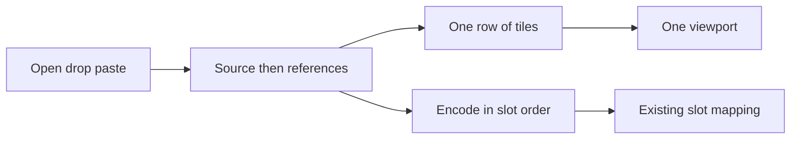
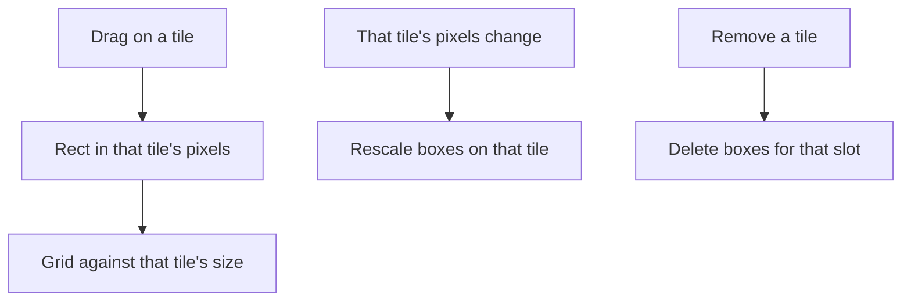

# Contact Sheet Canvas - Plan

## Goal Capsule

- **Objective:** A person can line up every image on the sheet in slot order, including an empty sheet, and send that lineup with the prompt.
- **Means:** One sheet in slot order, with each box stored in the pixels of the tile it was drawn on (KTD2).
- **Authority hierarchy:** R-IDs govern behavior. KTDs govern mechanism. Provider image-slot mapping stays as it is.
- **Stop conditions:** Stop if a box drawn on one tile has to be stored in another tile's pixels to satisfy FLUX 3. That is a product change, not a compile tweak.
- **Execution profile:** Feature work. Lock box ownership in scene tests before the canvas starts drawing on more than one tile.
- **Finishes and ships:** The implementer lands the work on the current branch.

---

## Product Contract

### Summary

The canvas shows every image in the scene as one row, and it shows an empty sheet when there are none. The person adds, removes, and reorders on that sheet. The sheet order is the order the model receives. A finished job stays in history until the person promotes it.

### Problem Frame

Models already accept several images, and some accept none. The canvas still shows one source image. Further images are a label list in the side panel, and a drop of several files keeps the first. A text-only prompt has to start from a canvas that asks for a picture.

### Key Decisions

- **The canvas is the sheet.** Pan and zoom cover every tile, including a sheet with no tiles. (session-settled: user-approved, chosen over opening one image full-frame: the sheet stays the canvas.) Governs R1, R5.
- **A box belongs to the tile under the drag.** (session-settled: user-approved, chosen over boxes only on the first image: the other tiles are editable.) Governs R4.
- **Finishing a job does not add a tile.** (session-settled: user-approved, chosen over the result becoming another tile: the history row is the result until Promote.) Governs R7.

### Requirements

**The sheet**

- R1. The canvas shows the scene's images as tiles in slot order, source then references, and shows no tile when the scene has none.
- R2. Open, drop, and paste add images, including several files in path order. The person can remove a tile and move it left or right. The first image is the source. Later images are references. Sheet order is the order encoded for the model.
- R3. Generate with no images stays available for a model that already allows it. A model that already rejects too few images still rejects it. Krea 3 with regional edit is that existing case.

**Boxes and view**

- R4. A box-tool drag on a tile stores the box in that tile's pixels. An empty sheet with a concrete aspect ratio still draws Layout boxes on the virtual frame. Those Layout boxes stay Layout after the first image arrives, and FLUX 3 keeps rejecting them until the person removes them.
- R5. Fit, actual size, pan, and zoom apply to the whole sheet.

**Labels, history, relaunch**

- R6. Each tile shows its existing slot label, including the "not sent" suffix when the model will drop it. The side panel no longer lists the images. A load past the current model's max adds tiles up to that max and shows the refusal on the sheet.
- R7. A finished job adds a history row and leaves the sheet unchanged. Promote replaces the source tile with that result. Compare draws the saved boxes on one rectangle, not across the other tiles.
- R8. Relaunch restores every tile in slot order.

### Success Criteria

- A sheet of two images sends those two images in left-to-right order.
- A sheet with no images can generate on a model that already allows an empty image list.
- A box drawn on the second tile is still on that tile after Promote replaces the first.
- Quitting and reopening restores both tiles.

### Scope Boundaries

- Provider slot kinds stay as they are. Krea 2 still treats tile 0 as the edit image and later tiles as style references. FLUX.2 still numbers them.
- The side panel keeps the prompt, the inspector, and the validation notice that says how many images will be sent.
- Compare does not swap the historical photos onto the sheet.

#### Deferred to Follow-Up Work

- Dragging tiles to reorder them.
- Opening one tile full-frame.
- Converting Layout boxes into image boxes when the first photo arrives.
- Changing Google or OpenAI so a tile marked "not sent" is left out of the byte cap.

### Acceptance Examples

- AE1. Text only.
  - **Covers:** R1, R3
  - **Given:** the sheet has no tiles and the model is one that already allows zero images.
  - **When:** the person generates from a prompt.
  - **Then:** the request carries no image, and the sheet stays empty when the job finishes.
- AE2. Two files.
  - **Covers:** R2
  - **Given:** the sheet is empty.
  - **When:** the person drops file A and then file B.
  - **Then:** A is the left tile, B is the right tile, and the request encodes A then B.
- AE3. Box on the second tile.
  - **Covers:** R4, R7
  - **Given:** two tiles, and a box drawn on the right tile.
  - **When:** the person promotes a result.
  - **Then:** the left tile is the result, and the box is still on the right tile in that tile's pixels.
- AE4. Past the max.
  - **Covers:** R6
  - **Given:** the selected model accepts two images.
  - **When:** the person drops three files.
  - **Then:** two tiles appear, and the sheet says the third was not added.
- AE5. Relaunch.
  - **Covers:** R8
  - **Given:** two tiles, the second added by paste.
  - **When:** the app relaunches from the session.
  - **Then:** both tiles are back in the same order.

---

## Planning Contract

### Key Technical Decisions

- KTD1. **Keep source plus references.** `Scene::slots` is the sheet order. The first file in an add calls `set_image`. Later files call `add_extra`. `build_request` already encodes `image` then `extras`. A single vec would rewrite `SessionFile` and every provider mapping for the same order, so that alternative did not need a prototype.
- KTD2. **One tile owns both rects.** For New, Keep, Move, and Remove, `src` and `tgt` are in the tile's pixels and `from_image` is that slot. Layout keeps `from_image` unset and uses the virtual frame until a source exists. `compile_prompt` grids each rect against that tile's size, and a Layout box against the virtual frame while the sheet is empty. `move_reference` and `remove_reference` retarget or delete boxes and leave the rectangles alone, because the image bytes did not change size. `clear_source` does the same for the boxes that survive. `set_source` rescales boxes with `from_image` 0 only when a source was already there and its pixels were replaced. When `set_source` fills an empty sheet, it rescales Layout boxes from the virtual frame into the new source pixels and leaves the kind as Layout. Removing a tile deletes boxes that pointed at it. A missing `from_image` on an image box is not compiled as `ref_image_0`. `collapse_move_boxes` during Promote touches Move boxes on tile 0 only.
- KTD3. **One viewport, one row.** Tiles sit left to right at a shared display height, native aspect kept, with a fixed gap. The viewport's content size is that row. With no tiles and a concrete aspect ratio, the content size is the virtual frame. Actual size is scale 1 of that content. It is not native pixels for every tile, because one scale cannot match two pixel heights. Hit testing finds the tile, then maps into that tile's pixels. A drag clamps to the tile where it started, including the second drag of a Move. On an empty sheet the drag clamps to the virtual frame.
- KTD4. **Click selects, drag draws.** A select-tool click selects the tile under the pointer. If that press hits a box, it also selects the box. If it misses every box, it clears the selected box. A box-tool drag draws in the tile under the press. A drag shorter than 2 pixels only selects, which is the drop `finish_box` already uses. A click in the gap clears the selected box and leaves the selected tile. Slot labels use `text_xs` and `theme::TEXT_MUTED`, inside the tile, clipped to it. Ghost buttons sit in one row along the bottom of the selected tile's view rect, clipped to that rect, above the canvas hit layer, and not scaled by zoom. They are labeled Move left, Remove, and Move right. Move left is hidden on the first tile. Move right is hidden on the last. If the row is wider than the tile, Remove is kept and a move button is shown only when it fits entirely inside the tile. After a move, the selected tile is the slot the moved image landed in. After a remove, selection is the tile now at that index, or the new last tile. The inspector From list is display-only and lists `none` plus one label per current slot. Changing kind does not write `from_image`.
- KTD5. **Tile 0 stays `SessionFile.source`.** Later tiles are `SessionFile.references`, each with its own `SourceRef`, restored into `extras` in order. Version stays 1. Each tile's `SourceRef` travels with its pixel buffer when the person moves or removes a tile. After that, the source field is the ref now on tile 0. A missing or undecodable extra is a remove of that slot. A missing or undecodable source is a remove of slot 0, so the next tile becomes the source. The session version does not change, because `references` is already on the file.
- KTD6. **Compare uses one historical rectangle.** While compare is active, inspection boxes are drawn in the pixel size of the request's first image, mapped onto tile 0's display rect. The other tiles stay in the row and pan with the sheet, and they do not receive those boxes. A request with no image uses the 1000-wide virtual frame in place of that rect. Clearing compare restores the live boxes.
- KTD7. **Loads run in path order.** Decode one file, then the next. A decode error toasts, and the load continues. Files past `image_slots.max` are skipped. One `text_xs` line in `theme::TEXT_MUTED` sits under the row, left-aligned with the first tile. When a load skips files, the line is the existing "accepts at most {max} images" sentence plus the skipped count. The next load replaces it, and the line is omitted when that load skips nothing. Removing a tile clears it. Tiles already on the sheet after a model switch keep the "not sent" mark from `reference_marks`. The validation notice that says how many will be sent stays in the side panel.

### High-Level Technical Design

Slots stay the source of order. The sheet is a view of that order. Submit does not grow a second list.

A box is tied to one tile. Changing another tile's pixels does not move it.

### Sequencing

U1 lands the box rule before any tile is drawn. U2 is the row geometry U3 paints. U4 attaches files to slots the sheet already shows. U5 restores those slots on relaunch. U6 narrows Promote and compare after those boxes exist.

### System-Wide Impact

- **Submit.** `build_request` still sends source then extras. Provider mapping is unchanged. Krea 2 still treats index 0 as the edit image.
- **Session.** Owned files for extras use the `references` field `remove_unreferenced` already keeps. A failed decode of one extra removes that slot and shifts tags.
- **History.** Completion still only writes the history row. Promote still replaces the source. Compare stops using the live sheet transform for saved boxes.
- **Model switch.** Extra tiles stay. Labels and the validation notice already describe which ones will be sent.

### Risks & Dependencies

- **`rescale_after` today moves every box.** `move_reference` and `remove_reference` retarget the slot and then rescale from the source frame. U1 has to stop that rescale before U3 draws a second tile. Filtering by the new slot index is not enough, because the index was already rewritten.
- **`add_reference` on an empty scene does not set the source.** The first file has to call `set_image`. A reference-only sheet would upload nothing from `app.image` and would still allow Layout boxes.
- **`placed_rect` writes `from_image` 0 for Keep, Move, and Remove, and leaves New unset.** `from_label` treats unset as 0. U1 has to set the slot on New as well, or a box on tile 2 is sent as `ref_image_0`.
- **Compare has no stored frame.** Inspection keeps the boxes and the request images' sizes. KTD6 uses the first image's size because that is the size already on the loaded request.
- **Canvas tests drag in view pixels after a one-image fit.** A row with a gap will miss those coordinates. U3 updates the drags to the tile under the pointer.

### Sources & Research

- Slot order, frame, and box rescale: `crates/easel-core/src/scene.rs`
- Prompt tags on insert, remove, and move: `crates/easel-core/src/prose.rs`
- FLUX 3 grids boxes against one frame: `crates/easel-core/src/providers/bfl/flux3.rs`
- Provider remapping of the same slice: `crates/easel-core/src/providers/mod.rs`
- Pixels, labels, and the add cap: `crates/easel/src/app_state.rs`
- Encode order: `crates/easel/src/jobs/submit.rs`
- One image painted, one viewport: `crates/easel/src/canvas/mod.rs`, `crates/easel-core/src/geometry.rs`
- Session file already has `references`, flush writes it empty: `crates/easel-core/src/session.rs`, `crates/easel/src/session.rs`
- First-file drop and `source_ref` on extras: `crates/easel/src/image_load.rs`, `crates/easel/src/root.rs`
- Promote replaces the source: `crates/easel/src/jobs/promote.rs`
- Side panel label list: `crates/easel/src/side_panel/references.rs`

---

## Implementation Units

### U1. Box ownership

- **Goal:** A box stays in the pixels of the tile it belongs to when another tile changes size.
- **Requirements:** R4, R7
- **Dependencies:** none
- **Files:**
  - `crates/easel-core/src/scene.rs`
  - `crates/easel-core/src/providers/bfl/flux3.rs`
  - `crates/easel/src/side_panel/inspector.rs`
- **Approach:** Apply KTD2. `placed_rect` records the slot for New as well as Keep, Move, and Remove. `move_reference` and `remove_reference` retarget or delete boxes and do not rescale them. `set_source` rescales slot 0 only when a source was already present. The first source maps Layout boxes from the virtual frame into the new pixels and leaves the kind as Layout. `compile_prompt` grids against the matching image size, and against the virtual frame for a Layout box on an empty sheet. The inspector lists every current slot and does not write `from_image` on a kind change.
- **Execution note:** Extend the scene tests that lock single-frame rescale before changing which boxes move.
- **Patterns to follow:** `removing_the_source_shifts_reference_tags_and_from_image` and `moving_a_reference_rewrites_every_affected_tag` in `scene.rs`. `compile_prompt` in `flux3.rs`.
- **Test scenarios:**
  - A New box placed for slot 1 stores `from_image` 1. A Layout box still has `from_image` unset.
  - Two tiles, 100 by 100 and 400 by 200. A box at 10,10 on slot 1 is still 10,10 after the source is replaced by a 200 by 200 image. A box at 10,10 on slot 0 is rescaled onto the new source size.
  - The same two tiles, with a box at 10,10 on each. Moving the source to the right leaves both rectangles at 10,10. The box that was on the source now has `from_image` 1. The box that was on the reference now has `from_image` 0.
  - Removing slot 1 deletes the box that pointed at it and shifts a box that pointed at slot 2 down to slot 1. Prose `<ref_image_2>` becomes `<ref_image_1>`.
  - Covers AE3 at the scene layer. `collapse_move_boxes` copies `tgt` onto `src` for a Move on slot 0 and leaves a Move on slot 1 unchanged.
  - `compile_prompt` grids the slot 1 box against 400 by 200 and the slot 0 box against the source size. An unset `from_image` on a New box is a warning or a dropped box, and the text does not say `ref_image_0`.
  - A Layout box on an empty scene, then `set_source` of a 500 by 500 image, stays Layout, and its rectangle is inside that 500 by 500 image. FLUX 3 validation still reports that the kind cannot be used.
  - The inspector options are `none`, `ref_image_0`, and `ref_image_1` when two slots exist. Changing a Move to Keep leaves `from_image` 1.
- **Verification:** Scene and FLUX 3 tests show a box on slot 1 surviving a source resize, and the prompt grid uses that tile's size.

### U2. Row layout

- **Goal:** A pure layout maps slot sizes to one row and maps a point back to a tile's pixels.
- **Requirements:** R1, R5
- **Dependencies:** none
- **Files:**
  - `crates/easel-core/src/sheet.rs`
  - `crates/easel-core/src/geometry.rs`
- **Approach:** Apply KTD3. The layout takes pixel sizes in slot order and returns each tile's display rect inside one content size. `Viewport` stays one content rectangle. Fit, clamp, and actual size are unchanged once the content size is the row.
- **Patterns to follow:** `Viewport::fit` in `geometry.rs`.
- **Test scenarios:**
  - Sizes 100 by 100 and 400 by 200 produce two rects of equal height, the second twice as wide, separated by the gap, in that order.
  - An empty size list and no aspect produces an empty content size. An empty size list with a concrete aspect uses the virtual frame as the content size.
  - A point in the second rect maps to that image's pixels. A point in the gap maps to no tile. A point past the right edge of a tile clamps to that tile when the caller asks for a clamp, and misses when the caller asks for a hit.
  - `Viewport::fit` on the row content size centers the row and does not scale above 1.
- **Verification:** Layout tests fix the row without a window.

### U3. Sheet on the canvas

- **Goal:** The canvas paints the row, selects a tile, and draws a box in that tile's pixels.
- **Requirements:** R1, R4, R5, R6
- **Dependencies:** U1, U2
- **Files:**
  - `crates/easel/src/canvas/mod.rs`
  - `crates/easel/src/canvas/box_tool.rs`
  - `crates/easel/src/theme.rs`
- **Approach:** Apply KTD3 and KTD4. Paint each tile from source then extras. The selected tile uses `theme::ACCENT` for its border. Empty, with a concrete aspect, fits the virtual frame. Empty, with no frame, keeps the hint. The hint adds that a prompt can run with no image only when the selected model already allows zero images. Ghost buttons and labels follow KTD4. Fit and actual size pass the row content size, or the virtual frame when the row is empty, into the existing viewport.
- **Patterns to follow:** The single `paint_image` path and `finish_box` in `canvas/mod.rs`. `ui::Button::ghost`.
- **Test scenarios:**
  - No image and no aspect, on a model that already allows zero images, shows the hint, and the hint says a prompt can run with no image. The same empty sheet on Krea 3 with regional edit keeps the existing hint and does not add that sentence.
  - No image and aspect `1:1` shows the virtual frame and no tile. A box-tool drag on that frame stores a rectangle inside the 1000-wide frame.
  - Two images paint two tiles left to right. A select-tool click on the second tile's empty pixels selects that tile, clears the selected box, and the border is `theme::ACCENT`. A click on a box on that tile selects the box as well.
  - A box-tool drag on the second tile adds a box whose `from_image` is 1 and whose rect is inside that image's pixels. A press that moves less than 2 pixels selects the tile and adds no box.
  - A drag that starts on the second tile and ends over the first still stores a rect inside the second tile.
  - Fit on a 100 by 100 tile beside a 400 by 200 tile leaves both tiles fully inside the view.
  - The second tile's label matches `reference_marks` for index 1. When the model max is 1, that label contains "not sent".
- **Verification:** Canvas tests select a tile, draw on it, and fit the row. Colors come from `theme.rs`.

### U4. Add, remove, and reorder

- **Goal:** Files land on the sheet in order, and the side panel stops listing them.
- **Requirements:** R2, R6
- **Dependencies:** U1, U3
- **Files:**
  - `crates/easel/src/image_load.rs`
  - `crates/easel/src/root.rs`
  - `crates/easel/src/app_state.rs`
  - `crates/easel/src/side_panel/mod.rs`
  - `crates/easel/src/side_panel/references.rs`
  - `crates/easel/src/side_panel/form_tests.rs`
- **Approach:** Apply KTD1, KTD5, and KTD7. Open allows several files. Drop and paste append. The first image on an empty sheet calls `set_image`. Later images call `add_extra`. Each tile's `SourceRef` moves with its pixels. The References section is removed from the side panel. The sheet's muted line follows KTD7. Move buttons call `move_reference` and keep the pixel vec and the refs in the same order as `remove_reference_slot` already does for pixels.
- **Patterns to follow:** `LoadTarget` and `apply_load_result` in `image_load.rs`. `remove_reference_slot` in `app_state.rs`.
- **Test scenarios:**
  - Covers AE2. An empty scene that loads A then B ends with source A and one extra B. `build_request` bytes are A then B.
  - A scene that already has a source, then loads C, keeps the source and appends C.
  - Covers AE4. Three files when the max is 2 produce two tiles and a sheet line under the row that contains "accepts at most 2 images" and the skipped count. The third file is not in `extras`. Removing a tile clears that line.
  - A bad file between two good ones toasts, and the two good files still appear in order.
  - Paste of an extra does not set `source_ref`. Paste of the first image does.
  - Remove on the only tile clears `image`, `source_image`, and `source_ref`. Move right on the left tile swaps pixels and the two `SourceRef`s, and rewrites `<ref_image_0>` and `<ref_image_1>` in the prose. A box at 10,10 on each tile is still 10,10.
  - The side panel render has no References section.
- **Verification:** Load tests append in order, the cap is visible on the sheet, and the panel no longer lists slots.

### U5. Restore every tile

- **Goal:** Relaunch brings back the source and every extra.
- **Requirements:** R8
- **Dependencies:** U4
- **Files:**
  - `crates/easel/src/session.rs`
  - `crates/easel-core/src/session.rs`
- **Approach:** Apply KTD5. Flush owns the source when its ref is empty, and owns each extra that has no `SourceRef`. Flush writes the ref now on tile 0 as the source and the rest as references. Restore loads `file.references` into `extras` in order. A missing or undecodable extra calls `remove_reference` for that slot. A missing or undecodable source removes slot 0 and promotes the next tile. Version stays 1.
- **Patterns to follow:** The existing source own-and-restore path in `crates/easel/src/session.rs`. `remove_unreferenced` in `crates/easel-core/src/session.rs`.
- **Test scenarios:**
  - Covers AE5. A session with a source and one extra, flushed and reopened, has both pixel buffers in that order and the same `from_image` indexes.
  - An extra whose file is missing is gone after restore, and a box that pointed at the following slot has its index shifted down.
  - Flush with `source_ref` already set does not rewrite the source file, and still writes a new extra that has no ref.
  - Move the source to the right, flush, and reopen. The files come back in the swapped order.
  - A missing source file, with one extra present, restores that extra as the source and leaves `references` empty.
  - `remove_unreferenced` keeps the source path and the extra path, and deletes an owned file that neither field names.
- **Verification:** A round-trip session test restores two tiles. Core cleanup still keeps both owned paths.

### U6. Promote and compare

- **Goal:** Promote replaces the source only, and compare does not scatter saved boxes across the row.
- **Requirements:** R7
- **Dependencies:** U1, U3
- **Files:**
  - `crates/easel/src/jobs/promote.rs`
  - `crates/easel/src/canvas/mod.rs`
  - `crates/easel/src/bottom_strip.rs`
  - `crates/easel/src/bottom_strip_tests.rs`
  - `crates/easel/src/side_panel/generate_tests.rs`
- **Approach:** Apply KTD2 and KTD6. Promote still calls `set_image` and then `collapse_move_boxes` limited to tile 0. Completion of a job does not call `set_image`. Compare maps inspection boxes through the first request image's pixel size onto tile 0's display rect.
- **Patterns to follow:** `promote` in `jobs/promote.rs`. The inspection branch in `canvas/mod.rs`.
- **Test scenarios:**
  - Covers AE3. Two tiles and a Move box on each. Promote replaces the source pixels. The slot 0 Move has `src` equal to its old `tgt`. The slot 1 Move is unchanged, and the extra pixels are unchanged.
  - Covers AE1. An empty sheet and a model that already allows zero images submits a request with no images. When that job finishes, the sheet is still empty and the history row is the result.
  - Compare with two live tiles and an inspection whose first image is 80 by 40 draws the inspection boxes inside tile 0's display rect, mapped from 80 by 40, and draws none of them on the second tile. Both tiles still pan together.
  - Clearing compare draws the live boxes again.
- **Verification:** Promote, compare, and the empty-sheet generate test match the scenarios above.

---

## Verification Contract

- `cargo fmt --check`
- `cargo clippy --workspace --all-targets -- -D warnings`
- `cargo nextest run -p easel-core` after U1, U2, and U5
- `cargo nextest run -p easel` after U3, U4, U5, and U6
- Run the app with `WAYLAND_DISPLAY='' cargo run -p easel` and look at an empty sheet, a two-image sheet, and a box on the second tile. The person drives the window. Do not inject clicks.

## Definition of Done

- R1 through R8 hold, and AE1 through AE5 are covered by the tests named on U1, U3, U4, U5, and U6.
- The side panel has no second list of the same images.
- Abandoned layout experiments are not left in the diff.
- Fmt, clippy, and the nextest commands above pass.
