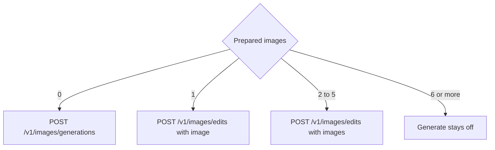
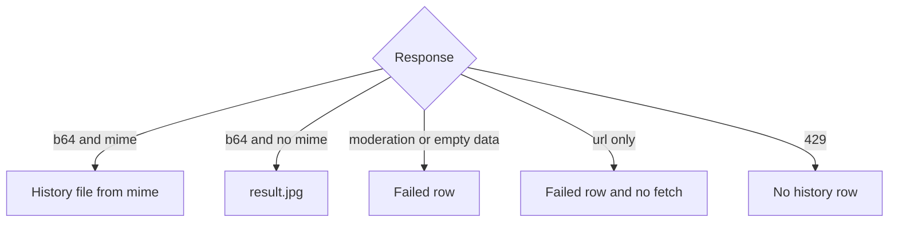

# xAI Image Provider - Plan

## Goal Capsule

- **Objective:** A person can pick xAI, pick Grok Imagine Image 2.0, and get one generated or edited picture into the same history as Black Forest Labs, Krea, Google, and OpenAI.
- **Means:** An xAI provider on the Imagine images API, with the request chosen by how many source images are present (KTD2).
- **Authority hierarchy:** R-IDs govern behavior. KTDs govern mechanism. `docs/api/xai.create.md`, `docs/api/xai.edit.md`, `docs/api/xai.multi-edit.md`, and `docs/api/xai.generation.md` are the local checklist. Where the multi-image page has no JSON, the October 2026 docs.x.ai pages and `EditImageRequest` win. The OpenAI provider stays the pattern for registration, the runner, and the history stamp.
- **Stop conditions:** Stop if a successful response returns the picture only as a URL. Leave that URL unfetched. Stop if the edits route requires multipart.
- **Execution profile:** Feature work. Prove the three request bodies and the failure mapping with tests before treating the form as done.
- **Finishes and ships:** The implementer lands the work on the current branch.

---

## Product Contract

### Summary

xAI joins Black Forest Labs, Krea, Google, and OpenAI. A person picks xAI, picks Grok Imagine Image 2.0, and one picture lands in the existing history. How many source images are present picks a generation, a one-image edit, or a multi-image edit. The form offers aspect ratio, resolution, and quality.

### Problem Frame

The header lists providers, and the body lists the selected provider's models. A same-response picture can already land in history. xAI is not a provider, so Grok Imagine cannot be picked, and an Imagine response is not decoded. The local notes describe generation, a single-image edit, and an edit of up to five images. The multi-image note names the cap and leaves the JSON to the live docs.

### Key Decisions

- **One picture per generate.** (session-settled: user-approved — chosen over a batch of pictures from one generate: history keeps one picture.) Governs R7.
- **The image count picks the request.** Zero, one, and two to five are different requests, and the form has no mode control. Governs R5, R8.

### Requirements

**Choosing a model**

- R1. The person can generate and edit with `grok-imagine-image-2.0`.
- R2. With xAI selected, the model list is that one id.
- R3. Switching provider or model keeps the prompt, the canvas, the boxes, and the references, and drops a quality, resolution, or aspect value the new model does not offer.
- R4. Generate sends the model that was selected when the click happened. Black Forest Labs, Krea, Google, and OpenAI keep their current requests.

**xAI request**

- R5. Zero prepared images send a generation. One sends a single-image edit. Two, three, four, or five send a multi-image edit. Six or more do not send.
- R6. The form offers aspect ratio, resolution, and quality, and the stored value is sent on generate and on edit. Aspect ratio is `auto`, `1:1`, `3:4`, `4:3`, `9:16`, `16:9`, `2:3`, `3:2`, `9:19.5`, `19.5:9`, `9:20`, `20:9`, `1:2`, `2:1`, `21:9`, `5:2`. Resolution is `1k`, `1.5k`, `2k`. Quality is `low`, `medium`, `auto`. Defaults are `auto`, `1k`, and `auto`.
- R7. The request asks for one picture, and history keeps the first picture in the response.
- R8. References travel with the request, canvas first when a canvas image exists, as data URIs. Past five prepared images, Generate stays off and the line is `At most 5 images.`

**Results**

- R9. A successful xAI picture appears in history and the strip the same way a finished OpenAI picture does. `image/jpeg` is stored as `result.jpg`. A missing or empty mime type is stored as JPEG. `image/png` and `image/webp` keep those names.
- R10. A moderation block, a rejected key, and a body with no usable image leave a failed history row and no image file. Empty `data`, a null or empty `b64_json`, and `respect_moderation` false are moderation blocks, including when bytes are also present. A URL-only body shows the strip line `no usable image` and is not fetched.
- R11. A missing key disables Generate before HTTP, with the existing no-key line. Settings has an xAI key row. The status bar does not show an xAI balance.
- R12. A rate limit leaves no history row, shows `rate limited`, and does not send a second request.

### Success Criteria

- Picking xAI and generating with an empty canvas puts one picture in the history strip.
- An edit with one source image and an edit with three source images each put one picture in that strip.
- Switching from an OpenAI quality the xAI form lacks leaves quality at `auto`.
- A FLUX 3 generate still posts to Black Forest Labs.

### Scope Boundaries

- One model, `grok-imagine-image-2.0`. One picture per request. Generation, one-image edit, and multi-image edit, chosen by prepared-image count. Aspect ratio, resolution, and quality. A settings key. A result in the existing history.
- Boxes stay on the canvas and stay out of the request.
- The prompting guide is the source for those request settings. It does not become a prompt helper.

#### Deferred to Follow-Up Work

- The xAI Files API and `file_id` inputs.
- More than one output picture, and deferred polling.
- Other Imagine slugs, including `grok-imagine-image-quality`, which retires on 2 November 2026 and then serves as 2.0 at quality `low`.
- A client byte cap, a prompt-length cap, and pixel-prep tiers for `1.5k` and `2k`.
- Translating another provider's resolution string onto `1k`.
- Reading scopes out of the api-key body, and an xAI balance in the status bar.

### Acceptance Examples

- AE1. Empty canvas, prompt set, key present.
  - **Covers:** R5, R7, R9
  - **Given:** xAI and `grok-imagine-image-2.0` are selected and no source image is loaded.
  - **When:** the person generates.
  - **Then:** one picture is in the history strip and no second picture is stored.
- AE2. One source image.
  - **Covers:** R5, R8
  - **Given:** the canvas holds one image.
  - **When:** the person generates.
  - **Then:** the edit uses that image, and one picture replaces it in the strip.
- AE3. Three source images.
  - **Covers:** R5, R8
  - **Given:** a canvas image and two extras are loaded.
  - **When:** the person generates.
  - **Then:** the canvas image is first, and one picture lands in the strip.
- AE4. Six source images after a switch.
  - **Covers:** R5, R8
  - **Given:** six images were loaded under a provider that allows them, and the person switches to xAI.
  - **When:** the form refreshes.
  - **Then:** Generate is off, the line is `At most 5 images.`, and no request is sent.
- AE5. Moderation with bytes present.
  - **Covers:** R10
  - **Given:** the response flags moderation and also carries image bytes.
  - **When:** the job finishes.
  - **Then:** history has a failed row and no image file.

### Sources

- `docs/api/xai.create.md`, `docs/api/xai.edit.md`, `docs/api/xai.generation.md`. These name `grok-imagine-image-2.0`, bearer auth, `https://api.x.ai/v1/images/generations`, the singular edit object, `aspect_ratio`, `resolution`, `quality`, `response_format`, and `n`.
- `docs/api/xai.multi-edit.md`. This names a cap of five and an aspect-ratio override. It has no URL and no JSON.
- `https://docs.x.ai/developers/model-capabilities/images/generation` and the editing page, both updated 8 October 2026. Quality is `low`, `medium`, or `auto`. Omitted quality is `auto`, served as `low` on generation and `medium` on edit. `b64_json` is optional and the default format is a temporary URL. Deferred mode allows only `url`.
- `https://docs.x.ai/developers/model-capabilities/images/multi-image-editing`, updated 28 August 2026. `POST /v1/images/edits` with an `images` array, at most five, at least two in the guide sample.
- `https://docs.x.ai/openapi.json`, fetched 18 October 2026. `EditImageRequest` makes `image` and `images` mutually exclusive. `ImageUrl` defines `url` and `file_id`. `ImageResolution` is `1k`, `1.5k`, `2k`. The request schema omits `quality`. Published samples use `mime_type` `image/jpeg`.
- `https://docs.x.ai/developers/migration/imagine-image-quality-nov-2`, updated 2 September 2026. `grok-imagine-image-2.0` has no shutdown date.
- `https://docs.x.ai/developers/models/grok-imagine-image-2.0`. Image generation is on `https://api.x.ai`, and the US regional host does not serve it. The published rate is requests per second, 6 at tier 0.

---

## Planning Contract

### Key Technical Decisions

- KTD1. Register xAI the way OpenAI is registered. `ProviderId` variant `Xai`, serde name `xai`, display name `xAI`, bearer auth, exact host `api.x.ai`, base URL `https://api.x.ai`, env `XAI_API_KEY`. The settings probe is `GET /v1/api-key`. A 401 is an invalid key. Any other HTTP status is accepted, including 404, matching the OpenAI probe. History stores the provider name `xai`. Governs R1, R2, R11.
- KTD2. The prepared-image list length picks the body. Zero images post `https://api.x.ai/v1/images/generations` with no image field. One image posts `https://api.x.ai/v1/images/edits` with a singular `image` object. Two to five post that same edits URL with an `images` array and no `image` key. Each object sends `url` as a data URI and `type` `image_url`, and does not send `file_id`. OpenAPI `ImageUrl` lists `url` and `file_id` only. The official curls also send `type`, so the body follows the curls. Aspect ratio, resolution, and quality from R6 are copied onto both URLs, including `auto`. The count rule holds. The live schema has two URLs and two edit keys, which is the whole selection. Governs R5, R6, R8.
- KTD3. Ask for bytes and keep one. Omit `n` and `deferred`. Set `response_format` to `b64_json`. Keep `data[0]` and drop later items. (session-settled: user-approved — chosen over a batch of pictures from one generate: history keeps one picture.) Governs R7, R9.
- KTD4. Classify the response before saving bytes. `respect_moderation` false, empty `data`, a null or empty `b64_json`, and HTTP 400 code `imagine:content-moderated` are `Blocked`. A missing moderation flag means the picture passed. A URL with no `b64_json` is `NoImage` and is not fetched. HTTP 401 on the image request is `Auth`. `Auth` writes a failed history row and no image file, with `Blocked` and `NoImage`. A present `mime_type` of `image/jpeg`, `image/png`, or `image/webp` is passed through. A missing or empty mime type is passed as `image/jpeg`. HTTP 429 is `RateLimited` with no retry delay, one post, and no history row. A `request_id` beside a usable `b64_json` is stored as the interaction id when non-empty, and that body is still inline. A `request_id` alone is not a poll ticket. Governs R9, R10, R12.
- KTD5. The five-image gate is the OpenAI refusal path, keyed on the prepared count. The generic "N of M images will be sent" line does not apply. `reference_steps` still takes five, so a submit that bypasses the button cannot post six. Form values are `ParamSchema` selects. A stored value survives a model switch only when the new schema lists it. There is no translation from `1K` to `1k`, and no translation from OpenAI `high` to a quality on this list. No prompt-length cap and no byte preflight. `supports_boxes` is false. The default prompt compiler stays. Governs R3, R6, R8.

### High-Level Technical Design

The new branch is the prepared-image count. Everything after a usable `b64_json` is the existing inline finish.

### Sequencing

U1 lands the provider id so later units can name it. U2 builds the request. U3 and U4 both depend on U2 and can land in either order after it.

---

## Implementation Units

### U1. Register the provider

- **Goal:** xAI appears in the provider menu and in settings, and history can name it.
- **Requirements:** R1, R2, R11
- **Dependencies:** none
- **Files:**
  - `crates/easel-core/src/model_spec.rs`
  - `crates/easel-core/src/providers/mod.rs`
  - `crates/easel-core/src/history.rs`
  - `crates/easel/src/settings/mod.rs`
  - `crates/easel/src/settings/credentials.rs`
  - `crates/easel/src/net/mod.rs`
  - `crates/easel/src/jobs/runner.rs`
  - `crates/easel/src/side_panel/validation.rs`
  - `crates/easel/src/status_bar.rs`
- **Approach:** Fill every exhaustive `ProviderId` match. Follow the OpenAI arm for auth, the host allow list, the settings row, the key probe, the missing-key label, and `cache_key`. Credentials stay keyed by the base URL.
- **Patterns to follow:** The OpenAI arms in those files.
- **Test scenarios:**
  - The host allow list accepts `api.x.ai` over https and rejects `us.api.x.ai` and plain http.
  - An unknown model id stores an empty provider string.
  - The key probe requests `GET https://api.x.ai/v1/api-key` with bearer auth.
  - A 401 probe is an invalid key. A 200 is accepted. A 404 is accepted.
  - A missing xAI key disables Generate with the existing no-key line, and a present key does not.
  - With xAI selected and a key present, the status bar does not request a balance. The OpenAI case in `crates/easel/src/status_bar.rs` is the pattern.
- **Verification:** The menu can list xAI, and settings can store a key for `https://api.x.ai`.

### U2. Build the Imagine request

- **Goal:** Generate posts one of the three JSON bodies from KTD2 and KTD3.
- **Requirements:** R4, R5, R6, R7, R8
- **Dependencies:** U1
- **Files:**
  - `crates/easel-core/src/providers/xai/mod.rs`
  - `crates/easel-core/src/providers/mod.rs`
- **Approach:**
  1. Add one `ModelSpec` and one provider type, registered in `ModelRegistry::specs` and `resolve_model`.
  2. Branch the body on the prepared-image list length per KTD2 and KTD3.
  3. Copy aspect ratio, resolution, and quality from the schema onto the JSON.
  4. Cap `reference_steps` at five per KTD5.
- **Execution note:** Write the three body tests first and make them pass before the form refusal in U4.
- **Patterns to follow:** `crates/easel-core/src/providers/openai/mod.rs` for the module shape and the data-URI helper. Resolution strings stay lowercase, as in `crates/easel-core/src/providers/bfl/flux3.rs`.
- **Test scenarios:**
  - Zero images post `https://api.x.ai/v1/images/generations` with `model` `grok-imagine-image-2.0`, the prompt, `response_format` `b64_json`, and the three form fields. The body has no `image`, no `images`, no `n`, and no `deferred`.
  - One image posts `https://api.x.ai/v1/images/edits` with `image.url` as a data URI and `image.type` `image_url`. The body has no `images` array and no `file_id`.
  - Three images post the edits URL with `images` length 3, the canvas data URI first, and no singular `image` key.
  - Six prepared images produce a body whose image list has length 5.
  - Quality `auto`, resolution `1.5k`, and aspect ratio `19.5:9` are copied through unchanged on a generation and on an edit.
  - `resolve_model` for `flux-3-image` still returns the Black Forest Labs provider.
  - A history row for `grok-imagine-image-2.0` stores the provider name `xai`.
- **Verification:** The three bodies match KTD2, and a FLUX id still resolves to Black Forest Labs.

### U3. Decode the Imagine response

- **Goal:** A usable picture becomes an inline history file, and the failure cases in KTD4 do not.
- **Requirements:** R7, R9, R10, R12
- **Dependencies:** U2
- **Files:**
  - `crates/easel-core/src/providers/xai/mod.rs`
  - `crates/easel/src/jobs/xai_tests.rs`
- **Approach:** Decode per KTD4 inside the provider. Leave `finish_inline` and its mime-to-filename match alone. Do not return `Submitted` from a body that already has bytes.
- **Patterns to follow:** `crates/easel/src/jobs/openai_tests.rs` for the one-shot runner proof, and the Google decoder for reading `mime_type` off the JSON.
- **Test scenarios:**
  - A 200 with `data[0].b64_json` and `mime_type` `image/jpeg` writes `result.jpg`, stores provider `xai`, and does not poll.
  - A 200 with bytes and no `mime_type` writes `result.jpg`.
  - A 200 with `mime_type` `image/png` writes `result.png`.
  - A 200 with two `data` items stores the first and drops the second.
  - A 200 with only a `url` records `NoImage`, writes no file, and performs no GET.
  - A 200 with `respect_moderation` false and a non-empty `b64_json` writes no file and records `Blocked`.
  - A 200 with `data` `[]` records `Blocked`.
  - A 400 whose code is `imagine:content-moderated` records `Blocked`.
  - A 429 records `RateLimited`, writes no history row, and posts once.
  - A 401 records `Auth` and writes a failed history row with no image file.
  - Dismiss during the post drops a late 200.
- **Verification:** JPEG bytes land without a poll, a moderated body with bytes does not, and a URL is not fetched.

### U4. Form fields and the five-image gate

- **Goal:** The form shows R6, and six prepared images cannot generate.
- **Requirements:** R3, R6, R8
- **Dependencies:** U2
- **Files:**
  - `crates/easel-core/src/providers/xai/mod.rs`
  - `crates/easel/src/side_panel/validation.rs`
  - `crates/easel/src/side_panel/form_tests.rs`
- **Approach:** Put the R6 selects on the model spec. Add an xAI refusal beside the OpenAI cap check, using the prepared count. Do not route the overflow through the truncation notice.
- **Patterns to follow:** `openai_caps_disable_generate` in `crates/easel/src/side_panel/form_tests.rs`, and `refusal_messages` in `crates/easel-core/src/providers/openai/mod.rs`.
- **Test scenarios:**
  - With xAI selected, the form offers the R6 aspect ratios, resolutions, and qualities, and the initial values are `auto`, `1k`, and `auto`.
  - Five prepared images, a prompt, and a key leave Generate enabled.
  - Six prepared images disable Generate, the line is `At most 5 images.`, and the truncation notice is absent.
  - An empty prompt disables Generate with the existing empty-prompt line.
  - Switching from Google resolution `2K` to xAI sets resolution to `1k`. Quality `low` carries. Aspect ratio `16:9` carries.
  - Switching from OpenAI quality `max` to xAI sets quality to `auto`.
  - Switching from xAI back to FLUX 3 keeps the prompt and the canvas, and the FLUX request is unchanged.
- **Verification:** Six images cannot generate, five can, and a Google `2K` value does not ride onto the xAI body.

---

## Verification Contract

- `cargo fmt --check`
- `cargo clippy --workspace --all-targets -- -D warnings`
- `cargo nextest run -p easel-core` covers the request bodies and the decode mapping.
- `cargo nextest run -p easel` covers the runner, the form, and the key probe.

---

## Definition of Done

- U1 through U4 meet their verification lines.
- Black Forest Labs, Krea, Google, and OpenAI requests are unchanged.
- The four commands in the Verification Contract pass.
- Abandoned experimental code is not left in the diff.

---

## System-Wide Impact

`ProviderId` is matched exhaustively, so U1 touches every arm: settings, the credential store, the key map, history, the runner cache key, and the missing-key label. Credentials stay under the base URL `https://api.x.ai`. The job runner's inline path is shared. xAI must hand it bytes and a mime type, and must not start a poll. `Auth`, `Blocked`, and `NoImage` write a failed history row. `RateLimited` and other HTTP failures write none (KTD4). The status bar requests a balance only for Black Forest Labs, so an xAI selection shows none (R11). Other providers' request builders stay as they are.

---

## Risks & Dependencies

- Official edit curls send `type` `image_url`. `ImageUrl` in the OpenAPI file defines `url` and `file_id` only. KTD2 sends `type` because the curls do. If a live 400 names that field, drop `type` and keep `url`.
- The 8 October 2026 generation guide documents `quality`. The OpenAPI request schema fetched the same month omits it. Send it per R6. If a live 400 names `quality`, drop the field and keep the form value out of the JSON until the schema catches up.
- `1.5k` is in `ImageResolution` and on the model price table. The generation guide prose lists `1k` and `2k`. The form offers `1.5k` per R6.
- No prompt-length max is published for `grok-imagine-image-2.0`. The 1024 figure is the sample for `grok-imagine-image` 1.0. A long prompt fails as HTTP, once, with no history row.
- Moderation is more than one shape. KTD4 lists the shapes to treat as `Blocked`. A new shape falls through to the existing HTTP failure, which writes no history row.
- The key probe treats every status other than 401 as a valid key. A 404 from `GET /v1/api-key` still toasts key accepted. That matches OpenAI today.
- `https://us.api.x.ai` does not serve these routes. The allow list is the exact host `api.x.ai`.
