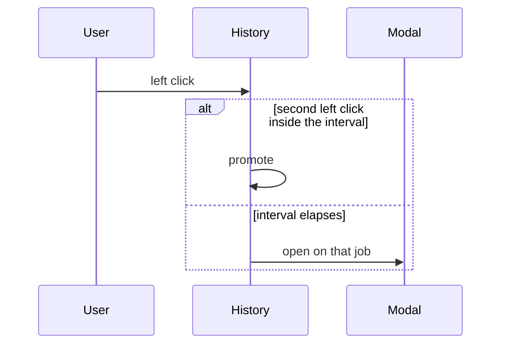
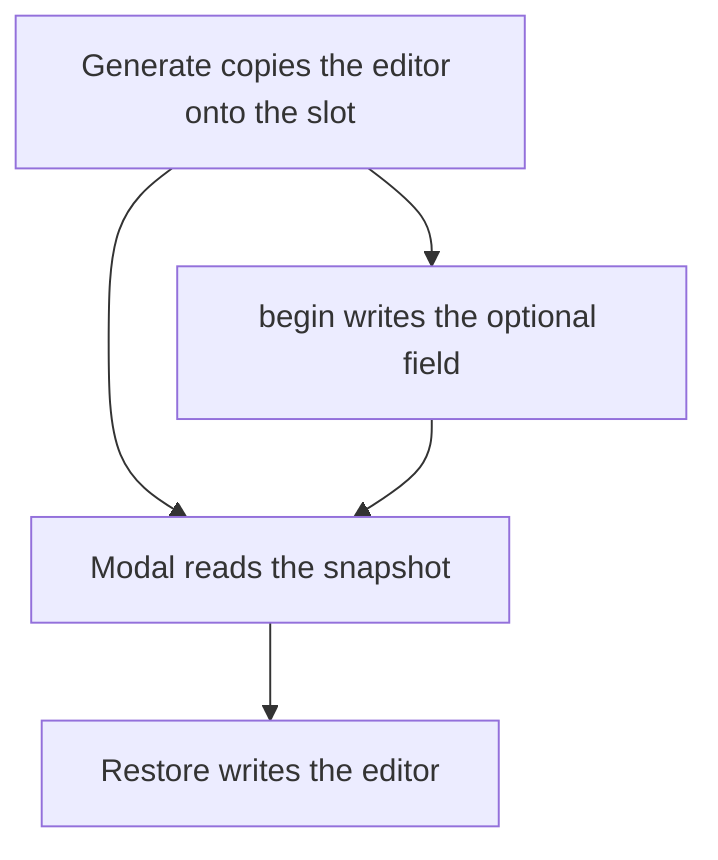
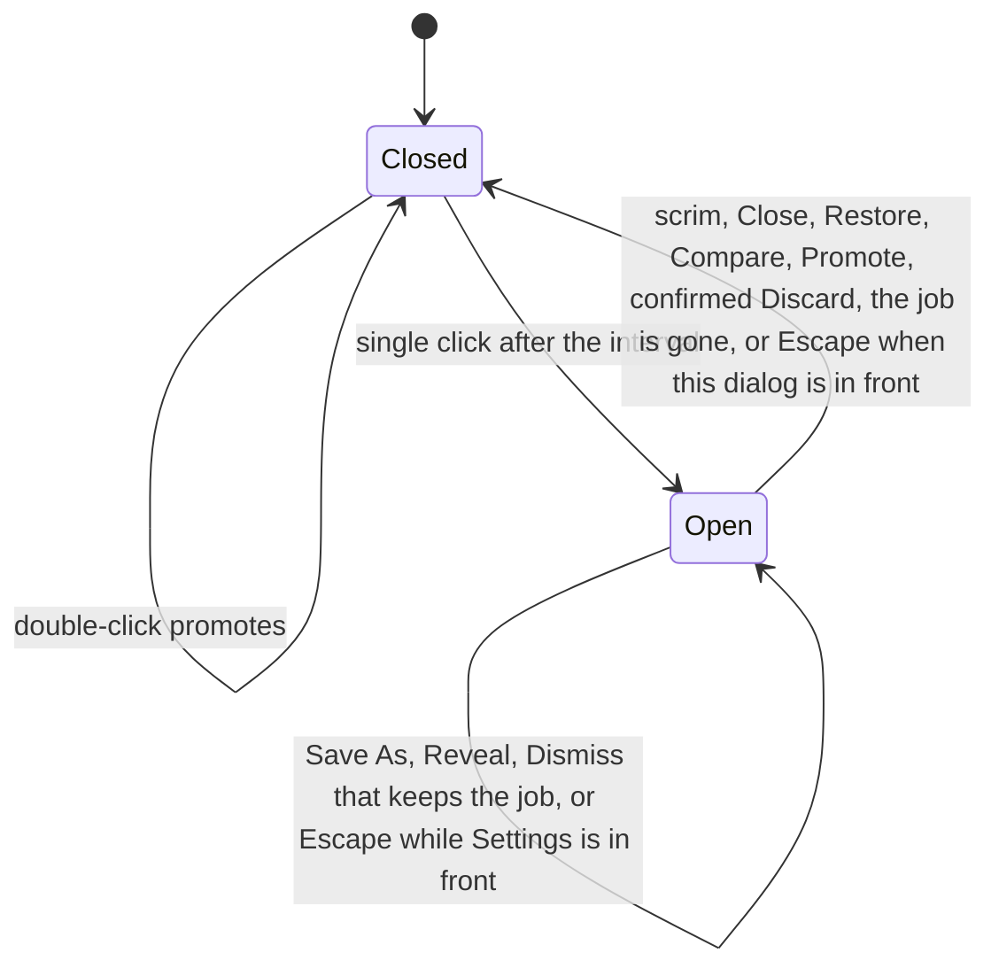

# History Item Modal - Plan

## Goal Capsule

- **Objective:** A person can open a History item, see the result and the prompt, put the editor back to the moment they pressed Generate, and show that result file in the file manager.
- **Means:** A modal on the History item, fed by an editor snapshot taken at Generate (KTD2).
- **Authority hierarchy:** R-IDs govern behavior. KTDs govern mechanism. The History action sets stay as they are.
- **Stop conditions:** Stop if Restore would write `compiled_prompt` into the prompt field. That text is not what the person typed.
- **Execution profile:** Feature work. Lock the snapshot round-trip before the modal offers Restore.
- **Finishes and ships:** The implementer lands the work on the current branch.

---

## Product Contract

### Summary

Clicking a History item opens a modal with the result image when that file decodes, the details stored for that item, the prompt, and that item's actions. Restore puts the editor back to the Generate press. Reveal selects the result file in the file manager.

### Problem Frame

A History click today selects the row and shows Promote, Save As, Compare, and Discard under the list. The result image, the typed prompt, and the editor as it was at Generate are not on that row. The job file keeps the compiled prompt, which has already dropped reference tags and, for FLUX 3 with boxes, has appended box JSON.

### Key Decisions

- **The click opens a modal, and the actions live there.** A double-click still promotes. (session-settled: user-approved, chosen over an action row on the History item: the buttons move into the modal.) Governs R1, R2, R3.
- **Restore returns the editor to the Generate press.** (session-settled: user-directed, chosen over writing the prompt text alone: the model and the form values return with the prompt.) Governs R8, R9.
- **Running and failed items use the same modal.** The image is shown when the result file decodes. Reveal is shown when the result file exists. (session-settled: user-approved, chosen over a modal only for finished images: every row opens the same dialog.) Governs R4, R5, R10.

### Requirements

**Opening**

- R1. A single click on a History item opens a modal for that item.
- R2. A double-click promotes the image onto the canvas and leaves the modal closed.
- R3. The modal carries that item's current actions, including the Discard confirmation, and the History pane has no action row of its own.
- R4. Every History item opens this same modal, including a job that is still running or has failed.

**What the modal shows**

- R5. The modal shows the result image when the result file decodes as an image.
- R6. The details are the status line, the cost when one is stored, the longer error when it exceeds the line, the model, and the pixel size when the image decodes.
- R7. The prompt is the typed prompt saved at Generate when that snapshot exists, and the compiled prompt otherwise.

**Restore and Reveal**

- R8. Restore writes the typed prompt, the model, the form values, and the aspect ratio from the moment Generate was pressed, and it clears Compare.
- R9. Restore is present only when that Generate snapshot exists, and it leaves the canvas image, references, and boxes unchanged.
- R10. Reveal asks the file manager to select the result file, and it is present only when that file exists.
- R11. When Reveal cannot select the file, the file stays unopened and the status bar reports the failure.

**While it is open**

- R12. The scrim and Close dismiss the history modal.
- R15. Escape dismisses the front dialog. Settings is in front when both are open.
- R13. Restore, Compare, Promote, and a confirmed Discard dismiss the modal. Save As, Reveal, and a Dismiss that keeps the item leave it open.
- R14. The modal stays on the job that was opened, and it closes when that job leaves the list.

### Scope Boundaries

- The Editor pane keeps its current layout.
- Restore leaves the canvas image, the references, and the boxes where they are.
- Entries saved before the snapshot still open, and they have no Restore button.
- Reveal selects the file in the file manager. It does not launch an image viewer.
- Restore overwrites the current editor immediately. Discard remains the only confirmation in this pane.

#### Deferred to Follow-Up Work

- Restoring the canvas image, the references, and the boxes from the generation that produced the item.
- Filling a typed prompt for entries that were saved before the snapshot existed.

### Acceptance Examples

- AE1. Covers R1, R2. A finished item with a decodable PNG. One click opens the modal and shows that image. A second click inside the double-click interval promotes the image and leaves the modal closed.
- AE2. Covers R8, R9. Generate with a tagged prompt, a non-default model, a non-default form value, and aspect `16:9`. Change the editor. Restore on that item puts the tagged prompt, the model, the form value, and the aspect back, and the canvas image is the one already on the sheet.
- AE3. Covers R4, R5, R10. A failed item with no result file opens the modal with Discard and no image and no Reveal. An unsupported result file opens the modal with Reveal and an empty image area.

---

## Planning Contract

### Key Technical Decisions

- KTD1. **Wait out the double-click interval before painting the modal.** Gpui hit-tests the last painted frame. A Settings-style scrim painted on the first down would take the second down, so Promote would never run and the existing click test would still pass. A single click arms a timer. A second left down inside the interval promotes and cancels the timer. When the interval elapses, the modal opens. (session-settled: user-approved, chosen over an action row on the History item: a double-click still promotes.) Governs R1, R2.
- KTD2. **Save the editor beside the job, not inside `JobRequest`.** At Generate, copy `scene.prose`, `model_id`, `values`, and `scene.aspect_ratio` onto the runner slot. `write_request` writes that object as an optional field on `request.json`. `begin`, `complete_inline`, and `fail_unpolled` all go through that writer. A second file next to `request.json` loses: one write either stores the request and the snapshot together, or it stores neither. Older files load with the field absent. The modal reads the slot while the slot still holds the job, and the file after the slot is gone. `JobRequest` stays the provider payload. About thirty-five struct literals construct it, and the compiled prompt in that payload is the wrong text for the prompt field. Conflict with the earlier "leave job storage alone" note: Restore cannot be done from the fields already in `request.json`, so this optional field is the storage change. (session-settled: user-directed, chosen over writing the prompt text alone: the model and the form values return with the typed prompt.) Governs R7, R8, R9.
- KTD3. **Key the modal by job id, or by slot token until an id exists.** `BottomStrip` selection is a row index, and a new live job lands at index 0. Completion, Dismiss, and a later Generate would retarget an index. The modal keeps its own id, and its actions dispatch on that id. `press` on the selected index would promote the new row. Completion refreshes the image, Reveal, and the actions in place. A Dismiss that leaves a history row follows that id. A vanished row closes the modal. Governs R14.
- KTD4. **Reveal calls `org.freedesktop.FileManager1.ShowItems`.** The object path is `/org/freedesktop/FileManager1`. The arguments are one `file` URI and an empty startup id. The call goes out through `dbus-send` so the crate list stays as it is. A missing binary, a missing bus name, or a non-zero exit sets the status bar and does not open the file. `xdg-open` would open the file, which fails R10. Governs R10, R11.
- KTD5. **Host the dialog on `Root`, the way Settings is hosted.** The History column is `theme::HISTORY_WIDTH` (260), and the pane row is `overflow_hidden`, so a dialog inside the column cannot cover the editor. Paint this dialog in `Root::render` before the Settings scrim, using the Settings scrim, `theme::PANEL`, `pane_header`, and `Button::ghost`. The open target sits on `AppState` next to `settings_open`. Escape already dispatches `CloseSettings`, and that handler closes the front dialog. Reject closing this modal while the Settings scrim is covering it. Governs R12, R15.

### High-Level Technical Design

### Sequencing

U1 stores the snapshot. U2 opens the modal and moves the actions. U3 adds Restore. U4 adds Reveal.

### System-Wide Impact

- **Generate.** `SidePanel::generate` still builds a `JobRequest` through `build_request`. The snapshot is a second copy on the slot, taken from `AppState` at that moment.
- **History files.** `request.json` gains an optional editor object, written by `write_request`. `begin`, `complete_inline`, and `fail_unpolled` all use that writer. `load_request` grows a way to read the object. Files written by the current app still load. There is no backfill.
- **Escape.** `CloseSettings` in `crates/easel/src/root.rs` closes the front dialog, per R15. Settings still toggles from `ctrl-,` while this modal is open.
- **Compare and Promote.** Both already mutate `AppState`. They keep that behavior and dismiss the modal so the scrim is gone when the editor or the canvas changes.
- **In-flight rows.** A queued row has no history id until a history write assigns one. The modal uses the slot token until then. The snapshot is already on the slot.

### Risks & Dependencies

- **The second click never reaches the row if the modal paints early.** Mitigation is KTD1. The test has to paint a frame between the two downs. Sending `click_count` 2 straight at the row stays green even when a scrim would have eaten the click.
- **`set_model` returns immediately when the id is unchanged, and it merges the current form into the new model's defaults when the id changes.** Restore assigns the snapshotted values after `set_model`, then calls `set_aspect_ratio` when the snapshot has a non-empty aspect, so the empty sheet matches the form. `reconcile_values` still drops keys the current schema rejects.
- **`ShowItems` talks to whichever file manager owns the bus name.** That may differ from the handler `xdg-mime` would launch for a folder. R11 covers a missing name or a failed call. There is no second launch.
- **`result.bin` is a file `decode_image` rejects.** Reveal stays. The image area stays empty. The failed line remains in the details.
- **A live slot can hold bytes when `complete` fails and writes no file.** The modal trusts the history file probe, not those bytes, for the image and for Reveal.

### Sources & Research

- History click, action sets, and the footer: `crates/easel/src/bottom_strip.rs`, `crates/easel/src/bottom_strip_tests.rs`
- Settings scrim and Escape: `crates/easel/src/root.rs`, `crates/easel/src/actions.rs`
- Generate and the compiled prompt: `crates/easel/src/side_panel/mod.rs`, `crates/easel/src/jobs/submit.rs`, `crates/easel/src/app_state.rs`
- Tag stripping and the FLUX 3 box suffix: `crates/easel-core/src/providers/mod.rs`, `crates/easel-core/src/providers/bfl/flux3.rs`
- `request.json`, result file names, and `result.bin`: `crates/easel-core/src/history.rs`
- Model switch and aspect: `AppState::set_model`, `AppState::reconcile_values`, `AppState::set_aspect_ratio`
- File manager selection: [File Manager D-Bus Interface](https://freedesktop.org/wiki/Specifications/file-manager-interface/)

---

## Implementation Units

### U1. Editor snapshot

- **Goal:** Generate records the editor, and a later load returns it.
- **Requirements:** R7, R8, R9
- **Dependencies:** none
- **Files:**
  - `crates/easel-core/src/history.rs`
  - `crates/easel/src/jobs/submit.rs`
  - `crates/easel/src/jobs/runner.rs`
  - `crates/easel/src/side_panel/mod.rs`
- **Approach:** Apply KTD2. The snapshot is prose, model id, form values, and aspect ratio. The slot holds it from submit until the slot is dropped. `write_request` persists it with the existing request fields. A reader returns the snapshot when the field is present. `JobRequest` literals stay unchanged.
- **Execution note:** Add the history round-trip test before the modal reads the field.
- **Patterns to follow:** `HistoryStore::begin` and `write_request` in `history.rs`. `build_request` in `submit.rs`.
- **Test scenarios:**
  - A snapshot with prose `make <cat_1> orange`, model `flux-3`, a form value, and aspect `16:9` survives `begin` and reads back with those four fields.
  - A `request.json` written without the field loads, and the snapshot reader reports it absent.
  - Submit stores the snapshot on the slot before any history write. The prose on the slot is the typed prompt, and `compiled_prompt` on the request may differ.
  - `complete_inline` and `fail_unpolled` persist the snapshot. After the slot is gone, the reader still returns it.
  - A failed write of `request.json` still leaves no history entry and does not report a snapshot for that id.
- **Verification:** History tests round-trip the new field and still load a file that lacks it.

### U2. History modal

- **Goal:** A single click opens the modal for that job, the actions move into it, and a double-click still promotes.
- **Requirements:** R1, R2, R3, R4, R5, R6, R7, R12, R13, R14, R15
- **Dependencies:** U1
- **Files:**
  - `crates/easel/src/bottom_strip.rs`
  - `crates/easel/src/bottom_strip_tests.rs`
  - `crates/easel/src/root.rs`
  - `crates/easel/src/app_state.rs`
  - `crates/easel/src/actions.rs`
  - `crates/easel/src/jobs/runner.rs`
- **Approach:** Apply KTD1, KTD3, and KTD5. The footer that maps `actions()` to ghost buttons goes away. Actions dispatch on the modal's job, per KTD3. `LiveJob` gains the snapshot prose and the model id, or a token lookup returns them, because a queued row has no `request.json` yet. The dialog shows the image from `decode_image` on `result_bytes` when that decode succeeds. Details follow R6. The prompt follows R7. Right-click opens the modal and does not promote. Scrim click clears a half-finished Discard confirm.
- **Execution note:** The double-click test runs in a `Root` window, the way `settings_opens_a_modal_and_escape_closes_it` does, and paints a frame between the two downs. A strip-only harness never paints the scrim.
- **Patterns to follow:** `Root::settings_modal`. `click_shows_actions_and_double_click_promotes` and `discard_confirms_before_removing_the_entry` in `bottom_strip_tests.rs`. `settings_opens_a_modal_and_escape_closes_it` in `root.rs`.
- **Test scenarios:**
  - Covers AE1. A done row. After one click and the interval, the modal is open, the image is the result, and the action labels are Promote, Save As, Compare, Discard. The History pane has no action buttons.
  - The same row. A second left down inside the interval promotes, `AppState` has the image, and the modal stays closed.
  - A right-click opens the modal and does not promote.
  - An in-flight row opens the modal with Dismiss only. A failed row with no file opens it with Discard only, and the image area is empty.
  - Discard shows the existing confirm question. Confirm removes the entry and closes the modal. Cancel leaves the entry and the modal.
  - Covers R15. With both dialogs open, the first Escape closes Settings and leaves the history modal open. The next Escape closes the history modal. A scrim click on the history modal closes it when Settings is closed.
  - Promote, Compare, and confirmed Discard close the modal. Save As and a Dismiss that leaves a history row leave it open on that same job.
  - With the modal open, a new live job inserted at index 0 leaves the modal on the original job. Promote writes that original image, not the new row's image.
  - A queued Dismiss that removes the row closes the modal.
  - An unsupported `result.bin` leaves the image area empty and still lists the failed line in the details.
- **Verification:** Strip and root tests show the modal, the moved actions, and a double-click that promotes with the modal staying closed.

### U3. Restore

- **Goal:** Restore writes the snapshotted editor and dismisses the modal.
- **Requirements:** R8, R9, R13
- **Dependencies:** U1, U2
- **Files:**
  - `crates/easel/src/jobs/promote.rs`
  - `crates/easel/src/bottom_strip.rs`
  - `crates/easel/src/bottom_strip_tests.rs`
- **Approach:** Apply KTD2. The button is shown only when the snapshot exists. It clears `inspection`, calls `set_model` with the snapshotted id, assigns `reconcile_values` of the snapshotted form, writes `scene.prose`, and calls `set_aspect_ratio` when the snapshot aspect is a non-empty string. An unknown model id leaves the editor unchanged and sets the status bar. The modal closes after a successful restore.
- **Patterns to follow:** `compare_selected` in `bottom_strip.rs` for loading a past request. `AppState::set_model` and `set_aspect_ratio`.
- **Test scenarios:**
  - Covers AE2. Prose `use <ref_image_1>`, model id changed, form value changed, aspect `16:9`, and a canvas image already set. Restore returns the prose, the model, the form value, and the aspect. The canvas image is untouched. Compare is closed. The modal is closed.
  - A done entry with no snapshot has no Restore button. The prompt area shows `compiled_prompt`.
  - The current model already matches the snapshot. Restore still replaces the form values.
  - The snapshot names a model id the registry does not have. The editor fields stay as they were, and the status bar reports the failure.
  - Restore while Compare is open clears `inspection` and shows the Editor header again.
- **Verification:** A strip test restores prose, model, values, and aspect, and leaves the canvas image in place.

### U4. Reveal

- **Goal:** Reveal selects the result file in the file manager.
- **Requirements:** R10, R11, R13
- **Dependencies:** U2
- **Files:**
  - `crates/easel-core/src/history.rs`
  - `crates/easel/src/bottom_strip.rs`
  - `crates/easel/src/bottom_strip_tests.rs`
- **Approach:** Apply KTD4. `HistoryStore` gains a public result path that probes `result.png`, `result.jpg`, `result.webp`, and `result.bin` in that order. The button is shown when that path exists. The URI percent-encodes the path. The UI asks a small launcher for `ShowItems` and treats a missing helper or a failed call as R11. The modal stays open.
- **Patterns to follow:** The four-name probe in `HistoryStore::result_bytes`. Status text through the status bar, as Settings does on close.
- **Test scenarios:**
  - Covers AE3. A failed entry with no result file has no Reveal button. An entry whose file is `result.bin` has Reveal and an empty image area.
  - A PNG entry asks the launcher for `ShowItems` with that file's URI and an empty startup id. The modal stays open.
  - The launcher returns a failure. The status bar reports it, and no other process is started.
  - A path containing a space is sent as a single file URI, with the space percent-encoded.
- **Verification:** History tests return the probed path. Strip tests show the button only when a file exists and surface a launcher failure on the status bar.

---

## Verification Contract

- `cargo fmt --check`
- `cargo clippy --workspace --all-targets -- -D warnings`
- `cargo nextest run -p easel`
- `cargo nextest run -p easel-core`
- Visual check, with the person driving the window: `WAYLAND_DISPLAY='' cargo run -p easel`, then capture with `magick import -window <id>` after `xwininfo -root -tree | rg easel`. Look at a done item, a failed item, Restore, and Reveal. Do not inject clicks.

---

## Definition of Done

- R1 through R15 hold in the tests named on U1 through U4.
- AE1, AE2, and AE3 pass.
- A `request.json` from before this change still loads, and its modal has no Restore button.
- `compiled_prompt` is never written into `scene.prose`.
- Abandoned experiments are removed from the diff.
- The visual check has been looked at for a done item, a failed item, Restore, and Reveal.
