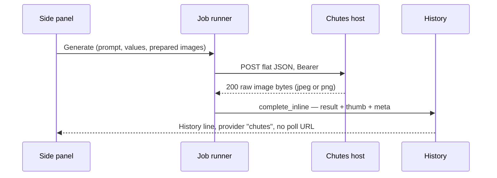
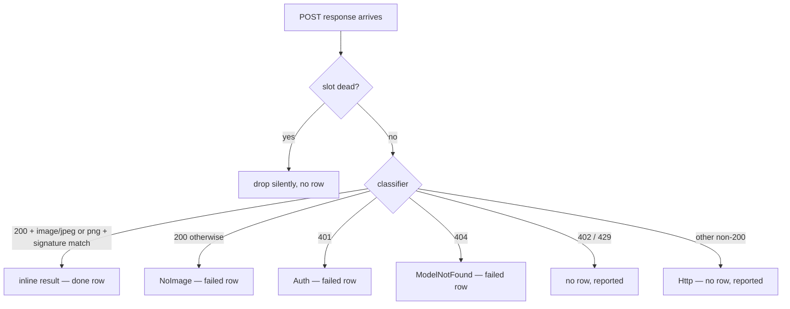

# Chutes Image Provider - Plan

## Goal Capsule

- **Objective:** A person with a Chutes key picks any of seven Chutes image models, generates or edits a picture from the prompt and canvas, and gets the result into the existing history after exactly one request.
- **Means:** One Chutes provider identity with one Bearer credential, seven flat model specs each posting flat JSON to its own documented endpoint, and the POST's raw image bytes treated as the finished result (KTD1, KTD4).
- **Authority hierarchy:** R-IDs govern behavior, KTDs govern mechanism. `docs/api/chutes.*.md` are the local checklists; each chute's live OpenAPI spec is the edge the plan cites for fields, bounds, required keys, and output content types (fetched 22 October 2026).
- **Stop conditions:** Stop if a live 200 response returns a JSON envelope instead of image bytes on any of the seven models. Stop if any model host rejects Bearer auth. Stop if live content types contradict the documented JPEG/PNG split.
- **Execution profile:** Feature work. Prove request bodies and response classification in `easel-core` before the form and runner tests.
- **Finishes and ships:** The implementer lands the work on the current branch.

---

## Product Contract

### Summary

Chutes joins Black Forest Labs, Krea, Google, OpenAI, and xAI. One key covers seven models: four classic checkpoints on a shared image-classic host, plus Qwen Image 2512, Qwen Image Edit 2511, and Z-Image Turbo on their own hosts. Every model answers its single POST with raw image bytes that land in the existing history without a poll. A loaded picture that a model cannot use produces a notice, not a blocked Generate; the only block is a request the API would reject outright.

### Problem Frame

Everything in the app today assumes a provider is one host serving its own JSON protocol. Chutes is different on every axis that matters to the app's contracts: seven endpoints spread across five hosts, flat JSON bodies with per-model field sets, responses that are the image itself rather than a job id or a URL, six models that take no input images at all, and one edit model that requires between one and three. The app's generic machinery — registry-driven menus, schema-driven forms, the clamp-and-notice image counting, the inline-byte runner path — already covers most of this, but no existing provider exercises the no-image slot or a required minimum of references. The gap is a provider identity, seven disciplined specs, an honest always-Protocol poll guard, and one deliberate convention break: no refusal machinery, because the note behavior the person wants is already the pipeline's default.

### Key Decisions

- KD1. Seven flat model options under one Chutes provider. (session-settled: user-directed — "each model will be a single option under the chutes provider" — chosen over one image-classic option with a checkpoint sub-selector: separate entries match how every other provider's menu works and keep per-checkpoint defaults in the spec where they belong.) Governs R1, R5.
- KD2. Image-count mismatches inform, not block. (session-settled: user-directed — "rather than disable just a note that image won't be sent" — chosen over xAI-style hard refusals: a note never dead-ends the form, and the only block left is a request the API itself cannot accept — Qwen Edit with zero references, since `image_b64s` is required.) Governs R6, R7.
- KD3. No Chutes balance or quota surface in the status bar. (session-settled: user-approved — proposed with the tradeoff in the scoping synthesis; the person confirmed. Settings gets the key row and test only; the management API documents no `me` balance endpoint, and the existing status bar stays Black Forest Labs-only by design.) Governs R3.

### Requirements

**Provider and key**

- R1. The provider menu lists Chutes once a key exists, and its model menu lists the seven models in this order: FLUX.1 schnell, Dreamshaper XL, iLustMix v80, Juggernaut XL, Qwen Image Edit 2511, Qwen Image 2512, Z-Image Turbo. (KD1)
- R2. All seven models share one credential: a non-empty `CHUTES_API_KEY` environment value wins over it, and the stored key is filed under the Chutes identity's base URL. (KD1)
- R3. Settings gets one generated "Chutes API key" row whose Test issues exactly one GET of `https://api.chutes.ai/users/me/quotas` with Chutes Bearer auth: 401 reports an invalid key, any other completed response accepts it, and the probe never generates an image or mutates anything. (KD3)
- R4. With a Chutes model selected and no key available, Generate is disabled with the line `No Chutes API key — open Settings`.

**Requests**

- R5. Each model posts one flat JSON body to its endpoint in the model table — editor prose in `prompt`, Bearer auth, `Content-Type: application/json` — carrying the model's schema fields and only those, with empty optionals omitted; no request carries a `model` field, a data-URI prefix, or a key the model does not document. (KD1)
- R6. The six text-to-image models accept no images. A loaded picture never disables Generate; the notice reads `0 of N images will be sent`; the request carries no image field; and while such a model is selected, loading further pictures is refused with the app's existing at-cap wording. (KD2)
- R7. Qwen Image Edit 2511 sends one to three prepared pictures as raw base64 strings in `image_b64s`, canvas picture first. With more than three prepared, Generate stays enabled, the first three are sent, and the notice names the split. With zero, Generate is disabled with `Add at least one image.` (KD2)
- R8. Every Chutes run is one POST. A successful response stores the picture directly, and no Chutes run polls, uploads, or downloads. (KD1)

**Results and failures**

- R9. A 200 becomes one history result only when its Content-Type is `image/jpeg` (with `image/jpg` normalized) or `image/png`, its body is non-empty, and its magic bytes agree with that type; the store picks the matching extension, and the row carries provider `chutes` and no poll URL.
- R10. Failures classify by HTTP status alone, per the failure table (KTD4): 401 Auth, 404 ModelNotFound, 429 RateLimited, 402 OutOfCredits, every other non-200 Http, and a 200 outside R9's gate NoImage; the existing runner row rule decides which classes write a history row.

**Compatibility**

- R11. Chutes results open, promote, save-as, reveal, compare, and restore through the existing history actions unchanged.
- R12. Switching provider or model keeps the prompt, canvas, pictures, and boxes; typed values carry only where the target schema accepts the key and range; the Box tool is disarmed on Chutes models and boxes never leave the machine. (KD2)
- R13. The other five providers' requests, results, settings, and history are unchanged, and their existing tests pass without modification.

### Model Table

All seven models: `prompt` required (from the editor), `seed` Int 0–4294967295 optional and omitted when unset, width/height Int default 1024. Output is the raw image bytes per model. `supports_boxes` false, size control width and height.

| Menu name | id | Endpoint | Images | Output | Fields beyond prompt |
| --- | --- | --- | --- | --- | --- |
| FLUX.1 schnell | `chutes-flux-schnell` | `https://vonkaiser-imageclassic.chutes.ai/image/flux` | none | JPEG | seed; width/height 128–2048; guidance Float 1–20 default 3.5; steps Int 1–50 default 4 |
| Dreamshaper XL | `chutes-dreamshaper-xl` | `https://vonkaiser-imageclassic.chutes.ai/image/dreamshaper` | none | JPEG | seed; width/height 128–2048; guidance 1–20 default 7.5; negative prompt; steps 1–50 default 25 |
| iLustMix v80 | `chutes-ilustmix-v80` | `https://vonkaiser-imageclassic.chutes.ai/image/ilustmix` | none | JPEG | same field set as Dreamshaper XL |
| Juggernaut XL | `chutes-juggernaut-xl` | `https://vonkaiser-imageclassic.chutes.ai/image/juggernaut` | none | JPEG | same field set as Dreamshaper XL |
| Qwen Image Edit 2511 | `chutes-qwen-image-edit-2511` | `https://vonkaiser-qwen-image-edit-2511.chutes.ai/generate` | 1–3 in `image_b64s` | JPEG | seed; width/height 128–2048; true CFG Float 0–10 default 1; negative prompt; steps Int 1–100 default 4 |
| Qwen Image 2512 | `chutes-qwen-image-2512` | `https://vonkaiser-qwen-image-2512.chutes.ai/generate` | none | JPEG | seed; width/height 128–2048; true CFG 0–10 default 4; negative prompt; steps 5–75 default 30 |
| Z-Image Turbo | `chutes-z-image-turbo` | `https://vonkaiser-z-image-turbo.chutes.ai/generate` | none | PNG | seed; width/height 576–2048; shift Float 1–10 default 3; guidance Float 0–5 default 0; max sequence length Int 256–2048 default 512; steps 1–100 default 9 |

### Key Flows

- F1. Text-to-image from an empty canvas
  - **Steps:** Pick Chutes and a text-to-image model, type the prompt, generate.
  - **Outcome:** One POST, one JPEG or PNG in history, no second request.
  - **Covered by:** R1, R5, R8, R9
- F2. Instruction edit
  - **Steps:** Pick Qwen Image Edit 2511, have one to three pictures on the canvas, type the edit instruction, generate.
  - **Outcome:** `image_b64s` carries the references, one JPEG in history.
  - **Covered by:** R7
- F3. Text-to-image with a picture loaded
  - **Steps:** Load a picture, then pick (or stay on) a text-to-image model.
  - **Outcome:** Generate stays on, the notice says the picture will not be sent, and the request does not carry it.
  - **Covered by:** R6
- F4. Failures and dismissal
  - **Steps:** A Chutes request fails with any status, or the person dismisses while it is in flight.
  - **Outcome:** Failures follow the table; a dismissed request never lands.
  - **Covered by:** R10, R11
- F5. Switch mid-session
  - **Steps:** Change provider or model after typing and loading pictures, with jobs in flight.
  - **Outcome:** In-flight jobs keep their snapshot; the form keeps prompt, canvas, and pictures, carrying values the target accepts.
  - **Covered by:** R12, R13

### Acceptance Examples

- AE1. FLUX.1 schnell from an empty canvas.
  - **Covers:** R1, R5, R8, R9
  - **Given:** Chutes and FLUX.1 schnell selected, prompt set, nothing loaded.
  - **When:** the person generates.
  - **Then:** one POST to `/image/flux`, one `result.jpg` stored with provider `chutes`, and no poll.
- AE2. Z-Image Turbo result format.
  - **Covers:** R9
  - **Given:** Z-Image Turbo selected.
  - **When:** a `image/png` 200 returns.
  - **Then:** history stores `result.png`.
- AE3. Picture loaded on a text-to-image model.
  - **Covers:** R6
  - **Given:** one picture is loaded and FLUX.1 schnell is selected.
  - **When:** the form refreshes.
  - **Then:** Generate stays enabled, the notice reads `0 of 1 images will be sent`, and the request carries no image field.
- AE4. Edit with two references.
  - **Covers:** R7
  - **Given:** Qwen Image Edit 2511 selected, two pictures loaded.
  - **When:** the person generates.
  - **Then:** the body carries two raw base64 strings in `image_b64s`, canvas first, and one JPEG lands.
- AE5. Edit with nothing loaded.
  - **Covers:** R7
  - **Given:** Qwen Image Edit 2511 selected, canvas empty.
  - **When:** the form refreshes.
  - **Then:** Generate is disabled with `Add at least one image.`
- AE6. Edit with four loaded.
  - **Covers:** R7
  - **Given:** four pictures (loaded while a higher-capacity model was selected) and Qwen Image Edit 2511 chosen.
  - **When:** the form refreshes.
  - **Then:** Generate stays enabled, the notice reads `3 of 4 images will be sent`, and the first three go out.
- AE7. Invalid key versus rate limit.
  - **Covers:** R10
  - **Given:** the key is invalid in one run, the account rate-limited in another.
  - **When:** the person generates.
  - **Then:** the 401 writes a failed row and the 429 does not.
- AE8. Switch across Chutes models.
  - **Covers:** R12
  - **Given:** Z-Image Turbo selected with guidance 0 and width 1024 typed, a prompt set, and a picture loaded.
  - **When:** the person switches to FLUX.1 schnell.
  - **Then:** prompt, picture, and width stay; guidance falls back to 3.5 because 0 is outside FLUX's range; Generate's state follows FLUX's rules.

### Success Criteria

- Each of the seven models posts the exact default body of the model table and lands one result with the right extension after one request.
- AE3 and AE6 hold on the form before any request; AE5 is the only image-count state that disables Generate.
- The failure table holds verbatim, including the row-versus-no-row split.
- Promote, save-as, reveal, compare, and restore work on Chutes rows as they do on xAI rows.
- The full test suites for both crates pass with no modification to existing provider code beyond the exhaustive-match arms U1 grows.

### Scope Boundaries

One provider, seven models, one key, one generated settings row, the documented fields, synchronous raw-byte results, and the existing history, canvas, and form behavior. Considered and not built:

- Runner submit-time allowlist enforcement — nothing today checks `allowed_hosts` on submit URLs (enforcement exists only on poll/download/resume, which Chutes never uses) and spec endpoints are static; reopen if a runtime-configurable endpoint ever enters the app.
- The image-classic unified `/generate` endpoint with a `model` field — rejected as the form model; the per-checkpoint paths carry each checkpoint's defaults without a `model` field, matching the flat-option decision (KD1).
- Aspect-ratio preset lists per model card (for example Qwen's 1328×1328) — width and height only.

Deferred to Follow-Up Work:

- A Chutes quota or balance surface in the status bar (KD3).
- Retries or backoff for 429, 5xx, or timeouts.
- Any other chutes.ai model — other image chutes, video, audio, and language models, segmentation models included.
- Multi-image fan-out (every Chutes model returns one image per request).

### Sources

- `docs/api/chutes.image-classic.md`, `docs/api/chutes.qwen.md`, `docs/api/chutes.qwen-edit.md`, `docs/api/chutes.z-image.md` — the user-provided local notes naming the hosts, per-checkpoint paths, flat bodies, raw-base64 media fields, shared key, and JPEG/PNG outputs.
- Live OpenAPI specs, fetched 22 October 2026: the four chute specs at `https://chutes.ai/app/chute/vonkaiser-{imageclassic,qwen-image-edit-2511,qwen-image-2512,z-image-turbo}/openapi.json` (fields, numeric minima and maxima, required `image_b64s`, 200 content types) and `https://api.chutes.ai/openapi.json` (`GET /users/me/quotas`, Authorization-header key, documented 200/422).
- Code evidence for each mechanism is cited inline on the KTDs and units that use it.

---

## Planning Contract

### Key Technical Decisions

- KTD1. **Seven unit-struct specs with `chutes-`-prefixed ids, registered in menu order.** Each model is a unit struct with a static `ModelSpec` (the `image_spec`-helper pattern in `crates/easel-core/src/providers/google/mod.rs`), listed in `ModelRegistry::specs` in the model table's order — registry order is menu order by existing test convention. Ids are `chutes-flux-schnell` and its six siblings: the prefix is chosen over bare model slugs (`flux-1-schnell`, `qwen-image-edit-2511`) because those collide with ids a Black Forest Labs or direct-Qwen provider would register, and ids persist immutably in history and session files (`provider_name` in `crates/easel-core/src/history.rs` derives them). Display names stay unprefixed.
- KTD2. **One identity, declarative host list, absolute endpoints.** `ProviderId::Chutes`: display `Chutes`, env `CHUTES_API_KEY`, Bearer auth, base URL `https://api.chutes.ai` used only for credential keying and the probe — every provider uses `spec.endpoint` verbatim (`build_submit` sites in each provider module), so seven hosts need no plumbing. `allowed_hosts` is five `Exact` rules (the four model hosts plus `api.chutes.ai`): a `Suffix(".chutes.ai")` rule would authorize any stranger's community chute, and the single account key rides the Authorization header everywhere.
- KTD3. **`ImageSlots::None` for the six text-to-image models.** A unit variant with `max()` 0, an empty `map_images` arm, and a `reference_marks` arm that keeps the existing `ref_image_N not sent` label — chosen over `List { max: 0 }`: the explicit variant is self-documenting and sidesteps `map_images`'s quirk of inserting the key before clipping (`crates/easel-core/src/providers/mod.rs`, `map_images`). Qwen Edit uses `List { max: 3, key: "image_b64s" }`, which `map_images` already emits as raw base64 strings. Exactly three matches grow arms: `ImageSlots::max`, `map_images`, and `AppState::reference_marks`.
- KTD4. **One shared classifier, xAI-`imagine` idiom.** A single function classifies a Chutes response: non-200 by status (401 Auth, 402 `OutOfCredits { hint: None }`, 404 ModelNotFound, 429 `RateLimited { retry_after: None }`, others `Http { status, body }`); on 200 it normalizes the content type (drop parameters, lowercase, `image/jpg` to `image/jpeg`), requires non-empty bytes, and cross-checks by sniffing the magic bytes alone — `bfl::protocol::extract_result_mime(None, bytes)`, the same body-only sniff history and save-as use — accepting only when the sniffed type equals the normalized content type, so a 200 whose body carries no recognized image magic is `NoImage` regardless of its header; only then does it yield `InlineImage { bytes, mime }` with empty interaction id and suggestion; every other 200 is `NoImage`. `inline_image` is the classifier's `Option`, `parse_submit` is its `Err` — with `Protocol("chutes returns the image on the submit response")` reserved for the unreachable 200-image case (the runner tries `inline_image` first and `parse_submit` only on `None`, so a literal always-Protocol `parse_submit` would reclassify every real failure as row-less Protocol; `crates/easel/src/jobs/runner.rs`, `finish_submit`). `parse_poll` returns the failed-Protocol guard and `cancel_request` stays the default `None`. `max_body_bytes` is 100 MB like xAI/Google/OpenAI, which selects the 180-second transport budget.
- KTD5. **Flat body from a fixed key list.** A shared `build_chutes` copies `prompt` from `request.compiled_prompt` (the default `compile_prompt` needs no override), then the spec's own field keys from `request.params` — `seed`, `width`, `height`, `guidance_scale`, `true_cfg_scale`, `shift`, `negative_prompt`, `num_inference_steps`, `max_sequence_length` — filtering null and empty-string values, then calls `map_images` for the spec (`crates/easel-core/src/providers/mod.rs`). It never sends a `model` field or a data-URI prefix.
- KTD6. **One deliberate block, in the provider validator only.** `validate_for_submit` runs schema validation plus the prompt-empty push (the `validate_submit` helper idiom shared by the google/openai macros; `crates/easel-core/src/providers/google/mod.rs`), and the Qwen Edit spec additionally pushes `FieldError { key: "images", message: "Add at least one image.", approved_max: None }` when the count it receives is zero. The form passes the clamped count (`Validation::messages` computes `sent = image_count.min(image_slots.max())`), so nothing can bypass a zero. Chutes adds no `refusal_messages`, no `send_notice` suppression, no arms in `Validation::messages` beyond the U1 identity match — the note behavior KD2 wants is the pipeline's default, proven by FLUX 3's over-cap notice.
- KTD7. **References clip in `reference_steps`.** Mirroring `inline_steps` (`crates/easel-core/src/providers/google/mod.rs`): `ReferenceStep::Inline(ImageInput::RawBase64)` per prepared picture, `.take(image_slots.max())` — zero images for the six `None` models, three for Qwen Edit, canvas picture first because `build_request` orders it that way (`crates/easel/src/jobs/submit.rs`).
- KTD8. **Probe and settings inherit, credits untouched.** `key_probe` grows a `Chutes` arm returning `https://api.chutes.ai/users/me/quotas` — a GET with `auth: Some(ProviderId::Chutes)`, cost nothing, generating nothing. The existing classification (`crates/easel/src/settings/mod.rs`, `test_key`) already treats 401 as invalid and any other completion as accepted; Chutes joins the non-BFL/Krea default arm. The status bar stays Black Forest Labs-only, which its tests already assert for every non-BFL provider.

### Failure Table

| Chutes response | `ProviderError` | History |
| --- | --- | --- |
| 200 image/jpeg or image/png, bytes match signature | inline image | done row, `result.jpg`/`result.png` |
| 200 wrong content type, empty body, or signature mismatch | `NoImage` | failed row |
| 401 | `Auth` | failed row |
| 404 | `ModelNotFound` | failed row |
| 402 | `OutOfCredits { hint: None }` | no row |
| 429 | `RateLimited { retry_after: None }` | no row |
| 403, 422, 5xx, any other non-200 | `Http { status, body }` | no row |
| transport timeout or connection failure | `Network` | no row |

The row column is the existing pre-poll rule in `crates/easel/src/jobs/runner.rs` (Blocked/Auth/ModelNotFound/NoImage write a failed row; everything else reports only), not new Chutes logic.

### High-Level Technical Design

One request carries a snapshot from form to history; nothing about Chutes needs a job, a poll, or a download.

Every response funnels through one classifier whose outcome decides both the stored row and the visible failure.

### Assumptions

- Chute specs document only 200 responses, so error bodies are unknown JSON; classification lifts the status code only and carries the raw body inside `Http` without parsing field errors.
- 402 signals account funding and maps to `OutOfCredits` with no hint, following the BFL precedent for the hint field.
- Omitting an optional field behaves as its documented default; empty negative prompts are omitted rather than sent as empty strings.
- Community deployments serve exactly the documented content types on the documented paths; drift surfaces as 404 or 422 with the local notes and OpenAPI URLs as the recovery breadcrumbs.

### Sequencing

U1 greets the compiler first and makes every exhaustive match whole. U2 adds the seven specs, the bodies, and the classifier, and is the proof unit. U3 and U4 both wait on U2 and can proceed in either order.

---

## Implementation Units

### U1. Add the Chutes identity and the no-image slot

- **Goal:** `ProviderId::Chutes` exists as a fully wired identity with its probe, and `ImageSlots::None` models the six no-image models, with no user-visible Chutes surface yet.
- **Requirements:** R2, R3, R6 (slot foundation), R12
- **Dependencies:** none
- **Files:**
  - `crates/easel-core/src/model_spec.rs`
  - `crates/easel-core/src/providers/mod.rs`
  - `crates/easel-core/src/history.rs`
  - `crates/easel/src/app_state.rs`
  - `crates/easel/src/side_panel/validation.rs`
  - `crates/easel/src/settings/mod.rs`
  - `crates/easel/src/settings/credentials.rs`
  - `crates/easel/src/net/mod.rs`
  - `crates/easel/src/jobs/runner.rs`
- **Approach:**
  1. Add `ProviderId::Chutes` and fill the five identity functions: base URL `https://api.chutes.ai`, env `CHUTES_API_KEY`, display `Chutes`, Bearer, hosts `Exact` × 5 (the four model hosts plus `api.chutes.ai`).
  2. Grow every exhaustive `ProviderId` match: `provider_name` in history, `missing_key_line`, `key_probe`, the `SessionKeys` set/clear/get matches, `provider_slug`, the runner `cache_key`, and the test-only `MapKeys` helper in net.
  3. Add the `key_probe` arm returning the quotas URL.
  4. Add `ImageSlots::None` and grow its three matches: `max()` to 0, an empty `map_images` arm, and the `reference_marks` arm keeping the existing `ref_image_N not sent` label.
- **Patterns to follow:** The xAI arm at each match site (xAI was the last provider added everywhere); the google host-rule test for the allowlist; the xAI probe tests in `crates/easel/src/settings/credentials.rs`.
- **Test scenarios:**
  - `ProviderId::Chutes` serializes as `chutes`, uses `CHUTES_API_KEY`, displays `Chutes`, and uses Bearer auth. `provider_name` yields `"chutes"`.
  - `allows_url` accepts `https://api.chutes.ai/users/me/quotas` and each of the four model hosts; it rejects `https://evil.chutes.ai/x` (stranger host), `http://api.chutes.ai/x`, and `https://api.chutes.ai.evil.example/x`.
  - The stored key files under the Chutes base URL; a non-empty env value beats it.
  - The probe is a GET of `https://api.chutes.ai/users/me/quotas` with `auth: Some(ProviderId::Chutes)`: 401 is invalid, 200 and 404 both accept, and no POST is made.
  - `missing_key_line(ProviderId::Chutes)` renders `No Chutes API key — open Settings`.
  - `ImageSlots::None.max()` is 0 and `map_images` emits no field even when given inputs.
- **Verification:** The workspace compiles with the new variant (the compile errors are the match checklist), and the identity, hosts, probe, and slot tests pass.

### U2. Build the seven specs, the bodies, and the classifier

- **Goal:** Each Chutes model carries its documented fields and bounds, posts the exact flat body, and classifies every response per the failure table with no reachable poll path.
- **Requirements:** R1, R5, R6 (body side), R7 (body and clip side), R8, R9, R10
- **Dependencies:** U1
- **Files:**
  - `crates/easel-core/src/providers/chutes/mod.rs` (new)
  - `crates/easel-core/src/providers/mod.rs`
- **Approach:**
  1. Build the seven specs with a shared helper for the common fields (seed, width, height and each model's own keys, bounds, and defaults per the model table), `beta` false, `supports_boxes` false, width-height size control, `ImageSlots::None` except Qwen Edit's 3-entry `image_b64s` list.
  2. Register them in `ModelRegistry::specs` in menu order, add `ProviderId::Chutes` to `providers()`, and map the seven ids in `resolve_model`.
  3. Implement one macro-implemented provider trait for the seven (the `impl_google!` pattern) sharing `build_chutes` (KTD5), the classifier (KTD4), `parse_poll`'s failed-Protocol guard, and `reference_steps` (KTD7).
  4. Implement `validate_for_submit` with schema validation, the prompt-empty push, and the edit-only zero-image push (KTD6).
- **Execution note:** Write the body and classification tests first; the whole profession of this provider lives in `easel-core`, and the app-crate units only prove wiring.
- **Patterns to follow:** `crates/easel-core/src/providers/google/mod.rs` for the spec helper, macro-implemented trait, and inline shared validator; `crates/easel-core/src/providers/xai/mod.rs` for the `imagine`-shaped classifier and parse guards; `crates/easel/src/jobs/submit.rs` for the prepared-image order the clip consumes.
- **Test scenarios:**
  - The registry lists the seven ids in the exact order of the model table, every spec resolves to Chutes, and each displays the unprefixed menu name.
  - Default bodies, one per model: FLUX posts prompt, 1024 width and height, 3.5 guidance, 4 steps, and no negative, no `model`, no image key; Dreamshaper/iLustMix/Juggernaut post 7.5 guidance and 25 steps; Qwen Edit posts `image_b64s` raw base64 canvas-first plus true CFG 1 and 4 steps; Qwen 2512 posts true CFG 4 and 30 steps; Z-Image posts shift 3, guidance 0, max sequence 512, and 9 steps.
  - An unset seed and an empty negative prompt are absent from every body; any body containing `model` or a `data:` prefix fails.
  - Bounds: width 127 and 2049 rejected, 128 and 2048 accepted classic and Qwen-side; 575 rejected and 576 and 2048 accepted on Z-Image; steps 0 rejected everywhere, 4 accepted on Z-Image but 4 rejected on Qwen 2512, 76 rejected and 75 accepted on Qwen 2512, 100 accepted on Qwen Edit and Z-Image; guidance 20.5 rejected classic-side, 5.5 rejected on Z-Image, 0 accepted on Z-Image and on Qwen true CFG.
  - Classification per the failure table: each status mapping verbatim; `image/jpg` normalizes to jpeg; a 200 `text/html` or `application/json` body is `NoImage`; a 200 jpeg content type with PNG magic (and a PNG type with JPEG bytes) is `NoImage`; an empty body is `NoImage`; and a 200 `image/jpeg` (or `image/png`) over body bytes with no recognizable image magic is `NoImage` — the classifier sniffs the body alone and must never reuse the response header as the sniff fallback (KTD4).
  - Classifier partition: a response the classifier accepts makes `inline_image` `Some` and can never reach `parse_submit`; a response it rejects makes `parse_submit` return exactly its error. `parse_poll` is always the failed-Protocol guard.
  - `reference_steps` yields zero entries for a `None` model given any pictures, and three entries with the canvas picture first for Qwen Edit given four.
  - `validate_for_submit`: empty prompt produces `Prompt is empty` on every spec; zero images on the edit spec produces `Add at least one image.` with `approved_max` unset; zero images on any other Chutes spec produces no image error. The count reaching the validator is the clamped one — pass 0 through the clamp path and assert the block still fires. (KTD6)
- **Verification:** Every default body equals the model table, the classification table is exhaustively asserted, and no Chutes response can produce `Submitted`.

### U3. Prove the form contract: the note, the single block, the switches

- **Goal:** The form-level contract holds: notes where a request can proceed, the one block where it cannot, key gating, menu order, and value carry-over.
- **Requirements:** R1, R4, R6, R7 (form side), R12
- **Dependencies:** U2
- **Files:**
  - `crates/easel/src/side_panel/form_tests.rs`
  - `crates/easel/src/side_panel/switch_tests.rs`
- **Approach:**
  1. Add app-crate tests asserting the U2 behaviors through the real form: no production code beyond U1's arms is expected here — the note behavior is inherited and must stay inherited.
  2. Assert the key-gated menu and the provider row generation.
  3. Assert value carry-over against real schemas per AE8.
- **Patterns to follow:** The OpenAI/xAI form-test precedents in `crates/easel/src/side_panel/form_tests.rs`; `switch_tests.rs` for menu and value-carry tests.
- **Test scenarios:**
  - Chutes is absent from the provider menu without a key and appears with one; the model menu shows the seven names in order. Covers R1.
  - Covers AE3. A loaded picture under FLUX.1 schnell keeps Generate enabled and renders `0 of 1 images will be sent`; opening the inspector on the request shows no image field will be sent.
  - Covers AE6. Four pictures under Qwen Image Edit (loaded under a higher-capacity model first) keep Generate enabled with `3 of 4 images will be sent`.
  - Covers AE5. Zero pictures under Qwen Image Edit disable Generate with `Add at least one image.`
  - Missing key with a Chutes model selected disables Generate with the R4 line. Covers R4.
  - Covers AE8. Z-Image → FLUX.1 schnell carries width 1024 and the prompt, drops guidance 0 for 3.5, and keeps the loaded picture and its notice state.
  - Loading a new picture while a `None`-slot model is selected is refused with the existing at-cap wording, and the refusal does not clear what is already loaded. Covers R6.
  - A FLUX 3 form still posts to `https://api.bfl.ai` unchanged after the Chutes additions — the sibling-provider regression guard. Covers R13.
- **Verification:** AE3, AE5, and AE6 hold on the real form; no Chutes-specific conditionals exist in `validation.rs` beyond U1's identity arm.

### U4. Prove the runner and history path

- **Goal:** A Chutes success stores one picture after one request with the right extension and meta, and each failure class leaves the documented history state.
- **Requirements:** R8, R9, R10, R11, R13
- **Dependencies:** U2
- **Files:**
  - `crates/easel/src/jobs/chutes_tests.rs` (new)
  - `crates/easel/src/jobs/mod.rs`
- **Approach:**
  1. Mirror the xAI harness — scripted transport, seeded key, one-POST assertions, meta inspection — for each success and failure class.
  2. Assert the request/body and the stored artifacts (result file, `meta.json` provider and poll URL) rather than internal states.
- **Execution note:** Use minimal real JPEG and PNG byte fixtures so the thumbnail and signature paths run for real.
- **Patterns to follow:** `crates/easel/src/jobs/xai_tests.rs` end to end: the `open` harness, `assert_one_post`, the failed-row helpers, and the dismiss race test.
- **Test scenarios:**
  - Covers AE1. A 200 jpeg from FLUX.1 schnell writes `result.jpg`, one POST, `meta.json` with provider `chutes` and a null `poll_url`, and `thumb.jpg` exists.
  - Covers AE2. A 200 png from Z-Image Turbo writes `result.png`.
  - Covers AE4. A Qwen Edit run with two pictures posts both in `image_b64s`, canvas first, and writes one JPEG.
  - Four pictures prepared under a higher-capacity model, then Qwen Edit selected: the request holds exactly three entries in `image_b64s`.
  - Covers AE7. A 401 writes a failed row with the `Auth` error and no image file; a 429 writes no row and performs exactly one POST.
  - A 404 writes a failed row with `ModelNotFound`; a 402 writes no row; a 403 writes no row; a 200 `application/json` writes a failed row with `NoImage` and no image file.
  - Dismissing during the POST drops the late 200 — no row, no file.
  - A saved Chutes history row restores: the saved model id resolves, the typed values and prose come back, and restoring a Qwen Edit row onto an empty canvas re-arms its `Add at least one image.` line. The same registry check gates compare. Covers R11.
  - The status bar makes no request for a non-BFL provider — relies on and re-runs the existing per-provider credits assertions; a Chutes model selected never triggers a credits fetch.
- **Verification:** One request per success, correct extensions, meta fields, no poll in any transport log, and the failure-row split matches the failure table.

---

## Verification Contract

- `cargo fmt --check`
- `cargo clippy --workspace --all-targets -- -D warnings`
- `cargo nextest run -p easel-core` — specs, menu order, bodies, bounds, classification, validator.
- `cargo nextest run -p easel` — form contract, probe, runner lifecycle, history writes, sibling-provider regressions.
- Focused loops while building: `cargo nextest run -p easel-core chutes` and `cargo nextest run -p easel chutes`.
- Manual smoke, only with `CHUTES_API_KEY` available and the person driving: one FLUX.1 schnell generate and one Qwen Image Edit edit with a single reference — each makes one request and stores the right extension.

---

## Definition of Done

- U1 through U4 meet their verification lines and the four commands pass.
- The model menu shows exactly the seven models in order, and Chutes is invisible until a key exists.
- AE3 and AE6 hold from the real form: a loaded picture never disables a Chutes generate, with the count notice telling the truth about what will be sent.
- AE5 is the only image-count block, with the exact `Add at least one image.` line — the missing-key and empty-prompt pushes aside.
- A success always produces exactly one POST; 401, 404, and NoImage write failed rows; 402, 429, and other non-200 write none.
- Every other provider's tests pass without modification beyond the U1 match arms.
- No abandoned or experimental code is left in the diff.

---

## System-Wide Impact

Adding a `ProviderId` variant touches every exhaustive match in both crates — the five identity functions in `crates/easel-core/src/model_spec.rs`, the registry, history's `provider_name`, the side panel's `missing_key_line`, settings' probe and `SessionKeys` and `provider_slug`, net's test `MapKeys`, and the runner's cache key — which is U1's checklist by construction: `cargo clippy --workspace --all-targets` fails until the list is complete. `ImageSlots::None` touches exactly three matches and is used by no existing provider. Chutes rides the shared inline completion path, so the history store, strip, and editor modal need no Chutes-aware code, and no poll/download/resume code can engage because `parse_submit` never returns a `Submitted`. Two app behaviors are inherited and now apply to Chutes and should not be misread as bugs: the provider menu hides any provider without a key, and a key cleared while a job is queued fails that job at start with an Auth report and no history row. The status bar keeps fetching only Black Forest Labs credits.

## Risks & Dependencies

- **Community chutes can change under us.** All seven endpoints are one community operator's deployments at $1.80/hour, not first-party Chutes infrastructure. A slug, host, or field change surfaces as a 404 or 422; the local notes and the four OpenAPI URLs in Sources are the recovery breadcrumbs.
- **Error bodies are unspecified.** The chute specs document only 200 responses; classification is status-only by design, so a well-formed error message from a host never reaches the person beyond the generic failure line. The raw body is preserved inside `Http` errors for inspection.
- **The 180-second transport budget outruns long runs.** Bodies over 1 MB select the shared long budget, and a 100-step Qwen Edit or large reference set can exceed it; the run reports a network failure with no row. A provider-specific timeout is out of scope for this plan.
- **One credential, many hosts.** The account-scoped Bearer key is sent to five hosts per the design; the `Exact` allowlist keeps the declared set auditable, and any future provider that ever builds URLs dynamically should reopen submit-time enforcement (see Scope Boundaries).
- **Ids outlive the plan.** Renaming a `chutes-*` id after release orphans every history row and session snapshot that references it (KTD1); the prefix decision exists to prevent collisions from ever forcing that.
