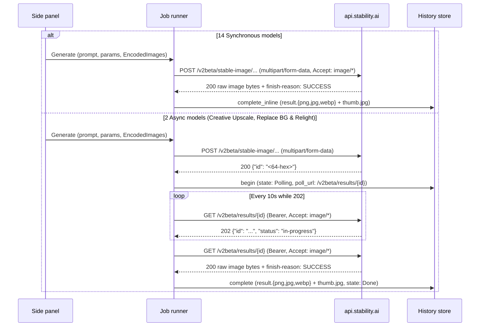

# Stability AI Image Provider - Plan

## Goal Capsule

- **Objective:** A person with a Stability AI key picks any of the sixteen Stability AI models across Generate, Upscale, and Edit, runs a synchronous or polled job from the prompt and canvas, and gets the resulting PNG, JPEG, or WebP into the existing history.
- **Means:** One Stability AI provider identity sending `multipart/form-data` with `Accept: image/*` and Bearer auth across all thirteen v2beta endpoints, completing fourteen model options inline from the submit response and polling `GET /v2beta/results/{id}` into inline completion for the two async services (KTD1, KTD2, KTD3).
- **Authority hierarchy:** R-IDs govern behavior and KTDs govern mechanism. `docs/api/stability.*.md` are the authoritative OpenAPI 3.0.1 schemas for endpoints, fields, bounds, required keys, and response headers. Where the Outpaint cURL example writes `-F bottom=200` and the OpenAPI schema defines `down`, the OpenAPI schema wins.
- **Stop conditions:** Stop if any synchronous endpoint stops returning raw image bytes under `Accept: image/*`. Stop if `GET /v2beta/results/{id}` requires a second unauthenticated CDN download instead of returning image bytes on HTTP 200. Stop if any endpoint rejects `Authorization: Bearer`.
- **Execution profile:** Feature work. Prove multipart request bodies, validation rules, and sync/async response classification in `easel-core` before wiring the runner, form, and settings tests.
- **Finishes and ships:** The implementer lands the work on the current branch.

---

## Product Contract

### Summary

Stability AI joins Black Forest Labs, Krea, Google, OpenAI, xAI, Chutes, and Qwen. One API key unlocks sixteen model choices covering all thirteen v2beta services in `docs/api/stability.*`: Stable Image Ultra, Stable Image Core, four Stable Diffusion 3.5 checkpoints, three upscalers, and seven edit services. Fourteen model choices finish in one request and two poll `GET /v2beta/results/{id}` every ten seconds until the image bytes arrive.

### Problem Frame

Every provider in Easel today either posts JSON and receives inline bytes or a temporary image URL, or polls a JSON status endpoint that hands back an unauthenticated CDN link. Stability AI's v2beta surface differs in three ways that current providers do not exercise together: every request is `multipart/form-data` mixing text parts with one to three named binary image parts (`image`, `mask`, `subject_image`, `background_reference`, `light_reference`), several edit and upscale services need no prompt or make the prompt conditional on how many images are loaded, and the two async services return the final image bytes directly in the authenticated `GET /v2beta/results/{id}` poll response rather than a separate download URL. Supporting the full `docs/api/stability.*` catalog requires bridging those multipart, validation, image-preparation, and poll-completion gaps without disturbing the seven existing providers.

### Key Decisions

- KD1. Cover all thirteen endpoints in `docs/api/stability.*` plus `/v2beta/results/{id}` polling. (session-settled: user-directed — chosen over Generate models only or a single-image subset: the user selected the full `docs/api/stability.*` surface during intake.) Governs R1, R5, R12, R13.
- KD2. List the four Stable Diffusion 3.5 variants as separate model entries alongside the other twelve services. (session-settled: user-approved — proposed in the scoping synthesis and confirmed, chosen over one Stable Diffusion 3.5 entry with a model dropdown: separate entries match the flat model menu convention and give Large/Medium their default `cfg_scale` of 4 and Large Turbo/Flash their default of 1.) Governs R1, R6.
- KD3. Switch Stable Image Ultra and the Stable Diffusion 3.5 models between text-to-image and image-to-image from the loaded image count. (session-settled: user-approved — proposed in the scoping synthesis and confirmed, chosen over a manual `mode` selector: an empty canvas sends `aspect_ratio` and no `strength`, while a loaded image sends `image` and `strength` and omits `aspect_ratio`.) Governs R6.
- KD4. Map multi-image edit services by prepared slot order, canvas first. (session-settled: user-approved — proposed in the scoping synthesis and confirmed, chosen over dedicated mask or reference file pickers: Erase and Inpaint use slot 1 as `image` and optional slot 2 as `mask`, and Replace Background and Relight uses slot 1 as `subject_image`, slot 2 as `background_reference`, and slot 3 as `light_reference`.) Governs R7, R8, R9.
- KD5. Allow an empty prompt on services where text is unused or optional. (session-settled: user-approved — proposed in the scoping synthesis and confirmed, chosen over requiring dummy prompt text: Fast Upscale, Remove Background, and Erase never send `prompt`, Outpaint sends `prompt` only when non-empty, and Replace Background and Relight requires `background_prompt` only when no `background_reference` image is loaded.) Governs R9, R10.
- KD6. Treat `finish-reason: CONTENT_FILTERED` as a `Blocked` failure instead of storing a blurred image. (session-settled: user-approved — proposed in the scoping synthesis and confirmed, chosen over saving blurred output to history: blurred moderation outputs record a failed row with no image file, matching HTTP 403 `content_moderation`.) Governs R14, R15.

### Requirements

**Provider and key**

- R1. The provider menu lists `Stability AI` once a key exists, and its model menu lists the sixteen models in the exact order of the model table. (KD1, KD2)
- R2. All sixteen models share one credential: a non-empty `STABILITY_API_KEY` environment variable overrides the stored key, and the stored key is filed under `https://api.stability.ai`.
- R3. Settings includes one generated "Stability AI API key" row whose Test button sends one `GET https://api.stability.ai/v2beta/results/0000000000000000000000000000000000000000000000000000000000000000` with Stability Bearer auth: HTTP 401 reports an invalid key, HTTP 404 or 200 accepts it, and the probe never spends credits or generates an image.
- R4. With a Stability AI model selected and no key available, Generate is disabled with `No Stability AI API key — open Settings`, and the status bar makes no balance request.

**Multipart requests and parameters**

- R5. Every Stability AI submit sends `POST` to its endpoint on `https://api.stability.ai` with Bearer auth, `Accept: image/*`, and a `multipart/form-data` body carrying only the fields documented for that service in the model table, with unset optional numbers and empty optional strings omitted. (KD1)
- R6. On Stable Image Ultra and the four SD 3.5 models, zero loaded images send `aspect_ratio` (plus `mode="text-to-image"` and `model` on SD 3.5) and omit `image` and `strength`. One loaded image sends binary part `image` and text part `strength` (plus `mode="image-to-image"` and `model` on SD 3.5) and omits `aspect_ratio`. (KD2, KD3)
- R7. Stable Image Core accepts zero images (`0 of N images will be sent` when images are loaded). The ten upscale and edit services require at least one image and disable Generate with `Add at least one image.` when none is loaded. When more images are loaded than a Stability AI model accepts, Generate stays enabled, excess images are omitted, and the notice reports `{sent} of {total} images will be sent`. (KD4)
- R8. On Erase and Inpaint, the first prepared image is sent as `image` and a second prepared image, when present, is sent as `mask`. When only one image is sent to Erase or Inpaint, upload preparation preserves its PNG alpha channel so Stability AI can derive the mask from transparency. (KD4)
- R9. On Replace Background and Relight, the first prepared image is sent as `subject_image`, a second as `background_reference`, and a third as `light_reference`. Non-empty editor prose is sent as `background_prompt`. When fewer than two images are loaded, empty editor prose disables Generate with `Prompt is empty`. `light_source_strength` is sent only when a third image (`light_reference`) is loaded or `light_source_direction` is set. `keep_original_background` is sent as `"true"` or `"false"`. (KD4, KD5)
- R10. Fast Upscale, Remove Background, and Erase never send a `prompt` field and allow an empty prompt box. Outpaint allows an empty prompt box, sends `prompt` only when non-empty, and disables Generate with `Set at least one outpaint direction above 0.` when `left`, `right`, `up`, and `down` are all zero. Search and Replace disables Generate when `search_prompt` is empty, and Search and Recolor disables Generate when `select_prompt` is empty. (KD5)
- R11. Input images that will be sent are checked against the selected service's documented dimension, pixel-count, and aspect-ratio rules in the model table before submit, and images down to 32×32 are accepted by upload preparation when the selected service allows them.

**Synchronous and async execution**

- R12. The fourteen synchronous models (Stable Image Ultra, Stable Image Core, the four SD 3.5 models, Fast Upscale, Conservative Upscale, Outpaint, Erase, Inpaint, Search and Replace, Search and Recolor, and Remove Background) complete in one POST when HTTP 200 returns non-empty `image/png`, `image/jpeg`, or `image/webp` bytes whose magic bytes match the header and whose `finish-reason` header is not `CONTENT_FILTERED`. (KD1)
- R13. Creative Upscale and Replace Background and Relight parse HTTP 200 `{"id": "<64-hex-chars>"}` on submit, record an in-flight history row with poll URL `https://api.stability.ai/v2beta/results/{id}`, and poll that URL with Bearer auth and `Accept: image/*` every 10 seconds: HTTP 202 keeps the job in `in-progress` polling, and HTTP 200 stores the returned image bytes directly into the history row without a second download request. (KD1)
- R14. Any HTTP 200 submit or poll response carrying header `finish-reason: CONTENT_FILTERED` (or JSON `finish_reason: "CONTENT_FILTERED"`), and any HTTP 403 response, fails as `Blocked` (`blocked by safety`), writes a failed history row, and writes no image file. (KD6)
- R15. Non-200 responses classify per the failure table: 401 `Auth`, 403 `Blocked`, 404 `ModelNotFound` on submit (or failed poll on `/v2beta/results/{id}`), 429 `RateLimited`, 400/413/422 `Validation` when the JSON body carries an `errors` message array and `Http` otherwise, and any other status `Http`. (KD6)

**Compatibility**

- R16. Stability AI results (`result.png`, `result.jpg`, `result.webp`) open, promote, save-as, reveal, compare, and restore through the existing history actions unchanged, and switching providers or models preserves the prompt, canvas, references, boxes, and schema-compatible field values while disarming the Box tool on Stability AI models.
- R17. Black Forest Labs, Krea, Google, OpenAI, xAI, Chutes, and Qwen requests, settings probes, and history rows remain unchanged.

### Model Table

All sixteen models set `supports_boxes: false` and `beta: false`. Seed is optional `Int` `0..=4_294_967_294` (omitted when unset or `0`). Style preset is optional `Select` over the seventeen documented values (`enhance`, `anime`, `photographic`, `digital-art`, `comic-book`, `fantasy-art`, `line-art`, `analog-film`, `neon-punk`, `isometric`, `low-poly`, `origami`, `modeling-compound`, `cinematic`, `3d-model`, `pixel-art`, `tile-texture`). Aspect ratio is `Select` over `21:9`, `16:9`, `3:2`, `5:4`, `1:1`, `4:5`, `2:3`, `9:16`, `9:21` with default `1:1`. Output format defaults to `png` over `png`, `jpeg`, `webp` (`png`, `webp` only on Remove Background).

| Menu name | id | Endpoint | Mode | Images | Prompt | Service-specific fields | Input image bounds |
| --- | --- | --- | --- | --- | --- | --- | --- |
| Stable Image Ultra | `stability-ultra` | `/v2beta/stable-image/generate/ultra` | Sync | 0–1 (`image`) | Required | `aspect_ratio` (0 images only); `strength` Float 0–1 default 0.7 (1 image only); `negative_prompt`; `seed`; `style_preset`; `output_format` | w,h 64–16384; pixels ≥ 4096 |
| Stable Image Core | `stability-core` | `/v2beta/stable-image/generate/core` | Sync | 0 | Required | `aspect_ratio`; `negative_prompt`; `seed`; `style_preset`; `output_format` | none |
| SD 3.5 Large | `sd3.5-large` | `/v2beta/stable-image/generate/sd3` | Sync | 0–1 (`image`) | Required | sends `model="sd3.5-large"` and `mode`; `aspect_ratio` (0 images); `strength` 0–1 default 0.7 (1 image); `cfg_scale` Float 1–10 default 4; `negative_prompt`; `seed`; `style_preset`; `output_format` | w,h ≥ 64 |
| SD 3.5 Large Turbo | `sd3.5-large-turbo` | `/v2beta/stable-image/generate/sd3` | Sync | 0–1 (`image`) | Required | same as `sd3.5-large` with `model="sd3.5-large-turbo"`, `cfg_scale` default 1 | w,h ≥ 64 |
| SD 3.5 Medium | `sd3.5-medium` | `/v2beta/stable-image/generate/sd3` | Sync | 0–1 (`image`) | Required | same as `sd3.5-large` with `model="sd3.5-medium"`, `cfg_scale` default 4 | w,h ≥ 64 |
| SD 3.5 Flash | `sd3.5-flash` | `/v2beta/stable-image/generate/sd3` | Sync | 0–1 (`image`) | Required | same as `sd3.5-large` with `model="sd3.5-flash"`, `cfg_scale` default 1, `strength` default 0.95 | w,h ≥ 64 |
| Fast Upscale | `stability-upscale-fast` | `/v2beta/stable-image/upscale/fast` | Sync | 1 (`image`) | Unused | `output_format` | w,h 32–1536; pixels 1024–1048576 |
| Conservative Upscale | `stability-upscale-conservative` | `/v2beta/stable-image/upscale/conservative` | Sync | 1 (`image`) | Required | `creativity` Float 0.2–0.5 default 0.35; `negative_prompt`; `seed`; `output_format` | w,h ≥ 64; pixels 4096–9437184; ratio 1:2.5–2.5:1 |
| Creative Upscale | `stability-upscale-creative` | `/v2beta/stable-image/upscale/creative` | Async | 1 (`image`) | Required | `creativity` Float 0.1–0.5 default 0.3; `negative_prompt`; `seed`; `style_preset`; `output_format` | w,h ≥ 64; pixels 4096–1048576 |
| Outpaint | `stability-outpaint` | `/v2beta/stable-image/edit/outpaint` | Sync | 1 (`image`) | Optional | `left`, `right`, `up`, `down` Int 0–2000 default 0 (≥1 non-zero); `creativity` Float 0–1 default 0.5; `seed`; `style_preset`; `output_format` | w,h ≥ 64; pixels 4096–9437184; ratio 1:2.5–2.5:1 |
| Erase | `stability-erase` | `/v2beta/stable-image/edit/erase` | Sync | 1–2 (`image`, `mask`) | Unused | `grow_mask` Int 0–20 default 5; `seed`; `output_format` | w,h ≥ 64; pixels 4096–9437184 |
| Inpaint | `stability-inpaint` | `/v2beta/stable-image/edit/inpaint` | Sync | 1–2 (`image`, `mask`) | Required | `grow_mask` Int 0–100 default 5; `negative_prompt`; `seed`; `style_preset`; `output_format` | w,h ≥ 64; pixels 4096–9437184 |
| Search and Replace | `stability-search-and-replace` | `/v2beta/stable-image/edit/search-and-replace` | Sync | 1 (`image`) | Required | `search_prompt` Text required; `grow_mask` Int 0–20 default 3; `negative_prompt`; `seed`; `style_preset`; `output_format` | w,h ≥ 64; pixels 4096–9437184; ratio 1:2.5–2.5:1 |
| Search and Recolor | `stability-search-and-recolor` | `/v2beta/stable-image/edit/search-and-recolor` | Sync | 1 (`image`) | Required | `select_prompt` Text required; `grow_mask` Int 0–20 default 3; `negative_prompt`; `seed`; `style_preset`; `output_format` | w,h ≥ 64; pixels 4096–9437184; ratio 1:2.5–2.5:1 |
| Remove Background | `stability-remove-background` | `/v2beta/stable-image/edit/remove-background` | Sync | 1 (`image`) | Unused | `output_format` (`png`, `webp` only) | w,h ≥ 64; pixels 4096–4194304 |
| Replace Background and Relight | `stability-replace-background-and-relight` | `/v2beta/stable-image/edit/replace-background-and-relight` | Async | 1–3 (`subject_image`, `background_reference`, `light_reference`) | Required if 1 image (`background_prompt`) | `foreground_prompt`; `negative_prompt`; `preserve_original_subject` Float 0–1 default 0.6; `original_background_depth` Float 0–1 default 0.5; `keep_original_background` Bool default false; `light_source_direction` Select (`left`, `right`, `above`, `below`) optional; `light_source_strength` Float 0–1 default 0.3; `seed`; `output_format` | w,h ≥ 64; pixels 4096–9437184; subject ratio 1:2.5–2.5:1 |

### Key Flows

- F1. Text-to-image or image-to-image on Ultra and SD 3.5
  - **Steps:** Select Stability AI and Ultra or an SD 3.5 variant, type a prompt, and generate either from an empty canvas or with one image loaded.
  - **Outcome:** Empty canvas sends `aspect_ratio` (and `mode="text-to-image"` on SD 3.5); loaded canvas sends `image` and `strength` (and `mode="image-to-image"` on SD 3.5); one image lands in history after one POST.
  - **Covered by:** R5, R6, R12
- F2. Promptless and multi-image edits
  - **Steps:** Load one to three images on the sheet, pick Erase, Inpaint, Remove Background, Fast Upscale, Outpaint, or Replace Background and Relight, and generate.
  - **Outcome:** Prepared images map in slot order (`image` + `mask` or `subject_image` + `background_reference` + `light_reference`), promptless tools run without text, and excess images clamp with the send notice.
  - **Covered by:** R7, R8, R9, R10, R11
- F3. Async upscale and background replacement
  - **Steps:** Submit Creative Upscale or Replace Background and Relight, observe `in-progress` polling every 10 seconds, and receive the finished image (or dismiss while polling).
  - **Outcome:** Submit creates a polling history row, HTTP 202 keeps polling, and HTTP 200 writes the image bytes directly to the history row and marks it Done.
  - **Covered by:** R13, R14, R15

### Acceptance Examples

- AE1. SD 3.5 Large text-to-image vs image-to-image.
  - **Covers:** R5, R6, R12
  - **Given:** `sd3.5-large` is selected with prompt `"lighthouse"`, `aspect_ratio` `"16:9"`, and `strength` `0.7`.
  - **When:** the person generates once with an empty canvas and once with one loaded image.
  - **Then:** the first POST sends `mode="text-to-image"`, `model="sd3.5-large"`, and `aspect_ratio="16:9"` with no `image` or `strength`; the second POST sends `mode="image-to-image"`, `model="sd3.5-large"`, `image`, and `strength="0.7"` with no `aspect_ratio`.
- AE2. Promptless Fast Upscale on a 64×64 image.
  - **Covers:** R7, R10, R11, R12
  - **Given:** `stability-upscale-fast` is selected, a 64×64 image is loaded, and the prompt box is empty.
  - **When:** the person generates.
  - **Then:** Generate is enabled, the multipart body sends `image` and `output_format="png"` with no `prompt` part, and one image is stored in history.
- AE3. Erase and Inpaint with one vs two images.
  - **Covers:** R8, R10
  - **Given:** `stability-erase` is selected with a 512×512 image loaded, then a second 512×512 image is added.
  - **When:** the person generates in each state.
  - **Then:** the one-image request sends `image` encoded as PNG (preserving alpha) and no `mask` part; the two-image request sends slot 1 as `image` and slot 2 as `mask`.
- AE4. Replace Background and Relight slot and lighting rules.
  - **Covers:** R9, R13
  - **Given:** `stability-replace-background-and-relight` is selected with one subject image and an empty prompt, then a second background reference image is added.
  - **When:** the form validates and then submits.
  - **Then:** with one image and an empty prompt, Generate is disabled with `Prompt is empty`; with two images and an empty prompt, Generate is enabled and sends `subject_image` and `background_reference` while omitting `background_prompt` and `light_source_strength` (until `light_source_direction` or a third `light_reference` image is present).
- AE5. Creative Upscale async poll lifecycle.
  - **Covers:** R13, R14
  - **Given:** `stability-upscale-creative` is submitted with a 256×256 image and prompt.
  - **When:** the POST returns `{"id": "<64-hex>"}`, the first poll returns HTTP 202, and the second poll returns HTTP 200 `image/webp` with `finish-reason: SUCCESS`.
  - **Then:** history records one polling row after submit, stays in-flight on 202, and writes `result.webp` directly from the 200 poll response with no third HTTP request.
- AE6. Blurred content-filtered response.
  - **Covers:** R14
  - **Given:** a Stability AI submit or poll returns HTTP 200 with image bytes and header `finish-reason: CONTENT_FILTERED`.
  - **When:** the runner processes the response.
  - **Then:** the job fails with `Blocked` (`blocked by safety`), writes a failed history row, and saves no image file.
- AE7. Outpaint all-zero directions and Search prompt gates.
  - **Covers:** R10
  - **Given:** one image is loaded and `stability-outpaint` is selected with `left=0, right=0, up=0, down=0`, or `stability-search-and-replace` is selected with `search_prompt` cleared.
  - **When:** the form refreshes.
  - **Then:** Outpaint disables Generate with `Set at least one outpaint direction above 0.`, and Search and Replace disables Generate with `Search prompt is required`.

### Success Criteria

- Every model in the model table posts its documented multipart fields and omits undocumented or mode-excluded fields.
- All fourteen synchronous models land `result.png`, `result.jpg`, or `result.webp` after one POST, and both async models land their result directly from `GET /v2beta/results/{id}` on HTTP 200 without an extra download GET.
- `finish-reason: CONTENT_FILTERED` on HTTP 200 and `content_moderation` on HTTP 403 both record a `Blocked` failed row with no saved image bytes.
- All workspace formatting, clippy, and nextest suites pass with existing providers untouched.

### Scope Boundaries

One provider (`Stability AI`), sixteen model choices across thirteen endpoints, `multipart/form-data` requests, synchronous and `/v2beta/results/{id}` polled completions, and the settings key probe. Considered and not built:

- Cross-restart resume of in-flight Stability AI async jobs in `JobRunner::resume` — `resume()` is intentionally BFL-only (Krea also fails in-flight rows on restart), and Stability results expire after 24 hours; reopen only if cross-restart resume is generalized across providers.
- Over-cap image refusals that disable Generate when switching from a 3-image model to a 1-image or 0-image model — clamping with the existing `{sent} of {total} images will be sent` notice avoids dead-ending the form when switching models.

#### Deferred to Follow-Up Work

- Stability AI Control services (`sketch`, `structure`, `style`, `style-transfer`) and Stable Audio services (`stable-audio-2.0`, `stable-audio-2.5`, `stable-audio-3.0`).
- An interactive mask-painting brush on the canvas (Erase and Inpaint use either image alpha or a second loaded mask image).
- A Stability AI credit balance surface in the status bar.

### Sources

- `docs/api/stability.iu.md`, `docs/api/stability.ic.md`, `docs/api/stability.sd3.5.md` — Generate endpoints, parameters, image-to-image `mode` and `strength` rules, and credit rates.
- `docs/api/stability.upscale-fast.md`, `docs/api/stability.upscale-conservative.md`, `docs/api/stability.upscale-creative.md`, `docs/api/stability.results.md` — Upscale endpoints, input pixel/dimension rules, async `GenerationID` response, and `/v2beta/results/{id}` 10-second polling contract.
- `docs/api/stability.upscale-outpaint.md`, `docs/api/stability.edit-erase.md`, `docs/api/stability.edit-impaint.md`, `docs/api/stability.edit-replace.md`, `docs/api/stability.edit-recolor.md`, `docs/api/stability.edit-remove-background.md`, `docs/api/stability.edit-replace-background.md` — Edit endpoints, multipart binary field names, `grow_mask` and `creativity` bounds, and conditional prompt/lighting rules.

---

## Planning Contract

### Key Technical Decisions

- KTD1. **Sixteen unit-struct specs under `crates/easel-core/src/providers/stability/mod.rs` sharing one `ProviderId::Stability` identity.** `ProviderId::Stability` serializes as `"stability"`, displays `"Stability AI"`, reads `STABILITY_API_KEY`, uses `AuthScheme::Bearer`, sets base URL `https://api.stability.ai`, and restricts `allowed_hosts` to `[HostRule::Exact("api.stability.ai")]`. Each of the sixteen models in the model table is a unit struct with a static `ModelSpec` registered in `ModelRegistry::specs` in menu order. In `AppState::set_model` (`crates/easel/src/app_state.rs`), when an outgoing field value equals the outgoing model's schema default and the incoming model defines its own default for that key, keep the incoming model's default instead of overwriting it with the untouched outgoing default, while preserving values that differ from the outgoing default. (session-settled: user-approved — chosen over a single SD 3.5 entry with a model dropdown: separate specs carry per-checkpoint `cfg_scale` and `strength` defaults directly in `ParamSchema`.) Governs R1, R2, R4, R6, R16.
- KTD2. **Multipart builder from descriptor tables and raw `EncodedImage` bytes.** Each model descriptor declares its endpoint path, sync/async kind, prompt policy (`Required`, `Optional`, `Unused`, or `RequiredUnlessSecondImage`), image part names (`&[]`, `&["image"]`, `&["image", "mask"]`, or `&["subject_image", "background_reference", "light_reference"]`), and allowed schema keys. `build_submit` constructs `Body::Multipart { parts }` with text parts (`filename: None, content_type: "text/plain"`) and binary image parts (`filename: Some("image.{png|jpg|webp}")`, `content_type: image.media_type.clone()`, `bytes: image.bytes.clone()`) taken from `request.images.iter().take(max)` without base64 round-tripping. `HttpRequest.headers` sets `Accept: image/*` and omits `Content-Type` so `reqwest` attaches the multipart boundary; `ReqwestTransport::multipart_form` skips `.mime_str` when `part.content_type.is_empty()`. (session-settled: user-approved — chosen over dedicated mask/reference file pickers: ordered `request.images` slots map directly to each endpoint's named binary parts.) Governs R5, R6, R8, R9, R10.
- KTD3. **Unified image/error classifier across sync submit and async `/v2beta/results/{id}` polling.** A shared classifier inspects `HttpResponse`:
  1. If `finish-reason` header (case-insensitive) is `"CONTENT_FILTERED"`, or if a JSON body carries `"finish_reason": "CONTENT_FILTERED"` or `"name": "content_moderation"` or HTTP status is `403`, return `Err(ProviderError::Blocked)`. (session-settled: user-approved — chosen over storing blurred `CONTENT_FILTERED` images: blurred outputs fail closed as `Blocked`.)
  2. On HTTP `200`, normalize `content-type` (strip parameters, lowercase, map `image/jpg` to `image/jpeg`) or decode JSON `{"image": "<base64>"}` if JSON was returned; verify non-empty bytes and matching PNG/JPEG/WebP magic signature via `bfl::protocol::extract_result_mime(None, &bytes)` (with `"webp"` enabled on `image` in `crates/easel-core/Cargo.toml`), and return `Ok(InlineImage { bytes, mime, interaction_id: String::new(), suggestion: String::new() })`. Any HTTP `200` on a synchronous model (or on a poll response) that lacks valid image bytes is `Err(ProviderError::NoImage)`.
  3. On async submit (`Creative Upscale`, `Replace Background and Relight`), HTTP `200` parses `{"id": "<64-hex>"}` via `JobId::parse` and returns `Submitted { job_id, poll_url: "https://api.stability.ai/v2beta/results/{id}", quote: None }`.
  4. On `parse_poll`, HTTP `202` returns `PollOutcome::InFlight { status: "in-progress".into(), progress: None }`. In `JobRunner::finish_poll`, when `response` is `Ok(response)` and `provider.inline_image(&response)` returns `Some(image)`, the runner validates with `decode_image`, generates the thumbnail, calls `self.history.complete(&id, &image.bytes, &image.mime, &thumb, &Completion::default())`, and transitions the slot to `JobState::Done` without calling `start_download` or `plain_download`. `poll_request` uses `auth: Some(ProviderId::Stability)`, header `Accept: image/*`, and `max_body_bytes: 100 * 1024 * 1024`; `poll_policy` uses a 10-second interval (`initial: 10s, factor: 1.0, cap: 10s, deadline: 600s`). Governs R12, R13, R14, R15.
- KTD4. **Schema and per-service validation in `easel-core` plus `PrepOptions` floor adjustment.**
  1. In `ParamSchema::validate` (`crates/easel-core/src/schema.rs`), treat `Some(Value::String(s))` where `field.required && s.trim().is_empty()` as missing (`"{label} is required"`), and in `SchemaForm::build_control` (`crates/easel/src/side_panel/schema_form.rs`) set `clear_blank = field.default.is_none()` on `FieldKind::Text` so clearing `search_prompt` or `select_prompt` disables Generate.
  2. In `Stability::validate_for_submit`, enforce the service's prompt rule (R9, R10), minimum image count (`sent == 0` -> `Add at least one image.` on the 10 upscale/edit services), Outpaint direction sum (`left + right + up + down > 0`), and per-endpoint input image dimension, pixel-count, and aspect-ratio rules against `scene.slots().into_iter().take(image_count)` (when `width > 0 && height > 0`).
  3. In `PrepOptions` (`crates/easel-core/src/image_prep.rs`), add `min_side: u32` (defaulting to `256` in `PrepOptions::for_resolution` so existing behavior and tests are unchanged). In `submit::build_request` (`crates/easel/src/jobs/submit.rs`), when `app.spec().provider == ProviderId::Stability`, set `min_side: 32`, set `max_pixels: 9_437_184` (or `1_048_576` on `Fast Upscale` and `Creative Upscale`, `4_194_304` on `Remove Background`), and set `prefer_jpeg: false` when `Erase` or `Inpaint` is selected with a single image so PNG transparency is preserved even when all pixels are opaque. Governs R7, R8, R9, R10, R11.
- KTD5. **Zero-cost settings key probe on `/v2beta/results/{id}`.** `key_probe(ProviderId::Stability)` issues `GET https://api.stability.ai/v2beta/results/0000000000000000000000000000000000000000000000000000000000000000` with `auth: Some(ProviderId::Stability)`. An invalid key returns HTTP 401 (`"invalid key"` toast), while a valid key returns HTTP 404 `generation_not_found` (`"key accepted"` toast) without touching undocumented v1 endpoints or spending credits. Governs R3.

### Failure Table

| Stability AI response | `ProviderError` | Sync submit history | Async poll history |
| --- | --- | --- | --- |
| 200 `image/png`, `image/jpeg`, or `image/webp`, magic matches, `finish-reason != CONTENT_FILTERED` | inline image | done row (`result.png`/`jpg`/`webp`) | done row (`result.png`/`jpg`/`webp`) |
| 200 `finish-reason: CONTENT_FILTERED` (header or JSON) | `Blocked` | failed row, no image file | failed row, no image file |
| 200 on sync submit or poll with non-image body, empty bytes, or magic mismatch | `NoImage` | failed row | failed row |
| 200 on async submit with valid 64-hex `id` | `Submitted` | in-flight polling row | n/a |
| 202 on async poll | `PollOutcome::InFlight` | n/a | stays in-flight (`in-progress`) |
| 401 | `Auth` | failed row | failed row |
| 403 (`content_moderation` or other) | `Blocked` | failed row | failed row |
| 404 | `ModelNotFound` (submit) / `Protocol` (poll) | failed row | failed row |
| 400, 413, 422 with JSON `errors: ["..."]` | `Validation(joined_errors)` | no row | failed row |
| 429 | `RateLimited { retry_after: None }` | no row | failed row |
| 500 or other non-200 without `errors` | `Http { status, body }` | no row | failed row |
| transport timeout or connection error | `Network` | no row | failed row |

### High-Level Technical Design

Synchronous services finish in one multipart POST; async services (`Creative Upscale` and `Replace Background and Relight`) poll `GET /v2beta/results/{id}` every 10 seconds and complete inline from the poll response bytes.



Multipart assembly and response classification follow deterministic gates across all sixteen models.

```mermaid
flowchart TB
  Start[build_submit] --> Mode{Model family}
  Mode -->|Core| P0[prompt + schema fields, 0 images]
  Mode -->|Ultra / SD 3.5| HasImg{images.len() == 1?}
  HasImg -->|no| T2I[prompt + aspect_ratio, omit strength; SD 3.5 mode=text-to-image]
  HasImg -->|yes| I2I[prompt + image + strength, omit aspect_ratio; SD 3.5 mode=image-to-image]
  Mode -->|Single-image Upscale / Edit| P1[image + prompt per policy + schema fields]
  Mode -->|Erase / Inpaint| P2[slot 0 -> image, optional slot 1 -> mask]
  Mode -->|Replace BG & Relight| P3[slot 0 -> subject_image, slot 1 -> background_reference, slot 2 -> light_reference; light_source_strength only if light source set]
  P0 --> Resp{HTTP response}
  T2I --> Resp
  I2I --> Resp
  P1 --> Resp
  P2 --> Resp
  P3 --> Resp
  Resp -->|200 + finish-reason: CONTENT_FILTERED or 403| Blocked[ProviderError::Blocked -> failed row]
  Resp -->|200 + sync or poll + valid magic| Inline[InlineImage -> Done row]
  Resp -->|200 + async submit + 64-hex id| Poll[Submitted -> poll /v2beta/results/id every 10s]
  Resp -->|401 / 404 / 200 bad bytes| RowFail[Auth / ModelNotFound / NoImage -> failed row]
  Resp -->|400, 413, 422, 429, 5xx| LiveFail[Validation / RateLimited / Http]
```

### Sequencing

U1 wires `ProviderId::Stability`, the transport multipart guard, the required-text schema fix, `PrepOptions::min_side`, and inline poll completion in `JobRunner::finish_poll`. U2 builds the sixteen Stability AI specs, multipart builders, validators, and response/poll classifiers in `easel-core`. U3 proves the side-panel form, model-switching, and validation contracts, and U4 proves the synchronous and async runner and history lifecycles.

---

## Implementation Units

### U1. Wire `ProviderId::Stability` and core multipart, prep, schema, and poll-inline primitives

- **Goal:** `ProviderId::Stability` compiles across the workspace, `ReqwestTransport` accepts text multipart parts without a per-part MIME error, `ParamSchema` rejects blank required text fields, `PrepOptions` supports a configurable minimum side, and `JobRunner::finish_poll` can complete an async poll when `GET /v2beta/results/{id}` returns inline image bytes.
- **Requirements:** R2, R3, R4, R10, R11, R13
- **Dependencies:** none
- **Files:**
  - `crates/easel-core/Cargo.toml`
  - `crates/easel-core/src/model_spec.rs`
  - `crates/easel-core/src/schema.rs`
  - `crates/easel-core/src/image_prep.rs`
  - `crates/easel-core/src/history.rs`
  - `crates/easel/src/app_state.rs`
  - `crates/easel/src/net/mod.rs`
  - `crates/easel/src/net/reqwest_transport.rs`
  - `crates/easel/src/settings/mod.rs`
  - `crates/easel/src/settings/credentials.rs`
  - `crates/easel/src/side_panel/validation.rs`
  - `crates/easel/src/side_panel/schema_form.rs`
  - `crates/easel/src/jobs/submit.rs`
  - `crates/easel/src/jobs/runner.rs`
- **Approach:**
  1. Add `"webp"` to `image` features in `crates/easel-core/Cargo.toml` so WebP magic sniffing and thumbnail generation work in standalone `easel-core` tests.
  2. Add `ProviderId::Stability` in `crates/easel-core/src/model_spec.rs` per KTD1 and grow all exhaustive `ProviderId` matches across `history.rs`, `validation.rs`, `settings/mod.rs`, `net/mod.rs`, and `jobs/runner.rs`, plus `key_probe(ProviderId::Stability)` per KTD5.
  3. In `crates/easel/src/net/reqwest_transport.rs`, call `encoded.mime_str(&part.content_type)` only when `!part.content_type.is_empty()` per KTD2.
  4. In `crates/easel-core/src/schema.rs` and `crates/easel/src/side_panel/schema_form.rs`, reject whitespace-only strings on `required: true` `FieldKind::Text` fields and set `clear_blank = field.default.is_none()` per KTD4, and in `AppState::set_model` (`crates/easel/src/app_state.rs`) keep the target model's default when an outgoing value equals the outgoing model's untouched default per KTD1.
  5. Add `min_side: u32` to `PrepOptions` in `crates/easel-core/src/image_prep.rs` (defaulting to `256` in `PrepOptions::for_resolution`) and configure `submit::build_request` for `ProviderId::Stability` per KTD4.
  6. In `JobRunner::finish_poll` (`crates/easel/src/jobs/runner.rs`), check `provider.inline_image(response)` on `Ok(response)` before `parse_poll` and complete the in-flight history row directly via `self.history.complete` per KTD3.
- **Patterns to follow:** `ProviderId::Chutes` and `ProviderId::Qwen` arms across `model_spec.rs`, `settings/mod.rs`, `validation.rs`, and `runner.rs`; `JobRunner::finish_download` and `JobRunner::finish_inline` in `crates/easel/src/jobs/runner.rs`.
- **Test scenarios:**
  - `ProviderId::Stability` serializes as `"stability"`, displays `"Stability AI"`, uses `STABILITY_API_KEY`, uses `AuthScheme::Bearer`, and `allows_url` accepts `https://api.stability.ai/v2beta/results/abc` while rejecting `http://api.stability.ai` and `https://evil.stability.ai`.
  - `key_probe(ProviderId::Stability)` builds `GET https://api.stability.ai/v2beta/results/0000000000000000000000000000000000000000000000000000000000000000` with `auth: Some(ProviderId::Stability)` and `Body::Empty`; HTTP 401 toasts `"invalid key"` and HTTP 404 toasts `"key accepted"`.
  - `missing_key_line(ProviderId::Stability)` returns `"No Stability AI API key — open Settings"`.
  - `ParamSchema::validate` rejects an empty or whitespace-only string `""` on a `required: true` `FieldKind::Text` field with `"{label} is required"`.
  - `prepare_for_upload` with `min_side: 32` accepts a 64×64 image and encodes a 64×64 opaque image as `image/png` when `prefer_jpeg` is `false`, while `PrepOptions::for_resolution("1k")` still rejects images below 256×256.
  - `ReqwestTransport::multipart_form` builds a valid `reqwest::multipart::Form` when a text `Part` has `content_type: "text/plain"` or `""` alongside a binary `image/png` `Part`.
- **Verification:** Both crates compile cleanly with `ProviderId::Stability`, and unit tests for identity, host allowlist, key probe, required text validation, `min_side` prep, and multipart form construction pass.

### U2. Implement the sixteen Stability AI specs, multipart builders, validators, and classifiers

- **Goal:** All sixteen Stability AI models resolve from `ModelRegistry`, validate their service-specific field and image constraints, build exact `Body::Multipart` requests, and classify synchronous and polled responses per the model and failure tables.
- **Requirements:** R1, R5, R6, R7, R8, R9, R10, R11, R12, R13, R14, R15 (KD1, KD2, KD3, KD4, KD5, KD6, KTD1, KTD2, KTD3, KTD4)
- **Dependencies:** U1
- **Files:**
  - `crates/easel-core/src/providers/stability/mod.rs`
  - `crates/easel-core/src/providers/mod.rs`
- **Approach:**
  1. Define the sixteen unit structs and their `ModelSpec`s in `crates/easel-core/src/providers/stability/mod.rs` in the exact order of the model table, and register them in `ModelRegistry::specs()`, `ModelRegistry::providers()`, and `resolve_model()` in `crates/easel-core/src/providers/mod.rs` per KTD1.
  2. Implement `build_submit` per KTD2: attach `Accept: image/*`, `auth: Some(ProviderId::Stability)`, and `Body::Multipart { parts }` carrying the service's prompt part (`prompt` or `background_prompt`, omitted when unused or empty), conditional `mode`/`model`/`aspect_ratio`/`strength` on Ultra and SD 3.5 (R6), conditional `light_source_strength` and `"true"`/`"false"` `keep_original_background` on Replace Background and Relight (R9), optional schema fields (`seed` omitted when `0` or unset, empty text/select omitted), and ordered binary image parts (`image`, `mask`, `subject_image`, `background_reference`, `light_reference`).
  3. Implement `validate_for_submit` per KTD4: check prompt requiredness per service, minimum image count (`sent == 0` -> `Add at least one image.` on the 10 upscale/edit services), Outpaint direction sum (`left + right + up + down > 0`), and per-endpoint input image dimension, pixel-count, and aspect-ratio bounds on `scene.slots().into_iter().take(image_count)`.
  4. Implement `inline_image`, `parse_submit`, `poll_request`, `parse_poll`, and `poll_policy` per KTD3 and the failure table.
- **Execution note:** Write the `easel-core` unit tests for all sixteen multipart bodies, validation rules, and response/poll classifications alongside the module before touching UI form tests.
- **Patterns to follow:** `crates/easel-core/src/providers/chutes/mod.rs` for descriptor-driven multi-model specs and raw-byte magic verification; `crates/easel-core/src/providers/krea/assets.rs` for `Part` construction.
- **Test scenarios:**
  - `ModelRegistry::specs()` lists the sixteen Stability AI model IDs in the exact order of the model table, all resolving to `ProviderId::Stability`.
  - Covers AE1. `sd3.5-large` with 0 images sends `mode="text-to-image"`, `model="sd3.5-large"`, `prompt`, `aspect_ratio="16:9"`, `cfg_scale="4"`, `output_format="png"`, and omits `image` and `strength`; with 1 image it sends `mode="image-to-image"`, `model="sd3.5-large"`, `image`, `strength="0.7"`, and omits `aspect_ratio`. `stability-ultra` with 0 images sends `aspect_ratio` and omits `strength`; with 1 image it sends `image` and `strength` and omits `aspect_ratio` and `mode`.
  - `sd3.5-large-turbo` and `sd3.5-flash` default `cfg_scale` to `1` (`strength` default `0.95` on Flash); `sd3.5-large` and `sd3.5-medium` default `cfg_scale` to `4`.
  - Covers AE2. `stability-upscale-fast` with 1 image and empty prompt passes `validate_for_submit` and builds a multipart body with `image` and `output_format` and no `prompt` part, even if `compiled_prompt` is non-empty.
  - Covers AE3. `stability-erase` and `stability-inpaint` send 1 image as `image` (with `Erase` omitting `prompt` and `Inpaint` requiring `prompt`), and send 2 images as `image` (slot 0) and `mask` (slot 1).
  - Covers AE4. `stability-replace-background-and-relight` with 1 image fails validation when prompt is empty and passes when prompt is set (sending `subject_image` and `background_prompt`, omitting `light_source_strength`); with 2 images and empty prompt it passes validation and sends `subject_image` and `background_reference` without `background_prompt`; with 3 images or `light_source_direction="left"` it includes `light_source_strength="0.3"`.
  - Covers AE7. `stability-outpaint` with `left=0, right=0, up=0, down=0` fails `validate_for_submit` with `Set at least one outpaint direction above 0.`, and with `down=200` it sends part `down="200"` (not `bottom`). `stability-search-and-replace` and `stability-search-and-recolor` fail validation when `search_prompt` or `select_prompt` is empty or whitespace.
  - `stability-remove-background` only accepts `png` and `webp` for `output_format` (rejecting `jpeg`) and sends no `prompt` part.
  - Input image bounds in `validate_for_submit`: a 20×20 image fails on `Fast Upscale` (min 32×32); a 48×48 image passes on `Fast Upscale` and fails on `Conservative Upscale` (min 64×64); a 1600×1000 image fails on `Fast Upscale` (max side 1536 and max 1,048,576 pixels) and `Creative Upscale` (max 1,048,576 pixels) but passes on `Conservative Upscale` (up to 9,437,184 pixels); a 300×1000 image (ratio 1:3.33) fails on `Outpaint` and `Conservative Upscale` (ratio must be between 1:2.5 and 2.5:1).
  - Sync and poll response classification: HTTP 200 with valid PNG/JPEG/WebP bytes and `finish-reason: SUCCESS` yields `InlineImage`; HTTP 200 with `finish-reason: CONTENT_FILTERED` header (or JSON `finish_reason: "CONTENT_FILTERED"`) yields `None` from `inline_image` and `Err(ProviderError::Blocked)` from `parse_submit` / `PollOutcome::Failed(ProviderError::Blocked)` from `parse_poll`; HTTP 403 yields `Blocked`; HTTP 401 yields `Auth`; HTTP 404 yields `ModelNotFound` on submit; HTTP 429 yields `RateLimited`; HTTP 400/413/422 with `{"id":"...","name":"bad_request","errors":["some-field: is required"]}` yields `Validation("some-field: is required")`; HTTP 200 on `Creative Upscale` and `Replace Background and Relight` submit with a 64-hex `id` yields `Submitted` pointing to `https://api.stability.ai/v2beta/results/{id}` with a 10-second `poll_policy`.
- **Verification:** All sixteen models pass request-body, validation, and response/poll classification unit tests in `cargo nextest run -p easel-core`.

### U3. Prove the side-panel form, validation notices, and model-switching contracts

- **Goal:** The side panel exposes Stability AI when a key is present, enforces every form-level gate and clamping notice across the sixteen models, and preserves compatible state across switches.
- **Requirements:** R1, R4, R7, R8, R9, R10, R11, R16, R17
- **Dependencies:** U2
- **Files:**
  - `crates/easel/src/side_panel/form_tests.rs`
  - `crates/easel/src/side_panel/switch_tests.rs`
  - `crates/easel/src/status_bar.rs`
- **Approach:**
  1. Add `"STABILITY_API_KEY"` (and `"DASHSCOPE_API_KEY"`) to `ProviderEnvGuard::clear()` in `crates/easel/src/side_panel/switch_tests.rs` so provider menu tests stay isolated from ambient shell variables.
  2. Add form and switch tests in `form_tests.rs` and `switch_tests.rs` covering provider visibility, the sixteen-model menu order, missing-key gating, promptless generation, required text field clearing, Outpaint direction validation, over-cap image clamping notices, and value carry-over on model switches.
  3. Add a status-bar test in `crates/easel/src/status_bar.rs` asserting that selecting a Stability AI model with a key present makes no credit balance HTTP request.
- **Patterns to follow:** Chutes and Qwen tests in `crates/easel/src/side_panel/form_tests.rs` and `crates/easel/src/side_panel/switch_tests.rs`; `xai_does_not_ask_for_credits` in `crates/easel/src/status_bar.rs`.
- **Test scenarios:**
  - Stability AI is hidden from the provider menu without a key and appears once a key is set, listing all sixteen models in the exact model table order. Covers R1.
  - Missing Stability AI key disables Generate with `No Stability AI API key — open Settings`, and with a key present the status bar makes zero HTTP requests. Covers R4.
  - Covers AE2. Selecting `Fast Upscale`, `Remove Background`, or `Erase` with one 64×64 image loaded and an empty prompt enables Generate, and `build_request` succeeds with PNG bytes preserved on 1-image `Erase`/`Inpaint`.
  - Covers AE4. Selecting `Replace Background and Relight` with 1 image and an empty prompt disables Generate with `Prompt is empty`; adding a second image enables Generate with the prompt still empty.
  - Covers AE7. Selecting `Outpaint` with 1 image and all four directions at `0` disables Generate with `Set at least one outpaint direction above 0.`; setting `left` to `200` enables Generate. Typing and then clearing `search_prompt` on `Search and Replace` disables Generate with `Search prompt is required`.
  - Loading 3 images on `Replace Background and Relight` and switching to `Stable Image Ultra` keeps Generate enabled with notice `1 of 3 images will be sent`; switching to `Stable Image Core` keeps Generate enabled with `0 of 3 images will be sent`; switching to `Inpaint` with 0 images disables Generate with `Add at least one image.`. Covers R7, R16.
  - Switching from `Stable Image Ultra` with `output_format="jpeg"` to `Remove Background` resets `output_format` to `"png"`, while `output_format="webp"` carries over. Switching from `SD 3.5 Large` (`cfg_scale=4`) to `SD 3.5 Large Turbo` or `SD 3.5 Flash` updates untouched `cfg_scale` to `1` (and untouched `strength` `0.7` to `0.95` on Flash), while an explicitly edited `cfg_scale=6.5` carries over and keeps prompt, canvas, and boxes. Covers R6, R16.
- **Verification:** All side-panel form, switch, and status-bar tests pass in `cargo nextest run -p easel`.

### U4. Prove the synchronous and async runner and history lifecycles

- **Goal:** Synchronous Stability AI runs complete in one POST, async runs (`Creative Upscale` and `Replace Background and Relight`) poll `/v2beta/results/{id}` on 202 and complete inline on 200 without a second download GET, and every failure class matches the failure table.
- **Requirements:** R12, R13, R14, R15, R16, R17
- **Dependencies:** U2
- **Files:**
  - `crates/easel/src/jobs/stability_tests.rs`
  - `crates/easel/src/jobs/mod.rs`
- **Approach:**
  1. Create `crates/easel/src/jobs/stability_tests.rs` (wired in `crates/easel/src/jobs/mod.rs`) using `FakeTransport` and real PNG, JPEG, and WebP fixtures.
  2. Test synchronous completion, async 202 -> 200 inline poll completion, `finish-reason: CONTENT_FILTERED` blocking on both submit and poll, HTTP error classification, dismissal during submit and during polling, and history restore/compare.
- **Execution note:** Use valid PNG, JPEG, and WebP fixtures so `decode_image`, `thumbnail`, and `HistoryStore::complete` / `complete_inline` run their real decoding paths.
- **Patterns to follow:** `crates/easel/src/jobs/chutes_tests.rs` and `crates/easel/src/jobs/runner.rs` poll tests.
- **Test scenarios:**
  - Synchronous PNG (`stability-ultra`), JPEG (`sd3.5-large`), and WebP (`stability-remove-background`) 200 responses with `finish-reason: SUCCESS` each issue one multipart POST, write `result.png`, `result.jpg`, or `result.webp` plus `thumb.jpg`, and record `provider: "stability"` and `poll_url: null` in `meta.json`. Covers R12.
  - Covers AE5. Submitting `stability-upscale-creative` (and `stability-replace-background-and-relight`) receives 200 `{"id": "<64-hex>"}`, writes an in-flight history row with `poll_url: "https://api.stability.ai/v2beta/results/<64-hex>"`, stays in `JobState::Polling` with status `"in-progress"` on HTTP 202, and on HTTP 200 `image/webp` writes `result.webp` and `thumb.jpg` and transitions to `JobState::Done` with exactly 3 total requests (1 POST + 2 GETs, no unauthenticated download GET).
  - Covers AE6. HTTP 200 with `finish-reason: CONTENT_FILTERED` on a synchronous `stability-ultra` submit, and HTTP 200 with `finish-reason: CONTENT_FILTERED` on a `stability-upscale-creative` poll, both transition to `JobState::Failed { error: ProviderError::Blocked }`, write a failed history row, and write no `result.*` file.
  - HTTP 403 `content_moderation` writes a failed row with `Blocked`; HTTP 401 writes a failed row with `Auth`; HTTP 404 on submit writes a failed row with `ModelNotFound`; HTTP 400 with `{"id":"1","name":"bad_request","errors":["prompt: is required"]}` fails with `Validation` and writes no row on sync submit; HTTP 429 fails with `RateLimited` and writes no row on sync submit. Covers R15.
  - Dismissing an async `Creative Upscale` job while in `Polling` marks the history row `Dismissed` and ignores a late 200 poll response. Covers R13, R16.
  - Restoring a completed Stability AI history row restores the model ID, prompt, and form values into `AppState`. Covers R16.
- **Verification:** `cargo nextest run -p easel stability` passes all synchronous, async polling, moderation, error, dismissal, and restore tests.

---

## Verification Contract

- `cargo fmt --check`
- `cargo clippy --workspace --all-targets -- -D warnings`
- `cargo nextest run -p easel-core`
- `cargo nextest run -p easel`
- Focused loops during implementation: `cargo nextest run -p easel-core stability` and `cargo nextest run -p easel stability`.

---

## Definition of Done

- U1 through U4 meet their verification criteria and all four Verification Contract commands pass with zero warnings.
- `Stability AI` appears in Settings and in the provider menu (once a key exists) with all sixteen models in the exact order of the model table.
- Synchronous and async polled requests match the OpenAPI schemas in `docs/api/stability.*`, and `GET /v2beta/results/{id}` completes inline on HTTP 200 without a second download request.
- `finish-reason: CONTENT_FILTERED` and HTTP 403 `content_moderation` never save blurred images to disk.
- Existing tests for Black Forest Labs, Krea, Google, OpenAI, xAI, Chutes, and Qwen pass without regressions.
- No dead-end or experimental code remains in the diff.

---

## System-Wide Impact

- **Exhaustive `ProviderId` matches:** Adding `ProviderId::Stability` updates `model_spec.rs`, `providers/mod.rs`, `history.rs`, `side_panel/validation.rs`, `side_panel/switch_tests.rs`, `settings/mod.rs`, `net/mod.rs`, and `jobs/runner.rs`.
- **Shared runner poll completion (`JobRunner::finish_poll`):** Checking `provider.inline_image(response)` on HTTP 200 poll responses before `parse_poll` is additive; BFL and Krea return `None` from `inline_image` (the default trait implementation) and continue through `parse_poll` -> `PollOutcome::Ready` -> `start_download` unchanged.
- **Shared schema required-text validation (`ParamSchema::validate` & `SchemaForm::build_control`):** Treating empty/whitespace strings on `required: true` `FieldKind::Text` fields as missing only affects required text fields in `ParamSchema.fields` (`search_prompt` and `select_prompt` on Stability AI; existing providers put `prompt` in the scene editor rather than `ParamSchema.fields` or use optional `negative_prompt`).
- **Shared upload preparation (`PrepOptions`):** `PrepOptions::for_resolution` keeps `min_side: 256` and `prefer_jpeg: true` for all existing providers; only `ProviderId::Stability` lowers `min_side` to `32` and preserves PNG on 1-image `Erase`/`Inpaint`.

---

## Risks & Dependencies

- **24-hour async result retention:** Stability AI deletes async results 24 hours after generation (`docs/api/stability.results.md`), and polling more than once every 10 seconds risks HTTP 429 rate-limiting. `poll_policy` enforces a 10-second interval with a 10-minute deadline.
- **Positional multi-image slots require discoverability:** Because Easel's reference strip orders images positionally (`ref_image_0`, `ref_image_1`, `ref_image_2`), users on `Erase`/`Inpaint` and `Replace Background and Relight` rely on field help text to know that slot 2 is `mask` or `background_reference` and slot 3 is `light_reference`. Concise help strings on `grow_mask` and `light_source_direction` document this mapping in the form.
- **Single-image `Erase` and `Inpaint` require image transparency when no separate mask is loaded:** If a user uploads a fully opaque image without a second mask image, preserving PNG format avoids a format error, though the API may return an unchanged image or a 400 error message (which surfaces via `ProviderError::Validation`).
