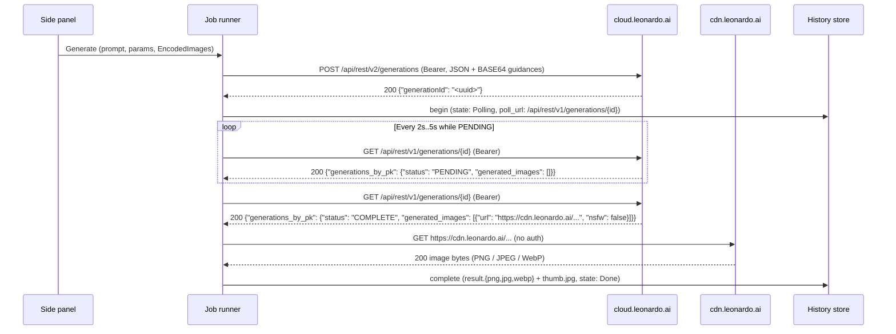

# Leonardo.Ai Image Provider - Plan

## Goal Capsule

- **Objective:** A person with a Leonardo.Ai API key picks any of the forty-three Leonardo.Ai image models across generation, upscaling, and background removal, runs a job from the prompt and canvas, and gets the finished PNG, JPEG, or WebP into the existing history.
- **Means:** One `Leonardo.Ai` provider identity posting JSON with inline base64 image guidances to `POST /api/rest/v2/generations`, polling `GET /api/rest/v1/generations/{id}` until `COMPLETE`, and downloading `generated_images[0].url` from `cdn.leonardo.ai` into `HistoryStore` (KTD1, KTD2, KTD3, KTD4).
- **Authority hierarchy:** R-IDs govern product behavior and KTDs govern implementation mechanism. `docs/api/leonardo.create.md` is the authoritative OpenAPI 3.0.0 schema for request discriminators, parameter names, bounds, enums, and `guidances` shapes.
- **Stop conditions:** Stop if `POST /api/rest/v2/generations` rejects `"type": "BASE64"` in `guidances` and requires a prior `/api/rest/v1/init-image` S3 upload. Stop if `GET /api/rest/v1/generations/{id}` stops returning `generations_by_pk` for v2 generation IDs. Stop if `cloud.leonardo.ai` rejects `Authorization: Bearer`.
- **Execution profile:** Feature work. Prove the forty-three model descriptors, JSON body builders, validation rules, and submit/poll classifiers in `easel-core` before wiring the side-panel form and job-runner integration tests.
- **Finishes and ships:** The implementer lands the work on the current branch.

---

## Product Contract

### Summary

Leonardo.Ai joins Black Forest Labs, Krea, Google, OpenAI, xAI, Chutes, and Qwen. One API key unlocks all forty-three image models in `docs/api/leonardo.create.md` — Phoenix 1.0 and 0.9, Lucid Origin and Realism, the nine Leonardo SDXL presets, the two Aurora upscalers, Remove Background, and twenty-seven hosted partner image models — through `POST /api/rest/v2/generations` and `GET /api/rest/v1/generations/{id}` polling.

### Problem Frame

`docs/api/leonardo.create.md` consolidates eighty-one models behind a single discriminated `POST /api/rest/v2/generations` endpoint on `https://cloud.leonardo.ai`, while job completion is polled on `GET /api/rest/v1/generations/{id}` and finished images are served from `cdn.leonardo.ai`. Unlike existing providers in Easel, Leonardo's forty-three image models span seven distinct parameter and image-guidance shapes inside one endpoint: multi-slot image guidance (`image_to_image`, `content`, `style`, `character`, `depth`, `edge`, `pose`, `text_image`) with per-slot strength enums and item caps, single-slot `image_reference` arrays up to sixteen images, dual-slot foreground and replacement-background inputs on `remove-bg`, promptless upscalers whose `width` and `height` describe the input image rather than the output target, discrete width/height allowlists on fourteen partner models, and per-model style UUID lists. Several discriminator names (`gpt-image-1.5`, `gpt-image-2`) also collide with existing OpenAI model IDs in `ModelRegistry`.

### Key Decisions

- KD1. **Expose all forty-three image models in `docs/api/leonardo.create.md` and exclude the thirty-eight video, 3D, and audio models.** (session-settled: user-directed — chosen over Leonardo's sixteen native image models only or a twenty-six-model subset: the user selected all forty-three image models during intake.) Governs R1, R5.
- KD2. **Send canvas and reference images inline as base64 (`"type": "BASE64"`, `"data": "<base64>"`) inside `parameters.guidances`.** (session-settled: user-approved — proposed in the scoping synthesis and confirmed, chosen over a two-step `/api/rest/v1/init-image` presigned upload flow: every v2 image model schema accepts `BASE64` directly in `guidances`.) Governs R6, R7, R8, R9.
- KD3. **Expose `guidance_type` and `guidance_strength` dropdowns on models with multiple guidance slots or required style strength.** (session-settled: user-approved — proposed in the scoping synthesis and confirmed, chosen over hardcoding a single guidance slot: Phoenix, Lucid, Flux Dev/Schnell, the nine SDXL presets, and Krea 2 require explicit slot and strength selection when images are attached.) Governs R7, R8.
- KD4. **Run all forty-three models, including `remove-bg`, through the async `POST /api/rest/v2/generations` and `GET /api/rest/v1/generations/{id}` poll lifecycle, and map a second loaded image on `remove-bg` to `guidances.background_image_reference`.** (session-settled: user-approved — proposed in the scoping synthesis and confirmed, chosen over a separate `/api/rest/v2/generationssync` path: one async protocol handles every Leonardo model uniformly.) Governs R9, R14, R15.
- KD5. **Send `"quantity": 1` in `parameters` on every request without exposing a batch count field.** (session-settled: user-approved — proposed in the scoping synthesis and confirmed, chosen over exposing `quantity` or leaving Leonardo's server default of `4`: Easel records one image per history row and must not bill four generations to discard three.) Governs R5.
- KD6. **Expose `style_ids` as a single `style` dropdown mapped to a one-element `style_ids: ["<uuid>"]` array.** (session-settled: user-approved — proposed in the scoping synthesis and confirmed, chosen over raw UUID array text input: human-readable preset labels prevent invalid UUIDs across models.) Governs R12.

### Requirements

**Provider and key**

- R1. The provider menu lists `Leonardo.Ai` once a key is available, and its model menu lists the forty-three models in the exact order and display names of the model table. (KD1)
- R2. All forty-three models share one credential: a non-empty `LEONARDO_API_KEY` environment variable overrides the stored key, and the stored key is filed under `https://cloud.leonardo.ai`.
- R3. Settings includes one generated "Leonardo.Ai API key" row whose Test button sends `GET https://cloud.leonardo.ai/api/rest/v2/models` with Leonardo Bearer auth: HTTP 401 or 403 reports `"invalid key"`, HTTP 200 reports `"key accepted"`, and the probe never starts a generation.
- R4. With a Leonardo.Ai model selected and no key available, Generate is disabled with `No Leonardo.Ai API key — open Settings`, and the status bar makes no balance request.

**Request bodies, guidances, and parameters**

- R5. Every Leonardo.Ai submit sends `POST https://cloud.leonardo.ai/api/rest/v2/generations` with Bearer auth and a JSON body `{"model": "<wire_model>", "public": false, "parameters": { ... }}` containing `"quantity": 1` and only the parameters documented for that model in the model table, omitting unset optional numbers (`seed` when `0` or unset) and empty optional strings. (KD1, KD5)
- R6. Prepared canvas and reference images are encoded as raw base64 strings and placed in `parameters.guidances` in slot order (canvas first, then reference tiles) as `{"image": {"type": "BASE64", "data": "<base64>"}}`, and `parameters.guidances` is omitted whenever zero images are sent. (KD2)
- R7. On the fifteen multi-guidance models (Phoenix 0.9/1.0, Lucid Origin/Realism, FLUX Dev, FLUX Schnell, and the nine SDXL presets), the form exposes `guidance_type` and `guidance_strength`; when one or more images are loaded, `build_submit` populates `parameters.guidances[guidance_type]` with `"strength": "<guidance_strength>"` on each entry and never serializes `guidance_type` or `guidance_strength` as top-level keys in `parameters`. (KD2, KD3)
- R8. On the fifteen multi-guidance models and `krea/krea-2`, `validate_for_submit` enforces per-slot strength and image-count rules when at least one image is loaded: `style` accepts `LOW`, `MID`, `HIGH`, `ULTRA`, or `MAX` (up to 4 images on Phoenix and SDXL, 1 on Lucid and FLUX Dev/Schnell, 10 on Krea 2), `content` accepts `LOW`, `MID`, `HIGH`, or `ULTRA` (1 image), and `image_to_image`, `character`, `depth`, `edge`, `pose`, and `text_image` accept `LOW`, `MID`, or `HIGH` (1 image); on Phoenix and SDXL, non-`style` slots send only the first prepared image. (KD2, KD3)
- R9. On the eighteen single-slot `image_reference` generation models (`flux-kontext-pro`, `flux-kontext-max`, `flux-pro-2.0`, `bfl/flux-3-image`, `ideogram/ideogram-4.5`, `gemini-2.5-flash-image`, `nano-banana-2`, `google/nano-banana-2.1`, `nano-banana-2-lite`, `gemini-image-2`, `seedream-4.0`, `seedream-4.5`, `seedream-5.0-pro`, `bytedance/seedream-5.0-flash`, `gpt-image-1.5`, `gpt-image-2`, `openai/gpt-image-2.5-flare`, `openai/gpt-image-2.5-sunburst`), loaded images up to the model's cap map to `parameters.guidances.image_reference` without a `strength` field; on `remove-bg`, slot 1 maps to `guidances.image_reference[0]` and optional slot 2 maps to `guidances.background_image_reference[0]`. (KD2, KD4)
- R10. The six text-only models (`ideogram-v3.0`, `ideogram-v4.0`, `ideogram/p-image-ideogram`, `recraft-v4`, `recraft-v4-pro`, `krea-2-turbo`) accept zero images (`0 of N images will be sent` when images are loaded); `aurora-upscaler-creative`, `aurora-upscaler-precise`, and `remove-bg` require at least one image and disable Generate with `Add at least one image.` when none is loaded; when more images are loaded than a Leonardo.Ai model sends, Generate stays enabled, excess images are omitted, and the notice reports `{sent} of {total} images will be sent`.
- R11. The forty generation models require a non-empty prompt within the model's character limit (`2000` on Phoenix 0.9/1.0, FLUX Dev/Schnell, and Lucid Origin; `5000` on Krea 2; `9999` or `10000` on the rest) and disable Generate with `Prompt is empty` when blank; `aurora-upscaler-creative`, `aurora-upscaler-precise`, and `remove-bg` allow an empty prompt and never send `parameters.prompt`.
- R12. On the thirty models with `style_ids` in the model table, the form exposes a `style` dropdown whose options match that model's allowed style UUIDs (using documented preset names from the style table and raw UUID strings for the twenty-four undocumented SDXL preset UUIDs) and serializes the selected option as `"style_ids": ["<uuid>"]`. (KD6)
- R13. On the forty generation models, `width` and `height` are integer inputs validated against each model's range and `multipleOf: 8` rule or discrete axis/pair allowlist in the model table; on `aurora-upscaler-creative` and `aurora-upscaler-precise`, `validate_for_submit` requires a prepared input image of at least `128×128` pixels whose upscaled output stays within `16,384` pixels per side and `64,000,000` total pixels, `build_submit` sets `parameters.width` and `parameters.height` from the prepared input image dimensions, and `upscale_factor` serializes as a JSON integer (`2`, `3`, `4`, `6`, or `8`).

**Async polling, download, and errors**

- R14. On HTTP 200 from `POST /api/rest/v2/generations`, `parse_submit` extracts `generationId` (from top-level `generationId`, `/generate/generationId`, or `/sdGenerationJob/generationId`), validates it via `JobId::parse`, and returns `Submitted` with `poll_url` `https://cloud.leonardo.ai/api/rest/v1/generations/{id}` and a 2-second poll interval (`initial: 2s, factor: 1.25, cap: 5s, deadline: 600s`). (KD4)
- R15. `poll_request` sends `GET https://cloud.leonardo.ai/api/rest/v1/generations/{id}` with Bearer auth; `parse_poll` maps `generations_by_pk.status` `"PENDING"` (or `"QUEUED"` / `"PROCESSING"`) to `PollOutcome::InFlight`, maps `"COMPLETE"` with a valid `https://*.leonardo.ai` URL at `generations_by_pk.generated_images[0].url` (and `nsfw != true`) to `PollOutcome::Ready`, maps `"COMPLETE"` with `nsfw: true` to `PollOutcome::Failed(ProviderError::Blocked)`, maps `"COMPLETE"` with an empty `generated_images` array to `PollOutcome::Failed(ProviderError::NoImage)`, and maps `"FAILED"` or a missing `generations_by_pk` object to `PollOutcome::Failed`. (KD4)
- R16. Non-200 submit and poll responses classify per the failure table: HTTP 401 or 403 `Auth`, HTTP 402 `OutOfCredits`, HTTP 404 `ModelNotFound` on submit (`Protocol` on poll), HTTP 429 `RateLimited`, HTTP 400 or 422 whose error text mentions `content moderation` or `nsfw` as `Blocked`, other HTTP 400 or 422 with an error message as `Validation`, and any other status as `Http`.

**Compatibility**

- R17. Completed Leonardo.Ai images (`result.png`, `result.jpg`, `result.webp`) open, promote, save-as, reveal, compare, and restore through the existing history actions unchanged, and switching providers or models preserves the prompt, canvas, references, boxes, and compatible edited field values while adopting the target model's defaults for untouched fields and disarming the Box tool.
- R18. Black Forest Labs, Krea, Google, OpenAI, xAI, Chutes, and Qwen requests, model-ID lookups, settings probes, and history rows remain unchanged.

### Model Table

All forty-three models set `supports_boxes: false` and `beta: false`, and use a `"leonardo-"`-prefixed `ModelSpec.id` so global model lookups never collide with OpenAI or BFL specs while sending the exact `wire_model` discriminator in `body["model"]`. Where `seed` is listed, it is optional `Int` (`0..=max_seed`, omitted when `0` or unset). Where `prompt_enhance` is listed, it is `Select` over `AUTO`, `ON`, `OFF` (default `OFF` on the nine SDXL presets, `AUTO` on all others).

| # | Menu name | `ModelSpec.id` | `wire_model` | Images | Prompt max | Width × Height (default) | Guidance & model-specific fields |
| --- | --- | --- | --- | --- | --- | --- | --- |
| 1 | Phoenix 1.0 | `leonardo-phoenix-v1.0` | `phoenix-v1.0` | 0–4 | 2000 | 32–2048 step 8 (1024×1024) | `mode` (`FAST`/`QUALITY`/`ULTRA`, def `FAST`); `contrast` (`LOW`/`MEDIUM`/`HIGH`, def `MEDIUM`); `prompt_enhance`; `style` (23, def `Dynamic`); `negative_prompt`; `tiling` Bool; `seed`; `guidance_type` (`image_to_image`/`content`/`style`/`character`, def `image_to_image`); `guidance_strength` (`LOW`..`MAX`, def `MID`) |
| 2 | Phoenix 0.9 | `leonardo-phoenix-v0.9` | `phoenix-v0.9` | 0–4 | 2000 | 32–2048 step 8 (1024×1024) | same as `leonardo-phoenix-v1.0` |
| 3 | Lucid Origin | `leonardo-lucid-origin` | `lucid-origin` | 0–1 | 2000 | w 16–3840, h 16–3616 step 8 (1200×1200) | `mode` (`FAST`/`ULTRA`, def `FAST`); `prompt_enhance`; `style` (8, def `Dynamic`); `seed`; `guidance_type` (`content`/`style`, def `content`); `guidance_strength` (`LOW`..`MAX`, def `MID`) |
| 4 | Lucid Realism | `leonardo-lucid-realism` | `lucid-realism` | 0–1 | 9999 | 16–2496 step 8 (1024×1024) | `mode` (`FAST`/`ULTRA`, def `FAST`); `prompt_enhance`; `style` (21, def `Dynamic`); `seed`; `guidance_type` (`content`/`style`, def `content`); `guidance_strength` (`LOW`..`MAX`, def `MID`) |
| 5 | Cinematic Kino | `leonardo-kino-xl` | `kino-xl` | 0–4 | 9999 | 32–1536 step 8 (1024×1024) | `mode` (`FAST`/`QUALITY`, def `FAST`); `contrast` (def `MEDIUM`); `prompt_enhance` (def `OFF`); `style` (21, def `Cinematic`); `negative_prompt`; `transparency` Bool; `tiling` Bool; `seed`; `guidance_type` (8 SDXL slots, def `image_to_image`); `guidance_strength` (`LOW`..`MAX`, def `MID`) |
| 6 | Anime | `leonardo-anime-xl` | `anime-xl` | 0–4 | 9999 | w 32–1584, h 32–1536 step 8 (1024×1024) | SDXL preset fields with `mode` def `FAST`, `contrast` def `LOW`, `style` (12, def `Anime General`) |
| 7 | Portrait Perfect | `leonardo-portrait-perfect` | `portrait-perfect` | 0–4 | 9999 | 32–1536 step 8 (1024×1024) | SDXL preset fields with `mode` def `QUALITY`, `contrast` def `MEDIUM`, `style` (8, def `Portrait Cinematic`) |
| 8 | Stock Photography | `leonardo-stock-photography` | `stock-photography` | 0–4 | 9999 | 32–1536 step 8 (1024×1024) | SDXL preset fields with `mode` def `QUALITY`, `contrast` def `MEDIUM`, `style` (2, def `Stock Photo`) |
| 9 | Illustrative Albedo | `leonardo-illustrative-albedo` | `illustrative-albedo` | 0–4 | 9999 | w 32–1584, h 32–1536 step 8 (1024×1024) | SDXL preset fields with `mode` def `FAST`, `contrast` def `MEDIUM`, `style` (16, def `Illustration`) |
| 10 | Concept Art | `leonardo-concept-art` | `concept-art` | 0–4 | 9999 | w 32–1584, h 32–1536 step 8 (1024×1024) | SDXL preset fields with `mode` def `FAST`, `contrast` def `MEDIUM`, `style` (8, def `726585f5-d231-4a3a-bee9-9a5e5d3df779`) |
| 11 | Lifelike Vision | `leonardo-lifelike-vision` | `lifelike-vision` | 0–4 | 9999 | w 32–1584, h 32–1536 step 8 (1024×1024) | SDXL preset fields with `mode` def `FAST`, `contrast` def `MEDIUM`, `style` (20, def `Dynamic`) |
| 12 | Graphic Design | `leonardo-graphic-design` | `graphic-design` | 0–4 | 9999 | w 32–1584, h 32–1536 step 8 (1024×1024) | SDXL preset fields with `mode` def `FAST`, `contrast` def `MEDIUM`, `style` (7, def `Graphic Design 2D`) |
| 13 | Leonardo Lightning | `leonardo-lightning-xl` | `lightning-xl` | 0–4 | 9999 | w 32–1584, h 32–1536 step 8 (1024×1024) | SDXL preset fields with `mode` def `FAST`, `contrast` def `MEDIUM`, `style` (22, def `Dynamic`) |
| 14 | FLUX Dev | `leonardo-flux-dev` | `flux-dev` | 0–1 | 2000 | 480–2048 step 8 (1024×1024) | `prompt_enhance`; `style` (16, def `Dynamic`); `seed`; `guidance_type` (`content`/`style`, def `content`); `guidance_strength` (`LOW`..`MAX`, def `MID`) |
| 15 | FLUX Schnell | `leonardo-flux-schnell` | `flux-schnell` | 0–1 | 2000 | 32–2048 step 8 (1024×1024) | same as `leonardo-flux-dev` with min width/height 32 |
| 16 | FLUX.1 Kontext | `leonardo-flux-kontext-pro` | `flux-kontext-pro` | 0–4 (`image_reference`) | 9999 | 32–2048 (1024×1024) | `prompt_enhance`; `style` (19, def `Dynamic`); `seed` |
| 17 | FLUX.1 Kontext Max | `leonardo-flux-kontext-max` | `flux-kontext-max` | 0–4 (`image_reference`) | 9999 | 32–2048 (1024×1024) | `prompt_enhance`; `style` (19, def `Dynamic`); `seed` |
| 18 | FLUX.2 Pro | `leonardo-flux-pro-2.0` | `flux-pro-2.0` | 0–4 (`image_reference`) | 9999 | 64–14142 (1440×1440) | `prompt_enhance`; `style` (19, def `Dynamic`); `seed` |
| 19 | FLUX 3 Image | `leonardo-flux-3-image` | `bfl/flux-3-image` | 0–10 (`image_reference`) | 9999 | discrete 672–6256 (1024×1024) | `prompt_enhance` |
| 20 | Ideogram 3.0 | `leonardo-ideogram-v3.0` | `ideogram-v3.0` | 0 | 9999 | 32–2048 (1024×1024) | `quality` (`TURBO`/`BALANCED`/`QUALITY`, optional); `prompt_enhance`; `style` (8, def `Dynamic`); `negative_prompt`; `seed` |
| 21 | Ideogram 4.0 | `leonardo-ideogram-v4.0` | `ideogram-v4.0` | 0 | 10000 | discrete pairs 1152–3328 (2048×2048) | `quality` (`TURBO`/`BALANCED`/`QUALITY`, def `BALANCED`); `prompt_enhance` |
| 22 | P-Image-Ideogram | `leonardo-p-image-ideogram` | `ideogram/p-image-ideogram` | 0 | 10000 | discrete pairs 512–3456 (1024×1024) | `quality` (`VERY_LOW`/`LOW`/`MEDIUM`/`HIGH`, def `MEDIUM`); `prompt_enhance` |
| 23 | Ideogram 4.5 | `leonardo-ideogram-4.5` | `ideogram/ideogram-4.5` | 0–5 (`image_reference`) | 10000 | discrete pairs 720–3328 (1024×1024) | `quality` (`VERY_LOW`/`LOW`/`MEDIUM`/`HIGH`, def `MEDIUM`); `prompt_enhance`; `seed` |
| 24 | Nano Banana | `leonardo-gemini-2.5-flash-image` | `gemini-2.5-flash-image` | 0–6 (`image_reference`) | 9999 | discrete pairs w 0, 768–1536, h 0, 672–1344 (1024×1024) | `prompt_enhance`; `style` (19, def `Dynamic`); `seed` |
| 25 | Nano Banana 2 | `leonardo-nano-banana-2` | `nano-banana-2` | 0–6 (`image_reference`) | 9999 | discrete pairs w 0, 768–6336, h 0, 672–5504 (1024×1024) | `prompt_enhance`; `style` (19, def `Dynamic`); `seed` |
| 26 | Nano Banana 2.1 | `leonardo-nano-banana-2.1` | `google/nano-banana-2.1` | 0–14 (`image_reference`) | 9999 | discrete pairs w 0, 768–6336, h 0, 672–5504 (1024×1024) | `prompt_enhance`; `style` (19, def `Dynamic`) |
| 27 | Nano Banana 2 Lite | `leonardo-nano-banana-2-lite` | `nano-banana-2-lite` | 0–6 (`image_reference`) | 9999 | discrete w 0, 768–1584, h 0, 672–1376 (1024×1024) | `prompt_enhance`; `style` (19, def `Dynamic`); `seed` |
| 28 | Nano Banana Pro | `leonardo-gemini-image-2` | `gemini-image-2` | 0–6 (`image_reference`) | 9999 | discrete w 0, 768–6336, h 0, 672–5504 (1024×1024) | `prompt_enhance`; `style` (19, def `Dynamic`); `seed` |
| 29 | Seedream 4.0 | `leonardo-seedream-4.0` | `seedream-4.0` | 0–6 (`image_reference`) | 9999 | 32–14142 (1024×1024) | `prompt_enhance`; `style` (8, def `Dynamic`); `seed` |
| 30 | Seedream 4.5 | `leonardo-seedream-4.5` | `seedream-4.5` | 0–6 (`image_reference`) | 9999 | 32–14142 (2048×2048) | `prompt_enhance`; `style` (8, def `Dynamic`); `seed` |
| 31 | Seedream 5.0 Pro | `leonardo-seedream-5.0-pro` | `seedream-5.0-pro` | 0–10 (`image_reference`) | 9999 | 768–2048 (2048×2048) | `mode` (`FAST`/`QUALITY`, def `QUALITY`); `output_format` (`jpeg`/`png`, def `jpeg`); `prompt_enhance`; `seed` |
| 32 | Seedream 5.0 Flash | `leonardo-seedream-5.0-flash` | `bytedance/seedream-5.0-flash` | 0–10 (`image_reference`) | 9999 | 1024–3008 (2048×2048) | `output_format` (`jpeg`/`png`, def `jpeg`); `prompt_enhance` |
| 33 | GPT Image-1.5 | `leonardo-gpt-image-1.5` | `gpt-image-1.5` | 0–6 (`image_reference`) | 9999 | 1024–1536 step 8 (1024×1024) | `quality` (`LOW`/`MEDIUM`/`HIGH`, def `MEDIUM`); `transparency` Bool; `prompt_enhance`; `style` (21, def `Dynamic`) |
| 34 | GPT Image 2 | `leonardo-gpt-image-2` | `gpt-image-2` | 0–6 (`image_reference`) | 9999 | discrete w 768–3808, h 640–3584 (1024×1024) | `quality` (`LOW`/`MEDIUM`/`HIGH`, def `MEDIUM`); `prompt_enhance`; `style` (21, def `Dynamic`) |
| 35 | GPT Image 2.5 Flare | `leonardo-gpt-image-2.5-flare` | `openai/gpt-image-2.5-flare` | 0–16 (`image_reference`) | 9999 | discrete w 768–3808, h 640–3584 (1024×1024) | `quality` (`LOW`/`MEDIUM`/`HIGH`/`XHIGH`/`MAX`, def `HIGH`); `transparency` Bool; `prompt_enhance`; `style` (21, def `Dynamic`) |
| 36 | GPT Image 2.5 Sunburst | `leonardo-gpt-image-2.5-sunburst` | `openai/gpt-image-2.5-sunburst` | 0–16 (`image_reference`) | 9999 | discrete w 768–3808, h 640–3584 (1024×1024) | same as `leonardo-gpt-image-2.5-flare` |
| 37 | Recraft V4 | `leonardo-recraft-v4` | `recraft-v4` | 0 | 9999 | discrete 768–1536 (1024×1024) | `prompt_enhance` |
| 38 | Recraft V4 Pro | `leonardo-recraft-v4-pro` | `recraft-v4-pro` | 0 | 9999 | discrete 1536–3072 (2048×2048) | `prompt_enhance` |
| 39 | Krea 2 Turbo | `leonardo-krea-2-turbo` | `krea-2-turbo` | 0 | 9999 | 16–4096 step 8 (1024×1024) | `prompt_enhance` |
| 40 | Krea 2 | `leonardo-krea-2` | `krea/krea-2` | 0–10 (`style`) | 5000 | 16–4096 step 8 (1024×1024) | `quality` (`MEDIUM`/`HIGH`, def `MEDIUM`); `prompt_enhance`; `seed`; `guidance_strength` (`LOW`..`MAX`, def `MID`) |
| 41 | Aurora Upscaler Creative | `leonardo-aurora-upscaler-creative` | `aurora-upscaler-creative` | 1 (`image_reference`) | Unused | from input image (min 128×128) | `upscale_factor` (`2`/`3`/`4`/`6`/`8`, def `2`, sent as integer); `creativity` (`low`/`mid`/`high`, def `mid`); `seed` |
| 42 | Aurora Upscaler Precise | `leonardo-aurora-upscaler-precise` | `aurora-upscaler-precise` | 1 (`image_reference`) | Unused | from input image (min 128×128) | `upscale_factor` (`2`/`3`/`4`/`6`/`8`, def `2`, sent as integer); `upscale_mode` (`clean`/`detailed`, def `detailed`); `seed` |
| 43 | Remove Background | `leonardo-remove-bg` | `remove-bg` | 1–2 (`image_reference`, `background_image_reference`) | Unused | none | `size` (`auto`/`preview`/`full`/`50MP`, def `full`); `type` (`auto`/`person`/`product`/`car`/`animal`/`graphic`/`transportation`/`other`, def `auto`); `type_level` (`none`/`1`/`2`/`latest`, optional); `format` (`png`/`jpg`/`webp`, def `png`); `channels` (`rgba`/`alpha`, def `rgba`); `crop` Bool def `false`; `crop_margin` Text; `scale` Text; `position` Text; `roi` Text; `bg_color` Text; `shadow_type` (`none`/`drop`/`3d`/`car`, def `none`); `shadow_opacity` Int 0–100; `semitransparency` Bool def `true` |

### Style Preset Table

The forty documented style UUIDs map to these display labels in `style` dropdowns; the twenty-four additional SDXL preset UUIDs in `docs/api/leonardo.create.md` (on `kino-xl`, `anime-xl`, `portrait-perfect`, `illustrative-albedo`, `concept-art`, `lifelike-vision`, and `graphic-design`) appear as their raw UUID strings and map to themselves.

| Style label | UUID | Style label | UUID |
| --- | --- | --- | --- |
| `3D Render` | `debdf72a-91a4-467b-bf61-cc02bdeb69c6` | `Macro` | `30c1d34f-e3a9-479a-b56f-c018bbc9c02a` |
| `Acrylic` | `3cbb655a-7ca4-463f-b697-8a03ad67327c` | `Minimalist` | `cadc8cd6-7838-4c99-b645-df76be8ba8d8` |
| `Anime General` | `b2a54a51-230b-4d4f-ad4e-8409bf58645f` | `Monochrome` | `a2f7ea66-959b-4bbe-b508-6133238b76b6` |
| `Bokeh` | `9fdc5e8c-4d13-49b4-9ce6-5a74cbb19177` | `Moody` | `621e1c9a-6319-4bee-a12d-ae40659162fa` |
| `Cinematic` | `a5632c7c-ddbb-4e2f-ba34-8456ab3ac436` | `Neutral` | `0d914779-c822-430a-b976-30075033f1c4` |
| `Cinematic Close-Up` | `cc53f935-884c-40a0-b7eb-1f5c42821fb5` | `None` | `556c1ee5-ec38-42e8-955a-1e82dad0ffa1` |
| `Cinematic Concept` | `33abbb99-03b9-4dd7-9761-ee98650b2c88` | `Portrait` | `ab5a4220-7c42-41e5-a578-eddb9fed3d75` |
| `Creative` | `6fedbf1f-4a17-45ec-84fb-92fe524a29ef` | `Portrait Cinematic` | `4edb03c9-8a26-4041-9d01-f85b5d4abd71` |
| `Dynamic` | `111dc692-d470-4eec-b791-3475abac4c46` | `Portrait Fashion` | `0d34f8e1-46d4-428f-8ddd-4b11811fa7c9` |
| `Fashion` | `594c4a08-a522-4e0e-b7ff-e4dac4b6b622` | `Pro B&W Photography` | `22a9a7d2-2166-4d86-80ff-22e2643adbcf` |
| `Film` | `85da2dcc-c373-464c-9a7a-5624359be859` | `Pro Color Photography` | `7c3f932b-a572-47cb-9b9b-f20211e63b5b` |
| `Food` | `d574325d-1278-4fe2-974b-768525f253c3` | `Pro Film Photography` | `581ba6d6-5aac-4492-bebe-54c424a0d46e` |
| `Game Concept` | `09d2b5b5-d7c5-4c02-905d-9f84051640f4` | `Ray Traced` | `b504f83c-3326-4947-82e1-7fe9e839ec0f` |
| `Graphic Design 2D` | `703d6fe5-7f1c-4a9e-8da0-5331f214d5cf` | `Retro` | `6105baa2-851b-446e-9db5-08a671a8c42f` |
| `Graphic Design 3D` | `7d7c2bc5-4b12-4ac3-81a9-630057e9e89f` | `Sketch (B&W)` | `be8c6b58-739c-4d44-b9c1-b032ed308b61` |
| `Graphic Design Pop Art` | `2e74ec31-f3a4-4825-b08b-2894f6d13941` | `Sketch (Color)` | `093accc3-7633-4ffd-82da-d34000dfc0d6` |
| `Graphic Design Vector` | `1fbb6a68-9319-44d2-8d56-2957ca0ece6a` | `Stock Photo` | `5bdc3f2a-1be6-4d1c-8e77-992a30824a2c` |
| `HDR` | `97c20e5c-1af6-4d42-b227-54d03d8f0727` | `Unprocessed` | `62736842-6e4b-4028-b79a-4f1a1606e893` |
| `Illustration` | `645e4195-f63d-4715-a3f2-3fb1e6eb8c70` | `Vibrant` | `dee282d3-891f-4f73-ba02-7f8131e5541b` |
| `Long Exposure` | `335e6010-a75c-45d9-afc5-032c65e9180e` | `Watercolor` | `1db308ce-c7ad-4d10-96fd-592fa6b75cc4` |

### Key Flows

- F1. Text-to-image and multi-guidance generation
  - **Steps:** Select `Leonardo.Ai` and `Phoenix 1.0`, `Lucid Origin`, or an SDXL preset, enter a prompt, optionally load 1–4 images and choose `guidance_type` and `guidance_strength`, and click Generate.
  - **Outcome:** `POST /api/rest/v2/generations` sends `"quantity": 1`, `"style_ids": ["<uuid>"]`, and (when images are loaded) `guidances[guidance_type]` with base64 image data and `strength`; `GET /api/rest/v1/generations/{id}` polls until `COMPLETE`, and `JobRunner` downloads `generated_images[0].url` into history.
  - **Covered by:** R5, R6, R7, R8, R12, R14, R15
- F2. Promptless Aurora upscaling and background removal
  - **Steps:** Load a 128×128 or larger image on the canvas (plus an optional replacement background image on `Remove Background`), select `Aurora Upscaler Creative`, `Aurora Upscaler Precise`, or `Remove Background` with an empty prompt, and click Generate.
  - **Outcome:** Aurora sends the prepared image's `width` and `height`, integer `upscale_factor`, and `guidances.image_reference`; `Remove Background` sends `guidances.image_reference` (and `guidances.background_image_reference` when a second image is loaded) with no `prompt`, `width`, or `height`.
  - **Covered by:** R6, R9, R10, R11, R13, R14, R15
- F3. Partner reference-guided generation
  - **Steps:** Load up to sixteen images on the sheet, pick a hosted partner model such as `GPT Image 2.5 Flare`, `Nano Banana 2.1`, `Seedream 5.0 Pro`, or `Krea 2`, and click Generate.
  - **Outcome:** Prepared images map to `guidances.image_reference` (or `guidances.style` with `strength` on `Krea 2`), discrete width/height values are validated before submit, and excess images clamp with `{sent} of {total} images will be sent`.
  - **Covered by:** R5, R6, R8, R9, R10, R13

### Acceptance Examples

- AE1. Phoenix 1.0 text-to-image vs style and content guidance.
  - **Covers:** R5, R6, R7, R8, R12
  - **Given:** `leonardo-phoenix-v1.0` is selected with prompt `"ancient observatory"`, `style = "Dynamic"`, `guidance_type = "style"`, and `guidance_strength = "MAX"`.
  - **When:** the person generates once with an empty canvas, once with two loaded images under `guidance_type = "style"`, and once after switching `guidance_type` to `"content"` while keeping `guidance_strength = "MAX"`.
  - **Then:** the zero-image POST sends `model: "phoenix-v1.0"`, `quantity: 1`, and `style_ids: ["111dc692-d470-4eec-b791-3475abac4c46"]` with no `guidances`, `guidance_type`, or `guidance_strength` keys; the two-image `style` POST sends two `BASE64` entries in `parameters.guidances.style` with `"strength": "MAX"`; switching `guidance_type` to `"content"` with `guidance_strength = "MAX"` disables Generate with `Content guidance strength must be LOW, MID, HIGH, or ULTRA.`.
- AE2. Aurora Upscaler Precise on a 128×128 image with an empty prompt.
  - **Covers:** R10, R11, R13, R14, R15
  - **Given:** `leonardo-aurora-upscaler-precise` is selected, a 128×128 image is loaded on the canvas, `upscale_factor` is `"4"`, and the prompt editor is empty.
  - **When:** the person clicks Generate.
  - **Then:** Generate is enabled, `POST /api/rest/v2/generations` sends `model: "aurora-upscaler-precise"`, `parameters.width: 128`, `parameters.height: 128`, `parameters.upscale_factor: 4` (JSON integer), `parameters.upscale_mode: "detailed"`, `parameters.quantity: 1`, and `parameters.guidances.image_reference` with one `BASE64` image and no `prompt` key.
- AE3. Remove Background with one vs two loaded images and residual prompt text.
  - **Covers:** R9, R10, R11
  - **Given:** `leonardo-remove-bg` is selected while the prompt editor still contains `"leftover prompt"`, first with one 512×512 subject image and then with a second 512×512 background image added.
  - **When:** the person generates in each state.
  - **Then:** the one-image request sends `guidances.image_reference` with slot 1 and omits `background_image_reference`, `prompt`, `width`, and `height`; the two-image request sends slot 1 in `guidances.image_reference` and slot 2 in `guidances.background_image_reference`.
- AE4. Poll lifecycle and NSFW moderation on `GET /api/rest/v1/generations/{id}`.
  - **Covers:** R14, R15, R16
  - **Given:** a Leonardo.Ai submit returns `200 {"generationId": "11111111-2222-4333-8444-555555555555"}`.
  - **When:** the first poll returns `status: "PENDING"` and the second poll returns `status: "COMPLETE"` with `generated_images: [{"url": "https://cdn.leonardo.ai/users/u/generations/g/out.jpg", "nsfw": false, "id": "..."}]` (or `nsfw: true`).
  - **Then:** the first poll keeps the job in `Polling`; the `nsfw: false` second poll downloads `out.jpg` without auth headers and completes the history row; the `nsfw: true` response fails the job with `ProviderError::Blocked` (`blocked by safety`) and writes no image file.
- AE5. Global model ID isolation from OpenAI `gpt-image-*`.
  - **Covers:** R1, R5, R18
  - **Given:** `leonardo-gpt-image-2` is selected in `AppState`.
  - **When:** `build_submit` runs and `ModelRegistry::specs()` is queried for `spec.id.starts_with("gpt-image")`.
  - **Then:** `build_submit` sends `"model": "gpt-image-2"` to `https://cloud.leonardo.ai/api/rest/v2/generations`, `history::provider_name("leonardo-gpt-image-2")` returns `"leonardo"`, and `spec.id.starts_with("gpt-image")` still matches only the six OpenAI models.
- AE6. Settings key probe on `GET /api/rest/v2/models`.
  - **Covers:** R3
  - **Given:** the user enters a Leonardo.Ai key in Settings and clicks Test.
  - **When:** `cloud.leonardo.ai` responds with HTTP 401, HTTP 403, or HTTP 200.
  - **Then:** HTTP 401 and HTTP 403 toast `"invalid key"`, and HTTP 200 toasts `"key accepted"`.

### Success Criteria

- All forty-three models in the model table build valid `POST /api/rest/v2/generations` bodies matching `docs/api/leonardo.create.md` and omit undocumented or mode-excluded keys.
- Every model completes through `POST /api/rest/v2/generations` -> `GET /api/rest/v1/generations/{id}` -> unauthenticated `cdn.leonardo.ai` image download into `HistoryStore`.
- Prompt-level moderation errors (`400` with `content moderation`) and response-level `nsfw: true` flags both fail closed as `ProviderError::Blocked` with no saved image file.
- Workspace formatting, clippy, and nextest suites pass with zero regressions across existing providers.

### Scope Boundaries

One provider (`Leonardo.Ai`), forty-three image models on `POST /api/rest/v2/generations`, inline `BASE64` image guidance, `GET /api/rest/v1/generations/{id}` polling, `cdn.leonardo.ai` result downloads, and `GET /api/rest/v2/models` key probing. Considered and not built:

- A separate `/api/rest/v2/generationssync` code path for `remove-bg` — `POST /api/rest/v2/generations` already supports `remove-bg` with the same parameters and avoids maintaining a second Leonardo response parser for one model; reopen only if async queue latency for `remove-bg` proves unacceptable.
- Two-step `/api/rest/v1/init-image` presigned S3 image uploads — all thirty-seven image-accepting v2 schemas accept `"type": "BASE64"` directly inside `guidances`; reopen only if Leonardo deprecates inline `BASE64` on `/api/rest/v2/generations`.
- Cross-restart resume of in-flight Leonardo jobs in `JobRunner::resume` — `resume()` is BFL-only (`entry.provider != "bfl"`), matching Krea; reopen only if cross-restart polling resume is generalized across providers.

#### Deferred to Follow-Up Work

- The thirty-eight video (`motion_2.0`, `veo-3.1*`, `kling*`, `ltxv*`, `happy-horse*`, `hailuo*`, `wan*`, `bfl/flux-3-video`, `seedance*`, `grok-imagine-1.5`, `gemini-omni*`), 3D (`rodin-v2`, `meshy/meshy-7`), and audio (`music-v1`, `sound-effects-v2`, `dialogue-v3`, `seed-audio-1.0`) models in `docs/api/leonardo.create.md`.
- Custom LoRA `user_elements` and `platform_elements` UUID/weight arrays on FLUX Dev and SDXL preset models.
- A Leonardo API credit balance indicator in the status bar.

### Sources

- `docs/api/leonardo.create.md` — OpenAPI 3.0.0 specification for `POST https://cloud.leonardo.ai/api/rest/v2/generations`, all eighty-one model request schemas, `guidances` structures, `style_ids` UUID enums, and `200 {"generationId", "apiCreditCost"}` response schema.
- Leonardo REST API v1 `GET https://cloud.leonardo.ai/api/rest/v1/generations/{id}` (`getGenerationById`) and v2 `GET https://cloud.leonardo.ai/api/rest/v2/models` (`getModels`) specifications, plus Leonardo style UUID tables (`Phoenix`, `Lucid Realism`, `FLUX Dev`, `FLUX.1 Kontext`).

---

## Planning Contract

### Key Technical Decisions

- KTD1. **Table-driven descriptor architecture for all forty-three models under `crates/easel-core/src/providers/leonardo/mod.rs` sharing `ProviderId::Leonardo`.** `ProviderId::Leonardo` serializes as `"leonardo"`, displays `"Leonardo.Ai"`, reads `LEONARDO_API_KEY`, uses `AuthScheme::Bearer`, sets base URL `https://cloud.leonardo.ai`, and sets `allowed_hosts` to `[HostRule::Exact("cloud.leonardo.ai"), HostRule::Suffix(".leonardo.ai")]` so `allows_url` accepts both API poll URLs and `https://cdn.leonardo.ai/...` result URLs. A static `[ModelDesc; 43]` table drives a `LazyLock<[ModelSpec; 43]>` array and `LeonardoModel(&'static ModelDesc)` provider struct, avoiding forty-three copy-pasted struct definitions while exposing `&'static ModelSpec` slices to `ModelRegistry::specs()`. Every `ModelSpec.id` is prefixed with `"leonardo-"` while `ModelDesc.wire_model` holds the exact OpenAPI discriminator string. In `AppState::set_model` (`crates/easel/src/app_state.rs`), when an outgoing field value equals the outgoing model's schema default and the incoming model defines its own default for that key, keep the incoming model's default so untouched `width`, `height`, `mode`, `quality`, `contrast`, `prompt_enhance`, and `style` values switch to the incoming model's defaults. (session-settled: user-directed — chosen over sixteen-model or twenty-six-model subsets: covers all forty-three image models without colliding with OpenAI's `gpt-image-*` IDs.) Governs R1, R2, R4, R5, R17, R18.
- KTD2. **Descriptor-driven JSON body and `guidances` assembly with `quantity: 1` and human-readable `style` lookup.** Each `ModelDesc` declares its prompt rule (`Required { max_chars }` or `Unused`), dimension rule (`Range { min_w, max_w, min_h, max_h, def_w, def_h, multiple_of_8 }`, `Discrete { w_enum, h_enum, pairs, def_w, def_h }`, `FromInputImage { min_side: 128 }`, or `None`), guidance mode (`None`, `MultiSlot { slots, max_images }`, `KreaStyle { max_images: 10 }`, `ImageReference { max_images }`, or `RemoveBg`), optional `style_uuids: &'static [&'static str]` with `default_style_uuid`, and model-specific schema fields. `build_submit` builds `{"model": desc.wire_model, "public": false, "parameters": params}` with `"quantity": 1`, maps `style` label (or raw UUID) to `"style_ids": ["<uuid>"]`, converts `upscale_factor` from `Select` string to JSON integer on Aurora Upscalers, populates `width` and `height` on Aurora Upscalers from `request.images[0].width` and `request.images[0].height`, strips UI-only `guidance_type`, `guidance_strength`, and `style` keys from `parameters`, and serializes `ImageInput::RawBase64` entries into the active `guidances` slot when `!images.is_empty()`. (session-settled: user-approved — instantiates KD2, KD3, KD5, KD6.) Governs R5, R6, R7, R8, R9, R12, R13.
- KTD3. **Dimension, guidance, prompt, and 128×128 upload-preparation validation.**
  1. All forty generation models define `width` and `height` as `FieldKind::Int { min, max, step: 1 }` so `SchemaForm` renders `NumberInput` controls rather than `Slider`s (`(max - min) / step > 200`); models with `multipleOf: 8` attach `CrossRule::MultipleOf { keys: vec!["width".into(), "height".into()], n: 8, exempt_zero: true }`, and models with `DimensionRule::Discrete` validate `w_enum.contains(&w)`, `h_enum.contains(&h)`, and any coupled `(width, height)` `pairs` in `Leonardo::validate_for_submit`, returning a `FieldError` that lists the supported pixel values or pairs when rejected.
  2. `Leonardo::validate_for_submit` enforces prompt requiredness and `max_chars` on the forty generation models (and ignores `scene.prose` on the two Aurora Upscalers and `remove-bg`), requires `sent_images >= 1` on the two Aurora Upscalers and `remove-bg` (`Add at least one image.`), computes the prepared input dimensions (`fit_pixels(slot.width, slot.height, 4_000_000)`) on the two Aurora Upscalers to verify `prep_w >= 128 && prep_h >= 128` (`Input image must be at least 128×128.`) and `prep_w * upscale_factor <= 16_384 && prep_h * upscale_factor <= 16_384 && (prep_w * upscale_factor) * (prep_h * upscale_factor) <= 64_000_000` (`Upscaled image exceeds 16384px or 64 MP limit.`), and validates `guidance_strength` against the selected `guidance_type` slot's allowed enum when `sent_images >= 1`.
  3. Add `AppState::max_sent_images(&self) -> usize` returning `1` when a Phoenix or SDXL model has a non-`style` `guidance_type` selected and `self.spec().capabilities.image_slots.max()` otherwise, and use it in `Validation::messages`, `Validation::send_notice`, `AppState::reference_marks`, and `submit::build_request`. In `PrepOptions` (`crates/easel-core/src/image_prep.rs`), add `min_side: u32` (defaulting to `256` in `PrepOptions::for_resolution` so existing providers are unchanged). In `submit::build_request` (`crates/easel/src/jobs/submit.rs`), when `app.spec().provider == ProviderId::Leonardo`, set `options.min_side = 128` and prepare only up to `app.max_sent_images()` images so text-only models (`max == 0`), unsent tiles on 1-image guidance slots, and 128×128 Aurora inputs never fail in `prepare_for_upload`. Governs R8, R10, R11, R13.
- KTD4. **Async v2 submit, v1 poll, NSFW gate, and CDN download protocol.**
  1. `parse_submit` accepts HTTP 200 JSON, reads `generationId` from `/generationId`, `/generate/generationId`, or `/sdGenerationJob/generationId`, validates it with `JobId::parse`, and returns `Submitted { job_id, poll_url: "https://cloud.leonardo.ai/api/rest/v1/generations/{id}", quote: None }`.
  2. `poll_request` issues `GET` to `submitted.poll_url` with `auth: Some(ProviderId::Leonardo)` and `max_body_bytes: 2 * 1024 * 1024`; `poll_policy` uses `initial: 2s, factor: 1.25, cap: 5s, deadline: 600s`.
  3. `parse_poll` inspects `/generations_by_pk`: if missing or `null`, return `PollOutcome::Failed(ProviderError::Protocol("poll response missing generations_by_pk".into()))`; if `status` is `"PENDING"`, `"QUEUED"`, or `"PROCESSING"`, return `PollOutcome::InFlight { status, progress: None }`; if `status` is `"FAILED"`, return `PollOutcome::Failed(ProviderError::Protocol("generation failed".into()))`; if `status` is `"COMPLETE"`, inspect `generated_images`: if empty, return `PollOutcome::Failed(ProviderError::NoImage)`; if `generated_images[0].nsfw == Some(true)`, return `PollOutcome::Failed(ProviderError::Blocked)`; otherwise validate `generated_images[0].url` with `ProviderId::Leonardo.allows_url(url)` and `Url::parse` and return `PollOutcome::Ready { url, settled_cost: None, prompt: None, duration: None }`, which `JobRunner` downloads via `plain_download` (`auth: None`) and stores in `HistoryStore`. (session-settled: user-approved — instantiates KD4.) Governs R14, R15, R16.
- KTD5. **Zero-cost settings key probe on `GET /api/rest/v2/models` with 401/403 rejection.** `key_probe(ProviderId::Leonardo)` in `crates/easel/src/settings/mod.rs` sends `GET https://cloud.leonardo.ai/api/rest/v2/models` with `auth: Some(ProviderId::Leonardo)`, and `SettingsPanel::test_key` includes `ProviderId::Leonardo` in the `response.status == 403` guard alongside `Bfl` and `Krea` so both `401` and `403` (`"access-denied"`) toast `"invalid key"` while `200` toasts `"key accepted"`. Governs R3.

### Failure Table

| Leonardo.Ai response | `ProviderError` / outcome | Submit history | Poll / download history |
| --- | --- | --- | --- |
| Submit 200 with valid `generationId` | `Submitted` | in-flight polling row (`poll_url` set) | n/a |
| Submit 200 missing or invalid `generationId` | `Protocol` | no row | n/a |
| Poll 200 `status: "PENDING"` / `"QUEUED"` / `"PROCESSING"` | `PollOutcome::InFlight` | n/a | stays in-flight |
| Poll 200 `status: "COMPLETE"`, `nsfw: false`, valid `https://cdn.leonardo.ai/...` URL, valid image bytes | `PollOutcome::Ready` -> download | n/a | done row (`result.png`/`jpg`/`webp`) |
| Poll 200 `status: "COMPLETE"`, `nsfw: true` | `Blocked` | n/a | failed row, no image file |
| Poll 200 `status: "COMPLETE"`, `generated_images: []` | `NoImage` | n/a | failed row |
| Poll 200 `status: "COMPLETE"`, non-`.leonardo.ai` or non-HTTPS URL | `Protocol` | n/a | failed row |
| Poll 200 `status: "FAILED"` or `generations_by_pk: null` | `Protocol` | n/a | failed row |
| 400 or 422 with `"content moderation"` or `"nsfw"` in error message | `Blocked` | failed row | failed row |
| 400 or 422 with other JSON `error` / `message` | `Validation(message)` | no row | failed row |
| 401 or 403 (`"access-denied"` / unauthorized) | `Auth` | failed row | failed row |
| 402 | `OutOfCredits` | no row | failed row |
| 404 | `ModelNotFound` (submit) / `Protocol` (poll) | failed row | failed row |
| 429 | `RateLimited { retry_after: None }` | no row | failed row |
| 500 or other non-200 status | `Http { status, body }` | no row | failed row |
| transport timeout or connection error | `Network` | no row | failed row |

### High-Level Technical Design

Every Leonardo.Ai model submits to `POST /api/rest/v2/generations`, polls `GET /api/rest/v1/generations/{id}`, and downloads the completed image from `cdn.leonardo.ai`.



Request assembly branches on the model descriptor's family and attached image count.

```mermaid
flowchart TB
  Start[build_submit] --> Base[model = wire_model, public = false, quantity = 1]
  Base --> PromptGate{Prompt policy}
  PromptGate -->|Required: 40 generation models| AddPrompt[parameters.prompt = compiled_prompt]
  PromptGate -->|Unused: Aurora Upscalers & Remove BG| SkipPrompt[omit parameters.prompt]
  AddPrompt --> DimGate{Dimension rule}
  SkipPrompt --> DimGate
  DimGate -->|Range or Discrete: 40 models| FormDims[width & height from form values]
  DimGate -->|FromInputImage: 2 Aurora models| InputDims[width & height from request.images 0]
  DimGate -->|None: Remove BG| NoDims[omit width & height]
  FormDims --> GuideGate{Guidance mode & images}
  InputDims --> GuideGate
  NoDims --> GuideGate
  GuideGate -->|0 images sent| OmitGuide[omit parameters.guidances]
  GuideGate -->|MultiSlot: Phoenix, Lucid, SDXL, Flux Dev/Schnell| MultiGuide[guidances.{guidance_type} = BASE64 + guidance_strength]
  GuideGate -->|KreaStyle: krea/krea-2| KreaGuide[guidances.style = BASE64 + guidance_strength]
  GuideGate -->|ImageReference: 18 partner models + 2 Aurora| RefGuide[guidances.image_reference = BASE64 array]
  GuideGate -->|RemoveBg: remove-bg| BgGuide[slot 0 -> image_reference, optional slot 1 -> background_image_reference]
```

### Sequencing

U1 wires `ProviderId::Leonardo`, the host allowlist, the `GET /api/rest/v2/models` settings probe, untouched-default model switching in `AppState::set_model`, and `PrepOptions::min_side`. U2 implements the forty-three Leonardo model descriptors, schemas, JSON body builders, validators, and submit/poll classifiers in `easel-core`. U3 proves the side-panel form, guidance/dimension/prompt validation, and model-switching behavior, and U4 proves the end-to-end submit, poll, moderation, and CDN download runner lifecycle.

---

## Implementation Units

### U1. Wire `ProviderId::Leonardo`, settings probe, `PrepOptions::min_side`, and untouched-default model switching

- **Goal:** `ProviderId::Leonardo` compiles across the workspace, Settings probes `GET /api/rest/v2/models` and rejects HTTP 401 and 403, `PrepOptions` supports a configurable `min_side` (`128` for Leonardo), and `AppState::set_model` adopts the incoming model's defaults for untouched fields.
- **Requirements:** R2, R3, R4, R10, R13, R17
- **Dependencies:** none
- **Files:**
  - `crates/easel-core/src/model_spec.rs`
  - `crates/easel-core/src/image_prep.rs`
  - `crates/easel-core/src/history.rs`
  - `crates/easel/src/app_state.rs`
  - `crates/easel/src/net/mod.rs`
  - `crates/easel/src/settings/mod.rs`
  - `crates/easel/src/settings/credentials.rs`
  - `crates/easel/src/side_panel/validation.rs`
  - `crates/easel/src/jobs/submit.rs`
  - `crates/easel/src/jobs/runner.rs`
- **Approach:**
  1. Add `ProviderId::Leonardo` in `crates/easel-core/src/model_spec.rs` per KTD1 (`base_url: "https://cloud.leonardo.ai"`, `env_var: "LEONARDO_API_KEY"`, `display_name: "Leonardo.Ai"`, `AuthScheme::Bearer`, `LEONARDO_HOSTS = &[HostRule::Exact("cloud.leonardo.ai"), HostRule::Suffix(".leonardo.ai")]`) and update exhaustive matches in `history.rs`, `side_panel/validation.rs`, `settings/mod.rs`, `net/mod.rs`, and `jobs/runner.rs`.
  2. In `crates/easel/src/settings/mod.rs`, point `key_probe(ProviderId::Leonardo)` at `"https://cloud.leonardo.ai/api/rest/v2/models"` and add `ProviderId::Leonardo` to the `response.status == 403` invalid-key check in `SettingsPanel::test_key` per KTD5.
  3. In `crates/easel-core/src/image_prep.rs`, add `min_side: u32` to `PrepOptions` (defaulting to `256` in `PrepOptions::for_resolution`), add `AppState::max_sent_images(&self) -> usize` in `crates/easel/src/app_state.rs` (used in `Validation::messages`, `Validation::send_notice`, `AppState::reference_marks`, and `submit::build_request`), and in `crates/easel/src/jobs/submit.rs` set `options.min_side = 128` and take at most `app.max_sent_images()` images when `app.spec().provider == ProviderId::Leonardo` per KTD3.
  4. In `AppState::set_model` (`crates/easel/src/app_state.rs`), compare each outgoing `(key, value)` against `outgoing_defaults.get(key)`: when the value equals the outgoing default and the incoming schema defines a default for `key`, keep the incoming default per KTD1.
- **Patterns to follow:** `ProviderId::Krea` and `ProviderId::Qwen` arms across `model_spec.rs`, `settings/mod.rs`, `settings/credentials.rs`, `validation.rs`, and `runner.rs`.
- **Test scenarios:**
  - `ProviderId::Leonardo` serializes as `"leonardo"`, displays `"Leonardo.Ai"`, reads `LEONARDO_API_KEY`, uses `AuthScheme::Bearer`, and `allows_url` accepts `https://cloud.leonardo.ai/api/rest/v1/generations/abc` and `https://cdn.leonardo.ai/users/u/out.png` while rejecting `http://cloud.leonardo.ai` and `https://evil-leonardo.ai`.
  - Covers AE6. `key_probe(ProviderId::Leonardo)` builds `GET https://cloud.leonardo.ai/api/rest/v2/models` with `auth: Some(ProviderId::Leonardo)` and `Body::Empty`; HTTP 401 and HTTP 403 toast `"invalid key"` and HTTP 200 toasts `"key accepted"`.
  - `missing_key_line(ProviderId::Leonardo)` returns `"No Leonardo.Ai API key — open Settings"`.
  - `prepare_for_upload` with `min_side: 128` accepts a 128×128 image and rejects a 64×64 image, while `PrepOptions::for_resolution("1k")` still rejects images below 256×256.
- **Verification:** Both crates compile cleanly with `ProviderId::Leonardo`, and unit tests for provider identity, host allowlist, settings key probe, and `min_side: 128` upload preparation pass.

### U2. Implement the forty-three Leonardo.Ai model descriptors, JSON builders, validators, and poll classifiers

- **Goal:** All forty-three Leonardo.Ai models resolve from `ModelRegistry`, expose their exact schemas and style presets, validate guidance/dimension/prompt/image rules, build `POST /api/rest/v2/generations` JSON bodies, and classify submit and poll responses per the model and failure tables.
- **Requirements:** R1, R5, R6, R7, R8, R9, R10, R11, R12, R13, R14, R15, R16, R18 (KD1, KD2, KD3, KD4, KD5, KD6, KTD1, KTD2, KTD3, KTD4)
- **Dependencies:** U1
- **Files:**
  - `crates/easel-core/src/providers/leonardo/mod.rs`
  - `crates/easel-core/src/providers/mod.rs`
- **Approach:**
  1. Create `crates/easel-core/src/providers/leonardo/mod.rs` with the static `[ModelDesc; 43]` table in the exact order of the model table, the 64-entry style UUID/label lookup table from the style preset table, `LazyLock<[ModelSpec; 43]>`, and `LeonardoModel(&'static ModelDesc)` implementing `Provider`, and register them in `ModelRegistry::specs()`, `ModelRegistry::providers()`, and `resolve_model()` in `crates/easel-core/src/providers/mod.rs` per KTD1 and KTD2.
  2. Implement `reference_steps` and `build_submit` per KTD2: emit `POST https://cloud.leonardo.ai/api/rest/v2/generations` with `"model": desc.wire_model`, `"public": false`, and `"parameters"` containing `"quantity": 1`, conditional `prompt`, model-specific parameters, mapped `"style_ids": ["<uuid>"]`, integer `upscale_factor` and input image `width`/`height` on Aurora Upscalers, and `guidances` built from `ImageInput::RawBase64` (`{"image": {"type": "BASE64", "data": b64}}` plus `"strength"` where required).
  3. Implement `validate_for_submit` per KTD3: check prompt requiredness and character caps on the forty generation models, minimum image count (`sent_images >= 1`) on Aurora Upscalers and `remove-bg`, `128×128` minimum prepared input dimensions and `16,384`px / `64` MP maximum upscaled output bounds on Aurora Upscalers, discrete `width`/`height` axis and pair allowlists (with allowed values named in the error message) on the fourteen discrete-dimension models, and per-slot `guidance_strength` enums when `sent_images >= 1`.
  4. Implement `parse_submit`, `poll_request`, `parse_poll`, and `poll_policy` per KTD4 and the failure table.
- **Execution note:** Write comprehensive `easel-core` unit tests covering all forty-three descriptors, guidance modes, discrete/range dimension rules, style preset mappings, and submit/poll classifications before moving to UI tests.
- **Patterns to follow:** `crates/easel-core/src/providers/chutes/mod.rs` for descriptor-driven multi-model specs and prefixed `ModelSpec.id`s; `crates/easel-core/src/providers/krea/protocol.rs` for `JobId::parse`, `PollOutcome`, and `ProviderId::allows_url` verification.
- **Test scenarios:**
  - Covers AE5. `ModelRegistry::specs()` lists all forty-three Leonardo model IDs in the exact order of the model table, `resolve_model` resolves each `"leonardo-*"` ID to `ProviderId::Leonardo`, and `ModelRegistry::specs().iter().filter(|s| s.id.starts_with("gpt-image")).count()` remains `6`.
  - Every one of the forty-three models builds a valid default `build_submit` payload whose `"model"` matches `wire_model`, `"public"` is `false`, `"parameters.quantity"` is `1`, and no UI-only keys (`guidance_type`, `guidance_strength`, `style`) appear in `parameters`.
  - Covers AE1. `leonardo-phoenix-v1.0` with 0 images omits `guidances` and sends `"style_ids": ["111dc692-d470-4eec-b791-3475abac4c46"]`; with 2 images and `guidance_type = "style"`, `guidance_strength = "MAX"`, it sends 2 `BASE64` items in `parameters.guidances.style` with `"strength": "MAX"`; with 2 images and `guidance_type = "image_to_image"`, `guidance_strength = "HIGH"`, it sends only the first image in `parameters.guidances.image_to_image`; with 1 image and `guidance_type = "content"`, `guidance_strength = "MAX"`, `validate_for_submit` fails with `Content guidance strength must be LOW, MID, HIGH, or ULTRA.`; with 1 image and `guidance_type = "character"`, `guidance_strength = "ULTRA"`, `validate_for_submit` fails with `Guidance strength for character must be LOW, MID, or HIGH.`.
  - `leonardo-krea-2` with 2 images and `guidance_strength = "ULTRA"` sends 2 `BASE64` items in `parameters.guidances.style` with `"strength": "ULTRA"`, and omits `guidances` when 0 images are attached.
  - Covers AE2. `leonardo-aurora-upscaler-precise` and `leonardo-aurora-upscaler-creative` pass `validate_for_submit` when 1 image (`128×128`) is loaded and prompt is empty, fail with `Add at least one image.` when 0 images are loaded, fail with `Input image must be at least 128×128.` when a `64×64` image is loaded, fail with `Upscaled image exceeds 16384px or 64 MP limit.` when a `1024×1024` image is paired with `upscale_factor = "8"`, and serialize `parameters.width`, `parameters.height` from `request.images[0]` and `parameters.upscale_factor` as JSON integer `4` (not `"4"`), omitting `prompt`.
  - Covers AE3. `leonardo-remove-bg` with 1 image and non-empty `compiled_prompt` omits `prompt`, `width`, `height`, and `background_image_reference` while sending slot 0 in `guidances.image_reference`; with 2 images it sends slot 0 in `guidances.image_reference` and slot 1 in `guidances.background_image_reference`.
  - Discrete and multiple-of-8 dimension validation: `leonardo-phoenix-v1.0` rejects `width = 1025` (`MultipleOf` 8); `leonardo-recraft-v4` accepts `1024×1024` and rejects `1000×1024` with an error listing the allowed pixel values; `leonardo-ideogram-v4.0` accepts `2048×2048` and `1440×2880` and rejects the non-paired `1440×1440`; `leonardo-nano-banana-2` accepts `0×0` and `1024×1024` and rejects `500×500`.
  - Covers AE4. `parse_submit` accepts `{"generationId": "<uuid>"}` and `{"generate": {"generationId": "<uuid>"}}` and builds `https://cloud.leonardo.ai/api/rest/v1/generations/<uuid>`; `parse_poll` maps `"PENDING"` to `InFlight`, maps `"COMPLETE"` with `nsfw: false` and `https://cdn.leonardo.ai/...` to `Ready`, maps `"COMPLETE"` with `nsfw: true` to `Failed(ProviderError::Blocked)`, maps `"COMPLETE"` with `generated_images: []` to `Failed(ProviderError::NoImage)`, maps `"COMPLETE"` with `https://evil.example.com/a.png` to `Failed(ProviderError::Protocol)`, and maps `"FAILED"` or `generations_by_pk: null` to `Failed(ProviderError::Protocol)`.
  - Error classification: HTTP 400 with `{"error": "content moderation filter: nude", "code": "unexpected"}` maps to `ProviderError::Blocked`; HTTP 400 with `{"error": "Unexpected variable foo", "code": "bad-request"}` maps to `ProviderError::Validation("Unexpected variable foo")`; HTTP 401 and 403 map to `Auth`; HTTP 402 maps to `OutOfCredits`; HTTP 404 maps to `ModelNotFound` on submit and `Protocol` on poll; HTTP 429 maps to `RateLimited`.
- **Verification:** `cargo nextest run -p easel-core leonardo` passes all descriptor, body-builder, validation, and submit/poll classification tests.

### U3. Prove the side-panel form, validation notices, and model-switching contracts

- **Goal:** The side panel exposes `Leonardo.Ai` when a key is present, renders `NumberInput` controls for `width` and `height`, enforces every form-level gate and clamping notice across the forty-three models, and switches defaults cleanly across models.
- **Requirements:** R1, R4, R7, R8, R10, R11, R12, R13, R17, R18
- **Dependencies:** U2
- **Files:**
  - `crates/easel/src/side_panel/form_tests.rs`
  - `crates/easel/src/side_panel/switch_tests.rs`
  - `crates/easel/src/status_bar.rs`
- **Approach:**
  1. Add `"LEONARDO_API_KEY"` (and `"DASHSCOPE_API_KEY"`) to `ProviderEnvGuard::clear()` in `crates/easel/src/side_panel/switch_tests.rs`.
  2. Add form and model-switch tests in `crates/easel/src/side_panel/form_tests.rs` and `crates/easel/src/side_panel/switch_tests.rs` covering provider visibility, the forty-three-model menu order, missing-key gating, `NumberInput` rendering on narrow-span `multipleOf: 8` models (`kino-xl`, `flux-dev`, `gpt-image-1.5`), promptless `Aurora Upscaler` and `Remove Background` enabling, multi-guidance strength validation, over-cap image clamping notices, and default vs edited field carry-over across switches.
  3. Add a status-bar test in `crates/easel/src/status_bar.rs` verifying that selecting a Leonardo.Ai model with a key present makes zero credit balance HTTP requests.
- **Patterns to follow:** Chutes and Qwen tests in `crates/easel/src/side_panel/form_tests.rs` and `crates/easel/src/side_panel/switch_tests.rs`; `xai_does_not_ask_for_credits` in `crates/easel/src/status_bar.rs`.
- **Test scenarios:**
  - `Leonardo.Ai` is hidden from the provider menu without a key and appears once a key is set, listing all forty-three models in the exact model table order. Covers R1.
  - Missing Leonardo.Ai key disables Generate with `No Leonardo.Ai API key — open Settings`, and with a key present the status bar makes zero HTTP requests. Covers R4.
  - Covers AE2, AE3. Selecting `Aurora Upscaler Precise`, `Aurora Upscaler Creative`, or `Remove Background` with 0 images disables Generate with `Add at least one image.`; loading one 128×128 image with an empty prompt enables Generate and `build_request` succeeds.
  - Covers AE1. Selecting `Phoenix 1.0` with 1 loaded image, `guidance_type = "content"`, and `guidance_strength = "MAX"` disables Generate with `Content guidance strength must be LOW, MID, HIGH, or ULTRA.`; changing `guidance_strength` to `"HIGH"` enables Generate.
  - Loading 3 images on `Phoenix 1.0` with `guidance_type = "style"` sends all 3 images with no clamping notice, whereas switching `guidance_type` to `"image_to_image"` (or switching to `Lucid Origin`, max 1 image) keeps Generate enabled with notice `1 of 3 images will be sent` and marks tiles 2 and 3 as `"not sent"`; switching to `Ideogram 4.0` (0 images) keeps Generate enabled with `0 of 3 images will be sent` even if one of the canvas images is smaller than 256×256. Covers R8, R10, R17.
  - Switching from `Lucid Origin` (untouched default `1200×1200`) to `Phoenix 1.0` updates `width` and `height` to `1024×1024`, and switching to `Ideogram 4.0` updates untouched `width` and `height` to `2048×2048`, while an explicitly edited `width = 1536, height = 1536` on `Phoenix 1.0` carries over to `FLUX Dev` and preserves prompt, canvas, references, and boxes. Covers R13, R17.
- **Verification:** All side-panel form, switch, and status-bar tests pass in `cargo nextest run -p easel`.

### U4. Prove the async submit, poll, moderation, and CDN download runner lifecycle

- **Goal:** Leonardo.Ai jobs submit to `/api/rest/v2/generations`, record an in-flight polling row in `HistoryStore`, poll `/api/rest/v1/generations/{id}` through `PENDING` to `COMPLETE`, download the image from `cdn.leonardo.ai` without auth headers, and classify moderation and HTTP errors per the failure table.
- **Requirements:** R14, R15, R16, R17, R18
- **Dependencies:** U2
- **Files:**
  - `crates/easel/src/jobs/leonardo_tests.rs`
  - `crates/easel/src/jobs/mod.rs`
- **Approach:**
  1. Create `crates/easel/src/jobs/leonardo_tests.rs` (wired in `crates/easel/src/jobs/mod.rs`) using `FakeTransport` and valid PNG, JPEG, and WebP fixtures.
  2. Test the full `POST /api/rest/v2/generations` -> `GET /api/rest/v1/generations/{id}` (`PENDING` -> `COMPLETE`) -> `GET https://cdn.leonardo.ai/...` download flow, `nsfw: true` poll blocking, prompt-moderation 400 blocking, HTTP 401/403/402/404/429/500 classification, dismissal during polling, and history restore.
- **Execution note:** Use real PNG, JPEG, and WebP fixtures so `decode_image`, `thumbnail`, and `HistoryStore::complete` run their real decoding paths.
- **Patterns to follow:** `crates/easel/src/jobs/krea_tests.rs` and `crates/easel/src/jobs/qwen_tests.rs`.
- **Test scenarios:**
  - Covers AE4. Submitting `leonardo-phoenix-v1.0` posts to `https://cloud.leonardo.ai/api/rest/v2/generations` with `Authorization: Bearer`, records an in-flight history row with `provider: "leonardo"` and `poll_url: "https://cloud.leonardo.ai/api/rest/v1/generations/<id>"`, stays in `JobState::Polling` on `status: "PENDING"`, fetches `https://cdn.leonardo.ai/...` with `auth: None` on `status: "COMPLETE"`, and writes `result.png` (or `result.jpg` / `result.webp`) plus `thumb.jpg` and transitions to `JobState::Done`.
  - Covers AE4. A `COMPLETE` poll response with `nsfw: true` transitions the job to `JobState::Failed { error: ProviderError::Blocked }`, makes no CDN download request, writes a failed history row, and writes no `result.*` file.
  - Submit HTTP 400 with `{"error": "content moderation filter: nude"}` writes a failed history row with `ProviderError::Blocked`; HTTP 401 and 403 write a failed history row with `ProviderError::Auth`; HTTP 404 writes a failed history row with `ProviderError::ModelNotFound`; HTTP 400 with `{"error": "Unexpected variable"}` fails with `Validation` and writes no row; HTTP 429 fails with `RateLimited` and writes no row. Covers R16.
  - Dismissing an in-flight Leonardo.Ai job while in `Polling` marks the history row `Dismissed` and ignores a subsequent poll response. Covers R14, R17.
  - Restoring a completed Leonardo.Ai history row restores `model_id`, prompt, and form values into `AppState`. Covers R17.
- **Verification:** `cargo nextest run -p easel leonardo` passes all submit, poll, download, moderation, error, dismissal, and restore tests.

---

## Verification Contract

- `cargo fmt --check`
- `cargo clippy --workspace --all-targets -- -D warnings`
- `cargo nextest run -p easel-core`
- `cargo nextest run -p easel`
- Focused loops during implementation: `cargo nextest run -p easel-core leonardo` and `cargo nextest run -p easel leonardo`.

---

## Definition of Done

- U1 through U4 meet their verification criteria and all four Verification Contract commands pass with zero warnings.
- `Leonardo.Ai` appears in Settings and in the provider menu (once a key exists) with all forty-three models in the exact order of the model table.
- Request bodies match `docs/api/leonardo.create.md`, send `"quantity": 1`, map inline `BASE64` images into the model's `guidances` structure, and poll `GET /api/rest/v1/generations/{id}` through to `cdn.leonardo.ai` download.
- Prompt-level moderation errors and poll-level `nsfw: true` responses fail as `ProviderError::Blocked` without saving an image file.
- Existing tests for Black Forest Labs, Krea, Google, OpenAI, xAI, Chutes, and Qwen pass without regressions.
- No dead-end or experimental code remains in the diff.

---

## System-Wide Impact

- **Exhaustive `ProviderId` matches:** Adding `ProviderId::Leonardo` updates `model_spec.rs`, `providers/mod.rs`, `history.rs`, `side_panel/validation.rs`, `side_panel/switch_tests.rs`, `settings/mod.rs`, `net/mod.rs`, and `jobs/runner.rs`.
- **Untouched default handling in `AppState::set_model` (`crates/easel/src/app_state.rs`):** Preserving the incoming model's default when an outgoing value equals the outgoing model's untouched default ensures switching between models with different default dimensions (`1024`, `1200`, `1440`, `2048`) or modes (`FAST` vs `QUALITY`) adopts the new model's default while still carrying over user-edited values.
- **Upload preparation minimum side (`PrepOptions::min_side`):** `PrepOptions::for_resolution` keeps `min_side: 256` for all existing providers; only `ProviderId::Leonardo` lowers `min_side` to `128` and skips `prepare_for_upload` when `image_slots.max() == 0`.
- **Settings 403 key-probe classification (`SettingsPanel::test_key`):** Adding `ProviderId::Leonardo` to the HTTP 403 branch alongside `Bfl` and `Krea` leaves Google, OpenAI, xAI, Chutes, and Qwen probe behavior unchanged.

---

## Risks & Dependencies

- **v2 submit paired with v1 poll endpoint:** Leonardo's REST API v2 defines `POST /api/rest/v2/generations` (`docs/api/leonardo.create.md`) but still polls job status on `GET /api/rest/v1/generations/{id}`. Both endpoints live on `https://cloud.leonardo.ai` under the same Bearer API key and are covered by `HostRule::Exact("cloud.leonardo.ai")`.
- **Per-slot guidance caps and strength enums on multi-guidance models:** On Phoenix and the nine SDXL presets, `style` accepts up to 4 images and `LOW..=MAX` strength, whereas `content` accepts 1 image and `LOW..=ULTRA`, and the remaining slots accept 1 image and `LOW..=HIGH`. Validating strength against the selected slot in `validate_for_submit` and taking only the first image on 1-image slots prevents server-side 400 validation errors.
- **Large base64 payloads when attaching up to 16 reference images:** `openai/gpt-image-2.5-flare` and `openai/gpt-image-2.5-sunburst` accept up to 16 reference images (`google/nano-banana-2.1` accepts up to 14). `prepare_for_upload` downscales each image to at most 4 megapixels and encodes opaque images as JPEG (`quality: 92`), keeping multi-image JSON bodies compact.
