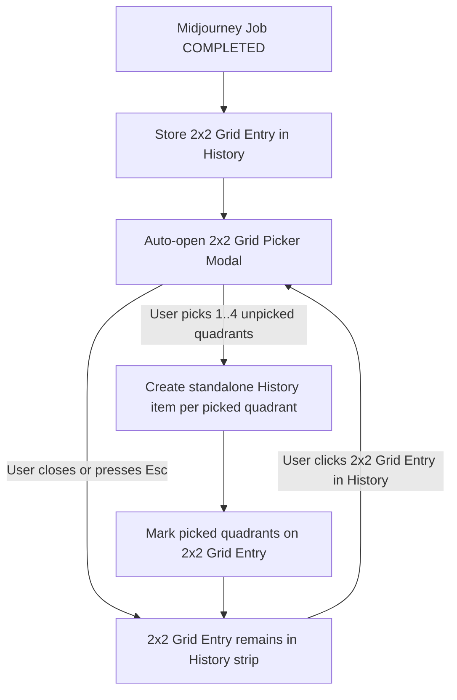
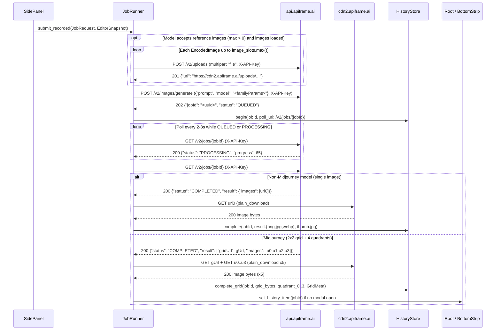
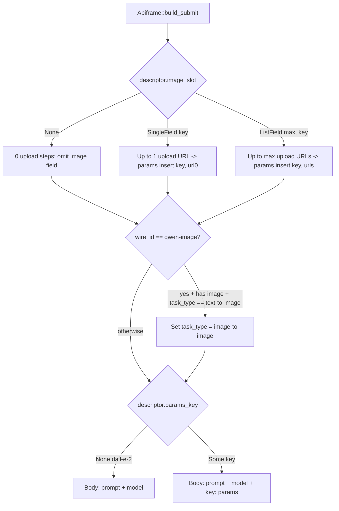
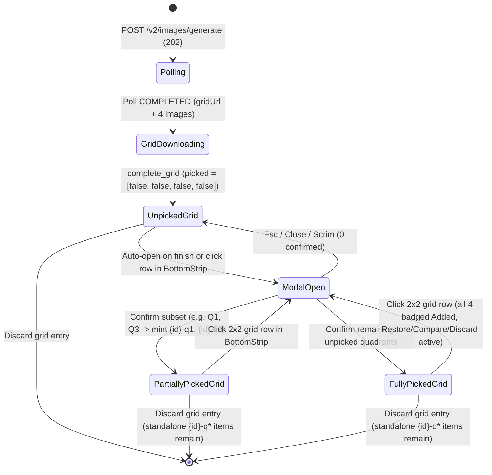
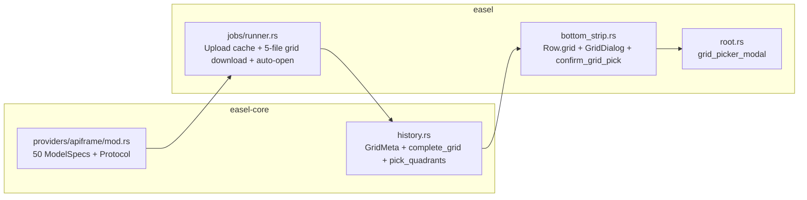

# Apiframe Image Provider - Plan

## Goal Capsule

- **Objective:** A person with an Apiframe API key can pick any of the 50 Apiframe image models from Easel's provider and model menus, generate from a prompt or edit from the canvas and references, and either land a single-image result in History or pick any of Midjourney's four generated images from a 2x2 grid modal into standalone History items at completion time or later.
- **Means:** One `ProviderId::Apiframe` identity authenticating via `X-API-Key` across 50 descriptor-backed `ModelSpec`s (`apiframe-*` internal IDs mapping to exact wire `model` strings and 17 family parameter objects), temporary reference image uploads via `POST /v2/uploads`, job submission and polling via `POST /v2/images/generate` and `GET /v2/jobs/:id`, and a 5-file Midjourney grid download (`gridUrl` plus four quadrant files) feeding a `Root`-hosted 2x2 Grid Picker modal (KTD1, KTD2, KTD3, KTD4, KTD5, KTD6).
- **Authority hierarchy:** R-IDs and Key Decisions in `## Product Contract` govern product behavior, and KTDs in `## Planning Contract` govern implementation mechanism. `docs/api/apiframe.create.md`, `docs/api/apiframe.results.md`, and the live `apiframe.ai/docs/*.mdx` pages fetched on 25 October 2026 are authoritative for endpoints, parameter wrapper keys, field bounds, upload behavior, and job polling status codes.
- **Stop conditions:** Stop if `POST /v2/images/generate` stops returning a `jobId` for async polling on `GET /v2/jobs/:id`. Stop if `POST /v2/uploads` stops returning an HTTPS URL accepted by image-capable models. Stop if Midjourney `COMPLETED` responses omit `result.gridUrl` or four URLs in `result.images`.
- **Execution profile:** Feature work. Prove `ProviderId::Apiframe`, the 50 model schemas, `POST /v2/uploads`, and `GET /v2/jobs/:id` parsing in `easel-core` and `HistoryStore::complete_grid` / `pick_quadrants` before wiring the runner, side-panel form tests, and the `Root` 2x2 Grid Picker modal.
- **Finishes and ships:** The implementer lands the work on the current branch.

---

## Product Contract

Product Contract preservation: Product Contract unchanged.

### Summary

Apiframe joins Easel as an image provider covering all 50 models in `docs/api/apiframe.create.md` under a single API key. Models that accept reference images automatically upload loaded canvas and reference images before submitting the job, and single-image models store their finished image directly in History. Midjourney jobs save their 2x2 composite grid in History and open a 2x2 Grid Picker modal where the user can promote any of the four quadrants into individual History items immediately or when reopening the grid later.

### Problem Frame

An Apiframe account gives one API key access to 50 image models across 14 families, including Midjourney, Seedream, Ideogram, Imagen, Kling, Wan, and Reve. Today a person with an Apiframe key cannot run any of those models from Easel's prompt, canvas, and reference workflow. Even if the basic job-submission and polling loop were wired up, two mismatches would break the workflow: Apiframe's image-to-image and editing models require uploaded media URLs rather than inline base64 payloads, and Midjourney always produces four distinct images plus a 2x2 composite grid whereas Easel's History assumes one image per job. Without a dedicated 2x2 grid selection flow, a Midjourney run would either discard three paid variations or flood History with unwanted tiles.

### Key Decisions

- KD1. **Include all 50 models from `docs/api/apiframe.create.md` under the Apiframe provider.** One Apiframe key unlocks the entire documented catalog in table order. (session-settled: user-directed — chosen over non-overlapping model families only or a Midjourney-only subset: the user selected all 50 models in the catalog.) Governs R1, R5.
- KD2. **Support canvas and reference images on Apiframe models that accept image inputs.** Loaded images are uploaded to Apiframe and passed as URLs on models that support image-to-image or editing. (session-settled: user-approved — chosen over text-to-image only: the user confirmed that canvas and reference images should work independently on Apiframe models that accept them.) Governs R6, R7.
- KD3. **Open a 2x2 Grid Picker modal when a Midjourney job completes so the user can pick any number of the four images as History items.** Users inspect the 2x2 batch before choosing which variations enter History as individual items. (session-settled: user-directed — chosen over auto-saving all four images, saving only the 2x2 composite, or saving only the first image: the user specified a 2x2 grid modal where any subset becomes History items.) Governs R9, R10, R11.
- KD4. **Keep the 2x2 grid entry in History after picking so the user can reopen the modal and pick from the remaining quadrants later.** Picking one variation does not forfeit the other three from the same generation. (session-settled: user-directed — chosen over replacing the 2x2 grid entry with the selected items: the user required that clicking the 2x2 entry in History reopens the modal to pick unselected quadrants.) Governs R10, R12, R13.
- KD5. **Keep non-Midjourney models at one output image per run and omit a status-bar credit balance.** Single-image models follow the existing History item lifecycle, and Settings carries the key and key test without changing the status bar. (session-settled: user-approved — confirmed in the scoping synthesis over multi-output fan-out on non-Midjourney models or a live credit counter.) Governs R3, R8.

### Requirements

**Provider and credentials**

- R1. The provider menu lists `Apiframe` once a key is available, and its model menu lists all 50 models from `docs/api/apiframe.create.md` in table order.
- R2. All 50 Apiframe models share one credential read from `APIFRAME_API_KEY` when non-empty and otherwise from the stored key for `https://api.apiframe.ai`, sent via the `X-API-Key` header.
- R3. Settings includes an Apiframe API key row whose Test action issues a non-spending authenticated request to `https://api.apiframe.ai/v2/me`, reports HTTP 401 or 403 as an invalid key, and leaves the status bar unchanged.
- R4. With an Apiframe model selected and no key available, Generate is disabled with `No Apiframe API key — open Settings`.

**Models, parameters, and reference images**

- R5. Each of the 50 models exposes its documented model-specific generation parameters in the side panel form and submits them inside that model family's parameters object alongside `prompt` and `model`.
- R6. On Apiframe models whose documented parameters accept reference or input images, loaded canvas and reference images are uploaded to Apiframe via `POST /v2/uploads`, canvas image first, and their returned URLs are sent up to the model's documented maximum.
- R7. On text-only Apiframe models, or when more images are loaded than the selected model accepts, Generate stays enabled, excess images are omitted without being uploaded, and the form displays `{sent} of {total} images will be sent`.

**Job polling and single-image results**

- R8. Every non-Midjourney Apiframe job requests a single output image, polls `GET /v2/jobs/:id` with `X-API-Key` while status is `QUEUED` or `PROCESSING`, and on `COMPLETED` downloads `result.images[0]` into a standard single-image History item.
- R14. A job poll returning `FAILED` or an HTTP error records the failure according to Easel's provider error rules, surfaces the failure reason when present, and writes no broken image file.

**Midjourney 2x2 grid modal and history**

- R9. When a Midjourney job reaches `COMPLETED`, Easel stores a 2x2 grid History entry backed by `result.gridUrl` and the four quadrant images in `result.images`, and opens the 2x2 Grid Picker modal automatically unless another modal is already in front.
- R10. Clicking a completed Midjourney 2x2 grid entry in the History strip opens the 2x2 Grid Picker modal for that grid instead of the single-image History item modal or promoting the composite onto the canvas.
- R11. Inside the 2x2 Grid Picker modal, the user can select any number of unpicked quadrants from the four generated images and confirm to create a standalone single-image History item for each selected quadrant.
- R12. Quadrants already promoted to standalone History items from a given 2x2 grid are marked as already added in the 2x2 Grid Picker modal and cannot be picked a second time from that grid.
- R13. The 2x2 grid entry remains in the History strip after quadrants are picked from it, and discarding the 2x2 grid entry removes the grid entry while leaving any standalone History items already created from its quadrants intact.

**Compatibility**

- R15. Standalone History items created from Apiframe single-image runs or picked from a Midjourney 2x2 grid support Promote, Compare, Save As, Reveal, Restore, and Discard identically to existing providers.
- R16. Switching between Apiframe and other providers or models preserves the prompt, canvas, references, boxes, and schema-compatible form values while disarming the Box tool on Apiframe models.

### Model Table

All 50 models post JSON to `https://api.apiframe.ai/v2/images/generate` with `supports_boxes: false` and `beta: false`. Each model's Easel `ModelSpec::id` is `"apiframe-<wire_id>"` (KTD1) while the JSON `"model"` field sends the exact wire identifier below. Optional integer `seed` fields are omitted when `0` or unset, optional strings are omitted when empty, and multi-output count fields (`number_of_images` on `gpt-image-1.5`, `n` on `kling-image`, `num_images` on `qwen-image`) are omitted from the form so every non-Midjourney run produces one image (R8).

| # | Menu name | Easel `id` | Wire `model` | Params key | Image slots (`max`, field) | Schema fields inside params object |
| --- | --- | --- | --- | --- | --- | --- |
| 1 | Midjourney | `apiframe-midjourney` | `midjourney` | `midjourneyParams` | None (0) | `aspect_ratio` Select (`1:1`, `16:9`, `9:16`, `4:3`, `3:4`, `3:2`, `2:3`, `21:9`) default `1:1` |
| 2 | Nano Banana | `apiframe-nano-banana` | `nano-banana` | `nanoBananaParams` | List (`14`, `image_input`) | `aspect_ratio` Select (`1:1`, `16:9`, `9:16`, `4:3`, `3:4`, `3:2`, `2:3`, `21:9`) default `1:1`; `output_format` Select (`png`, `jpg`, `webp`) default `png` |
| 3 | Nano Banana Pro | `apiframe-nano-banana-pro` | `nano-banana-pro` | `nanoBananaParams` | List (`14`, `image_input`) | `aspect_ratio` Select (`match_input_image`, `1:1`, `16:9`, `9:16`, `4:3`, `3:4`, `3:2`, `2:3`, `21:9`) default `1:1`; `resolution` Select (`512px`, `1K`, `2K`, `4K`) default `2K`; `output_format` Select (`jpg`, `png`, `webp`) default `jpg` |
| 4 | Nano Banana 2 | `apiframe-nano-banana-2` | `nano-banana-2` | `nanoBananaParams` | List (`14`, `image_input`) | `aspect_ratio` Select (`match_input_image`, `1:1`, `16:9`, `9:16`, `4:3`, `3:4`, `3:2`, `2:3`, `21:9`) default `1:1`; `resolution` Select (`512px`, `1K`, `2K`, `4K`) default `1K`; `output_format` Select (`jpg`, `png`) default `jpg`; `google_search` Bool default `false`; `image_search` Bool default `false` |
| 5 | Nano Banana 2 Lite | `apiframe-nano-banana-2-lite` | `nano-banana-2-lite` | `nanoBananaParams` | List (`14`, `image_input`) | `aspect_ratio` Select (`match_input_image`, `1:1`, `16:9`, `9:16`, `4:3`, `3:4`, `3:2`, `2:3`, `21:9`) default `1:1`; `output_format` Select (`jpg`, `png`) default `jpg`; `google_search` Bool default `false`; `image_search` Bool default `false` |
| 6 | Flux 1.1 Pro | `apiframe-flux-1.1-pro` | `flux-1.1-pro` | `fluxParams` | Single (`1`, `image_prompt`) | `aspect_ratio` Select (`1:1`, `16:9`, `9:16`, `4:3`, `3:4`, `3:2`, `2:3`, `21:9`, `custom`) default `1:1`; `width` Int `256..=1440`; `height` Int `256..=1440`; `output_format` Select (`jpg`, `png`, `webp`) default `jpg`; `output_quality` Int `0..=100` default `90`; `prompt_upsampling` Bool default `false`; `seed` Int |
| 7 | Flux 1.1 Pro Ultra | `apiframe-flux-1.1-pro-ultra` | `flux-1.1-pro-ultra` | `fluxParams` | Single (`1`, `image_prompt`) | `aspect_ratio` Select (`1:1`, `16:9`, `9:16`, `4:3`, `3:4`, `3:2`, `2:3`, `21:9`) default `1:1`; `raw` Bool default `false`; `image_prompt_strength` Float `0.0..=1.0` default `0.1`; `output_format` Select (`jpg`, `png`, `webp`) default `jpg`; `seed` Int |
| 8 | Flux 2 Pro | `apiframe-flux-2-pro` | `flux-2-pro` | `fluxParams` | List (`8`, `input_images`) | `aspect_ratio` Select (`1:1`, `16:9`, `9:16`, `4:3`, `3:4`, `3:2`, `2:3`, `21:9`, `match_input_image`, `custom`) default `1:1`; `resolution` Select (`0.5 MP`, `1 MP`, `2 MP`, `4 MP`) default `1 MP`; `width` Int `256..=2048`; `height` Int `256..=2048`; `output_format` Select (`jpg`, `png`, `webp`) default `jpg`; `output_quality` Int `0..=100` default `90`; `prompt_upsampling` Bool default `false`; `seed` Int |
| 9 | Flux 2 Dev | `apiframe-flux-2-dev` | `flux-2-dev` | `fluxParams` | List (`5`, `input_images`) | `aspect_ratio` Select (`1:1`, `16:9`, `9:16`, `4:3`, `3:4`, `3:2`, `2:3`, `21:9`, `match_input_image`, `custom`) default `1:1`; `width` Int `256..=1440`; `height` Int `256..=1440`; `go_fast` Bool default `true`; `output_format` Select (`jpg`, `png`, `webp`) default `jpg`; `output_quality` Int `0..=100` default `90`; `seed` Int |
| 10 | Flux 2 Flex | `apiframe-flux-2-flex` | `flux-2-flex` | `fluxParams` | List (`10`, `input_images`) | `aspect_ratio` Select (`1:1`, `16:9`, `9:16`, `4:3`, `3:4`, `3:2`, `2:3`, `21:9`, `match_input_image`, `custom`) default `1:1`; `resolution` Select (`0.5 MP`, `1 MP`, `2 MP`, `4 MP`) default `1 MP`; `width` Int `256..=2048`; `height` Int `256..=2048`; `steps` Int `1..=50` default `30`; `guidance` Float `1.5..=10.0` default `4.5`; `prompt_upsampling` Bool default `false`; `output_format` Select (`jpg`, `png`, `webp`) default `jpg`; `output_quality` Int `0..=100` default `90`; `seed` Int |
| 11 | Flux 2 Max | `apiframe-flux-2-max` | `flux-2-max` | `fluxParams` | List (`8`, `input_images`) | `aspect_ratio` Select (`1:1`, `16:9`, `9:16`, `4:3`, `3:4`, `3:2`, `2:3`, `21:9`, `match_input_image`, `custom`) default `1:1`; `resolution` Select (`0.5 MP`, `1 MP`, `2 MP`, `4 MP`) default `1 MP`; `width` Int `256..=2048`; `height` Int `256..=2048`; `output_format` Select (`jpg`, `png`, `webp`) default `jpg`; `output_quality` Int `0..=100` default `90`; `seed` Int |
| 12 | Seedream 3 | `apiframe-seedream-3` | `seedream-3` | `seedreamParams` | None (0) | `aspect_ratio` Select (`1:1`, `16:9`, `9:16`, `4:3`, `3:4`, `3:2`, `2:3`, `21:9`, `custom`) default `1:1`; `size` Select (`small`, `regular`, `big`) default `regular`; `width` Int `512..=2048`; `height` Int `512..=2048`; `guidance_scale` Float `1.0..=10.0` default `2.5`; `seed` Int |
| 13 | Seedream 3.1 | `apiframe-seedream-3.1` | `seedream-3.1` | `seedreamParams` | None (0) | `aspect_ratio` Select (`1:1`, `16:9`, `9:16`, `4:3`, `3:4`, `3:2`, `2:3`, `21:9`, `custom`) default `1:1`; `resolution` Select (`1K`, `2K`) default `2K`; `width` Int `512..=3024`; `height` Int `512..=3024`; `use_pre_llm` Bool default `true`; `seed` Int |
| 14 | Seedream 4 | `apiframe-seedream-4` | `seedream-4` | `seedreamParams` | List (`10`, `image_input`) | `aspect_ratio` Select (`match_input_image`, `1:1`, `16:9`, `9:16`, `4:3`, `3:4`, `3:2`, `2:3`, `21:9`) default `1:1`; `size` Select (`1K`, `2K`, `4K`, `custom`) default `2K`; `width` Int `1024..=4096`; `height` Int `1024..=4096`; `enhance_prompt` Bool default `true` |
| 15 | Seedream 4.5 | `apiframe-seedream-4.5` | `seedream-4.5` | `seedreamParams` | List (`14`, `image_input`) | `aspect_ratio` Select (`match_input_image`, `1:1`, `16:9`, `9:16`, `4:3`, `3:4`, `3:2`, `2:3`, `21:9`) default `1:1`; `size` Select (`2K`, `4K`, `custom`) default `2K`; `width` Int `1024..=4096`; `height` Int `1024..=4096` |
| 16 | Seedream 5 Lite | `apiframe-seedream-5-lite` | `seedream-5-lite` | `seedreamParams` | List (`14`, `image_input`) | `aspect_ratio` Select (`match_input_image`, `1:1`, `16:9`, `9:16`, `4:3`, `3:4`, `3:2`, `2:3`, `21:9`) default `1:1`; `size` Select (`2K`, `3K`) default `2K`; `output_format` Select (`png`, `jpg`) default `png` |
| 17 | Seedream 5.0 Pro | `apiframe-seedream-5-pro` | `seedream-5-pro` | `seedreamParams` | List (`10`, `image_input`) | `aspect_ratio` Select (`match_input_image`, `1:1`, `16:9`, `9:16`, `4:3`, `3:4`, `3:2`, `2:3`, `21:9`) default `1:1`; `size` Select (`1K`, `2K`) default `2K`; `output_format` Select (`png`, `jpg`) default `png`; `seed` Int |
| 18 | Ideogram V2 | `apiframe-ideogram-v2` | `ideogram-v2` | `ideogramParams` | None (0) | `aspect_ratio` Select (`1:1`, `16:9`, `9:16`, `3:2`, `2:3`, `4:3`, `5:4`, `3:5`, `10:16`, `16:10`, `1:3`) default `1:1`; `style_type` Select (`Auto`, `General`, `Realistic`, `Design`, `Render_3d`, `Anime`, `None`) default `Auto`; `magic_prompt_option` Select (`Auto`, `On`, `Off`) default `Auto`; `negative_prompt` Text; `seed` Int |
| 19 | Ideogram V2 Turbo | `apiframe-ideogram-v2-turbo` | `ideogram-v2-turbo` | `ideogramParams` | None (0) | Same schema as `apiframe-ideogram-v2` |
| 20 | Ideogram V2a | `apiframe-ideogram-v2a` | `ideogram-v2a` | `ideogramParams` | None (0) | Same schema as `apiframe-ideogram-v2` |
| 21 | Ideogram V2a Turbo | `apiframe-ideogram-v2a-turbo` | `ideogram-v2a-turbo` | `ideogramParams` | None (0) | Same schema as `apiframe-ideogram-v2` |
| 22 | Ideogram V3 Balanced | `apiframe-ideogram-v3-balanced` | `ideogram-v3-balanced` | `ideogramParams` | List (`3`, `style_reference_images`) | `aspect_ratio` Select (`1:1`, `16:9`, `9:16`, `4:3`, `3:4`, `3:2`, `2:3`, `16:10`, `10:16`, `3:1`, `1:3`) default `1:1`; `style_type` Select (`Auto`, `General`, `Realistic`, `Design`, `None`) default `Auto`; `magic_prompt_option` Select (`Auto`, `On`, `Off`) default `Auto`; `style_preset` Text optional; `seed` Int |
| 23 | Ideogram V3 Turbo | `apiframe-ideogram-v3-turbo` | `ideogram-v3-turbo` | `ideogramParams` | List (`3`, `style_reference_images`) | Same schema as `apiframe-ideogram-v3-balanced` |
| 24 | Ideogram V3 Quality | `apiframe-ideogram-v3-quality` | `ideogram-v3-quality` | `ideogramParams` | List (`3`, `style_reference_images`) | Same schema as `apiframe-ideogram-v3-balanced` |
| 25 | Ideogram V4 Balanced | `apiframe-ideogram-v4-balanced` | `ideogram-v4-balanced` | `ideogramParams` | List (`3`, `style_reference_images`) | Same schema as `apiframe-ideogram-v3-balanced` |
| 26 | Ideogram V4 Turbo | `apiframe-ideogram-v4-turbo` | `ideogram-v4-turbo` | `ideogramParams` | List (`3`, `style_reference_images`) | Same schema as `apiframe-ideogram-v3-balanced` |
| 27 | Ideogram V4 Quality | `apiframe-ideogram-v4-quality` | `ideogram-v4-quality` | `ideogramParams` | List (`3`, `style_reference_images`) | Same schema as `apiframe-ideogram-v3-balanced` |
| 28 | Ideogram Character | `apiframe-ideogram-character` | `ideogram-character` | `ideogramParams` | Single (`1`, `character_reference_image`) | `aspect_ratio` Select (`1:1`, `16:9`, `9:16`, `4:3`, `3:4`, `3:2`, `2:3`, `16:10`, `10:16`, `3:1`, `1:3`) default `1:1`; `style_type` Select (`Auto`, `Fiction`, `Realistic`) default `Auto`; `rendering_speed` Select (`turbo`, `default`, `quality`) default `default`; `magic_prompt_option` Select (`Auto`, `On`, `Off`) default `Auto`; `seed` Int |
| 29 | Stable Diffusion 3.5 Large | `apiframe-stable-diffusion-3.5-large` | `stable-diffusion-3.5-large` | `stableDiffusionParams` | Single (`1`, `image`) | `aspect_ratio` Select (`1:1`, `16:9`, `21:9`, `3:2`, `2:3`, `4:5`, `5:4`, `9:16`, `9:21`) default `1:1`; `cfg` Float `0.0..=20.0` default `3.5`; `steps` Int `1..=40` default `28`; `prompt_strength` Float `0.0..=1.0` default `0.85`; `negative_prompt` Text; `output_format` Select (`webp`, `jpg`, `png`) default `webp`; `output_quality` Int `0..=100` default `90`; `seed` Int |
| 30 | Stable Diffusion 3.5 Large Turbo | `apiframe-stable-diffusion-3.5-large-turbo` | `stable-diffusion-3.5-large-turbo` | `stableDiffusionParams` | Single (`1`, `image`) | Same as `apiframe-stable-diffusion-3.5-large` with `cfg` default `1.0`, `steps` default `4`, and no `negative_prompt` |
| 31 | Stable Diffusion 3.5 Medium | `apiframe-stable-diffusion-3.5-medium` | `stable-diffusion-3.5-medium` | `stableDiffusionParams` | Single (`1`, `image`) | Same schema as `apiframe-stable-diffusion-3.5-large` |
| 32 | Stable Diffusion 3 | `apiframe-stable-diffusion-3` | `stable-diffusion-3` | `stableDiffusionParams` | Single (`1`, `image`) | Same as `apiframe-stable-diffusion-3.5-large` with `steps` Int `1..=28` default `28` |
| 33 | Imagen 3 | `apiframe-imagen-3` | `imagen-3` | `imagenParams` | None (0) | `aspect_ratio` Select (`1:1`, `9:16`, `16:9`, `3:4`, `4:3`) default `1:1`; `output_format` Select (`jpg`, `png`) default `jpg` |
| 34 | Imagen 3 Fast | `apiframe-imagen-3-fast` | `imagen-3-fast` | `imagenParams` | None (0) | Same schema as `apiframe-imagen-3` |
| 35 | Imagen 4 | `apiframe-imagen-4` | `imagen-4` | `imagenParams` | None (0) | `aspect_ratio` Select (`1:1`, `9:16`, `16:9`, `3:4`, `4:3`) default `1:1`; `image_size` Select (`1K`, `2K`) default `1K`; `output_format` Select (`jpg`, `png`) default `jpg` |
| 36 | Imagen 4 Ultra | `apiframe-imagen-4-ultra` | `imagen-4-ultra` | `imagenParams` | None (0) | Same schema as `apiframe-imagen-4` |
| 37 | Imagen 4 Fast | `apiframe-imagen-4-fast` | `imagen-4-fast` | `imagenParams` | None (0) | Same schema as `apiframe-imagen-3` |
| 38 | DALL-E 3 | `apiframe-dall-e-3` | `dall-e-3` | `dalleParams` | None (0) | `aspect_ratio` Select (`1:1`, `3:2`, `2:3`) default `1:1`; `style` Select (`vivid`, `natural`) default `vivid` |
| 39 | DALL-E 2 | `apiframe-dall-e-2` | `dall-e-2` | *(none)* | None (0) | No model-specific parameters object (`{"prompt", "model": "dall-e-2"}` only) |
| 40 | GPT Image 1.5 | `apiframe-gpt-image-1.5` | `gpt-image-1.5` | `gptImageParams` | List (`10`, `input_images`) | `aspect_ratio` Select (`1:1`, `3:2`, `2:3`) default `1:1`; `quality` Select (`auto`, `low`, `medium`, `high`) default `auto`; `background` Select (`auto`, `transparent`, `opaque`) default `auto`; `input_fidelity` Select (`low`, `high`) default `low`; `output_format` Select (`webp`, `png`, `jpeg`) default `webp` |
| 41 | Kling Image | `apiframe-kling-image` | `kling-image` | `klingImageParams` | Single (`1`, `image`) | `model_name` Select (`kling-v1`, `kling-v1-5`, `kling-v2`) default `kling-v1`; `aspect_ratio` Select (`16:9`, `9:16`, `1:1`, `4:3`, `3:4`, `3:2`, `2:3`) default `1:1`; `image_fidelity` Float `0.0..=1.0` default `0.5`; `negative_prompt` Text |
| 42 | Qwen Image | `apiframe-qwen-image` | `qwen-image` | `qwenImageParams` | Single (`1`, `image_url`) | `task_type` Select (`text-to-image`, `image-to-image`, `image-edit`) default `text-to-image`; `image_size` Select (`square`, `square_hd`, `portrait_4_3`, `portrait_16_9`, `landscape_4_3`, `landscape_16_9`) default `square_hd`; `num_inference_steps` Int `2..=250` default `30`; `guidance_scale` Float `0.0..=20.0` default `4.0`; `strength` Float `0.0..=1.0` default `0.8`; `acceleration` Select (`none`, `regular`, `high`) default `none`; `negative_prompt` Text; `output_format` Select (`png`, `jpeg`) default `png`; `seed` Int |
| 43 | Qwen Image 2 | `apiframe-qwen-image-2` | `qwen-image-2` | `qwenImage2Params` | Single (`1`, `image`) | `aspect_ratio` Select (`1:1`, `2:3`, `3:2`, `3:4`, `4:3`, `9:16`, `16:9`, `21:9`, `2:1`, `1:2`) default `1:1`; `negative_prompt` Text; `seed` Int |
| 44 | Qwen Image 2 Pro | `apiframe-qwen-image-2-pro` | `qwen-image-2-pro` | `qwenImage2Params` | Single (`1`, `image`) | Same schema as `apiframe-qwen-image-2` |
| 45 | Wan Image 2.6 | `apiframe-wan-image-2.6` | `wan-image-2.6` | `wanImageParams` | Single (`1`, `image`) | `aspect_ratio` Select (`1:1`, `2:3`, `3:2`, `3:4`, `4:3`, `9:16`, `16:9`, `21:9`) default `1:1`; `prompt_extend` Bool default `false`; `negative_prompt` Text; `seed` Int `0..=2147483647` |
| 46 | Wan Image 2.7 | `apiframe-wan-image-2.7` | `wan-image-2.7` | `wanImage27Params` | Single (`1`, `image`) | `aspect_ratio` Select (`1:1`, `2:3`, `3:2`, `3:4`, `4:3`, `9:16`, `16:9`, `21:9`) default `1:1`; `thinking_mode` Bool default `true`; `seed` Int `0..=2147483647` |
| 47 | Wan Image 2.7 Pro | `apiframe-wan-image-2.7-pro` | `wan-image-2.7-pro` | `wanImage27Params` | Single (`1`, `image`) | Same schema as `apiframe-wan-image-2.7` |
| 48 | Grok Image 2 | `apiframe-grok-image` | `grok-image` | `grokImageParams` | Single (`1`, `image`) | `aspect_ratio` Select (`auto`, `1:1`, `16:9`, `9:16`, `4:3`, `3:4`, `3:2`, `2:3`, `2:1`, `1:2`, `19.5:9`, `9:19.5`, `20:9`, `9:20`) default `1:1`; `resolution` Select (`1k`, `2k`) default `2k`; `quality` Select (`low`, `medium`) default `medium` |
| 49 | Grok Image Fast | `apiframe-grok-imagine-image` | `grok-imagine-image` | `grokImagineParams` | Single (`1`, `image`) | `aspect_ratio` Select (`1:1`, `2:3`, `3:2`, `16:9`, `9:16`) default `1:1` |
| 50 | Reve Create | `apiframe-reve-create` | `reve-create` | `reveParams` | None (0) | `aspect_ratio` Select (`3:2`, `16:9`, `9:16`, `2:3`, `4:3`, `3:4`, `1:1`) default `3:2`; `version` Select (`latest`, `reve-create@20250915`) default `latest`; `seed` Int |

### Key Flows



- F1. Single-image generation or edit on a non-Midjourney model
  - **Trigger:** The user selects Apiframe and any non-Midjourney model, enters a prompt with optional canvas/reference images, and clicks Generate.
  - **Steps:** Easel uploads up to the model's supported number of reference images when applicable, submits the job, polls until completion, and downloads the first result image.
  - **Outcome:** One finished image lands in the History strip as a standard History item.
  - **Covered by:** R5, R6, R7, R8, R15
- F2. Midjourney generation and initial 2x2 grid selection
  - **Trigger:** The user runs a Midjourney generation and the polled job reaches `COMPLETED`.
  - **Steps:** Easel saves the 2x2 grid entry in History, opens the 2x2 Grid Picker modal showing the four quadrants, and the user picks one or more quadrants.
  - **Outcome:** Each picked quadrant becomes its own standalone History item, and the 2x2 grid entry stays in History with those quadrants marked as picked.
  - **Covered by:** R9, R11, R12, R13, R15
- F3. Reopening a Midjourney 2x2 grid from History to pick remaining images
  - **Trigger:** The user clicks an existing Midjourney 2x2 grid entry in the History strip.
  - **Steps:** Easel reopens the 2x2 Grid Picker modal with previously picked quadrants badged as already added, and the user selects any of the remaining quadrants.
  - **Outcome:** Newly picked quadrants become standalone History items without duplicating earlier picks.
  - **Covered by:** R10, R11, R12, R13

### Acceptance Examples

- AE1. Initial pick from a completed Midjourney 2x2 grid
  - **Covers:** R9, R11, R12, R13
  - **Given:** A Midjourney job finishes with four URLs in `result.images` and a `result.gridUrl`.
  - **When:** The 2x2 Grid Picker modal opens automatically and the user selects quadrants 1 and 3 and confirms.
  - **Then:** Two standalone single-image History items are added to the History strip for quadrants 1 and 3, and the 2x2 grid entry remains in the History strip with quadrants 1 and 3 marked as already added.
- AE2. Reopening a 2x2 grid entry to pick a remaining quadrant
  - **Covers:** R10, R11, R12, R13
  - **Given:** A Midjourney 2x2 grid entry in History already has quadrants 1 and 3 picked.
  - **When:** The user clicks the 2x2 grid entry in the History strip and selects quadrant 4 in the modal.
  - **Then:** Quadrants 1 and 3 are shown as already added and disabled, quadrant 4 is added as a new standalone History item, and quadrant 2 remains available for future picks.
- AE3. Closing the 2x2 Grid Picker modal without picking
  - **Covers:** R9, R10, R13
  - **Given:** A Midjourney job finishes and auto-opens the 2x2 Grid Picker modal.
  - **When:** The user presses Escape or Close without selecting any quadrant.
  - **Then:** No standalone quadrant items are created yet, and clicking the 2x2 grid entry in History reopens the modal with all four quadrants available.
- AE4. Reference image upload on an image-capable Apiframe model vs text-only model
  - **Covers:** R6, R7
  - **Given:** One image is on the canvas and one reference image is in the side panel.
  - **When:** The user generates with `apiframe-flux-2-pro` (which accepts reference images) and then switches to `apiframe-dall-e-3` (text-only).
  - **Then:** `apiframe-flux-2-pro` uploads both images and sends their URLs in `fluxParams.input_images`, while `apiframe-dall-e-3` keeps Generate enabled, displays `0 of 2 images will be sent`, and sends no image upload.

### Scope Boundaries

All 50 image models listed in `docs/api/apiframe.create.md`, using `POST /v2/images/generate`, `GET /v2/jobs/:id`, and `POST /v2/uploads` for temporary reference image uploads, plus the Midjourney 2x2 Grid Picker modal. Boxes remain on the canvas and are not sent to Apiframe models. Considered and not built:

- Exposing Ideogram's `image` + `mask` inpainting parameters across `ideogram-*` models — those fields require a second binary mask image that Easel's reference strip does not distinguish from style or character references; reopen only if Easel adds a dedicated mask slot. (session-settled: user-approved — confirmed in the scoping synthesis.)
- Cross-restart resume of in-flight Apiframe jobs in `JobRunner::resume` — `resume()` is intentionally scoped to BFL (Krea also fails in-flight rows on restart); reopen only if cross-restart resume is generalized across polled providers.

#### Deferred to Follow-Up Work

- Midjourney follow-up action endpoints (`upsample`, `variations`, `inpaint`, `outpaint`, `pan`).
- Apiframe video generation, music generation, standalone background-removal/upscale endpoints outside `/v2/images/generate`, and LoRA training (`/v2/loras`).
- Persistent `/v2/assets` library management and webhook delivery (`webhookUrl`, `webhookEvents`).
- Multi-image batch fan-out on non-Midjourney models.
- Displaying an Apiframe credit balance in the status bar.

### Sources

- `docs/api/apiframe.create.md` — `POST /v2/images/generate` contract, `result.images` and `result.gridUrl` format, and the 50-model table.
- `docs/api/apiframe.results.md` — `GET /v2/jobs/:id` status lifecycle (`QUEUED`, `PROCESSING`, `COMPLETED`, `FAILED`), polling guidance, and error codes.
- `docs/plans/2026-10-18-1108-feat-history-item-modal-plan.md` — existing History item modal architecture on `Root` and `AppState`.
- `docs/plans/2026-10-22-2158-feat-chutes-image-provider-plan.md` and `docs/plans/2026-10-24-2355-feat-stability-image-provider-plan.md` — multi-model provider registration, image-count notice rules, and settings probe conventions.
- Apiframe live documentation (`https://apiframe.ai/docs/llms.txt`, `https://apiframe.ai/docs/uploads.mdx`, `https://apiframe.ai/docs/account/me.mdx`, and all 50 `https://apiframe.ai/docs/images/*.mdx` pages) — `POST /v2/uploads` multipart temporary file upload (`201 Created` returning `cdn2.apiframe.ai/uploads/...`), `GET /v2/me`, and per-family parameter schemas.

---

## Planning Contract

### Key Technical Decisions

- KTD1. **Prefix internal `ModelSpec::id` values with `apiframe-` while sending the unprefixed wire `model` string.** `ProviderId::Apiframe` serializes as `"apiframe"`, displays `"Apiframe"`, reads `APIFRAME_API_KEY`, uses `AuthScheme::HeaderKey { header: "X-API-Key".into() }`, sets base URL `https://api.apiframe.ai`, and allows hosts `[HostRule::Exact("api.apiframe.ai"), HostRule::Exact("cdn2.apiframe.ai"), HostRule::Suffix(".apiframe.ai")]`. Each of the 50 models in `crates/easel-core/src/providers/apiframe/mod.rs` registers a static `ModelSpec` with `id: "apiframe-<wire_id>"` so `"flux-2-pro"` and `"gpt-image-1.5"` do not collide with `ProviderId::Bfl` and `ProviderId::OpenAi` in `ModelRegistry::specs()`, `resolve_model()`, or `model_spec.rs` prefix tests, while `build_submit` writes the unprefixed `wire_id` into `"model"`. `ReqwestTransport::credential_name` adds `"x-api-key"` so `X-API-Key` is always redacted in logs. (session-settled: user-approved — confirmed in the scoping synthesis over unprefixed IDs that would collide with BFL and OpenAI.) Governs R1, R2, R4, R5, R16.
- KTD2. **Descriptor-driven parameter wrapper dispatch across the 18 parameter-object shapes.** Each model descriptor in `crates/easel-core/src/providers/apiframe/mod.rs` declares `id`, `display_name`, `wire_id`, `params_key: Option<&'static str>` (`Some("midjourneyParams")`, `Some("nanoBananaParams")`, `Some("fluxParams")`, `Some("seedreamParams")`, `Some("ideogramParams")`, `Some("stableDiffusionParams")`, `Some("imagenParams")`, `Some("dalleParams")`, `None` for `dall-e-2`, `Some("gptImageParams")`, `Some("klingImageParams")`, `Some("qwenImageParams")`, `Some("qwenImage2Params")`, `Some("wanImageParams")`, `Some("wanImage27Params")`, `Some("grokImageParams")`, `Some("grokImagineParams")`, `Some("reveParams")`), `image_slot: ApiframeImageSlot`, and its `ParamSchema`. `build_submit` constructs `{"prompt": request.compiled_prompt, "model": descriptor.wire_id}` and, when `params_key` is `Some(key)` and the collected parameter map is non-empty, inserts `key: Value::Object(params)`. On `apiframe-qwen-image`, when an uploaded image URL is present and `task_type` is `"text-to-image"`, `build_submit` promotes `task_type` to `"image-to-image"`; when `task_type` is `"image-to-image"` or `"image-edit"` and zero images are loaded, `validate_for_submit` returns `FieldError { key: "images", message: "Add at least one image." }`. Governs R5, R6, R8.
- KTD3. **Cap `reference_steps` to `image_slots.max()` and upload via `POST /v2/uploads`.** `Apiframe::reference_steps(&self, images: &[EncodedImage])` takes `images.iter().take(self.spec().capabilities.image_slots.max())` and maps each `EncodedImage` to `ReferenceStep::Upload` posting `Body::Multipart { parts: vec![Part { name: "file", filename: Some("image.{jpg|png|webp}"), content_type, bytes }] }` to `https://api.apiframe.ai/v2/uploads` with `auth: Some(ProviderId::Apiframe)`. Because text-only models have `ImageSlots::None` (`max = 0`), they emit zero upload steps even when images are loaded on the canvas. `parse_upload` accepts HTTP `200` or `201`, reads string `"url"`, verifies `ProviderId::Apiframe.allows_url(url)`, and returns `Ok(ImageInput::Url(url.to_owned()))`, which `JobRunner::resolve_steps` caches under `"apiframe:{content_hash}"`. (session-settled: user-approved — confirmed in the scoping synthesis over exposing Ideogram's masked-inpainting pair.) Governs R6, R7.
- KTD4. **Submit (`202 Accepted`), poll (`GET /v2/jobs/:id`), and progress normalization.** `parse_submit` accepts HTTP `200` or `202`, extracts `"jobId"` via `JobId::parse`, and returns `Submitted { job_id, poll_url: "https://api.apiframe.ai/v2/jobs/{jobId}", quote: None }`. `poll_request` issues `GET` to `submitted.poll_url` with `auth: Some(ProviderId::Apiframe)`, and `poll_policy` uses `initial: 2s, factor: 1.25, cap: 3s, deadline: 600s` per `docs/api/apiframe.results.md`. `parse_poll` maps `"QUEUED"` and `"PROCESSING"` to `PollOutcome::InFlight` with `progress` normalized from `0..=100` to `(p / 100.0).clamp(0.0, 1.0) as f32`; maps `"FAILED"` to `PollOutcome::Failed` (`ProviderError::Blocked` when the `error` string contains `"content policy"` or `"moderation"` case-insensitively, and `ProviderError::Protocol(error)` otherwise); and on `"COMPLETED"` extracts `creditCost` as `settled_cost` and validates `result.images` against `ProviderId::Apiframe.allows_url`. Governs R8, R9, R14.
- KTD5. **Five-file Midjourney grid download and `GridMeta` persistence in `HistoryStore`.** `PollOutcome::Ready` gains `grid_urls: Option<[url::Url; 4]>`. On non-Midjourney models (`result.gridUrl` absent), `parse_poll` sets `url = result.images[0]` and `grid_urls = None`. On Midjourney (`model == "midjourney"` or `result.gridUrl` present), `parse_poll` requires a valid `result.gridUrl` and four valid URLs in `result.images[0..4]` (all passing `ProviderId::Apiframe.allows_url`), setting `url = grid_url` and `grid_urls = Some([u0, u1, u2, u3])`. During `JobState::Downloading`, when `grid_urls` is `Some(quadrants)`, `JobRunner` downloads `gridUrl` and all four quadrant URLs, verifies `decode_image` on all five payloads, and calls `HistoryStore::complete_grid`, which writes `result.{png,jpg,webp}` and `thumb.jpg` for the composite grid, writes `quadrant_0.{png,jpg,webp}` through `quadrant_3.{png,jpg,webp}`, and stores `grid: Some(GridMeta { grid_url, images, picked: [false; 4] })` on `Meta` in `meta.json`. `HistoryStore::pick_quadrants(&self, grid_id: &JobId, quadrants: &[usize], created_at: &str)` mints standalone History entries (`JobId` `"{grid_id}-q{1..4}"`) for each unpicked quadrant index, copying `<grid_id>/request.json` (including `EditorSnapshot`) so `Restore` and `Compare` work unchanged, writing `<new_id>/result.{png,jpg,webp}` and `<new_id>/thumb.jpg` from that quadrant's bytes, inserting `<new_id>` into `history.json` ahead of `grid_id` with `created_at` at least the grid row's `created_at` so newly picked rows sort above the 2x2 grid entry, and setting `grid.picked[q] = true` in `<grid_id>/meta.json`. (session-settled: user-approved — confirmed in the scoping synthesis over lazy on-pick network fetches that could fail after CDN expiry.) Governs R9, R11, R12, R13, R15.
- KTD6. **Auto-open and reopen routing for the 2x2 Grid Picker modal on `BottomStrip` and `Root`.** `JobRunner` exposes `watch_app_state(&mut self, app: gpui::Entity<AppState>)` (called in `Root::with_history` and `BottomStrip::new`). When `complete_grid` succeeds in `JobRunner`, if `!app_state.settings_open && app_state.history_item.is_none()`, `JobRunner` sets `app_state.set_history_item(Some(HistoryItem { token: Some(token), id: Some(grid_id) }), cx)`. `BottomStrip::Row` carries `grid: Option<GridMeta>` populated in **both** `row_from_live` and `row_from_history`, and `BottomStrip::rebuild` skips `JobState::Done` live slots whose `id` is already present in `self.history.list()` so persisted history order governs completed rows and newly picked quadrants appear at the top of the strip. Clicking or double-clicking a row where `row.grid.is_some()` immediately opens the modal (`cancel_arm` + `open_row`) instead of promoting the 2x2 composite onto the canvas. When the targeted `history_item` row has `grid: Some(grid_meta)`, `BottomStrip::dialog(cx)` returns `None` and `BottomStrip::grid_dialog(cx)` returns `Some(GridDialog)` with the four decoded quadrant `RenderImage`s, `picked: [bool; 4]`, transient `selected: [bool; 4]`, metadata, prompt, and row actions (`Restore`, `Compare`, `Save As`, `Reveal`, `Discard`), and `Root::render` paints `self.grid_picker_modal(dialog)` instead of `self.history_modal`. Confirming selected quadrants calls `BottomStrip::confirm_grid_pick(cx)`, which invokes `history.pick_quadrants`, refreshes the strip, and closes the modal. Governs R9, R10, R11, R12, R13, R15.
- KTD7. **Non-spending Settings key probe on `GET /v2/me`.** `key_probe(ProviderId::Apiframe)` issues `GET https://api.apiframe.ai/v2/me` with `auth: Some(ProviderId::Apiframe)` and `Body::Empty`. In `SettingsPanel::test_key` (`crates/easel/src/settings/mod.rs`), `ProviderId::Apiframe` joins `ProviderId::Bfl | ProviderId::Krea` in treating HTTP `401` and `403` (`"API key is inactive"`) as `"invalid key"`, while `200` reports `"key accepted"`. Governs R3.

### Failure Table

| Apiframe stage & response | `ProviderError` / Outcome | History effect |
| --- | --- | --- |
| Upload `200` or `201` with allowed `https://cdn2.apiframe.ai/...` `"url"` | `Ok(ImageInput::Url)` | cached under `"apiframe:{content_hash}"` |
| Upload `200` or `201` with missing or off-allowlist `"url"` | `Protocol("unexpected upload host")` | no row |
| Submit `200` or `202` with valid `"jobId"` | `Ok(Submitted)` | in-flight polling row (`poll_url: https://api.apiframe.ai/v2/jobs/{id}`) |
| Poll `200` `"QUEUED"` or `"PROCESSING"` | `PollOutcome::InFlight` (`progress / 100.0`) | stays in-flight |
| Poll `200` `"COMPLETED"` on non-Midjourney with valid `result.images[0]` | `PollOutcome::Ready { grid_urls: None }` | downloads 1 file -> `Done` single-image row |
| Poll `200` `"COMPLETED"` on Midjourney with valid `gridUrl` + 4 `images` | `PollOutcome::Ready { grid_urls: Some([..; 4]) }` | downloads 5 files -> `Done` 2x2 grid row + auto-opens 2x2 Grid Picker modal |
| Poll `200` `"COMPLETED"` with missing URLs or disallowed host | `PollOutcome::Failed(Protocol)` | failed row, no image file |
| Poll `200` `"FAILED"` with content policy / moderation `error` | `PollOutcome::Failed(Blocked)` | failed row, no image file |
| Poll `200` `"FAILED"` with other `error` string | `PollOutcome::Failed(Protocol(error))` | failed row, no image file |
| Submit or Upload `401` or `403` | `Auth` | failed row on submit; no row on upload |
| Submit `402` | `OutOfCredits` | no row |
| Submit `404` | `ModelNotFound` | failed row |
| Submit `400` or `422` with error details | `Validation(details)` | no row |
| Submit or Poll `429` | `RateLimited { retry_after: None }` | no row on submit; failed row on poll |
| Any other non-2xx or transport error | `Http` / `Network` | no row on submit; failed row on poll |

### High-Level Technical Design

Upload, job submission, polling, and single-image vs. 5-file Midjourney grid completion follow two branches inside `JobRunner`.



Request construction maps each of the 50 models through its descriptor's parameter wrapper and image-slot rule before response classification.



A Midjourney 2x2 grid entry transitions through `GridMeta.picked` states as the user picks quadrants across one or more modal sessions.



Component ownership keeps pure protocol and disk state in `easel-core` and modal/runner coordination in `easel`.



### Output Structure

```text
crates/
  easel-core/
    src/
      providers/
        apiframe/
          mod.rs          # new: 50 Apiframe ModelSpecs, 18 params wrappers, upload/submit/poll protocol, unit tests
        bfl/
          protocol.rs     # modified: PollOutcome::Ready { grid_urls: None, .. }
        krea/
          protocol.rs     # modified: PollOutcome::Ready { grid_urls: None, .. }
        mod.rs            # modified: register Apiframe specs, ProviderId::Apiframe, PollOutcome::Ready.grid_urls
      job.rs              # modified: PollOutcome::Ready destructuring
      model_spec.rs       # modified: ProviderId::Apiframe, APIFRAME_HOSTS
      history.rs          # modified: GridMeta, complete_grid, grid_meta, quadrant_bytes, pick_quadrants
  easel/
    src/
      jobs/
        apiframe_tests.rs # new: end-to-end upload, poll, single-image, and Midjourney 2x2 grid runner tests
        runner.rs         # modified: watch_app_state, 5-file grid download, complete_grid call, auto-open modal
      bottom_strip.rs     # modified: Row.grid, GridDialog, double-click guard on grid rows, confirm_grid_pick
      root.rs             # modified: grid_picker_modal rendering and interaction
```

### Sequencing

U1 wires `ProviderId::Apiframe`, `APIFRAME_HOSTS`, `X-API-Key` redaction, Settings `GET /v2/me` key probing, and `HistoryStore` 2x2 grid persistence (`GridMeta`, `complete_grid`, `pick_quadrants`). U2 implements `crates/easel-core/src/providers/apiframe/mod.rs` with all 50 `ModelSpec`s, the 18 parameter-wrapper builders, `POST /v2/uploads` reference steps, and `POST /v2/images/generate` + `GET /v2/jobs/:id` parsers. U3 updates `JobRunner` for 5-file Midjourney grid downloads and auto-opening the modal on completion, and builds the 2x2 Grid Picker modal in `BottomStrip` and `Root`. U4 proves the side-panel form, model-switching, and reference-count notices across the 50 models, and U5 proves the end-to-end runner and 2x2 Grid Picker modal lifecycles.

---

## Implementation Units

### U1. Wire `ProviderId::Apiframe`, Settings key probe, and `HistoryStore` 2x2 grid persistence

- **Goal:** `ProviderId::Apiframe` compiles across every exhaustive match site in both crates, Settings probes `GET https://api.apiframe.ai/v2/me` with `X-API-Key` redaction, and `HistoryStore` persists 2x2 grid entries and mints standalone History items from selected quadrants.
- **Requirements:** R2, R3, R4, R9, R11, R12, R13, R15 (KD3, KD4, KD5, KTD1, KTD5, KTD7)
- **Dependencies:** none
- **Files:**
  - `crates/easel-core/src/model_spec.rs`
  - `crates/easel-core/src/job.rs`
  - `crates/easel-core/src/providers/mod.rs`
  - `crates/easel-core/src/providers/bfl/protocol.rs`
  - `crates/easel-core/src/providers/krea/protocol.rs`
  - `crates/easel-core/src/history.rs`
  - `crates/easel/src/net/mod.rs`
  - `crates/easel/src/net/reqwest_transport.rs`
  - `crates/easel/src/settings/mod.rs`
  - `crates/easel/src/settings/credentials.rs`
  - `crates/easel/src/side_panel/validation.rs`
  - `crates/easel/src/jobs/runner.rs`
- **Approach:**
  1. Add `ProviderId::Apiframe` and `APIFRAME_HOSTS` in `crates/easel-core/src/model_spec.rs` and append `ProviderId::Apiframe` to `ModelRegistry::providers()` in `crates/easel-core/src/providers/mod.rs` per KTD1.
  2. Add `grid_urls: Option<[url::Url; 4]>` to `PollOutcome::Ready` in `crates/easel-core/src/providers/mod.rs` (initializing `grid_urls: None` in `bfl/protocol.rs`, `krea/protocol.rs`, and `job.rs`).
  3. Update all exhaustive `ProviderId` matches in `history.rs`, `side_panel/validation.rs`, `settings/mod.rs` (including `key_probe` and the HTTP `401 | 403` check in `SettingsPanel::test_key` per KTD7), `net/mod.rs` (`MapKeys`), `net/reqwest_transport.rs` (`"x-api-key"` in `credential_name`), and `jobs/runner.rs` (`cache_key`).
  4. In `crates/easel-core/src/history.rs`, add `GridMeta { pub grid_url: String, pub images: [String; 4], pub picked: [bool; 4] }`, optional `grid: Option<GridMeta>` on `Meta`, `complete_grid`, `grid_meta`, `quadrant_bytes`, and `pick_quadrants` per KTD5.
- **Execution note:** Prove `HistoryStore::complete_grid`, `pick_quadrants`, `EditorSnapshot` inheritance, and grid removal in `history.rs` unit tests before wiring the UI modal.
- **Patterns to follow:** `ProviderId::Krea` and `ProviderId::Chutes` arms across `model_spec.rs` and `settings/mod.rs`; `HistoryStore::complete` and `HistoryStore::complete_inline` in `crates/easel-core/src/history.rs`.
- **Test scenarios:**
  - `ProviderId::Apiframe` serializes as `"apiframe"`, displays `"Apiframe"`, reads `APIFRAME_API_KEY`, uses `AuthScheme::HeaderKey { header: "X-API-Key" }`, and `allows_url` accepts `https://api.apiframe.ai/v2/images/generate` and `https://cdn2.apiframe.ai/images/a.png` while rejecting `http://api.apiframe.ai` and `https://apiframe.ai.evil.example/x`.
  - `key_probe(ProviderId::Apiframe)` builds `GET https://api.apiframe.ai/v2/me` with `auth: Some(ProviderId::Apiframe)`; `SettingsPanel::test_key` reports `"invalid key"` on HTTP 401 and HTTP 403 and `"key accepted"` on HTTP 200.
  - `missing_key_line(ProviderId::Apiframe)` returns `"No Apiframe API key — open Settings"`, and `ReqwestTransport` redacts `X-API-Key` header values in debug formatting.
  - `HistoryStore::complete_grid` writes `result.png`, `thumb.jpg`, and `quadrant_0.png`..`quadrant_3.png` and persists `GridMeta` with `picked: [false; 4]`.
  - Covers AE1, AE2. `HistoryStore::pick_quadrants(&grid_id, &[0, 2], ...)` creates standalone History entries `{grid_id}-q1` and `{grid_id}-q3` with their respective quadrant bytes, thumbnails, and cloned `request.json` + `EditorSnapshot`, orders them ahead of `grid_id` in `HistoryStore::list()`, updates `grid_meta(&grid_id).unwrap().picked` to `[true, false, true, false]`, and a subsequent `pick_quadrants(&grid_id, &[0, 3], ...)` ignores already-picked quadrant `0` and creates only `{grid_id}-q4` (`picked: [true, false, true, true]`).
  - `HistoryStore::remove(&grid_id)` deletes the 2x2 grid entry while leaving `{grid_id}-q1`, `{grid_id}-q3`, and `{grid_id}-q4` intact and loadable via `load_request`, `load_editor`, and `result_path`. Covers R13, R15.
- **Verification:** `cargo nextest run -p easel-core`, `cargo nextest run -p easel settings validation reqwest_transport`, and `cargo clippy --workspace --all-targets -- -D warnings` pass with all `HistoryStore` grid and `ProviderId::Apiframe` tests green.

### U2. Implement the 50 Apiframe `ModelSpec`s, 18 parameter wrappers, upload steps, and job polling protocol

- **Goal:** All 50 Apiframe models in the Model Table are registered in `ModelRegistry`, build their documented parameter objects and `POST /v2/uploads` steps, and classify `POST /v2/images/generate` and `GET /v2/jobs/:id` responses per KTD1–KTD5 and the Failure Table.
- **Requirements:** R1, R5, R6, R7, R8, R9, R14 (KD1, KD2, KD5, KTD1, KTD2, KTD3, KTD4, KTD5)
- **Dependencies:** U1
- **Files:**
  - `crates/easel-core/src/providers/apiframe/mod.rs`
  - `crates/easel-core/src/providers/mod.rs`
- **Approach:**
  1. Create `crates/easel-core/src/providers/apiframe/mod.rs` with a static 50-entry descriptor table in the exact order of `docs/api/apiframe.create.md`, generating 50 `ModelSpec`s (`id: "apiframe-<wire_id>"`, mapping single-image descriptors to `ImageSlots::Single` and multi-image descriptors to `ImageSlots::List`) and registering them in `ModelRegistry::specs()` and `resolve_model()` in `crates/easel-core/src/providers/mod.rs` per KTD1 and KTD2.
  2. Implement `Apiframe::reference_steps` and `parse_upload` per KTD3: slice `images.iter().take(self.spec().capabilities.image_slots.max())` to emit `ReferenceStep::Upload` (`POST https://api.apiframe.ai/v2/uploads`, multipart `"file"` part) and parse HTTP `200 | 201` `"url"` with `ProviderId::Apiframe.allows_url`.
  3. Implement `Apiframe::validate_for_submit` and `build_submit` per KTD2: enforce non-empty prompt (`1..=2000` chars), enforce `apiframe-qwen-image` `task_type` image presence (`Add at least one image.` when `task_type != "text-to-image"` and `image_count == 0`), auto-promote `task_type` to `"image-to-image"` when an image URL is supplied with `task_type == "text-to-image"`, place uploaded image URLs into the descriptor's documented field (`image_input`, `input_images`, `style_reference_images`, `character_reference_image`, `image_prompt`, `image_url`, or `image`), and wrap schema values under the descriptor's `params_key` (omitting the wrapper on `apiframe-dall-e-2` and omitting unset optional fields).
  4. Implement `parse_submit`, `poll_request`, `poll_policy`, and `parse_poll` per KTD4, KTD5, and the Failure Table.
- **Execution note:** Write table-driven unit tests in `crates/easel-core/src/providers/apiframe/mod.rs` asserting that all 50 models round-trip through `resolve_model`, emit their exact wire `model` string and `params_key`, and honor their image-slot caps.
- **Patterns to follow:** `crates/easel-core/src/providers/chutes/mod.rs` for descriptor-backed multi-model registration; `crates/easel-core/src/providers/krea/assets.rs` and `crates/easel-core/src/providers/krea/protocol.rs` for `ReferenceStep::Upload`, `parse_upload`, `parse_submit`, and `parse_poll`.
- **Test scenarios:**
  - `ModelRegistry::specs()` contains all 50 Apiframe models in `docs/api/apiframe.create.md` table order with `id` `"apiframe-<wire_id>"`, and existing OpenAI (`registry_lists_the_six_openai_models_in_menu_order`) and BFL (`flux-2-pro`) registry tests continue to pass unchanged. Covers R1.
  - Every one of the 18 parameter-wrapper shapes builds its exact JSON payload: `midjourney` wraps `midjourneyParams`, `nano-banana*` wraps `nanoBananaParams`, `flux-*` wraps `fluxParams`, `seedream-*` wraps `seedreamParams`, `ideogram-*` wraps `ideogramParams`, `stable-diffusion-*` wraps `stableDiffusionParams`, `imagen-*` wraps `imagenParams`, `dall-e-3` wraps `dalleParams`, `dall-e-2` sends `{"prompt", "model": "dall-e-2"}` with no params object, `gpt-image-1.5` wraps `gptImageParams`, `kling-image` wraps `klingImageParams`, `qwen-image` wraps `qwenImageParams`, `qwen-image-2*` wraps `qwenImage2Params`, `wan-image-2.6` wraps `wanImageParams`, `wan-image-2.7*` wraps `wanImage27Params`, `grok-image` wraps `grokImageParams`, `grok-imagine-image` wraps `grokImagineParams`, and `reve-create` wraps `reveParams`. Covers R5.
  - Covers AE4. `reference_steps` on `apiframe-flux-2-pro` (`max = 8`) with 2 `EncodedImage`s returns 2 `ReferenceStep::Upload` requests to `https://api.apiframe.ai/v2/uploads` and `build_submit` places their URLs in `fluxParams.input_images`, whereas `reference_steps` on `apiframe-dall-e-3` (`max = 0`) with 2 `EncodedImage`s returns an empty Vec and `build_submit` sends no image field.
  - Single-image slot mapping places the uploaded URL into `fluxParams.image_prompt` (`apiframe-flux-1.1-pro`), `ideogramParams.character_reference_image` (`apiframe-ideogram-character`), `qwenImageParams.image_url` (`apiframe-qwen-image`, auto-upgrading `task_type` from `"text-to-image"` to `"image-to-image"`), and `<family>Params.image` (`stable-diffusion-*`, `kling-image`, `qwen-image-2*`, `wan-image-*`, `grok-*`). Covers R6.
  - `parse_upload` accepts HTTP 201 `{"url": "https://cdn2.apiframe.ai/uploads/u1.png"}` and rejects off-host URLs (`https://evil.example/u1.png`) with `ProviderError::Protocol`.
  - `parse_submit` accepts HTTP 202 `{"jobId": "a1b2c3d4-e5f6-7890-abcd-ef1234567890", "status": "QUEUED"}` and sets `poll_url` to `https://api.apiframe.ai/v2/jobs/a1b2c3d4-e5f6-7890-abcd-ef1234567890`; HTTP 401 -> `Auth`, 402 -> `OutOfCredits`, 404 -> `ModelNotFound`, 400 with details -> `Validation`, 429 -> `RateLimited`.
  - `parse_poll` normalizes `"PROCESSING"` `progress: 65` to `Some(0.65)`, maps `"FAILED"` with `"Provider returned an error: content policy violation"` to `PollOutcome::Failed(ProviderError::Blocked)`, maps `"COMPLETED"` on non-Midjourney to `PollOutcome::Ready { url: images[0], grid_urls: None, settled_cost: Some(5.0), .. }`, and maps `"COMPLETED"` on Midjourney to `PollOutcome::Ready { url: gridUrl, grid_urls: Some([u0, u1, u2, u3]), settled_cost: Some(10.0), .. }` while failing with `Protocol` if fewer than 4 `images` URLs are present or any URL is off-allowlist. Covers R8, R9, R14.
- **Verification:** `cargo nextest run -p easel-core apiframe` passes all 50-model schema, upload, submit, and poll unit tests.

### U3. Implement 5-file Midjourney grid download in `JobRunner` and the 2x2 Grid Picker modal in `BottomStrip` and `Root`

- **Goal:** Midjourney `COMPLETED` jobs download `gridUrl` and all four quadrant images, persist a 2x2 grid History entry, auto-open the 2x2 Grid Picker modal when no other modal is open, and let the user pick any unpicked quadrants into standalone History items immediately or when reopening the grid entry later.
- **Requirements:** R9, R10, R11, R12, R13, R14, R15 (KD3, KD4, KTD5, KTD6)
- **Dependencies:** U1, U2
- **Files:**
  - `crates/easel/src/jobs/runner.rs`
  - `crates/easel/src/bottom_strip.rs`
  - `crates/easel/src/bottom_strip_tests.rs`
  - `crates/easel/src/root.rs`
- **Approach:**
  1. Add `JobRunner::watch_app_state(&mut self, app: gpui::Entity<AppState>)` (wired in `Root::with_history` and `BottomStrip::new`). In `JobRunner::start_download` (`crates/easel/src/jobs/runner.rs`), branch on `grid_urls`: when `None`, keep the existing single-file download path; when `Some(quadrant_urls)`, download `url` (`gridUrl`) and all four `quadrant_urls` via `provider.download_request`, verify `decode_image` on all five responses (failing or expiring the job without writing partial files if any fails per KTD5), call `self.history.complete_grid(&id, &grid_bytes, &quadrant_bytes, &thumb, grid_meta, &completion)`, transition the slot to `JobState::Done`, and if `!app_state.settings_open && app_state.history_item.is_none()`, call `app_state.set_history_item(Some(HistoryItem { token: Some(token), id: Some(id) }), cx)` per KTD6.
  2. In `crates/easel/src/bottom_strip.rs`, add `grid: Option<GridMeta>` to `Row` (populated in both `row_from_live` and `row_from_history` via `self.history.grid_meta(id)`), skip `JobState::Done` live slots in `BottomStrip::rebuild` when their `id` is already in `self.history.list()` so newly picked quadrant rows sort above completed grid rows, add `grid_selection: [bool; 4]` to `BottomStrip` (cleared when the open `history_item` changes or closes), and update the left-click handler so clicking or double-clicking a row with `row.grid.is_some()` cancels arming and calls `open_row(index, cx)` without calling `promote_index` per KTD6.
  3. Update `BottomStrip::dialog(cx)` to return `None` when `self.rows[index].grid.is_some()`, and add `GridDialog` and `BottomStrip::grid_dialog(&mut self, cx: &mut Context<Self>) -> Option<GridDialog>` (returning `Some` when `self.rows[index].grid.is_some()` and decoding the four quadrant `RenderImage`s from `history.quadrant_bytes(id, 0..4)`), `BottomStrip::toggle_grid_quadrant(&mut self, quadrant: usize, cx: &mut Context<Self>)` (ignoring clicks where `picked[quadrant]` is already `true`), and `BottomStrip::confirm_grid_pick(&mut self, cx: &mut Context<Self>)` (calling `self.history.pick_quadrants`, rebuilding rows, and dismissing the modal) in `crates/easel/src/bottom_strip.rs`.
  4. In `crates/easel/src/root.rs`, render `self.grid_picker_modal(grid_dialog)` when `self.bottom_strip.update(cx, |strip, cx| strip.grid_dialog(cx))` is `Some`, using `cover_below_title_bar("grid-picker-scrim")`, `pane_header("Pick from 2×2 Grid")`, a 2x2 grid of the four quadrant images with `"1"`–`"4"` / `"Added"` badges (`theme::PANEL`, `theme::SURFACE`, `theme::BORDER`, `theme::BORDER_FOCUSED`), `Button::filled("grid-add-selected", format!("Add to History ({count})"))` (disabled when `count == 0`), and row action buttons (`Restore`, `Compare`, `Save As`, `Reveal`, `Discard` with `Confirm`/`Cancel`).
- **Patterns to follow:** `BottomStrip::dialog`, `BottomStrip::press`, and `Root::history_modal` in `crates/easel/src/bottom_strip.rs` and `crates/easel/src/root.rs`, adhering strictly to `AGENTS.md` theme rules (`theme::PANEL`, `theme::SURFACE`, `theme::BORDER`, `ui::pane_header`, `ui::Button::ghost`, `ui::Button::filled`, no `rgb(0x...)` literals).
- **Test scenarios:**
  - Covers AE1. Completing a Midjourney job downloads `gridUrl` + 4 quadrant URLs, writes the 2x2 grid entry to `HistoryStore`, and automatically sets `app_state.history_item` so `grid_dialog(cx)` is open with `picked: [false; 4]`; toggling quadrants 0 and 2 and calling `confirm_grid_pick(cx)` creates two standalone History rows at the top of `BottomStrip` while keeping the 2x2 grid row in the strip with `picked: [true, false, true, false]`.
  - Covers AE2. Clicking the 2x2 grid row in `BottomStrip` reopens `grid_dialog(cx)` with quadrants 0 and 2 marked `picked: true`; calling `toggle_grid_quadrant(0, cx)` is a no-op, while calling `toggle_grid_quadrant(3, cx)` and `confirm_grid_pick(cx)` creates one new standalone History row for quadrant 4 and updates `picked` to `[true, false, true, true]`.
  - Covers AE3. Pressing `Escape` (`CloseSettings`) or calling `dismiss_modal(cx)` when the 2x2 Grid Picker modal is open closes the modal without creating standalone History rows, and clicking the 2x2 grid row reopens it with all four quadrants unpicked.
  - Double-clicking a 2x2 grid row in `BottomStrip` opens `grid_dialog` and leaves `app_state.image()` (`None` on an empty canvas) unchanged instead of promoting the 2x2 composite image onto the canvas. Covers R10.
  - If `app_state.settings_open` is `true` (or another `history_item` modal is already open) when a Midjourney job finishes downloading, `app_state.history_item` is not overwritten, and the completed 2x2 grid row appears in `BottomStrip`. Covers R9.
  - Standalone History rows created from picked quadrants open the standard single-image `HistoryDialog` on single-click, promote their quadrant image onto the canvas on double-click, and support `Restore`, `Compare`, and `Discard`, while discarding the 2x2 grid row removes only the grid row. Covers R13, R15.
- **Verification:** `cargo nextest run -p easel bottom_strip` passes all 2x2 Grid Picker modal, auto-open, reopen, double-click guard, and standalone quadrant compatibility tests.

### U4. Prove side-panel form, reference clamping notices, and model-switching across Apiframe models

- **Goal:** The side panel lists `Apiframe` and its 50 models in table order once a key is set, enforces missing-key and `qwen-image` `task_type` validation, shows `{sent} of {total} images will be sent` notices across varying slot caps, and preserves compatible state on provider/model switches.
- **Requirements:** R1, R4, R5, R6, R7, R16
- **Dependencies:** U2
- **Files:**
  - `crates/easel/src/side_panel/form_tests.rs`
  - `crates/easel/src/side_panel/switch_tests.rs`
  - `crates/easel/src/status_bar.rs`
- **Approach:**
  1. Add `"APIFRAME_API_KEY"` (and `"DASHSCOPE_API_KEY"`) to `ProviderEnvGuard::clear()` in `crates/easel/src/side_panel/switch_tests.rs`.
  2. Add form and switch tests in `crates/easel/src/side_panel/form_tests.rs` and `crates/easel/src/side_panel/switch_tests.rs` verifying provider menu visibility, the 50-model menu order, missing-key message (`No Apiframe API key — open Settings`), `apiframe-qwen-image` `task_type` image requirement, reference-count notices across `0`, `1`, `3`, `5`, `8`, `10`, and `14` slot caps, Box tool disarming, and field carry-over across model switches.
  3. Add a status-bar test in `crates/easel/src/status_bar.rs` verifying that selecting an Apiframe model with a key present issues zero credit-balance requests.
- **Patterns to follow:** Chutes and Qwen tests in `crates/easel/src/side_panel/form_tests.rs`, `crates/easel/src/side_panel/switch_tests.rs`, and `crates/easel/src/status_bar.rs`.
- **Test scenarios:**
  - `Apiframe` is hidden from the provider menu when no key is set and appears once a key is configured, listing all 50 models in the exact order of `docs/api/apiframe.create.md`. Covers R1.
  - Selecting `apiframe-midjourney` with no key disables Generate with `No Apiframe API key — open Settings`, and with a key present the status bar makes zero HTTP requests. Covers R3, R4.
  - Covers AE4. With 2 images loaded, selecting `apiframe-flux-2-pro` (`max = 8`) shows no truncation notice, switching to `apiframe-stable-diffusion-3.5-large` (`max = 1`) keeps Generate enabled and shows `1 of 2 images will be sent`, and switching to `apiframe-dall-e-3` (`max = 0`) keeps Generate enabled and shows `0 of 2 images will be sent`.
  - Selecting `apiframe-qwen-image` with 0 images and `task_type` set to `"image-edit"` disables Generate with `Add at least one image.`; switching `task_type` back to `"text-to-image"` or loading 1 image enables Generate. Covers R5, R6.
  - Switching between `ProviderId::Bfl` (`flux-3-image` with Box tool armed) and `ProviderId::Apiframe` (`apiframe-flux-2-pro`) disarms the Box tool to `Tool::Select`, preserves the prompt, canvas image, references, and boxes, and keeps compatible `aspect_ratio` values while resetting incompatible values to the target model's default. Covers R16.
- **Verification:** `cargo nextest run -p easel side_panel` and `cargo nextest run -p easel status_bar` pass.

### U5. Prove end-to-end Apiframe single-image and Midjourney 2x2 grid runner lifecycles

- **Goal:** End-to-end `JobRunner` tests verify `POST /v2/uploads` caching, `POST /v2/images/generate` submission, `GET /v2/jobs/:id` polling, single-image download completion, 5-file Midjourney 2x2 grid download completion + auto-open modal, and failure handling.
- **Requirements:** R6, R7, R8, R9, R14, R15 (KTD3, KTD4, KTD5, KTD6)
- **Dependencies:** U2, U3
- **Files:**
  - `crates/easel/src/jobs/apiframe_tests.rs`
  - `crates/easel/src/jobs/mod.rs`
- **Approach:**
  1. Create `crates/easel/src/jobs/apiframe_tests.rs` and register `#[cfg(test)] mod apiframe_tests;` in `crates/easel/src/jobs/mod.rs`.
  2. Test single-image text-to-image (`apiframe-seedream-5-pro`), multi-reference upload + cache reuse (`apiframe-flux-2-pro`), text-only model with loaded canvas skipping upload (`apiframe-dall-e-3`), Midjourney 2x2 grid 5-file download + `complete_grid` + `AppState::history_item` auto-open, partial quadrant download failure, and poll `"FAILED"` / HTTP error handling.
- **Execution note:** Use valid PNG and JPEG fixtures so `decode_image`, `thumbnail`, `complete`, and `complete_grid` execute their real image decoding and file writing paths.
- **Patterns to follow:** `crates/easel/src/jobs/krea_tests.rs` and `crates/easel/src/jobs/chutes_tests.rs`.
- **Test scenarios:**
  - Covers AE4. Submitting `apiframe-flux-2-pro` with 2 prepared images uploads both via `POST https://api.apiframe.ai/v2/uploads` (`201 Created`), sends both returned `https://cdn2.apiframe.ai/uploads/...` URLs in `fluxParams.input_images` to `POST https://api.apiframe.ai/v2/images/generate` (`202 Accepted`), polls `GET https://api.apiframe.ai/v2/jobs/:id` through `"QUEUED"` and `"PROCESSING"` (`progress: 50` -> `0.5`), downloads `result.images[0]` on `"COMPLETED"`, and writes a `Done` History row; a second run with the same images reuses the cached upload URLs without re-posting to `/v2/uploads`.
  - Covers AE4. Submitting `apiframe-dall-e-3` with 1 prepared image issues zero requests to `/v2/uploads` and posts `POST /v2/images/generate` directly.
  - Covers AE1. Submitting `apiframe-midjourney` (with `watch_app_state` registered on `JobRunner`) polls `GET /v2/jobs/:id` until `"COMPLETED"`, downloads `result.gridUrl` and all 4 `result.images` URLs, persists `GridMeta` with `picked: [false; 4]` and all 4 quadrant files in `HistoryStore`, and automatically sets `app_state.history_item` to the completed grid job when no modal is open.
  - If 1 of the 4 Midjourney quadrant downloads returns HTTP 404 or invalid image bytes, the job fails cleanly without leaving a broken `Done` grid entry in `HistoryStore`. Covers R14.
  - A poll returning `"status": "FAILED"` with `"error": "Provider returned an error: content policy violation"` fails the job with `ProviderError::Blocked` and writes a failed History row with no image file; HTTP 402 on submit fails with `OutOfCredits` and writes no History row. Covers R14.
- **Verification:** `cargo nextest run -p easel apiframe` passes all end-to-end runner tests.

---

## Verification Contract

| Check | Command | Applies to | Done signal |
| --- | --- | --- | --- |
| Formatting | `cargo fmt --check` | Workspace | Exits 0 with no diff |
| Lints & warnings | `cargo clippy --workspace --all-targets -- -D warnings` | Workspace | Exits 0 with zero warnings |
| Core unit tests | `cargo nextest run -p easel-core` | `easel-core` (U1, U2) | All `easel-core` tests pass |
| App & UI tests | `cargo nextest run -p easel` | `easel` (U1, U3, U4, U5) | All `easel` tests pass |

---

## Definition of Done

- U1 through U5 meet their verification criteria and all four Verification Contract commands pass with zero warnings.
- `Apiframe` appears in Settings and in the provider menu (once a key exists) with all 50 models in the exact order of `docs/api/apiframe.create.md`.
- Image-capable Apiframe models upload canvas and reference images via `POST /v2/uploads`, while text-only models skip uploads and show `{sent} of {total} images will be sent`.
- Midjourney jobs download `gridUrl` and all four quadrant images, auto-open the 2x2 Grid Picker modal when no other modal is open, allow picking any subset of unpicked quadrants into standalone History items, and remain reopenable from the History strip with previously picked quadrants marked as already added.
- Existing tests for Black Forest Labs, Krea, Google, OpenAI, xAI, Chutes, and Qwen pass without regressions, and all UI code follows `AGENTS.md` theme and widget rules.
- No dead-end or experimental code remains in the diff.

---

## System-Wide Impact

- **Exhaustive `ProviderId` matches:** Adding `ProviderId::Apiframe` updates 20 sites across `crates/easel-core/src/model_spec.rs`, `crates/easel-core/src/providers/mod.rs`, `crates/easel-core/src/history.rs`, `crates/easel/src/jobs/runner.rs`, `crates/easel/src/side_panel/validation.rs`, `crates/easel/src/side_panel/switch_tests.rs`, `crates/easel/src/settings/mod.rs`, `crates/easel/src/net/mod.rs`, and `crates/easel/src/net/reqwest_transport.rs`.
- **Backward-compatible `HistoryStore` metadata:** `grid: Option<GridMeta>` on `Meta` uses `#[serde(default, skip_serializing_if = "Option::is_none")]`, so existing single-image History entries on disk load unchanged without migration, and standalone History items minted by `pick_quadrants` write `grid: None` and behave identically to single-image History entries across Promote, Compare, Save As, Reveal, Restore, and Discard.
- **Live vs. persisted row sync in `BottomStrip`:** Because `BottomStrip::rebuild` builds recently completed session jobs via `row_from_live` while their slot remains in `JobRunner::slots`, loading `self.history.grid_meta(id)` in both `row_from_live` and `row_from_history` guarantees that a Midjourney grid opens the 2x2 Grid Picker modal both immediately upon completion and after app restart.

---

## Risks & Dependencies

- **Apiframe temporary upload expiry (`POST /v2/uploads`):** Uploaded reference files on `cdn2.apiframe.ai/uploads/...` expire after 1–2 hours (`https://apiframe.ai/docs/uploads.mdx`). `JobRunner::uploads` is an in-memory session cache; if a cached upload URL is rejected after expiry in a multi-hour session, clearing the cached entry or restarting refreshes it.
- **90-day CDN retention on generated Midjourney quadrants:** Apiframe CDN URLs expire after 90 days (`docs/api/apiframe.create.md`). Downloading all four quadrant images alongside `gridUrl` during `JobState::Downloading` (KTD5) eliminates any dependency on the CDN after the job completes, so reopening a 2x2 grid in History months later still works offline.
- **Per-family parameter key divergence across model versions:** Apiframe splits parameter object keys within the Qwen (`qwenImageParams` vs. `qwenImage2Params`), Wan (`wanImageParams` vs. `wanImage27Params`), and Grok (`grokImageParams` vs. `grokImagineParams`) families and omits the parameter object entirely on `dall-e-2`. Encoding the exact `params_key` in each model's static descriptor (KTD2) prevents key-mismatch 400 errors.
