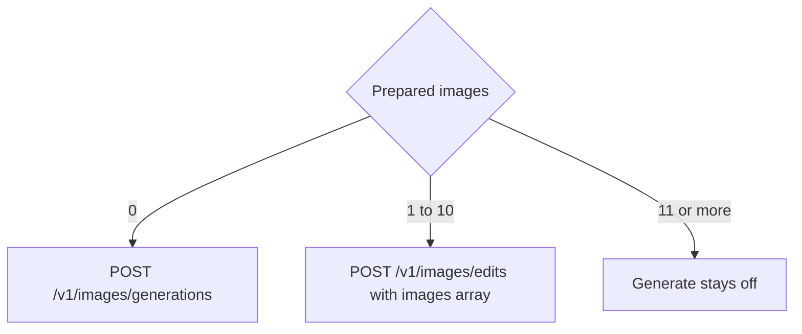
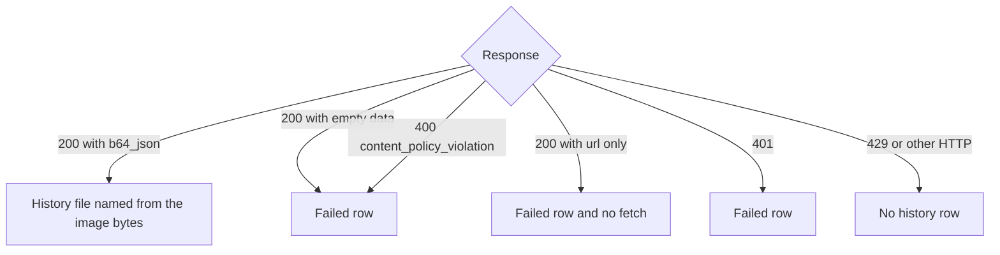

# Meta Muse Image Provider - Plan

## Goal Capsule

- **Objective:** A person can pick Meta, pick Muse Image 1.0, and get one generated or edited picture into the same history as the other ten providers.
- **Means:** A Meta provider on the single-shot images endpoints of Meta Model API. The request is chosen by whether source images are present (KTD2).
- **Authority hierarchy:** R-IDs govern behavior. KTDs govern mechanism. `https://dev.meta.ai/docs/image-generation`, fetched 27 October 2026, is the API checklist. The xAI provider in `crates/easel-core/src/providers/xai/mod.rs` is the pattern for registration, the runner, the refusal line, and the history stamp.
- **Stop conditions:** Stop if the edits endpoint rejects the JSON `images` body and requires multipart. Stop if a successful response carries the picture only as a URL even with `response_format` `b64_json`. Leave that URL unfetched.
- **Execution profile:** Feature work. Prove the two request bodies and the failure mapping with tests before treating the form as done.
- **Finishes and ships:** The implementer lands the work on the current branch.

---

## Product Contract

### Summary

Meta joins the provider list with one model, `muse-image-1.0`. A person picks Meta, and one picture lands in the existing history. With no source image, Generate sends a generation. With one to ten source images, it sends an edit. The form offers aspect size, output format, reasoning strength, and three switches for Muse's built-in grounding tools.

### Problem Frame

Muse Image is Meta's image model. It generates and edits from text plus up to ten reference images, and it can search the web and images for real-world references before it renders. Meta is not a provider in easel, so Muse cannot be picked, and its responses are not decoded. The API offers two surfaces: a conversational Responses API with server-held state, and OpenAI-compatible single-shot `images/generations` and `images/edits` endpoints. Every existing provider is single-shot, and history holds one picture per request.

### Key Decisions

- **One picture per generate.** (session-settled: user-approved — chosen over a batch of up to ten pictures from one generate: history keeps one picture.) Governs R7.
- **Single-shot endpoints only.** (session-settled: user-approved — chosen over the conversational Responses API: history does not carry turn state.) Governs R5.
- **The form exposes the grounding switches.** (session-settled: user-approved — chosen over a smaller form that leaves search and code always on.) Governs R6.
- **Provider "Meta", model "Muse Image 1.0", key `MODEL_API_KEY`.** (session-settled: user-approved — chosen over `META_API_KEY`: it is the name Meta's docs use.) Governs R1, R11.

### Requirements

**Choosing a model**

- R1. The person can generate and edit with `muse-image-1.0`, shown as Muse Image 1.0 under the provider Meta.
- R2. With Meta selected, the model list is that one id.
- R3. Switching provider or model keeps the prompt, the canvas, the boxes, and the references, and drops a size, output format, or reasoning value the new model does not offer.
- R4. Generate sends the model that was selected when the click happened. Other providers keep their current requests.

**Meta request**

- R5. Zero prepared images send a generation. One to ten send an edit. Eleven or more do not send.
- R6. The form offers size, output format, reasoning strength, image search, web search, and code execution, and the stored values are sent on generate and on edit. Size is `auto`, `1024x1024`, `1536x1024`, `1024x1536`, `1792x1024`, `1024x1792`. Output format is `webp`, `png`, `jpeg`. Reasoning strength is `high`, `low`. The three switches are on/off. Defaults are `auto`, `webp`, `high`, and all three switches on.
- R7. The request asks for one picture, and history keeps the first picture in the response.
- R8. References travel with the request as data URIs, canvas first when a canvas image exists. Past ten prepared images, Generate stays off and the line is `At most 10 images.`

**Results**

- R9. A successful Muse picture appears in history and the strip the same way a finished xAI picture does. The stored file name follows the image bytes: WebP is `result.webp`, PNG is `result.png`, JPEG is `result.jpg`.
- R10. A content-policy block, a rejected key, and a body with no usable image leave a failed history row and no image file. A URL-only body shows the strip line `no usable image` and is not fetched.
- R11. A missing key disables Generate before HTTP, with the existing no-key line naming Meta. Settings has a Meta key row. The status bar does not show a Meta balance.
- R12. A rate limit leaves no history row, shows `rate limited`, and does not send a second request. A retryable server error is not retried automatically.

### Success Criteria

- Picking Meta and generating with an empty canvas puts one picture in the history strip.
- An edit with one source image and an edit with three source images each put one picture in that strip.
- Switching from OpenAI size `1536x1024` to Meta keeps `1536x1024`. Switching from OpenAI quality `high` drops it, because Meta has no quality field.
- A FLUX 3 generate still posts to Black Forest Labs.

### Scope Boundaries

- One model, `muse-image-1.0`. One picture per request. Generation and multi-image edit through the JSON body. The R6 form. A settings key. A result in the existing history.
- Boxes stay on the canvas and stay out of the request.
- The built-in grounding runs on Meta's side. easel does not show the lookups it made.

#### Deferred to Follow-Up Work

- The Responses API: multi-turn refinement through `previous_response_id`, and replaying an `image_generation_call` id.
- Showing the `reasoning` summary that the Responses API returns.
- The Files API and `file_id` inputs.
- More than one output picture (`n` above 1), and streaming (`stream: true`).
- The `user` abuse identifier.
- A client byte cap on the edit body and a prompt-length cap.

### Acceptance Examples

- AE1. Empty canvas, prompt set, key present.
  - **Covers:** R5, R7, R9
  - **Given:** Meta and `muse-image-1.0` are selected and no source image is loaded.
  - **When:** the person generates.
  - **Then:** one picture is in the history strip and no second picture is stored.
- AE2. Three source images.
  - **Covers:** R5, R8
  - **Given:** a canvas image and two extras are loaded.
  - **When:** the person generates.
  - **Then:** the edit carries three images with the canvas first, and one picture lands in the strip.
- AE3. Eleven source images after a switch.
  - **Covers:** R5, R8
  - **Given:** eleven images were loaded under a provider that allows them, and the person switches to Meta.
  - **When:** the form refreshes.
  - **Then:** Generate is off, the line is `At most 10 images.`, and no request is sent.
- AE4. Switches turned off.
  - **Covers:** R6
  - **Given:** web search and code execution are off and image search is on.
  - **When:** the person generates.
  - **Then:** the request turns off web search and code execution, keeps image search on, and still returns one picture.
- AE5. Content-policy block.
  - **Covers:** R10
  - **Given:** the API rejects the prompt with a content-policy error.
  - **When:** the job finishes.
  - **Then:** history has a failed row and no image file.

### Sources

- `https://dev.meta.ai/docs/image-generation`, fetched 27 October 2026. Model `muse-image-1.0`. Base URL `https://api.meta.ai/v1`. `POST /v1/images/generations` and `POST /v1/images/edits`. The edits JSON body is an `images` array of 1 to 10 items, each with exactly one of `image_url` or `file_id`. `size` is a `"WxH"` aspect hint and is omitted for the default. `response_format` is `b64_json` (default) or `url`. `output_format` is `webp` (default), `png`, or `jpeg`, and is echoed in the response. `reasoning_strength` and `tool_enablement` are top-level Meta extensions. An unknown top-level field returns 400. `moderation` returns 400 on `muse-image-1.0`. Content-safety blocks are 400 with `code` `content_policy_violation`. Retryable failures are 503.
- `https://dev.meta.ai/docs/models`, fetched 27 October 2026. `GET https://api.meta.ai/v1/models` with bearer auth lists the enabled models.
- `https://dev.meta.ai/docs`. Auth is a bearer token, named `MODEL_API_KEY` in every sample.
- `docs/plans/2026-10-18-0210-feat-xai-image-provider-plan.md`. This plan follows the same shape and the same history and runner boundaries.

---

## Planning Contract

### Key Technical Decisions

- KTD1. **Register Meta the way xAI is registered, except for key precedence.** `ProviderId` variant `Meta`, serde name `meta`, display name `Meta`, bearer auth, exact host `api.meta.ai`, base URL `https://api.meta.ai`, env `MODEL_API_KEY`. For Meta only, `resolve_key` reads the store, then the session, then the environment. Every other provider keeps env first. `MODEL_API_KEY` is generic enough that another tool's secret may sit in it, and a key saved in Settings must be able to stop that secret from going to `api.meta.ai`. The settings probe is `GET https://api.meta.ai/v1/models`. A 401 is an invalid key. Any other status is accepted, matching the OpenAI and xAI probes. History and the runner cache key use the label `meta`. Governs R1, R2, R11.
- KTD2. **Image presence picks the endpoint, and edits use Meta's JSON body.** Zero images post `https://api.meta.ai/v1/images/generations` with no image field. One to ten post `https://api.meta.ai/v1/images/edits` with an `images` array whose items carry only `image_url` set to a data URI. Never `file_id`, never multipart. Both bodies carry `model`, `prompt`, `response_format` `b64_json`, `output_format`, `reasoning_strength`, and `tool_enablement` with all three booleans present. `size` is sent only when it is not `auto`. The body omits `n`, `stream`, `user`, `moderation`, and any other top-level key, because unknown top-level fields are rejected. Governs R5, R6, R8.
- KTD3. **Ask for bytes and keep one.** Omit `n` so the server default of 1 applies. Keep `data[0]` and drop later items. Governs R7, R9.
- KTD4. **Classify the response before saving bytes.**
  1. HTTP 401 is `Auth`. HTTP 429 is `RateLimited` with no retry delay.
  2. HTTP 400 whose `error.code` is `content_policy_violation` is `Blocked`.
  3. Any other non-200 status, including 503, is the existing `Http` failure, with no automatic retry.
  4. On 200, empty `data` is `Blocked`, since Meta removes filtered images before it returns them.
  5. A non-empty `data[0].b64_json` is decoded.
  6. A `url` with no `b64_json` is `NoImage` and is not fetched. A null or empty `b64_json` with no URL is `NoImage`.
  7. The mime comes from the decoded bytes through `extract_result_mime` in `crates/easel-core/src/providers/bfl/protocol.rs`, falling back to the echoed top-level `output_format`, then to `image/webp`.
  8. `Auth`, `Blocked`, and `NoImage` write a failed history row. `RateLimited` and `Http` write none.

  The response has no request id, so the interaction id is empty. Governs R9, R10, R12.
- KTD5. **Form values are `ParamSchema` fields, and the ten-image gate is the xAI refusal path.**
  - Size, output format, and reasoning strength are selects.
  - The switches are `FieldKind::Bool` fields keyed `enable_image_search`, `enable_web_search`, and `enable_shell`, labeled Image search, Web search, and Code execution. The builder nests them under `tool_enablement`.
  - Size reuses the key `size`, so a non-default OpenAI size such as `1536x1024` survives a switch. Output format reuses `output_format`, so a non-default Leonardo `png` survives.
  - A stored value survives a model switch only when the new schema lists it and it is not the outgoing model's default. A default is replaced by Meta's default, per the existing rule in `AppState::set_model` in `crates/easel/src/app_state.rs`. There is no translation between providers.
  - The over-cap line comes from a Meta `refusal_messages` beside the xAI check, keyed on the prepared count, and suppresses the generic "N of M images will be sent" notice. `reference_steps` still takes ten, so a submit that bypasses the button cannot post eleven.
  - `supports_boxes` is false. `size_control` is `AspectRatioAndResolution`, as on OpenAI. The default prompt compiler stays.

  Governs R3, R6, R8.

### High-Level Technical Design

The new branches are image presence on the way out and response classification on the way back. Everything after a usable `b64_json` is the existing inline finish.

### Sequencing

U1 lands the provider id so later units can name it. U2 builds the request. U3 and U4 both depend on U2 and can land in either order after it.

---

## Implementation Units

### U1. Register the provider

- **Goal:** Meta appears in the provider menu and in settings, and history can name it.
- **Requirements:** R1, R2, R11
- **Dependencies:** none
- **Files:**
  - `crates/easel-core/src/model_spec.rs`
  - `crates/easel-core/src/providers/mod.rs`
  - `crates/easel-core/src/history.rs`
  - `crates/easel/src/settings/mod.rs`
  - `crates/easel/src/settings/credentials.rs`
  - `crates/easel/src/net/mod.rs`
  - `crates/easel/src/jobs/runner.rs`
  - `crates/easel/src/side_panel/validation.rs`
  - `crates/easel/src/status_bar.rs`
- **Approach:** Fill every exhaustive `ProviderId` match per KTD1: base URL, env var, display name, auth scheme, host rules, the provider list, the history name, the settings key slot and label, the key map in `net`, the key probe, the runner `cache_key`, and `missing_key_line`. Add the Meta-only store-first order to `resolve_key` in `crates/easel/src/settings/mod.rs`. Credentials stay keyed by the base URL. Raise the provider count in `every_provider_is_registered_once` to eleven.
- **Patterns to follow:** The xAI arms in those files and the xAI asserts in `crates/easel-core/src/model_spec.rs` tests.
- **Test scenarios:**
  - The host allow list accepts `https://api.meta.ai` and `https://api.meta.ai/v1/models`, and rejects `http://api.meta.ai`, `https://dev.meta.ai`, and `https://api.meta.ai.evil.example/x`.
  - `ProviderId::Meta` serializes to `meta`, its env var is `MODEL_API_KEY`, and its display name is `Meta`.
  - The provider list stays alphabetical with Meta in it, and every provider appears once.
  - The key probe requests `GET https://api.meta.ai/v1/models` with bearer auth.
  - A 401 probe is an invalid key. A 200 is accepted. A 404 is accepted.
  - A stored Meta key wins over `MODEL_API_KEY` in the environment. With nothing stored or in the session, the env value is used. The existing env-first tests for OpenAI and xAI still pass.
  - A missing Meta key disables Generate with `No Meta API key — open Settings`, and a present key does not.
  - With Meta selected and a key present, the status bar does not request a balance.
- **Verification:** The menu lists Meta, and settings can store a key for `https://api.meta.ai`.

### U2. Build the Muse request

- **Goal:** Generate posts one of the two JSON bodies from KTD2.
- **Requirements:** R4, R5, R6, R7, R8
- **Dependencies:** U1
- **Files:**
  - `crates/easel-core/src/providers/meta/mod.rs`
  - `crates/easel-core/src/providers/mod.rs`
- **Approach:**
  1. Add one `ModelSpec` and one provider type, `MuseImage`, registered in `ModelRegistry::specs` and `resolve_model`.
  2. Put the R6 fields on the spec per KTD5, with `ImageSlots::List` max 10.
  3. Branch the URL on whether the prepared-image list is empty, and build the body per KTD2 and KTD3.
  4. Cap `reference_steps` at ten, inline base64, canvas first.
- **Execution note:** Write the two body tests first and make them pass before the form refusal in U4.
- **Patterns to follow:** `crates/easel-core/src/providers/xai/mod.rs` for the module shape, `field_string`, the data-URI helper, and the `posted` test helper.
- **Test scenarios:**
  - Covers AE1. Zero images post `https://api.meta.ai/v1/images/generations` with `model` `muse-image-1.0`, the prompt, `response_format` `b64_json`, `output_format` `webp`, `reasoning_strength` `high`, and `tool_enablement` with all three switches true. The body has no `images`, no `image`, no `size`, no `n`, no `stream`, no `moderation`, and no `user`.
  - One image posts `https://api.meta.ai/v1/images/edits` with `images` length 1 whose item has `image_url` as a data URI and no other key.
  - Covers AE2. Three images post the edits URL with `images` length 3 and the canvas data URI first.
  - Eleven prepared images produce ten reference steps and an `images` array of length 10.
  - Size `1536x1024` is sent as `size` on a generation and on an edit. Size `auto` is omitted from both.
  - Covers AE4. Web search and code execution off produce `tool_enablement` `{enable_image_search: true, enable_web_search: false, enable_shell: false}`.
  - Output format `png` and reasoning strength `low` are copied through on both URLs.
  - The body's top-level keys are exactly the KTD2 set, so no unknown field can trigger a 400.
  - `resolve_model` for `flux-3-image` still returns the Black Forest Labs provider.
  - A history row for `muse-image-1.0` stores the provider name `meta`.
- **Verification:** The two bodies match KTD2, and a FLUX id still resolves to Black Forest Labs.

### U3. Decode the Muse response

- **Goal:** A usable picture becomes an inline history file, and the failure cases in KTD4 do not.
- **Requirements:** R7, R9, R10, R12
- **Dependencies:** U2
- **Files:**
  - `crates/easel-core/src/providers/meta/mod.rs`
  - `crates/easel/src/jobs/meta_tests.rs`
  - `crates/easel/src/jobs/mod.rs`
- **Approach:** Decode per KTD4 inside the provider. `inline_image` returns the picture, and `parse_submit` never returns `Submitted`. Leave `finish_inline` and `result_file_name` alone, since they already map webp, png, and jpeg.
- **Patterns to follow:** `crates/easel/src/jobs/xai_tests.rs` for the one-shot runner proof. `extract_result_mime` in `crates/easel-core/src/providers/bfl/protocol.rs` for the byte sniff.
- **Test scenarios:**
  - A 200 with WebP bytes in `data[0].b64_json` and `output_format` `webp` writes `result.webp`, stores provider `meta`, and does not poll.
  - A 200 with PNG bytes and `output_format` `png` writes `result.png`.
  - A 200 with JPEG bytes and no `output_format` writes `result.jpg`, because the bytes win.
  - A 200 with unrecognized bytes and `output_format` `jpeg` falls back to `image/jpeg`.
  - A 200 with two `data` items stores the first and drops the second.
  - A 200 with only a `url` records `NoImage`, writes no file, and performs no GET.
  - A 200 with `data` `[]` records `Blocked` and writes no file.
  - Covers AE5. A 400 whose `error.code` is `content_policy_violation` records `Blocked` and writes a failed history row.
  - A 400 with another code is an `Http` failure with no history row.
  - A 429 records `RateLimited`, writes no history row, and posts once.
  - A 503 is an `Http` failure, writes no history row, and posts once.
  - A 401 records `Auth` and writes a failed history row with no image file.
  - Dismiss during the post drops a late 200.
- **Verification:** WebP bytes land without a poll, a filtered response does not, and a URL is not fetched.

### U4. Form fields and the ten-image gate

- **Goal:** The form shows R6, and eleven prepared images cannot generate.
- **Requirements:** R3, R6, R8
- **Dependencies:** U2
- **Files:**
  - `crates/easel-core/src/providers/meta/mod.rs`
  - `crates/easel/src/side_panel/validation.rs`
  - `crates/easel/src/side_panel/form_tests.rs`
  - `crates/easel/src/side_panel/switch_tests.rs`
- **Approach:** Add `IMAGE_CAP` and `refusal_messages` to the Meta module. Call them in `Validation::messages` beside the xAI check, and return `None` from `send_notice` past the cap, per KTD5.
- **Patterns to follow:** The xAI branches in `crates/easel/src/side_panel/validation.rs`, and the xAI cases in `form_tests.rs` and `switch_tests.rs`.
- **Test scenarios:**
  - With Meta selected, the form offers the R6 selects and three switches, and the initial values are `auto`, `webp`, `high`, and on, on, on.
  - Ten prepared images, a prompt, and a key leave Generate enabled.
  - Covers AE3. Eleven prepared images disable Generate, the line is `At most 10 images.`, and the truncation notice is absent.
  - An empty prompt disables Generate with the existing empty-prompt line.
  - Switching from OpenAI size `1536x1024` to Meta keeps `1536x1024`. Switching from OpenAI's default size `1024x1024` gives `auto`.
  - Switching from an Apiframe model with size `4K` to Meta gives `auto`, because Meta does not list it.
  - Switching from Leonardo output format `png` to Meta keeps `png`. Leonardo's default `jpeg` becomes `webp`.
  - Switching from Meta back to FLUX 3 keeps the prompt and the canvas, and the FLUX request is unchanged.
- **Verification:** Eleven images cannot generate, ten can, and the switches reach the request body.

---

## Verification Contract

| Command | Proves |
|---|---|
| `cargo fmt --check` | Formatting |
| `cargo clippy --workspace --all-targets -- -D warnings` | Lints, including exhaustive `ProviderId` matches |
| `cargo nextest run -p easel-core` | Request bodies, decode mapping, registration |
| `cargo nextest run -p easel` | Runner lifecycle, form, switch rules, key probe |

A visual check of the side panel with Meta selected follows the `AGENTS.md` capture steps. Live API checks need a real `MODEL_API_KEY` and are run by the user, not the implementer.

---

## Definition of Done

- U1 through U4 meet their verification lines.
- Other providers' requests are unchanged.
- The four commands in the Verification Contract pass.
- Abandoned experimental code is not left in the diff.

---

## System-Wide Impact

`ProviderId` is matched exhaustively, so U1 touches every arm: settings, the credential store, the key map, history, the runner cache key, and the missing-key line. Credentials stay under the base URL `https://api.meta.ai`. The job runner's inline path is shared. Meta must hand it bytes and a mime type, and must not start a poll. `MODEL_API_KEY` is a generic name, so a value exported for another tool would be picked up as the Meta key when nothing is saved in Settings. A saved Meta key takes precedence over it (KTD1), which makes Meta the one provider whose key order differs.

---

## Risks & Dependencies

- The edits JSON body is described as Meta-specific, and the OpenAI SDK always sends multipart. If a live 400 rejects the JSON `images` body, that trips a stop condition, and multipart becomes a separate decision.
- `size` is an aspect hint, so the returned pixel size does not match the selected value. History stores whatever comes back.
- Ten data-URI references can make a large body, and no request byte cap is published. A rejection fails once as HTTP with no history row.
- Built-in grounding sends prompt-derived searches to the web on Meta's side when the switches are on. The switches are the person's control over that.
- A 503 is not retried. The person generates again. Automatic backoff can come later if failures are common.
- `GET /v1/models` treats every non-401 status as a valid key, matching OpenAI and xAI today.
