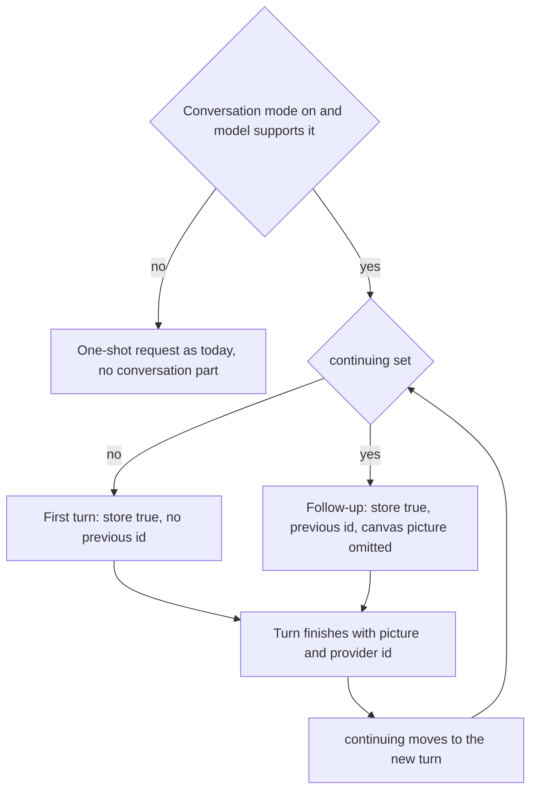
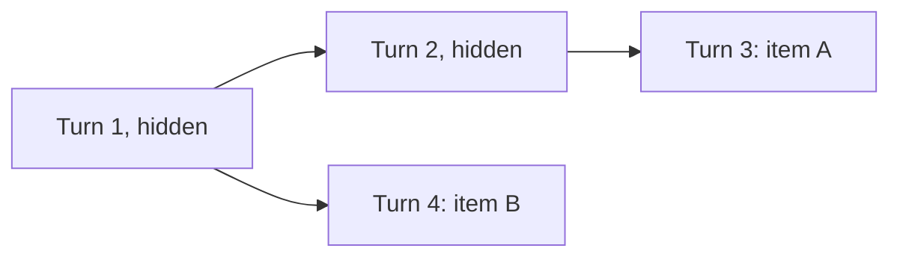
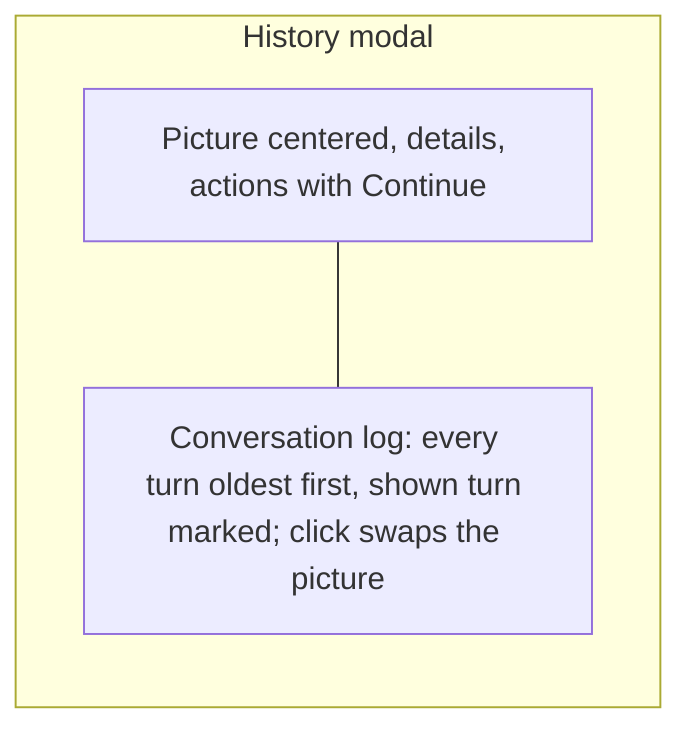

# Image Conversation Mode - Plan

## Goal Capsule

- **Objective:** A person can refine a Muse Image, Nano Banana 2.1, or Nano Banana Pro picture over several turns, see the conversation that led to any turn, and continue or branch from it. Conversation mode is the only path that asks a provider to keep a turn. One-shot Google turns send `store: false`, and one-shot Muse turns use the images endpoints under Meta's default retention for those endpoints.
- **Means:** An opt-in conversation mode that chains turns through the provider's own server-side state. Muse uses `previous_response_id` on the Responses API, and Google uses `previous_interaction_id` on the Interactions API (KTD2, KTD3, KTD4). The history modal gains a conversation log (KTD7).
- **Authority hierarchy:** R-IDs govern behavior. KTDs govern mechanism. `https://dev.meta.ai/docs/image-generation` and `https://ai.google.dev/gemini-api/docs/image-generation` (multi-turn section), both fetched 27 October 2026, are the API checklists. `docs/plans/2026-10-27-1114-feat-meta-muse-image-provider-plan.md` is a prerequisite and stays authoritative for one-shot Muse behavior.
- **Stop conditions:** Stop if the Meta provider from the Muse plan has not landed. Stop if Google rejects `previous_interaction_id` with `store: true` on `gemini-nano-banana-2.1`. Stop if a Muse Responses turn returns no `image_generation_call` when the docs say it should.
- **Execution profile:** Feature work across core, providers, app state, and the history modal. Prove the request bodies and the turn chain with tests before building the log UI.
- **Finishes and ships:** The implementer lands the work on the current branch.

---

## Product Contract

### Summary

The form gets a "Conversation mode" checkbox for Muse Image, Nano Banana 2.1, and Nano Banana Pro. With it off, every generate is one-shot and stateless, exactly as today. With it on, the provider keeps the turn, and the picture can be continued. A conversation takes one history item, showing its newest picture. Clicking it shows that picture centered as today, with the whole back-and-forth logged on the right. Clicking a turn in the log shows that turn's picture, and Continue makes the next Generate refine whichever picture is shown.

### Problem Frame

Muse Image and Nano Banana 2.1 and Pro are built for refining a picture over several turns, and both providers recommend it. Each turn builds on the last without resending the image. Easel treats every generate as unrelated. The Google provider sends `store: false` on purpose so Google keeps no copy, and its plan deferred multi-turn editing. The Muse plan uses the single-shot endpoints and defers the Responses API. History already records each picture's provider-side id (`interaction_id`) and a summary line (`suggestion`), but no turn knows which turn it came from. Nothing reads those ids back.

### Key Decisions

- **Conversation mode is opt-in, per generate.** (session-settled: user-directed — chosen over storing every turn: `store: false` stays unless the person explicitly wants it.) Governs R1, R2, R3.
- **The checkbox starts off on every launch.** (session-settled: user-approved — chosen over remembering the last setting: storing turns is an opt-in each session.) Governs R2.
- **Continuing is an explicit action on a history turn.** (session-settled: user-approved — chosen over auto-chaining whenever the canvas holds a supported picture.) Governs R6.
- **Turn state stays on the provider's servers.** (session-settled: user-approved — chosen over easel replaying prior turns: fuller conversation context.) Governs R4.
- **A turn continues on the model that made it.** (session-settled: user-approved — chosen over switching between Nano Banana 2.1 and Pro mid-conversation.) Governs R7.
- **The log shows only for conversation turns.** (session-settled: user-approved — chosen over a permanent pane with an empty state.) Governs R9.
- **Google conversations are in scope; Nano Banana 2 Lite is not.** (session-settled: user-directed — chosen over a Meta-only plan.) Governs R1.
- **A conversation is one history item, not one per turn.** (session-settled: user-directed — chosen over a row per turn: the item opens on the whole back-and-forth.) Governs R8a, R8b, R9, R10.
- **The item shows the newest turn's picture.** (session-settled: user-approved — chosen over the first turn's picture.) Governs R8a.
- **A branch is its own history item.** (session-settled: user-approved — chosen over folding branches into one item, and over offering Continue only on the newest turn.) Governs R8.
- **Clicking a log turn swaps the picture in place.** (session-settled: user-approved — chosen over reopening the modal on that turn.) Governs R11.

### Requirements

**Conversation mode**

- R1. The form shows a "Conversation mode" checkbox when the selected model is `muse-image-1.0`, `gemini-nano-banana-2.1`, or `gemini-3-pro-image`, and hides it for every other model, including `gemini-3.1-flash-lite-image`.
- R2. The checkbox is off when the app starts and is not restored from the saved session.
- R3. With the checkbox off, a generate is one-shot: Google sends `store: false`, and Muse uses the single-shot endpoints from the Muse plan. The turn records no conversation and cannot be continued.
- R4. With the checkbox on, a generate asks the provider to keep the turn, and the history row records that it is a conversation turn and which turn, if any, it continued.

**Continuing**

- R5. A history turn can be continued only if it was made in conversation mode, finished with a picture, and has a non-empty provider id.
- R6. Continue selects the turn's model, turns the checkbox on, and shows the turn's picture on the canvas. The next Generate sends the new prompt as a follow-up to that turn. References added to the canvas strip travel with it. The turn's own picture is not re-sent.
- R7. After a conversation turn finishes, its picture goes on the canvas and the next Generate continues from the new turn. Turning the checkbox off, switching model, or starting from a non-conversation picture ends the conversation, and the next generate starts fresh.
- R8. Continuing from an earlier turn starts a branch, which becomes its own history item. The original item and its turns stay unchanged.

**History items**

- R8a. The strip shows one item per conversation path, with the path's newest turn's picture, state, and cost. A turn that a later turn continued from is not shown on its own. While a follow-up runs, the item shows the running turn. If the follow-up fails, it shows as its own failed item, and the turn it continued stays visible.
- R8b. Deleting a conversation item removes its turns that no other item's path still uses. The confirm text says how many turns go.

**Conversation log**

- R9. Opening a conversation item shows its newest picture centered as today, with a conversation log on the right side of the modal. A non-conversation item shows the modal as today, with no log.
- R10. The log lists every turn of the item's path, from the first turn to the newest, oldest first. Each turn shows a thumbnail, its prompt, its model, and its summary line when there is one: Muse's reasoning summary or Google's search suggestion. The turn whose picture is shown is marked.
- R11. Clicking a turn in the log shows that turn's picture, details, and actions in the left column. The log stays as it is, with the clicked turn marked.
- R12. The modal offers Continue for the shown turn when it meets R5.

**Failures**

- R13. A follow-up that the provider rejects because its earlier turn is gone fails once, with no retry, and the strip line says the conversation can no longer be continued. The person can still generate fresh.
- R14. Every failure mapping from the Muse plan and the Google plan applies to conversation turns unchanged.

### Success Criteria

- With conversation mode off, Google request bodies are byte-identical to today's, and Muse posts to the single-shot endpoints.
- Three Muse turns in a row, each continuing the last, put one item in the history strip, and opening it shows all three turns in the log.
- Continuing from the first of those turns adds a second item whose log shows two turns, and the first item still shows three.
- The same three-turn flow works on Nano Banana 2.1.

### Scope Boundaries

- Muse Image, Nano Banana 2.1, and Nano Banana Pro. Text prompts plus reference images per turn. Server-side state only.
- Boxes stay as each model already treats them.
- A picture made with the checkbox off cannot be continued later, and is not converted into a conversation.

#### Deferred to Follow-Up Work

- Nano Banana 2 Lite and any other model.
- Continuing across models or providers.
- Easel-managed state: `store: false` with replayed turns.
- Showing the individual web and image lookups a model made.
- Deleting a conversation from the provider's servers.
- A standalone conversation view outside the history modal.

### Acceptance Examples

- AE1. Mode off.
  - **Covers:** R3
  - **Given:** Nano Banana 2.1 is selected and the checkbox is off.
  - **When:** the person generates.
  - **Then:** the body has `store: false` and no `previous_interaction_id`, and the history modal for that row shows no log and no Continue.
- AE2. Three Muse turns.
  - **Covers:** R4, R6, R7, R10
  - **Given:** Muse is selected with the checkbox on.
  - **When:** the person generates, then generates twice more with new prompts.
  - **Then:** the second and third requests carry the previous turn's response id, the strip holds one item showing turn three's picture, and opening it lists three turns.
- AE3. Branch.
  - **Covers:** R6, R8, R8a, R11
  - **Given:** the three-turn conversation from AE2.
  - **When:** the person opens the item, clicks turn one in the log, presses Continue, and generates.
  - **Then:** the strip gains a second item whose log lists turn one and the new turn. The first item still lists all three turns.
- AE3b. Delete a branch.
  - **Covers:** R8b
  - **Given:** the two items from AE3.
  - **When:** the person deletes the branch item.
  - **Then:** only the branch's new turn is removed. Turn one stays, because the first item still uses it.
- AE4. Model switch ends it.
  - **Covers:** R7
  - **Given:** a Google conversation is being continued.
  - **When:** the person switches to Nano Banana Pro and generates.
  - **Then:** the request has no `previous_interaction_id`.
- AE5. Expired turn.
  - **Covers:** R13
  - **Given:** a turn whose provider state is gone.
  - **When:** the person continues and generates.
  - **Then:** one request is sent, no picture is stored, and the strip says the conversation can no longer be continued.

### Sources

- `https://dev.meta.ai/docs/image-generation`, fetched 27 October 2026. `POST /v1/responses` with `model` `muse-image-1.0`. `input` is a string or a list of `{role: "user", content: [...]}` with `input_text` and `input_image` parts, where `image_url` may be a base64 data URL. `store` defaults to `true`. `previous_response_id` chains a turn without resending the image. `output` holds an optional `reasoning` item with `summary[].text`, a `message` item, and `image_generation_call` items with base64 `result`. Controls go in one `image_generation` tool: `enable_image_search`, `enable_web_search`, `enable_shell`, `reasoning_strength`, `size` (`"WxH"` or `"auto"`), and `output_format`. Any other tool is a 400. On the Responses API the abuse field is `safety_identifier`, not `user`.
- `https://ai.google.dev/gemini-api/docs/image-generation`, fetched 27 October 2026. Multi-turn editing sends `previous_interaction_id` with the new `input` and `response_format`. Nano Banana 2.1 is described as built for conversational editing. Nano Banana 2 Lite is "not optimized for multiple reference inputs or multi-turn sequential editing."
- `https://ai.google.dev/gemini-api/docs/migrate-to-interactions`. The server stores interactions by default (`store=true`), and `store=false` opts into stateless calls.
- `docs/plans/2026-10-17-1837-feat-google-image-models-plan.md`. Deferred "Multi-turn editing through a previous interaction id" and set `store: false`.
- `docs/plans/2026-10-27-1114-feat-meta-muse-image-provider-plan.md`. Defers the Responses API, `previous_response_id`, and the reasoning summary to this plan.

---

## Planning Contract

### Key Technical Decisions

- KTD1. **The conversation rides on the job request.** `JobRequest` gains an optional conversation part, persisted in `request.json` through `StoredRequest` with a serde default so old rows still load. It holds three things: that the turn is a conversation turn, the parent job id when continuing, and the parent's provider id. A conversation turn's own provider id stays in `Meta.interaction_id`, and its summary stays in `Meta.suggestion`. The parent job id is also written to the index: `IndexRow` gains `#[serde(default)] parent: Option<String>`, and `EntrySummary` gains `parent: Option<JobId>`. This lets the strip group turns without reading every `request.json`. A missing conversation part means one-shot. Governs R3, R4, R8, R8a.
- KTD2. **Providers opt in through the trait.** `Provider` gains a default-false `supports_conversation`. `MuseImage`, `NanoBanana21`, and `NanoBananaPro` return true. `build_submit` already receives the `JobRequest`, so each provider reads the conversation part there. No other provider changes. Governs R1.
- KTD3. **Google conversation turns flip `store` and add the id.** In `build_google`, a conversation turn sends `store: true`. A continued turn also sends top-level `previous_interaction_id` with the parent's provider id. `input`, `response_format`, and grounding are unchanged. A one-shot turn's body stays byte-identical to today. `decode_inline` already stores the response `id` as the interaction id and the search suggestion as the summary. Governs R3, R4, R6.
- KTD4. **Muse conversation turns use the Responses API.**
  - A conversation turn posts `https://api.meta.ai/v1/responses` with `model`, `store: true`, and `input` as one user message. The message's content is an `input_text` part with the prompt, then one `input_image` part per sent reference as a data URL.
  - A continued turn adds `previous_response_id` set to the parent's response id.
  - `tools` is one `image_generation` tool carrying the form values from the Muse plan's KTD2: the three `enable_*` switches, `reasoning_strength`, `output_format`, and `size` only when it is not `auto`. The tool replaces the top-level `tool_enablement` and `reasoning_strength` of the images endpoints.
  - The body sends no `response_format`, no `n`, and no other tool.
  - The decoder picks the first `output` item of type `image_generation_call` and base64-decodes its `result`. It names the file from the bytes as in the Muse plan's KTD4, stores the response `id` as the interaction id, and joins the `reasoning` item's `summary[].text` as the summary.
  - Errors map as in the Muse plan's KTD4. A 200 with no `image_generation_call`, or with an empty `result`, is `NoImage`.
  - One-shot Muse turns keep the single-shot endpoints.

  Governs R3, R4, R6, R10, R14.
- KTD5. **App state owns the mode and the turn being continued.** `AppState` gains `conversation_mode: bool` and `continuing: Option<ContinueFrom>`. `ContinueFrom` holds the job id, model id, provider id, and the `Arc<DecodedImage>` that was put on the canvas for that turn. The session file does not save either field.
  - `build_request` writes the conversation part only when the mode is on and the model supports it, with the parent from `continuing` when set.
  - While `app.image` is the same `Arc` as the continued picture (`Arc::ptr_eq`), the canvas image is left out of the sent images. Extras are sent as usual.
  - `set_model` clears `continuing`, unchecking clears it, and `set_image` with any picture other than the continued `Arc` clears it. This last rule covers loading a file, pasting, and promoting a different history item.
  - The runner advances only when all of these hold: a conversation turn finished with a picture and a non-empty provider id, `conversation_mode` is still on, `app.model_id` equals the turn's model, and the turn's parent matches `continuing` (or both are empty for a first turn). On advance, the runner promotes the turn's bytes through `jobs::promote` first, then sets the new `ContinueFrom` with the resulting `app.image` `Arc`. Today's finish path writes history only and never touches the canvas, so this promotion is new.
  - If two turns are sent from the same parent before either finishes, the first to finish advances. The other no longer matches the parent rule and stays in history as a branch.

  Governs R2, R6, R7.
- KTD6. **History walks the chain by parent links.** `HistoryStore` gains a read-only lookup that starts at a job and follows the parent job id in each `request.json` up to the first turn. It returns turns oldest first, each with id, model, prompt, summary, state, and whether it can be continued per R5. The walk stops at a missing or unreadable parent, a cycle, or 100 turns, and returns what it has. Governs R5, R8, R10.
- KTD7. **The log is a right column inside the history modal.** When the opened item has a conversation part, the modal grows from 480 px to 680 px, which fits the 720 px minimum window. The left column stays 480 px with its picture centered and its scroll unchanged. The log column is 200 px with a `ui::pane_header` titled "Conversation", the `PANEL` background, and a `border_l_1` in `theme::BORDER`. Its list scrolls on its own (`overflow_y_scroll`) under the header.
  - A log row has a 40 px square thumbnail on the left, taken from the strip's decoded-preview cache. A failed or pictureless turn shows its strip state line in `text_xs` and `TEXT_MUTED` in place of the thumbnail.
  - Beside it, the prompt is `text_xs`, clamped to two lines. Below that, the model and the summary are `text_xs` in `TEXT_MUTED`, with the summary clamped to three lines.
  - The shown turn's row has the `SURFACE` background and does not respond to clicks.
  - `HistoryDialog` holds the chain and a shown index, which starts at the newest turn. Clicking a log row changes the shown index and rebuilds the left column's image, detail lines, cost, and actions for that turn from the same loaders `open_row` uses. The chain is not reloaded, so the log keeps every turn.
  - A "Continue" action joins `Promote`, `Compare`, and the rest when the shown turn meets R5, and acts on the shown turn. It runs `set_model`, turns the mode on, and promotes the picture. Only then does it set `continuing` with the promoted `app.image` `Arc`, because `set_image` clears `continuing`. Then it closes the modal.

  Governs R9, R10, R11, R12.
- KTD8. **A gone turn is recognized narrowly and not retried.** For a continued turn, a Google 400 or 404, or a Muse 400 or 404, whose error message or `param` names the previous id, maps to a strip line `conversation can no longer be continued` and clears `continuing`. Anything else keeps its existing mapping. The exact error shapes are confirmed at implementation (see Open Questions). Governs R13.
- KTD9. **The strip folds a path into its newest turn.**
  - In `BottomStrip::rebuild`, a persisted row is left out when another persisted done row, or a live job, names it as parent. Live jobs carry their request's parent, so a running follow-up replaces its parent at once. A failed child does not hide its parent.
  - What remains is one row per path's newest turn, plus any failed follow-ups. Those rows keep today's thumbnail, state line, and cost, all taken from the newest turn.
  - Deleting a conversation row walks its chain and removes each turn that is not an ancestor of another remaining row, newest first, stopping at the first shared turn. The confirm line reads "Delete N turns?" when N is more than one.
  - `HistoryStore::evict_to` evicts by whole items with the same unshared-turns rule, ordered by each item's newest turn. A hidden ancestor is never evicted while a visible item still uses it.

  Governs R8, R8a, R8b.

### High-Level Technical Design

A turn's lifecycle, from the checkbox to the next continue:

How the strip folds turns into items, with a branch from turn one:

How the history modal composes when a conversation item is opened:

### Sequencing

U1 lands the request part, the index parent, the trait method, the chain lookup, and the item removal. U2 and U3 depend on U1 and are independent of each other. U4 depends on U1 and on at least one of U2 or U3 for an end-to-end test. U5 depends on U1 and U4.

---

## Implementation Units

### U1. Conversation request part and chain lookup

- **Goal:** A job can carry and persist its conversation link, and history can walk a chain.
- **Requirements:** R3, R4, R5, R8, R8a, R8b, R10
- **Dependencies:** none
- **Files:**
  - `crates/easel-core/src/job.rs`
  - `crates/easel-core/src/history.rs`
  - `crates/easel-core/src/providers/mod.rs`
- **Approach:** Add the conversation part per KTD1 and the default-false trait method per KTD2. Add the chain lookup per KTD6 beside `load_request` and `suggestion`. Thread the part through `StoredRequest` and `LoadedRequest`, and the parent through `IndexRow` and `EntrySummary`. Add a store method that removes an item's unshared turns per KTD9, and make `evict_to` use it.
- **Patterns to follow:** The serde-default handling of `interaction_id` and the `complete_writes_a_missing_interaction_id_back_as_empty` test in `crates/easel-core/src/history.rs`.
- **Test scenarios:**
  - An old `request.json` with no conversation part loads as one-shot.
  - A conversation turn's part round-trips through begin and load with its parent id and parent provider id.
  - A three-turn chain looked up from turn three returns turns one, two, and three in that order, with prompts, models, and summaries.
  - Looking up a branch turn returns only its own ancestors.
  - A missing parent stops the walk and returns the turns found so far.
  - A parent link that points back to a later turn stops at the cycle without looping.
  - A failed turn appears in the chain and is not continuable. A done turn with an empty interaction id is not continuable.
  - `supports_conversation` is false for every provider except the three named in R1.
  - An old `history.json` with no parent field lists every row with no parent.
  - `list` returns each conversation row's parent.
  - Covers AE3b. Removing branch item B removes turn four only. Removing item A afterwards removes turns three, two, and one.
  - Eviction over the cap removes the oldest item's unshared turns together, and never leaves a visible item without its ancestors.
- **Verification:** Chains load from disk, old rows and old indexes still load, and removal never strands a shared turn.

### U2. Google conversation turns

- **Goal:** Nano Banana 2.1 and Pro send stored, chained turns when asked, and are unchanged otherwise.
- **Requirements:** R1, R3, R4, R6, R13, R14
- **Dependencies:** U1
- **Files:**
  - `crates/easel-core/src/providers/google/mod.rs`
- **Approach:** Override `supports_conversation` on `NanoBanana21` and `NanoBananaPro` only. Branch `build_google` per KTD3. Add the KTD8 gone-turn mapping for continued turns.
- **Patterns to follow:** The existing body tests around `body["store"]` in the Google module.
- **Test scenarios:**
  - Covers AE1. A one-shot 2.1 request's JSON equals today's body exactly, including `store: false`.
  - A first conversation turn on 2.1 sends `store: true` and no `previous_interaction_id`.
  - A continued turn sends `store: true` and `previous_interaction_id` set to the parent id, with `input` holding only the new prompt and any extras.
  - Nano Banana Pro behaves the same. Nano Banana 2 Lite reports no conversation support, and a conversation part on its request is ignored, so it still sends `store: false`.
  - A 200 response stores its `id` as the interaction id, as today.
  - A continued turn that gets a 404 naming the previous interaction maps to the gone-turn outcome. A 404 on a first turn keeps today's mapping.
- **Verification:** One-shot Google bodies are unchanged, and conversation bodies carry `store` and the id.

### U3. Muse Responses turns

- **Goal:** Muse conversation turns post to the Responses API and decode its output.
- **Requirements:** R1, R3, R4, R6, R10, R13, R14
- **Dependencies:** U1
- **Files:**
  - `crates/easel-core/src/providers/meta/mod.rs`
  - `crates/easel/src/jobs/meta_tests.rs`
- **Approach:** Override `supports_conversation`. Branch `build_submit` per KTD4 on the conversation part. The decoder recognizes a Responses body by its `output` array and an images body by `data`, so one `inline_image` serves both. Add the KTD8 mapping.
- **Execution note:** Write the first-turn and continued-turn body tests first.
- **Patterns to follow:** The Muse plan's images-endpoint builder and decoder in the same module.
- **Test scenarios:**
  - A one-shot Muse request still posts to `https://api.meta.ai/v1/images/generations` or `/images/edits`.
  - A first conversation turn posts to `https://api.meta.ai/v1/responses` with `store: true`, no `previous_response_id`, `input[0].role` `user`, and `input[0].content[0]` an `input_text` with the prompt.
  - Two references add two `input_image` parts with data URLs after the text, canvas first.
  - A continued turn sends `previous_response_id` and leaves out the continued picture per KTD5.
  - The `tools` array has exactly one `image_generation` item, carrying the three switches, `reasoning_strength`, and `output_format`, and `size` only when not `auto`. The body has no top-level `tool_enablement`, `reasoning_strength`, `response_format`, or `n`.
  - A 200 with `reasoning`, `message`, and `image_generation_call` items writes the image, stores `resp_...` as the interaction id, and stores the summary text.
  - A 200 with the image item before the reasoning item still decodes, because items are picked by type.
  - A 200 with no `image_generation_call` records `NoImage`.
  - A 400 `content_policy_violation`, a 401, and a 429 map as in the Muse plan.
  - A continued turn whose 400 names `previous_response_id` maps to the gone-turn outcome.
- **Verification:** Both Muse surfaces decode, and conversation turns chain by response id.

### U4. Conversation mode in the form and app state

- **Goal:** The checkbox drives conversation turns, and continuing follows each finished turn.
- **Requirements:** R1, R2, R3, R6, R7, R13
- **Dependencies:** U1, and U2 or U3
- **Files:**
  - `crates/easel/src/app_state.rs`
  - `crates/easel/src/jobs/submit.rs`
  - `crates/easel/src/jobs/runner.rs`
  - `crates/easel/src/side_panel/mod.rs`
  - `crates/easel/src/side_panel/form_tests.rs`
  - `crates/easel/src/side_panel/switch_tests.rs`
  - `crates/easel/src/side_panel/generate_tests.rs`
- **Approach:**
  1. Add the KTD5 fields to `AppState` and leave them out of `crates/easel/src/session.rs`.
  2. Render the checkbox with `widgets::checkbox` under the schema fields when the provider supports conversation. Use `field_row` with help text that depends on state. With nothing being continued, it says the provider keeps the prompt and reference images and that easel can't delete them, for example "Google keeps this turn's prompt and images so it can be continued. Easel can't delete them." With `continuing` set, it reads "Continues from: " followed by the first 40 characters of the parent prompt.
  3. Fill the conversation part in `build_request` per KTD5, including the canvas omission.
  4. In the runner's finish path, advance `continuing` per KTD5, and clear it on the gone-turn outcome.
- **Patterns to follow:** The existing `FieldKind::Bool` checkbox rendering in `crates/easel/src/side_panel/schema_form.rs`, and the switch tests for `set_model`.
- **Test scenarios:**
  - The checkbox shows for the three R1 models and is hidden for Nano Banana 2 Lite, FLUX 3, and OpenAI.
  - A fresh `AppState` and a restored session both start with the checkbox off.
  - With the box off, `build_request` has no conversation part.
  - With the box on and nothing being continued, the part marks a first turn.
  - With `continuing` set, the part carries the parent job and provider ids, and the canvas image is not in `images` while it is the continued picture.
  - Replacing the canvas image with a different picture clears `continuing`, and the next request is a first turn that includes the new picture.
  - Covers AE4. Switching model clears `continuing`. Unchecking clears it.
  - Covers AE2. A finished conversation turn with a provider id moves `continuing` to that turn and puts its picture on the canvas. The next `build_request` leaves that picture out of `images`. A finished one-shot turn does not set it.
  - A first or continued turn that finishes after the person switched model, or after they unchecked the box, does not set `continuing`.
  - Two turns sent from the same parent: the first to finish advances, and the second leaves `continuing` alone.
  - The help text names the selected model's provider, switches to "Continues from:" with `continuing` set, and switches back after `set_model`.
  - Covers AE5. The gone-turn outcome shows `conversation can no longer be continued`, clears `continuing`, and sends one request.
- **Verification:** Three generates with the box on chain their turns, and the box off leaves requests one-shot.

### U5. One strip item per conversation, with its log and Continue

- **Goal:** A conversation shows as one history item, opening it shows the whole log on the right, and Continue resumes from any turn.
- **Requirements:** R5, R8, R8a, R8b, R9, R10, R11, R12
- **Dependencies:** U1, U4
- **Files:**
  - `crates/easel/src/bottom_strip.rs`
  - `crates/easel/src/jobs/runner.rs`
  - `crates/easel/src/root.rs`
  - `crates/easel/src/bottom_strip_tests.rs`
- **Approach:**
  1. Expose each live job's conversation parent from the runner, and fold rows in `rebuild` per KTD9.
  2. Route delete through the store's unshared-turns removal, with the turn count in the confirm line.
  3. Extend `HistoryDialog` with the chain from KTD6 and a shown index.
  4. Render the right column per KTD7 in `history_modal`, keeping the existing column as is.
  5. Add the Continue action for the shown turn when it is continuable, and handle it in `press`.
  6. Log rows change the shown turn in place.
- **Patterns to follow:** `history_modal` and `grid_picker_modal` in `crates/easel/src/root.rs`, `compare_selected` in `crates/easel/src/bottom_strip.rs` for loading a request into app state, and `AGENTS.md` for the pane header, borders, and text sizes.
- **Test scenarios:**
  - Opening a one-shot row gives a dialog with no chain and no Continue, at 480 px. A conversation row gives 680 px.
  - Covers AE2. Three chained turns give one strip row, showing turn three's thumbnail and cost. Opening it gives a chain of three, oldest first, with turn three shown and marked.
  - While a follow-up is running, the strip shows the running row in place of its parent. A failed follow-up shows as its own row, and its parent row comes back.
  - Each log row carries its prompt, its model, and its sanitized summary. A turn with no summary shows none.
  - Selecting turn one in the log shows turn one's picture and details, keeps the chain of three, and marks turn one.
  - Covers AE3. Continue from turn one and a finished turn give two strip rows. Their chains have three turns and two turns.
  - Deleting the two-turn branch row uses today's confirm text, because only one turn goes. It removes only the new turn and leaves the three-turn row whole. Deleting the three-turn row afterwards asks "Delete 3 turns?".
  - Continue on a continuable turn selects its model, turns the box on, sets `continuing` to that turn, puts its picture on the canvas, and closes the modal. Afterwards `continuing` is still set, and its picture is `Arc::ptr_eq` to `app.image`.
  - Continue is absent on a failed turn and on a turn with an empty provider id.
- **Verification:** A captured screenshot shows the picture centered and the log on the right, with borders and backgrounds from `theme.rs`.

---

## Verification Contract

| Command | Proves |
|---|---|
| `cargo fmt --check` | Formatting |
| `cargo clippy --workspace --all-targets -- -D warnings` | Lints |
| `cargo nextest run -p easel-core` | Request parts, chain lookup, Google and Muse bodies and decoders |
| `cargo nextest run -p easel` | Checkbox, app state, runner advance, history modal |

Visual check: run `WAYLAND_DISPLAY='' cargo run -p easel`, open a conversation turn, and capture the window with `magick import -window <id>`. Do not drive the app with `xdotool`. The user runs the live three-turn flows with real Meta and Gemini keys.

---

## Definition of Done

- U1 through U5 meet their verification lines.
- With conversation mode off, Google and Muse requests match the prior plans exactly.
- The four commands in the Verification Contract pass, and the screenshot matches KTD7.
- Abandoned experimental code is not left in the diff.

---

## System-Wide Impact

- **Privacy:** Conversation turns are stored by Meta and Google for as long as each provider keeps them. This happens only with the checkbox on, and the help text names the provider. Easel does not delete stored turns.
- **History format:** `request.json` and `history.json` each gain an optional parent field. Old rows load as one-shot. Neither struct denies unknown fields, so an older build still reads new files. It shows every turn as its own row and evicts row by row.
- **History strip:** Rows that a later turn continued from are hidden, so the strip count no longer equals the number of stored jobs. Delete and eviction remove whole items.
- **Runner:** For a conversation turn that advances, the finish path promotes the picture onto the canvas and sets `continuing`. Polling providers are untouched.
- **Shared types:** `JobRequest` gains a field, so every construction site in tests and providers gets the default.

---

## Risks & Dependencies

- The Muse provider plan must land first. U3 extends its module.
- Neither provider documents how long stored turns last or the exact error for a gone turn. KTD8 matches narrowly, and anything else fails as a plain HTTP error, once.
- Google may reject `previous_interaction_id` when `response_format` changes between turns, such as a new aspect ratio. The published sample changes `response_format` on turn two, so this is expected to work.
- Matching the continued picture by `Arc` identity means re-loading the same file from disk ends the conversation. That is intended, since the person put a new picture on the canvas.
- Promoting on finish replaces whatever the person had on the canvas while the turn ran. This happens only in conversation mode on the same model, so it is the next step of the conversation they asked for.
- Muse's Responses API may reject unknown fields as strictly as the images endpoints. The body sends only documented fields.

---

## Open Questions

### Deferred to Implementation

- The exact Google and Meta error bodies for a gone or unknown previous id. Capture one live sample each and tighten KTD8's match to it.
